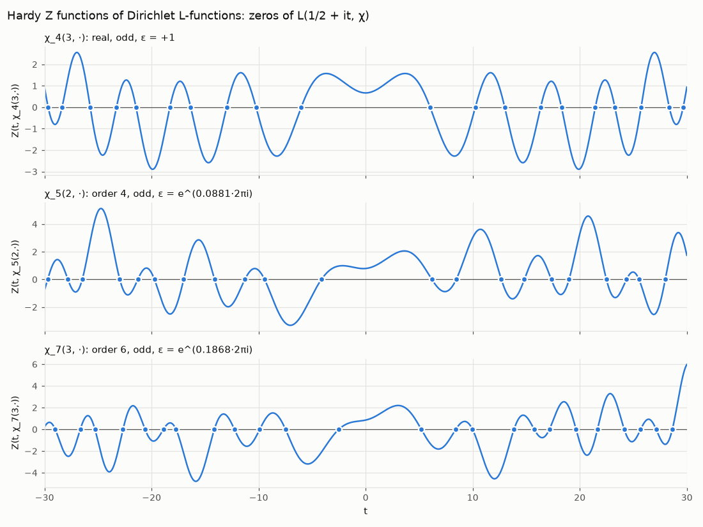
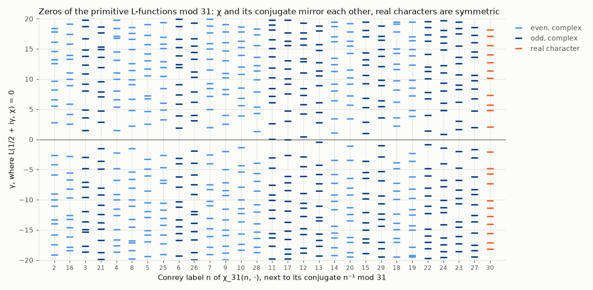
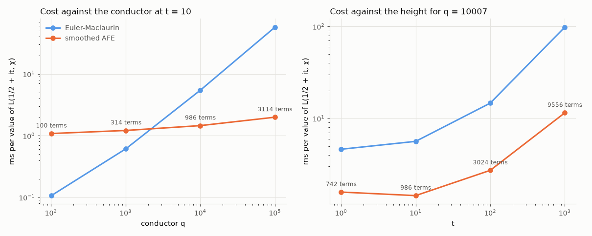
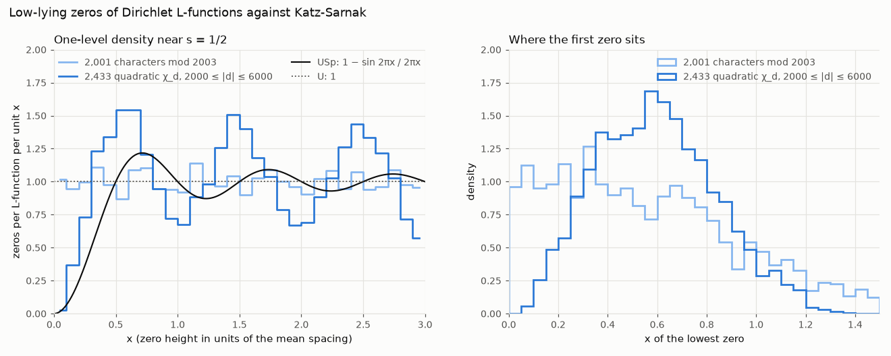
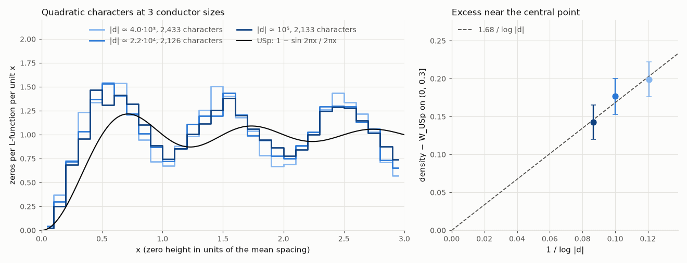

# zeta-explorer

[](https://github.com/louisbelot/zeta-explorer/actions/workflows/tests.yml)


The Riemann Hypothesis says every non-trivial zero of ζ(s) sits on the line
Re(s) = 1/2. On that line ζ is complex, but multiply it by the phase e^(iθ(t)) and
you get the real-valued Riemann-Siegel Z function, which changes sign at every zero.
This repo computes θ, Z, ζ(s) itself, the zeros and the Gram points straight from
the formulas, checks the results against mpmath, and uses Turing's method to prove
the zero count is complete: all 138,069 zeros of ζ with 0 < Im s ≤ 100000 are on
the critical line and simple. It also draws ζ over the complex plane, compares
100,000 zeros near t = 5·10⁶ with the eigenvalue statistics of large random
Hermitian matrices, rebuilds π(x) from the first 1000 zeros, hunts for Lehmer
pairs (the near misses that bound the de Bruijn-Newman constant), and checks the
value distribution of log|ζ(1/2 + it)| against random unitary matrices. A
simplified Odlyzko-Schönhage evaluator (one nonuniform FFT per window, then
band-limited interpolation) makes Z cost 2.6 μs per point at any height and
reproduces Odlyzko's published zeros near the 10¹²th zero to 3e-9.

The same machinery extends to Dirichlet L-functions: characters with LMFDB's
Conrey labels, L(s, χ) anywhere in the plane, zeros checked against LMFDB and
verified complete with the argument principle, the class number formula, a
smoothed approximate functional equation that needs O(√(q|t|)) terms instead of
O(q|t|), and the low-lying zeros of quadratic characters up to conductor 10⁵
against the symplectic prediction of Katz and Sarnak.

The same numerics also run in the browser at
[louisbelot.github.io/zeta-explorer](https://louisbelot.github.io/zeta-explorer/):
a phase portrait you can pan and zoom, a Z(t) explorer that marks zeros and Gram
points up to t = 10⁹, and the explicit formula building ψ(x) one zero at a time.

## Install

```bash
pip install "zeta-explorer[plot] @ git+https://github.com/louisbelot/zeta-explorer"
```

## Quick start

```python
from zeta_explorer.riemann_siegel import theta, z_rs, z_exact
from zeta_explorer.zeros import find_zeros, gram_point

find_zeros(10, 30)   # [14.134725141734695, 21.022039638771552, 25.01085758014569]
len(find_zeros(10, 100))   # 29
gram_point(0)        # 17.845599540410863, where theta(t) = 0
z_rs(1000.0)         # 0.9977946375478818 (mpmath: 0.9977946375215866)
z_rs(1000.0, corrections=0)   # 0.9976696568809473, C0 only

from zeta_explorer.zeta import zeta
zeta(-1)             # -1/12
zeta(2 + 3j)         # (0.7980219851462759-0.1137443080529385j)

from zeta_explorer.turing import verify_zeros
verify_zeros(10_000)
# Verification(n=10143, g_n=10000.881777216977, zeros=10144, blocks_after=2)

import numpy as np
zeta(np.array([-3, 0.5 + 14.134725141734693j]))   # vectorized: [1/120, ~1e-16]

from zeta_explorer.spacing import zeros_between, normalized_spacings
z = zeros_between(10**6, 10**6 + 5)   # zeros between Gram points g_1000000 and g_1000005
# [600270.74787059, 600271.48637367, 600271.76148043, 600272.00103217, 600273.02653325]

from zeta_explorer.multieval import zeros_fast
win, u = zeros_fast(10**12 - 2, 10**12 + 4)   # zeros as offsets u from win.t0
win.t0 - 267653395647 + u
# [1.62594824, 1.84752313, 2.36236697, 2.68163092, 2.86198994]
# Odlyzko's table: zero number 10^12 + 1 is at 267653395647 + 1.8475231278

from zeta_explorer.spacing import first_zeros
from zeta_explorer.explicit import pi_from_zeros, riemann_r
gamma = first_zeros(1000)  # the first 1000 zeros, 14.1347 to 1419.4225
pi_from_zeros(np.array([100.5, 10_000.5]), gamma)   # [25.026, 1229.54]; π = 25, 1229
riemann_r(1e15)      # 29844570495886.9

from zeta_explorer.lehmer import lehmer_pairs
pairs = lehmer_pairs(gamma[:700])   # pairs with Δ²g < 4/5
pairs[0]   # LehmerPair(n=34, gamma=111.0295..., delta=0.8451..., gap=0.3868..., score=0.5699..., bound=-0.3954...)

from zeta_explorer.plot import plot_z, plot_domain, plot_spiral, plot_spacing
plot_z(0, 60).savefig("z.png")
plot_domain().savefig("domain.png")

from zeta_explorer.characters import conrey, quadratic, class_number
from zeta_explorer.lfunction import dirichlet_l, l_zeros, verify_zeros
chi = conrey(5, 2)   # LMFDB label 5.2: order 4, odd, conductor 5
chi.root_number()    # (0.85065080835204+0.5257311121191335j)
dirichlet_l(0.5 + 10j, chi)   # (2.1249968234507937+2.163859185370417j)
l_zeros(chi, 0, 13)  # [6.1835782, 8.45722917, 12.67494642]
dirichlet_l(1, quadratic(-23)), class_number(-23)   # 1.9652 = 3π/√23, 3
verify_zeros(conrey(101, 2), 50).ok   # 90 zeros on the line, 90 in the box

from zeta_explorer.afe import l_afe
big = conrey(100003, 2)
l_afe(0.5 + 10j, big)   # (3.9151561336603864-8.036122558438148j), 1557 terms per sum
l_zeros(big, 0, 1.5)    # [0.60517956, 1.49288041]
```

## The math

### Theta

From Stirling's series for log Γ:

```
θ(t) = t/2·log(t/2π) − t/2 − π/8 + 1/(48t) + 7/(5760t³) + …
```

accurate to about 1e-13 for t ≥ 10.

### Riemann-Siegel formula

With a = sqrt(t/2π), N = ⌊a⌋ and p = a − N:

```
Z(t) ≈ 2·Σ_{n=1..N} cos(θ(t) − t·log n)/sqrt(n)  +  (−1)^(N−1)·a^(−1/2)·Σ_{k=0..4} C_k(p)·a^(−k)
```

Only about sqrt(t/2π) terms are needed, so at t = 10⁶ that's 398 terms. The
corrections come from Ψ(p) = cos(2π(p² − p − 1/16)) / cos(2πp) and its
derivatives:

```
C0 = Ψ
C1 = −Ψ⁽³⁾/(96π²)
C2 = Ψ⁽²⁾/(64π²) + Ψ⁽⁶⁾/(18432π⁴)
C3 = −Ψ⁽¹⁾/(64π²) − Ψ⁽⁵⁾/(3840π⁴) − Ψ⁽⁹⁾/(5308416π⁶)
C4 = Ψ/(128π²) + 19Ψ⁽⁴⁾/(24576π⁴) + 11Ψ⁽⁸⁾/(5898240π⁶) + Ψ⁽¹²⁾/(2038431744π⁸)
```

Twelve derivatives of a ratio of cosines is not something to do by hand. Ψ looks
singular at p = 1/4 and 3/4, but the numerator vanishes there too and Ψ is in fact
entire. So the code expands Ψ(1/2 + z) = −cos(2πz² − 5π/8)/cos(2πz) as a Taylor
series in z by dividing the two cosine series. That division runs at 110 digits
in mpmath, because 1/cos has poles at |z| = 1/4 and rounding errors grow like 4^j.
Derivatives of a power series are shifted coefficients, so each C_k becomes a
degree-90 polynomial in z, evaluated with Horner in doubles, and the removable
singularities need no special case. The tests rebuild C1 to C4 from mpmath's
numerical derivatives of Ψ and agree to 1e-15.


Each extra term should buy another factor of t^(−1/2). Over t in [200, 2000], the
largest value of |error|·t^((2k+3)/4) is:

| terms | error order | measured constant |
|---|---|---|
| C0 | t^(−3/4) | 0.119 |
| C0 to C1 | t^(−5/4) | 0.052 |
| C0 to C2 | t^(−7/4) | 0.0090 |
| C0 to C3 | t^(−9/4) | 0.029 |
| C0 to C4 | t^(−11/4) | 0.015 |

The constants come out about the same over [20, 200], which is the real check that
each C_k is right: a wrong coefficient would leave the previous order behind.
The bottom right of the chart is a different story. Past t ≈ 3000 the C3 and C4
curves hit a floor near 3e-11 set by doubles: the phases θ(t) − t·log n are around
10⁵ radians there, so each cosine is only good to about 1e-11. Gabcke (1979)
proved explicit bounds of this form for t ≥ 200, which is why the code trusts
z_rs from t = 200 up and calls mpmath below.

### ζ(s) everywhere

`zeta.py` has no mpmath in the loop. For Re s ≥ 0 it uses Euler-Maclaurin:

```
ζ(s) = Σ_{n<N} n^(−s) + N^(1−s)/(s−1) + N^(−s)/2
       + Σ_{k=1..M} B_2k/(2k)! · s(s+1)…(s+2k−2) · N^(−s−2k+1) + R
```

with Backlund's bound: |R| is at most |s+2M+1|/(σ+2M+1) times the first omitted
term, for σ > −(2M+1). N = 10 + ⌊|t|/π⌋ makes the Bernoulli terms shrink
geometrically, and M grows until the bound drops below 1e-16 relative. The
Bernoulli numbers are exact `Fraction`s. For Re s < 0 it switches to the
functional equation ζ(s) = χ(s)ζ(1 − s), with
χ(s) = 2^s·π^(s−1)·sin(πs/2)·Γ(1 − s) assembled in log space, since at large |t|
the sine overflows and Γ underflows. log Γ is Stirling's series after shifting
|z| past 15, summing the logs of the shifts so the imaginary part stays on the
continuous branch.

Against mpmath on 300 random points with |Re s| ≤ 30 and |Im s| ≤ 200 the
relative error stays under 1e-12. On the critical line at t = 10⁴ the absolute
error is 1.4e-11 (the same phase floor as above). The tests also check
ζ(1 − 2k) = −B_2k/(2k) for k up to 11, that Backlund's bound really bounds the
error and is within 50x of it, that χ(1/2 + it) = e^(−2iθ(t)), and that
e^(iθ)ζ(1/2 + it) is real and equals the Riemann-Siegel Z.

### Phase portrait

The picture at the top is `plot_domain()`: ζ(σ + it) for −5 ≤ σ ≤ 6 and
0 ≤ t ≤ 60, about 600,000 points. Hue is the argument of ζ, and the brightness
ramps up and resets every time |ζ| doubles, so the shading edges are level curves
of |ζ| (Wegert's enhanced phase portrait). A zero is a point where every color
meets, going around once counterclockwise; the pole at s = 1 goes the other way.
All the zeros in the strip sit on the dashed line σ = 1/2, the trivial zeros at
−2 and −4 sit on the left edge, and to the right of σ = 2 the picture is almost
flat red because ζ(s) is close to 1 there.

This needed ζ on arrays. `zeta`, `chi` and `loggamma` now take any array shape:
every point keeps its own N = 10 + ⌊|t|/π⌋, the main sums are one masked
(points × n) matrix built in chunks, and the Euler-Maclaurin tail drops each point
out of the loop as soon as its Backlund bound is small enough. The whole grid
takes 1.05 s, against 6.5 s for a Python loop over the old scalar version.

### Landscape and a sweep across the strip


`plot_landscape()` draws log₁₀|ζ(σ + it)| over −0.5 ≤ σ ≤ 2 and 0 ≤ t ≤ 40,
clipped to [−1.5, 1]. The pole at s = 1 is the plateau at the back left, and each
zero is a narrow pit on σ = 1/2. The t grid includes the zeros themselves, so each
pit reaches the floor.


`sweep_sigma()` moves σ from 0.1 to 0.9 and back as σ = 0.5 + 0.4·sin³(2πk/60),
so it lingers near the critical line. Off the line the curve winds around the
origin without touching it and |ζ| stays above 0. At σ = 1/2 both panels touch
zero at the same six heights.

### Analytic continuation


Σ n^(−s) only converges for σ > 1, and at the first zero s = 1/2 + 14.1347i the
partial sums spiral outward like N^(1/2)/|s − 1|. Two cheap fixes both land on
ζ(s) = 0. The alternating series η(s) = Σ (−1)^(n−1) n^(−s) converges for σ > 0,
and ζ = η/(1 − 2^(1−s)), but its error only falls like N^(−1/2). Adding the
first two Euler-Maclaurin terms N^(1−s)/(s−1) + N^(−s)/2 to the raw partial sum
gives an error of order |s|·N^(−σ−1), N^(−3/2) on the critical line, and it works
anywhere with σ > −1. The tests check both rates.

The functional equation is easiest to see through
ξ(s) = ½s(s − 1)π^(−s/2)Γ(s/2)ζ(s), which cancels the pole and the trivial zeros.
`xi(s)` evaluates it from the right half plane and reflects with ξ(s) = ξ(1 − s);
the tests check it against mpmath, check ξ(0) = ξ(1) = 1/2 and ξ(2) = π/6, and
check that it is real on the critical line.


On the critical line itself, ζ(1/2 + it) traces loops that pass through the
origin once per zero. It starts at ζ(1/2) = −1.4604, and between t = 0 and 40 it
goes through 0 six times.

### Zeros


Sign changes of Z on a grid, refined with the Illinois method
(regula falsi that halves a stuck endpoint's weight). All 29 zeros below t = 100
match mpmath's `zetazero` to 1e-9, and z_rs finds the same 29 to within 4e-6.

### Gram points and Gram's law

These solve θ(g_n) = nπ. θ is increasing and convex there, so Newton's method
started to the right of the root slides monotonically onto it. It's vectorized:
the first 100,001 Gram points take 0.12 s.


At g_n, e^(iθ) = (−1)^n, so if Z behaved like a cosine with one zero per Gram
interval we would always have (−1)^n Z(g_n) > 0. That's Gram's law. It first
fails at g_126 (Hutchinson, 1925). Up to n = 1000, 95.8% of Gram points are good;
up to 10,000, 91.8%; up to 100,000 (t ≈ 74,922), 88.9%.

A Gram block is a run [g_j, g_k) between consecutive good points. Rosser's rule
says a block of length k − j contains at least k − j zeros. The checker samples Z
inside each block, doubling the density until it sees enough sign changes. Up to
n = 100,000 every block passes:

| block length | 1 | 2 | 3 | 4 | 5 |
|---|---|---|---|---|---|
| count | 78,694 | 9,445 | 778 | 19 | 1 |

Rosser's rule does fail eventually; Brent found the first failure near
g_13999525. The signs come from z_rs with all four corrections. Any |Z| below 1e-6
is recomputed with mpmath before it's trusted, and below t = 200 mpmath is used
throughout.

### Turing's method

Sign changes of Z give a lower bound on N(T), the number of zeros with
0 < Im s ≤ T. A zero off the critical line, or a double zero, wouldn't show up as
a sign change. The upper bound comes from S(t) = N(t) − θ(t)/π − 1: Lehman proved
|∫ S(t) dt| ≤ 1.7 + 0.114·log t₂ over any [t₁, t₂] above 168, so S can't stay
positive for long. Brent turned that into a block count. If K consecutive Gram
blocks [g_n, g_p) obey Rosser's rule and

```
K ≥ (0.114/6π)·log² g_p + ((1.7 − 0.114·log 2π)/6π)·log g_p   (≈ 0.0061 log² + 0.08 log)
```

then N(g_n) ≤ n + 1. `verify_zeros(T)` finds a good Gram point g_n ≥ T, counts
n + 1 sign changes of Z below it, and finds the K blocks past it. The two bounds
meet, so every zero up to g_n is a sign change, which means it is on the line and
simple. For T = 100,000 it runs in 9 seconds, needs K = 2 blocks, and stops at
g_138068 ≈ 100000.29 with N = 138,069 (mpmath's `nzeros` agrees). The tests
cross-check smaller heights the same way.

### Many values of Z at once


Every value of Z costs about √(t/2π) terms: 399 at t = 10⁶, 206,393 near the
10¹²th zero. Odlyzko and Schönhage (1988) noticed that the main sum
F(t) = Σ n^(−1/2) e^(−it log n) is the same Dirichlet polynomial for every t in a
window, so its values on an evenly spaced grid can come out of one FFT and
everything in between can be interpolated. `ZWindow(t_lo, t_hi)` is a simplified
version of that.

The grid comes first. With a center t₀ and a spacing δ,
F(t₀ + jδ) = Σ b_n e^(−ij·δ log n) where b_n = n^(−1/2) e^(−it₀ log n). That is a
type-1 nonuniform FFT: arbitrary frequencies δ log n, integer outputs j. `nufft`
does it by Gaussian gridding (Dutt-Rokhlin, Greengard-Lee): spread each term onto
a 2x oversampled grid with a periodic Gaussian, run one FFT, and divide out the
Gaussian's Fourier coefficients e^(−τk²). With w grid points on each side and
τ = πw/(3m²), aliasing costs e^(−2πw/3) and cutting the Gaussian off costs
e^(−3πw/4), both relative to Σ|b_n|, so w = 15 is enough for 1e-13. The tests
compare it with the direct sum at three sizes and three tolerances.

Then interpolation. Multiplied by e^(iβt) with β = ½ log N, F has its spectrum in
[−β, β]. The grid samples at δ = π/α with α = 2β, twice the Nyquist rate. A sinc
of bandwidth α times a Gaussian e^(−ε²u²/2) rebuilds F from the K nearest samples
on each side. Two errors compete: the Gaussian smears the sinc's spectrum, which
lets in e^(−(α − β)²/2ε²) from the aliased copies, and stopping the sum at
distance L = Kδ loses e^(−ε²L²/2). Choosing ε² = (α − β)/L makes both
e^(−(α − β)L/2) = e^(−πK/4), so K = 36 gives 1e-12, and every Z(t) costs 73
multiply-adds whatever t is.

Precision turned out to matter as much as speed. At t = 10¹², t·log n is about
10¹³ radians, and in doubles that has an absolute error near 10⁻³. That is why the
direct sum is off by 3.5e-3 up there (left panel). The window only needs
t₀ log n mod 2π and θ(t₀) once, so those come from mpmath at about 36 digits, and
everything else works with the offset u = t − t₀:

```
θ(t₀ + u) − θ(t₀) = (u/2)·log(t₀/2π) + (t/2)·log1p(u/t₀) − u/2 + (Stirling tail difference)
```

All of those terms are moderate in size. Zeros and Gram points come back as
offsets too, because a double near 2.7·10¹¹ only resolves 6e-5. N goes up by one
each time t passes 2πk², so the grid uses the largest N in the window and the
extra term is subtracted directly for points below the jump.

On this machine, once the window is built, each Z costs 2.6 μs at any height. The
direct sum costs 7.4 μs at t = 10⁶, 795 μs at 10¹⁰ and 7.7 ms at 10¹². Building the
window takes 0.25 s at 10¹⁰ and about 1.3 s at 10¹², mostly for the mpmath phases.
Against mpmath's `siegelz`, the window's error stays between 8e-14 and 3e-13 from
t = 10⁴ to 10¹², while the direct sum's grows from 1e-11 to 3.5e-3.

The check that convinced me was Odlyzko's published table of zeros number
10¹² + 1 to 10¹² + 10⁴. `zeros_fast(10**12 - 2, 10**12 + 10**4 + 2)` finds all of
them in 2.5 s with the same numbering, and the largest difference from his values
is 2.8e-9 (RMS 7e-10; his file promises 1e-8).

Up there Gram blocks start breaking Rosser's rule. The block
[g_(10¹²+13452), g_(10¹²+13454)) has no zeros at all: Z reaches 98 inside it, and
its two zeros sit in the previous block, which is a single Gram interval holding
three. The block finder now deals with that. When a block still comes up short
after sampling it 1024 times more finely, it is merged with the block before it,
then with the blocks after it, until the union has as many sign changes as Gram
intervals. In 100,000 Gram intervals from n = 10¹² that happened 4 times; from
n = 10⁹, never. 20.1% of the Gram points near 10¹² are bad, against 17.5% near
10⁹.

### Zero spacings and random matrices


Montgomery conjectured in 1973 that the pair correlation of the zeros, measured in
units of the mean spacing, is 1 − (sin πu/πu)². Dyson recognized it as the pair
correlation of eigenvalues of large random Hermitian matrices (GUE), and Odlyzko's
computations from 1987 on confirmed it numerically.

`zeros_between(n_lo, n_hi)` finds every zero between two good Gram points. It
evaluates Z at the Gram points, samples each Gram block more finely until it has as
many sign changes as the block has intervals, then refines every bracket at once
with a vectorized Illinois method on z_rs. Between n = 10⁷ and 10⁷ + 100,000 it
finds exactly 100,000 zeros in 18 s. That count matters for the statistics: a
missed pair of close zeros would hide exactly the small spacings the plot is
about. The zeros are unfolded with x = θ(γ)/π, which makes the mean spacing 1.

The GUE curve is the exact sine-kernel answer, not the Wigner surmise. The
probability of no eigenvalue in an interval of length s is the Fredholm
determinant E(s) = det(I − K) with K(x, y) = sin π(x − y)/(π(x − y)) on [0, s].
Following Bornemann (2010), Gauss-Legendre quadrature with 40 nodes turns it into
an ordinary 40×40 determinant, and the error falls exponentially with the node
count (20 and 60 nodes agree to 1e-12). The spacing density is p(s) = E''(s); E
is entire, so the code interpolates it with a degree-80 Chebyshev series on
[0, 6] and differentiates the series twice. Checks: p(s) matches
π²s²/3 − 2π⁴s⁴/45 + π⁶s⁶/315 for small s, the derivatives agree with 30-digit
mpmath to 3e-10, p integrates to 1 with mean 1, and the variance comes out
0.17999 (the Wigner surmise gives 3π/8 − 1 = 0.1781). An independent check
samples 300 random 120×120 GUE matrices: the KS distance between their bulk
spacings and the sine-kernel CDF is 0.0044, against 0.28 for Poisson.

The zeros fit GUE well, but not perfectly, and the gap shrinks with height. For
100,000 consecutive zeros starting at five heights (the last two from
`zeros_fast`, which takes 11 s for the n = 10⁷ row against 18 s for
`zeros_between`, and gives the same numbers; at 10⁹ and 10¹² the range between
the outermost good Gram points holds 99,997 and 99,998 zeros):

| first zero | t range | spacing variance | KS distance to GUE | R₂ − Montgomery, 0.3 < u < 0.9 |
|---|---|---|---|---|
| n = 10⁵ | 74,924 to 139,503 | 0.1636 | 0.0174 | −0.012 |
| n = 10⁶ | 600,271 to 654,852 | 0.1668 | 0.0138 | −0.013 |
| n = 10⁷ | 4,992,382 to 5,038,615 | 0.1693 | 0.0110 | −0.013 |
| n = 10⁹ | 371,870,206 to 371,905,313 | 0.1725 | 0.0081 | −0.010 |
| n = 10¹² | 267,653,395,649 to 267,653,421,320 | 0.1763 | 0.0045 | −0.007 |
| GUE | | 0.1800 | 0 | 0 |

The zeros are more regular than GUE at these heights: smaller variance, a taller
peak in the histogram, and slightly fewer close pairs. The variance and the KS
distance move toward GUE as t grows. The dip in the pair correlation barely moves
up to 10⁷, then halves by 10¹². This is the finite-height
effect Bogomolny, Keating and coauthors explained by matching the zeros at height
t to unitary matrices of effective size log(t/2π)/√(12Λ), where Λ ≈ 1.573, which is
only about 3 at t = 5·10⁶. It decays like 1/log² t, so it is still visible in
Odlyzko's data near zero number 10²³.

### The explicit formula


Riemann's 1859 formula writes the prime counting function as a smooth main term
minus a sum over the zeros. The cleanest version is for Chebyshev's
ψ(x) = Σ_{p^k ≤ x} log p:

```
ψ(x) = x − Σ_ρ x^ρ/ρ − log 2π − ½·log(1 − x⁻²)
```

For π(x) it goes through J(x) = Σ_k π(x^(1/k))/k, which jumps by 1/k at every
prime power p^k:

```
J(x) = li(x) − Σ_ρ li(x^ρ) − log 2 + ∫_x^∞ dt / (t(t² − 1) log t)
π(x) = Σ_n μ(n)/n · J(x^(1/n))
```

The sum over n stops once x^(1/n) < 2, since J is 0 there. Both sums over ρ pair
each zero with its conjugate and run in order of height. At a jump both formulas
converge to the midpoint, so the code gives ψ(97) − ½·log 97 for ψ(97) and 24.5
for π(97).

The awkward part is li(x^ρ). Taking li of the complex number x^ρ lands on the
wrong branch as soon as γ·log x passes π, so it has to be Ei(ρ·log x). `ei(w)` is
written from scratch with three regimes: the power series for |w| < 4, the
continued fraction for E₁ (backward recurrence, depth 20 to 140 depending on |w|)
out to |w| = 40, and the asymptotic series beyond that. It matches mpmath to
1.5e-15 relative on 2,851 random points. The one region it refuses is
4 ≤ |w| < 40 within π/4 of the positive real axis, where neither the continued
fraction nor the series is accurate in doubles. The explicit formula never goes
there, because ρ·log x sits next to the imaginary axis. li(x) for real x, Riemann's
R(x) from the Gram series Σ (log x)^k/(k·k!·ζ(k+1)), and the tail integral
(40-node Gauss-Laguerre after substituting t = e^v) are all checked against
mpmath.

With the first 1000 zeros, on the half-integers 2.5 ≤ x ≤ 100.5:

| zeros | max error ψ | RMS error ψ | max error π | RMS error π |
|---|---|---|---|---|
| 100 | 0.96 | 0.28 | 0.21 | 0.069 |
| 1000 | 0.148 | 0.050 | 0.033 | 0.012 |

π(x) from 1000 zeros also rounds to the right integer at every half-integer from
1000.5 to 1099.5 (worst error 0.35), and π(10000.5) comes out as 1229.54 against
the true 1229. The left panel, 3000 values of x and 1000 zeros, takes 3.3 s. The
zeros come from `first_zeros(n)`, which sign-scans mpmath's Z below the good Gram
point g₇₉ ≈ 201.5 and uses `zeros_between` above it.

### Lehmer pairs


In 1956 Lehmer found two zeros near t = 7005 only 0.0377 apart, with Z rising to
just 0.004 between them. Close pairs like this used to give lower bounds on the
de Bruijn-Newman constant Λ (Rodgers and Tao proved Λ ≥ 0 in 2018). In the
convention of Csordas, Smith and Varga the zeros are x = 2γ, the zeros of
H₀(x) = Ξ(x/2)/8. A pair x_k < x_(k+1) with Δ = x_(k+1) − x_k and

```
g = Σ_{j ≠ k, k+1} [ 1/(x_j − x_k)² + 1/(x_j − x_(k+1))² ]     (j over positive and negative zeros)
```

is a Lehmer pair if Δ²g < 4/5, and then

```
Λ ≥ λ = [ (1 − 5Δ²g/4)^(4/5) − 1 ] / (8g)
```

Δ²g doesn't depend on the scale, so the code works with γ directly and divides
by 2g instead of 8g. `lehmer_sums` adds the 500 nearest zeros on each side
exactly, the mirrored negative zeros exactly over the first 500, and everything
further out through the smooth density log(t/2π)/2π, integrated in closed form.
That density integrates to the main term of θ(t)/π + 1 when it starts from
T₀ = 9.6769, where the smooth count is zero.

The real check doesn't use any list of zeros. Ξ(t) is even with real zeros ±γ,
so −(log Ξ)''(t) = Σ_j [1/(t − γ_j)² + 1/(t + γ_j)²]. Removing the two singular
terms leaves g in terms of Z', Z'' and Z''' at the two zeros plus a trigamma term
from the Gamma factor, all of which mpmath computes directly. The two agree to
3e-6 relative, both on the first pair and on Lehmer's.

Results:

- Below t = 1000 there are exactly 29 Lehmer pairs among the 649 zeros, the count
  Stopple reports in "Lehmer pairs revisited" (2017).
- Lehmer's pair (zeros 6709 and 6710): Δ = 0.0376985 in γ, Δ²g = 0.006933 and
  λ = −7.112e-4. The maximum of Z between them is 0.00397 at t = 7005.0818554,
  next to the zero of ζ' that Stopple lists at 7005.08185555.
- Up to t = 10⁵, 8,262 of the 138,068 consecutive pairs (6.0%) are Lehmer pairs.
  The tightest is zeros 95,248 and 95,249 near t = 71,732.90: 0.0147 apart (0.022
  mean spacings), with Δ²g = 0.0020 and λ = −1.08e-4.
- Starting at t ≈ 10⁶, 7,384 of 114,660 consecutive pairs qualify. Stopple counts
  7,398 of 114,661 near the same height, presumably over a slightly different
  window.
- Csordas, Odlyzko, Smith and Varga (1993) give Δ = 2.171392e-4 in x units for the
  pair van de Lune, te Riele and Winter found near t = 3.9·10⁸. `newman_bound`
  turns that into −5.894e-9; their published bound is −5.895e-9. That pair is out
  of reach here: Z peaks at about 1e-8 between the two zeros, below the rounding
  floor of z_rs at that height.

### Large values and the value distribution

`z_extrema(gamma)` finds the extremum of Z between each pair of consecutive zeros
with a vectorized golden-section search (Z is unimodal between consecutive zeros
in practice). Over all 138,068 gaps below t = 10⁵ (26 s), the running record of
|Z| ends with

| t | Z(t) |
|---|---|
| 50,626.478 | 23.747 |
| 55,104.583 | −24.830 |
| 63,751.863 | −26.073 |
| 74,956.025 | −27.694 |
| 77,403.722 | 28.216 |

and each of those values matches mpmath's `siegelz` to 1e-10.


Selberg's central limit theorem says log|ζ(1/2 + it)| divided by
sqrt(½·log log T) tends to a standard normal. Keating and Snaith (2000) proposed a
much sharper model: the characteristic polynomial of a random N×N unitary matrix
(CUE) with N = log(T/2π). Its moment generating function is exact,

```
E|det(I − U)|^s = Π_{j=1..N} Γ(j)·Γ(j + s) / Γ(j + s/2)²
```

so the cumulants are κ_m = (1 − 2^(1−m))·Σ_{j≤N} ψ^(m−1)(j), and the density
comes from Fourier inversion of the product along s = iu (trapezoid rule, step
0.01). The density integrates to 1 within 1e-9, its moments match the cumulants,
and a histogram of 20,000 Haar-random 12×12 unitaries sits within 0.015 of it.

Sampling 200,000 random t in [T, 1.01·T] with T = 2π·e^N, so that N is an
integer:

| N | T | variance | κ₃ | CUE variance | CUE κ₃ | Selberg ½ log log T |
|---|---|---|---|---|---|---|
| 8 | 1.87·10⁴ | 1.730 | −2.10 | 1.829 | −2.374 | 1.143 |
| 10 | 1.38·10⁵ | 1.864 | −2.20 | 1.940 | −2.393 | 1.236 |
| 12 | 1.02·10⁶ | 1.957 | −2.14 | 2.031 | −2.405 | 1.314 |
| 14 | 7.56·10⁶ | 2.019 | −2.13 | 2.108 | −2.414 | 1.381 |
| 16 | 5.58·10⁷ | 2.093 | −2.10 | 2.175 | −2.421 | 1.441 |

The means are all within 0.011 of zero. Selberg's normal is far too narrow at
these heights: the variance does grow like ½ log log T, but with 0.59 to 0.65 on
top. CUE gets the variance within 0.1, and it gets the strong negative skew right
in sign and roughly in size (log|ζ| has a long left tail from the zeros). The
remaining gap in the variance, 0.074 to 0.099, doesn't shrink with N. It looks
like the arithmetic correction from small primes that the hybrid model of Gonek,
Hughes and Keating puts on top of CUE, but I haven't computed that constant. The
fourth cumulant (5.5 to 6.7, against 6.3 for CUE) is too noisy at this sample
size to say more.

### Dirichlet L-functions



A Dirichlet character mod q is a homomorphism (Z/qZ)* → C*, extended by 0 to the
integers that share a factor with q. `conrey(q, n)` builds χ_q(n, ·) with the
Conrey labels LMFDB uses: for an odd prime p the generator g_p is the least
primitive root mod p², and with n ≡ g^a, m ≡ g^b mod p^e,
χ(m) = exp(2πi·ab/φ(p^e)). Powers of 2 use ±5^a instead, and a general q
multiplies the prime-power pieces via CRT. Values are stored as exact numerators
over the order, so χ² = 1 is an integer statement and real characters come out
exactly real. The conductor is the smallest d | q for which χ is trivial on
m ≡ 1 mod d, and `primitive()` builds the character mod d that induces χ.

For σ ≥ 0 the series is split by residue class, L(s, χ) = q^(−s) Σ_a χ(a)·ζ(s, a/q),
and each Hurwitz zeta gets the same Euler-Maclaurin tail as ζ itself, starting at
the term N = 10 + |t|/π so that about q·N terms are summed directly. The tail has
an integral term (N + a/q)^(1−s)/(s − 1), and since Σχ(a) = 0 the 1/(s − 1) parts
cancel. Writing that term as ((N + a/q)^(1−s) − 1)/(s − 1) with `expm1` removes
the cancellation before it happens, so L(1, χ) and its neighborhood come out to full
precision with no special case.

For σ < 0 the code uses the functional equation of the primitive character,

```
L(s, χ) = ε(χ)·2^s·π^(s−1)·q^(1/2−s)·Γ(1 − s)·sin(π(s + κ)/2)·L(1 − s, χ̄)
ε(χ) = τ(χ) / (i^κ·√q),   τ(χ) = Σ_a χ(a)·e^(2πia/q)
```

where κ = 0 for even and 1 for odd characters. Trivial zeros at s = −κ − 2m come out
as exact zeros. An imprimitive χ is its primitive character times the Euler factors
(1 − χ*(p)p^(−s)) for the primes that divide q but not the conductor.

On the critical line, θ(t, χ) = (t/2)·log(q/π) + arg Γ((1/2 + κ + it)/2) − arg(ε)/2
makes Z(t, χ) = e^(iθ)·L(1/2 + it, χ) real, the analogue of Riemann-Siegel Z. For a
complex χ the zeros are not symmetric about t = 0; the zeros of χ below the axis are
the zeros of χ̄ above it:



Sign changes of Z only find zeros on the line. `count_zeros_box` counts every zero
in −1/2 ≤ σ ≤ 2, |t| ≤ T with the argument principle: it follows arg L around the
rectangle, bisecting any step where the argument jumps by more than 0.5 rad, and
subtracts the trivial zeros inside the box. `verify_zeros` finds zeros on the line
and checks that both counts agree, which shows (up to floating-point error, not with
interval arithmetic) that every zero in the box is on the critical line and simple.
When the counts disagree it doubles the sampling density and tries again. That
happened for real: χ₅₉(9, ·) has two zeros at t = 14.636869 and 14.662140, 0.025
apart, with |Z| no bigger than 0.0011 between them, and the default grid stepped
over both. mpmath's `dirichlet` confirms the sign pattern.

Checks:

- L(s, χ) against mpmath's `dirichlet` at random points with −15 < σ < 15 and
  |t| < 80, for ten characters up to q = 40: relative error below 1e-12, worst
  5e-14.
- The first three zeros of χ₃(2, ·), χ₄(3, ·) and χ₅(2, ·) against LMFDB: within
  2e-15. The root number of χ₅(2, ·) matches LMFDB's root angle 0.0881040955873917.
- L(1 − k, χ) = −B_(k,χ)/k with generalized Bernoulli numbers computed from exact
  Bernoulli polynomials, k = 1 to 7 for seven characters.
- The class number formula L(1, χ_d) = 2πh/(w√|d|) for every fundamental d with
  −2000 < d < 0, with h counted from reduced binary quadratic forms: max error in h
  2e-14. For real fields L(1, χ_d)·√d/(2 log ε_d) with the fundamental unit from
  the continued fraction of (1 + √d)/2 or √(d/4) lands within 4e-15 of an integer
  for every fundamental d < 2000, and on the known class numbers 2, 2, 3, 3, 4 for
  d = 40, 60, 229, 316, 328.
- Orthogonality of the character table, the count of primitive characters
  Σ μ(q/d)φ(d), χ_q(m, ·)χ_q(n, ·) = χ_q(mn, ·), the symmetry χ_q(m, n) = χ_q(n, m),
  |τ(χ)| = √q, and ε = 1 for the quadratic characters tested (Gauss's sign of the
  quadratic Gauss sum).
- `verify_zeros` with T = 30 on every primitive character of conductor 3 to 100:
  1,815 L-functions, 80,838 zeros, all on the critical line (342 s).

### Large conductors



Euler-Maclaurin sums about q·(10 + |t|/π) terms, which is fine for q in the
thousands and hopeless at q = 10⁵. `afe.py` uses a smoothed approximate functional
equation in the style of Rubinstein instead. For a primitive χ with parity κ, the
completed L-function is

```
Λ(s, χ) = (q/π)^z·Γ(z)·L(s, χ) = ε(χ)·Λ(1 − s, χ̄),   z = (s + κ)/2
```

and Λ is the Mellin transform of the theta series Σ χ(n)·n^κ·exp(−πn²x/q). Split
the integral at |x| = 1 along the ray x = r·e^(iφ) instead of the positive axis, and
apply the theta transformation to the inner half. Both pieces become incomplete
gamma functions:

```
Λ(s, χ) = Σ χ(n)·(q/π)^z·n^(−s)·Γ(z, w_n) + ε·Σ χ̄(n)·(q/π)^z'·n^(s−1)·Γ(z', w̄_n)
w_n = πn²·e^(iφ)/q,   z' = (1 − s + κ)/2
```

With φ = 0 this is the classical formula, and it breaks high up. On the critical
line Γ(z) is about e^(−π|t|/4), the two sums cancel down to that size, and dividing
by Γ(z) loses every digit by t ≈ 50. Rotating fixes the scale. Along the ray,
|u^(z−1)| carries a factor e^(−φ·Im z), so with φ = sign(t)·(π/2 − θ) no term is
more than about e^(|t|θ/2) times Γ(z). The code takes |t|θ/2 = 3, which gives up
three e-folds (1.3 digits) and sets θ = 6/|t|. The terms decay like
exp(−πn²·sin θ/q), and each sum stops once that drops below e^(−43):

```
N ≈ √(43q / (π·sin θ)) ≈ √(43q|t| / 6π)
```

That is O(√(q|t|)) terms where Euler-Maclaurin needs O(q|t|). Below |t| = 3.8 the
angle stays at π/2 (no rotation) and N ≈ 3.7√q.

`gammaincc` computes Γ(z, w)/Γ(z) for z with real part 1/4 or 3/4 and imaginary part
up to t/2, and w nearly imaginary. It uses the power series of γ(z, w) when
|w| < |z| + 1 and Legendre's continued fraction (modified Lentz, with converged
entries dropped from the working set) otherwise. The fraction takes from a few to
about a hundred steps over the range the sums need. Both forms are relative to
Γ(z), the scale of the answer, so 1 − γ/Γ never cancels anything that matters. One
more rewrite keeps phases small: n^(−s)·w_n^z = n^κ·(π/q)^z·e^(izφ), so the t·log n
phase of each term cancels exactly instead of being computed and subtracted.

`dirichlet_l` picks a method per point with a cost model fit to the timings above:
the AFE when 0 < σ < 1 and q·(10 + |t|/π) > 25000 + 100·N. At t = 10 the crossover
is near q = 2000. At q = 100003 one value costs 2.0 ms against 57 ms, and at
q = 10007, t = 1000 it is 11.5 ms against 98 ms. `method="em"` forces the old path.

Checks:

- `gammaincc` against mpmath's `gammainc` at 80 random points with |Im z| ≤ 300 and
  10⁻⁴ ≤ |w| ≤ 10³: within 1e-11 (relative to max(1, |Q|)). Also Q(1, w) = e^(−w)
  and the recurrence Q(z + 1, w) = Q(z, w) + w^z·e^(−w)/Γ(z + 1).
- L against mpmath's `dirichlet` at random points of the strip with |t| < 200, for
  nine characters up to q = 97: relative error below 1e-12.
- The value cannot depend on the rotation, and a wrong formula would. At q = 1009,
  allowing 1.5, 3 or 6 e-folds of loss (which changes θ and the number of terms)
  moves L by less than 2e-12 relative at t = 0, 2, 40 and 400.
- AFE against Euler-Maclaurin for χ_(−2003) at σ = 0.2, 0.5 and 0.9: within 1e-11.
  The zeros of χ₁₀₀₀₇(2, ·) below t = 6 found both ways agree to 1e-10, and at
  q = 100003, t = 10 the two methods differ by 7e-14.

### Low-lying zeros



Katz and Sarnak predict that the zeros of a family of L-functions close to s = 1/2
follow the eigenvalues of a random matrix group, and that the group depends on the
family's symmetry. All characters mod a prime p form a unitary family: nothing
special happens at the central point, and the density of zeros there is flat. The
real quadratic characters χ_d form a symplectic family, and their zeros are pushed
away from s = 1/2 with density

```
W_USp(x) = 1 − sin(2πx) / (2πx)
```

`low_zeros` unfolds each zero with the L-function's own smooth count,
x = (θ(γ, χ) − θ(0, χ))/π, so every family has mean density 1 regardless of its
conductor. That needs θ to increase from t = 0, which holds when
log(q/π) + ψ((1/2 + κ)/2) > 0, i.e. q ≥ 10 for odd and q ≥ 216 for even characters.
Below that the code refuses. Only zeros with γ > 0 count; for a complex χ the zeros
below the axis belong to χ̄, which is in the family too.

The chart uses the 2,433 fundamental discriminants with 2000 ≤ |d| ≤ 6000 (both
signs) and the 2,001 nontrivial characters mod 2003, 13,347 zeros in all. The run
took 8 minutes on one process before the approximate functional equation, and 30 s
on 16 processes now. Results:

- Unitary: flat. Every bin of width 0.1 on [0, 3] is within 0.14 of 1.
- Symplectic: 0.029 zeros per L-function per unit x in [0, 0.1], where W_USp
  averages 0.022, and 0.37 in [0.1, 0.2], where it averages 0.15. Only 4.0% of the quadratic L-functions have a
  zero below x = 0.2, against 19.7% mod 2003.
- The quadratic density also oscillates with period 1 and peaks near x = 1/2, 3/2
  and 5/2, well beyond the oscillation in W_USp. This is Gram's law for L-functions.
  A real primitive χ has ε = 1, so θ(0) = 0 and the n = 1 term of
  Z(t) = Re(e^(iθ)·Σ χ(n)n^(−1/2−it)) is cos θ(t), which vanishes exactly at
  half-integer x. For complex characters x is measured from θ(0) = −arg(ε)/2, a
  phase spread around the circle, so the bias averages out. The higher terms only
  win slowly as log q grows. Stopple's experiment with about a million quadratic
  characters at |d| > 10¹² found that lower-order terms still matter at that size.



With the approximate functional equation the same experiment reaches conductors
near 10⁵. The 2,133 fundamental discriminants with 100000 ≤ |d| ≤ 103500 take 60 s
on 16 processes, and 2,000 characters mod 100003 take 42 s. The unitary family
stays flat (every bin within 0.17 of 1, 20.0% with a zero below x = 0.2). The
quadratic family moves toward W_USp, which averages 0.178 on (0, 0.3]:

| \|d\| | characters | zeros with x ≤ 3 | density on (0, 0.3] | excess over W_USp | first zero below 0.2 |
|---|---|---|---|---|---|
| 2000 to 6000 | 2,433 | 7,350 | 0.377 | 0.199 ± 0.023 | 4.0% |
| 20000 to 23500 | 2,126 | 6,394 | 0.354 | 0.177 ± 0.024 | 3.4% |
| 100000 to 103500 | 2,133 | 6,415 | 0.320 | 0.143 ± 0.022 | 2.8% |

The ± is the Poisson error of the zero count. The excess shrinks about like
1/log|d|: the weighted line through the origin, 1.68/log|d|, passes through all
three error bars. Lower-order terms of that size are what the L-functions ratios
conjecture predicts for this family (Conrey and Snaith), which is why the symplectic
limit shows up so slowly in data. The Gram oscillation is still there at 10⁵, a
little lower.

### In the browser

`web/` is a static page with no build step and no dependencies. `web/js/zeta.js`
is a port of the Python numerics: Euler-Maclaurin with Backlund's stopping rule,
the reflection formula through log χ, Stirling's log Γ, θ, Gram points, and the
Riemann-Siegel formula with C0 to C4. The Bernoulli numbers are exact BigInt
fractions. The C_k polynomials come precomputed in `web/data/rs.json`, trimmed to
the terms that still matter at |z| ≤ 1/2 (39 to 45 coefficients instead of 90; the
dropped tail changes nothing above 1e-16). Z uses Euler-Maclaurin below t = 200
and Riemann-Siegel above, same as the Python side.

The phase portrait is drawn by up to eight module workers, each rendering a band
of rows, first in 8×8 blocks and then at full resolution. A 948×474 frame of the
default view takes about 1 s on one core (2.2 μs per pixel), so it arrives in
roughly 150 ms. While the new frame renders, the old one is stretched to the new
view so panning stays smooth. The Z explorer samples Z once per pixel, takes zeros
from a table of the first 10,000 and finds the rest by sign changes and Illinois
refinement, and colors a Gram point orange when (−1)ⁿZ(g_n) < 0. At t = 10⁹ each Z
costs about 0.37 ms (12,615 terms), so the sample count is capped by a budget of
4·10⁶ terms per frame. Above 10⁸ or so the phases t·log n lose about 1e-6 radians
in doubles; the windowed evaluator would fix that, but the curve is fine for
looking at. The explicit formula keeps a running sum per x, so moving the slider
up only adds the new zeros.

`python -m zeta_explorer.site` writes the three data files: the trimmed
Riemann-Siegel coefficients, the first 10,000 zeros, and the spacing histogram and
pair correlation of 40,000 zeros from n = 10¹² (computed with `zeros_fast`, 13 s
for all three). A test checks that the committed coefficients and the first 200
zeros still match what the code produces.

The JavaScript has its own tests under `web/test`, run with `node --test`. They
compare ζ at 18 points across the plane, Z at 13 heights, θ, Gram points and the
first 29 zeros with mpmath values stored in `reference.json` (written by
`reference.py`), check that the live zero finder agrees with the table, and check
the explicit formula against the Python version and against ψ(x) itself.

Those tests caught a real bug in the Python zero table. `zeros_between` stopped
the Illinois iteration once a step fell below 1e-12 relative, which is 1e-8 in
absolute terms at t = 10⁴. The stopping step is usually much larger than the
remaining error, but not always: 635 of the first 10,000 zeros were off by more
than 5e-10, the worst by 4.5e-9. `first_zeros` now refines to 1e-15 relative and
28 zeros sampled across the table agree with mpmath's `zetazero` to 3e-11. Just above t = 200 the
Riemann-Siegel truncation error (3e-9 in Z) still limits zeros to about 1.5e-9.

## Development

```bash
pip install -e ".[dev]"
pytest
ruff check .
cd web && npm test
python -m http.server -d web 8000
```

## License

MIT
