# zeta-explorer

[](https://github.com/louisbelot/zeta-explorer/actions/workflows/tests.yml)


The Riemann Hypothesis says every non-trivial zero of ζ(s) sits on the line
Re(s) = 1/2. On that line ζ is complex, but multiply it by the phase e^(iθ(t)) and
you get the real-valued Riemann-Siegel Z function, which changes sign at every zero.
This repo computes θ, Z, ζ(s) itself, the zeros and the Gram points straight from
the formulas, checks the results against mpmath, and uses Turing's method to prove
the zero count is complete: all 138,069 zeros of ζ with 0 < Im s ≤ 100000 are on
the critical line and simple. It also draws ζ over the complex plane, compares
100,000 zeros near t = 5·10⁶ with the eigenvalue statistics of large random
Hermitian matrices, rebuilds π(x) from the first 1000 zeros, hunts for Lehmer
pairs (the near misses that bound the de Bruijn-Newman constant), and checks the
value distribution of log|ζ(1/2 + it)| against random unitary matrices. A
simplified Odlyzko-Schönhage evaluator (one nonuniform FFT per window, then
band-limited interpolation) makes Z cost 2.6 μs per point at any height and
reproduces Odlyzko's published zeros near the 10¹²th zero to 3e-9.

The same machinery extends to Dirichlet L-functions: characters with LMFDB's
Conrey labels, L(s, χ) anywhere in the plane, zeros checked against LMFDB and
verified complete with the argument principle, the class number formula, a
smoothed approximate functional equation that needs O(√(q|t|)) terms instead of
O(q|t|), and the low-lying zeros of quadratic characters up to conductor 10⁵.
Those zeros are compared with the symplectic prediction of Katz and Sarnak, with
the lower-order terms of the ratios conjecture (which fit the histograms with
χ² of 16 to 21 on 30 bins, against 298 to 719 for the limit law), and, for the lowest
zero, with gap probabilities of random symplectic matrices computed as Fredholm
determinants.

Elliptic curves come next: L-functions built from point counts, central zeros of
order 0 to 3 for the curves 11a, 37a, 389a and 5077a, and 1,674 quadratic twists
of 11a. Their central values sit exactly on Waldspurger's curves κc²/√d, and that
discreteness explains why their lowest zeros stay away from the center: SO(16)
random matrices with the matching cut on det(I − A) fit the even twists with χ² of
34.6 on 15 bins, against 159 to 182 without the cut. The odd twists repel their
first zero too, but the analogous cut on the central derivative, sized by Gross
and Zagier's height formula and the CFKRS arithmetic factor, removes 0.13% of the
matrices and changes nothing. Fitting the cut instead lands at 50 times that size
and still misses. With the symmetric square L-function of 11a computed from
scratch on the line Re s = 1, the ratios conjecture gives the one-level density of
the odd twists with χ² of 25.0 on 30 bins (270.1 for the SO(odd) limit), and its
1/log term sets an effective matrix size near 4. At that size excised SO(9) still
misses the first zero.

Heat flow came next. H_t(z), the heat-flow deformation of ξ behind the
de Bruijn-Newman constant, is computed from its defining integral on a shifted
contour, which keeps double precision at heights where H is 10⁻¹⁹¹. Running the
flow backwards, the close pair of zeros at γ = 564.161 and 564.506 collides at
t = −0.0614041 and leaves the real line, 2·10⁻⁴ above the bound Csordas, Smith and
Varga's criterion gives for that pair. The zeros move like charged particles: the
velocity of each one, predicted from the positions of 4,000 others, matches the
measured motion to 7·10⁻⁷. Past x ≈ 5600 the integral underflows, so
Polymath 15's effective Riemann-Siegel formula for H_t takes over. It is checked
against an independent heat-kernel average of ξ, stays inside the paper's error
bounds at every point tested, and runs in an Odlyzko-Schönhage window out to
x = 2·10¹². There the zeros of H_t for t > 0 line up on an arithmetic progression,
as close as a random-phase model built from the primes predicts.

The zeros also settle prime races. Under GRH and LI the share of log x where
primes ≡ 3 (mod 4) lead primes ≡ 1 is 0.9959279, computed from 868 zeros of
L(s, χ₋₄) and an exact tail, and the same code reproduces Fiorilli and Martin's
densities for twelve races mod 3 to 24 to six digits. With 3,130 zeros the
explicit formula rebuilds π(x; 4, 3) − π(x; 4, 1) closely enough to see the first
lead change at x = 26861.

Moments and positivity close the loop on the value distribution. The arithmetic
factor of the moment conjecture, read as a correction to the cumulants of
log|ζ|, accounts for the whole gap between the data and random unitary matrices
(variance within 0.015 at five heights, nothing fitted). Integrals of |ζ|^(2k) up
to t = 10¹⁰ follow the full CFKRS polynomials, while their leading term is still
off by a factor 11 for the sixth moment, and recomputing the paper's own tables
turned up a swapped pair of numbers in one row. Li's coefficients λ_n, summed over
the first million zeros and checked against Taylor coefficients of log ξ to
1e−12, are positive for every n tried up to 10⁵.

The extremes of ζ behave like those of a log-correlated field. Over 50,000
windows of length 2π at each height up to 10¹², the maximum of log|ζ| sits far
from the Fyodorov-Hiary-Keating limit law, and so do random unitary matrices of
the same size, even at N = 400. What separates ζ from them is arithmetic: the
window average of the sum over small primes has variance 0.043, and adding it to
the random-matrix variance matches the data to 0.004 from 10⁶ up, with nothing
fitted. Every Jensen polynomial of ξ with degree up to 12 and shift up to 1000
(and degree 40 at a few shifts) is decided hyperbolic in exact rational
arithmetic, as RH requires, and their zeros approach the Hermite limit of
Griffin, Ono, Rolen and Zagier at rate exactly δ(n).

Two newer pieces test the hypothesis from the outside. The Davenport-Heilbronn
function has a functional equation of exactly Riemann's shape but no Euler
product, and 614 of its first 7,136 zeros are off the critical line; the first
four pairs are proved to exist with Krawczyk boxes in Arb. For ζ itself the zero
count is redone in ball arithmetic, so RH up to t = 30,000 (35,673 zeros) comes
with a proof that has no floating-point step in it.

Ramanujan's τ(n) is computed exactly to
n = 2²⁰, and L(s, Δ) reproduces LMFDB's zeros and Manin's period ratios
36/691 : 1 : 3. The angles of τ(p) for the 78,498 primes below 10⁶ follow the
Sato-Tate law, and the Chebyshev functions of Sym^m L(s, Δ) sit near −2√x
exactly when the root number forces a central zero (m = 3 and 5). Dedekind zeta
functions of quadratic fields get real class numbers from cycles of reduced
indefinite forms, exact values of ζ_K(−1) two ways, and zero spacings that follow
two independent GUE spectra instead of one. Blocks of Platt's zeros near the
10⁹th, 10¹⁰th and 10¹¹th zero are proved to be zeros, complete and correctly
numbered in ball arithmetic.

The zeros also settle two old conjectures about primes, both against.
Mertens' |M(x)| < √x fails: 4,521 zeros computed to 2048 bits in ball
arithmetic, with ζ′(ρ) at each, feed an LLL lattice that finds a y with
h(y) = 1.2989 and another with h(y) = −1.3072, and Ingham's theorem turns each into
a bound on lim sup and lim inf of M(x)/√x. And with two million zeros, Lehman's
theorem reproduces Chao and Plymen's proof that π(x) > li(x) somewhere in
[1.39792136·10³¹⁶, 1.39847567·10³¹⁶].

The same numerics also run in the browser at
[louisbelot.github.io/zeta-explorer](https://louisbelot.github.io/zeta-explorer/):
a phase portrait you can pan and zoom, a Z(t) explorer that marks zeros and Gram
points up to t = 10⁹, the explicit formula building ψ(x) one zero at a time, and
Z(t, χ) with its zeros for every primitive Dirichlet character up to modulus 200.

## Install

```bash
pip install "zeta-explorer[plot] @ git+https://github.com/louisbelot/zeta-explorer"
```

## Quick start

```python
from zeta_explorer.riemann_siegel import theta, z_rs, z_exact
from zeta_explorer.zeros import find_zeros, gram_point

find_zeros(10, 30)   # [14.134725141734695, 21.022039638771552, 25.01085758014569]
len(find_zeros(10, 100))   # 29
gram_point(0)        # 17.845599540410863, where theta(t) = 0
z_rs(1000.0)         # 0.9977946375478818 (mpmath: 0.9977946375215866)
z_rs(1000.0, corrections=0)   # 0.9976696568809473, C0 only

from zeta_explorer.zeta import zeta
zeta(-1)             # -1/12
zeta(2 + 3j)         # (0.7980219851462759-0.1137443080529385j)

from zeta_explorer.turing import verify_zeros
verify_zeros(10_000)
# Verification(n=10143, g_n=10000.881777216977, zeros=10144, blocks_after=2)

import numpy as np
zeta(np.array([-3, 0.5 + 14.134725141734693j]))   # vectorized: [1/120, ~1e-16]

from zeta_explorer.spacing import zeros_between, normalized_spacings
z = zeros_between(10**6, 10**6 + 5)   # zeros between Gram points g_1000000 and g_1000005
# [600270.74787059, 600271.48637367, 600271.76148043, 600272.00103217, 600273.02653325]

from zeta_explorer.multieval import zeros_fast
win, u = zeros_fast(10**12 - 2, 10**12 + 4)   # zeros as offsets u from win.t0
win.t0 - 267653395647 + u
# [1.62594824, 1.84752313, 2.36236697, 2.68163092, 2.86198994]
# Odlyzko's table: zero number 10^12 + 1 is at 267653395647 + 1.8475231278

from zeta_explorer.spacing import first_zeros
from zeta_explorer.explicit import pi_from_zeros, riemann_r
gamma = first_zeros(1000)  # the first 1000 zeros, 14.1347 to 1419.4225
pi_from_zeros(np.array([100.5, 10_000.5]), gamma)   # [25.026, 1229.54]; π = 25, 1229
riemann_r(1e15)      # 29844570495886.9

from zeta_explorer.lehmer import lehmer_pairs
pairs = lehmer_pairs(gamma[:700])   # pairs with Δ²g < 4/5
pairs[0]   # LehmerPair(n=34, gamma=111.0295..., delta=0.8451..., gap=0.3868..., score=0.5699..., bound=-0.3954...)

from zeta_explorer.plot import plot_z, plot_domain, plot_spiral, plot_spacing
plot_z(0, 60).savefig("z.png")
plot_domain().savefig("domain.png")

from zeta_explorer.characters import conrey, quadratic, class_number
from zeta_explorer.lfunction import dirichlet_l, l_zeros, verify_zeros
chi = conrey(5, 2)   # LMFDB label 5.2: order 4, odd, conductor 5
chi.root_number()    # (0.85065080835204+0.5257311121191335j)
dirichlet_l(0.5 + 10j, chi)   # (2.1249968234507937+2.163859185370417j)
l_zeros(chi, 0, 13)  # [6.1835782, 8.45722917, 12.67494642]
dirichlet_l(1, quadratic(-23)), class_number(-23)   # 1.9652 = 3π/√23, 3
verify_zeros(conrey(101, 2), 50).ok   # 90 zeros on the line, 90 in the box

from zeta_explorer.afe import l_afe
big = conrey(100003, 2)
l_afe(0.5 + 10j, big)   # (3.9151561336603864-8.036122558438148j), 1557 terms per sum
l_zeros(big, 0, 1.5)    # [0.60517956, 1.49288041]

from zeta_explorer.ratios import quadratic_density
quadratic_density([-100003, 100001], [0.1, 0.5, 1.0])   # [0.1216, 1.4173, 0.8240]

from zeta_explorer.rmt import gap, first_density, symplectic, symplectic_n
gap(symplectic, 0.5), gap(symplectic_n(2), 0.5)   # 0.79479, 0.65935: P(no angle in (0, 1/2))

from zeta_explorer.effective import HtWindow, error, ratio
ratio(1e6 + 0.1, 0.2, 0.2)   # H_t/B_t at x + iy: (1.16407368-2.39967030j)
error(1e6 + 0.1, 0.2, 0.2)   # Polymath 15's bound on that: 7.0e-5
w = HtWindow(2e12, 2e12 + 100, 0.4)
u = w.zeros()                # 205 zeros of H_0.4, as offsets from w.t0 = x/2
w.displacement(u[:3])        # indices 3945951430273.., displacements 0.034, 0.031, 0.027
```

## The math

### Theta

From Stirling's series for log Γ:

```
θ(t) = t/2·log(t/2π) − t/2 − π/8 + 1/(48t) + 7/(5760t³) + …
```

accurate to about 1e-13 for t ≥ 10.

### Riemann-Siegel formula

With a = sqrt(t/2π), N = ⌊a⌋ and p = a − N:

```
Z(t) ≈ 2·Σ_{n=1..N} cos(θ(t) − t·log n)/sqrt(n)  +  (−1)^(N−1)·a^(−1/2)·Σ_{k=0..4} C_k(p)·a^(−k)
```

Only about sqrt(t/2π) terms are needed, so at t = 10⁶ that's 398 terms. The
corrections come from Ψ(p) = cos(2π(p² − p − 1/16)) / cos(2πp) and its
derivatives:

```
C0 = Ψ
C1 = −Ψ⁽³⁾/(96π²)
C2 = Ψ⁽²⁾/(64π²) + Ψ⁽⁶⁾/(18432π⁴)
C3 = −Ψ⁽¹⁾/(64π²) − Ψ⁽⁵⁾/(3840π⁴) − Ψ⁽⁹⁾/(5308416π⁶)
C4 = Ψ/(128π²) + 19Ψ⁽⁴⁾/(24576π⁴) + 11Ψ⁽⁸⁾/(5898240π⁶) + Ψ⁽¹²⁾/(2038431744π⁸)
```

Twelve derivatives of a ratio of cosines is not something to do by hand. Ψ looks
singular at p = 1/4 and 3/4, but the numerator vanishes there too and Ψ is in fact
entire. So the code expands Ψ(1/2 + z) = −cos(2πz² − 5π/8)/cos(2πz) as a Taylor
series in z by dividing the two cosine series. That division runs at 110 digits
in mpmath, because 1/cos has poles at |z| = 1/4 and rounding errors grow like 4^j.
Derivatives of a power series are shifted coefficients, so each C_k becomes a
degree-90 polynomial in z, evaluated with Horner in doubles, and the removable
singularities need no special case. The tests rebuild C1 to C4 from mpmath's
numerical derivatives of Ψ and agree to 1e-15.


Each extra term should buy another factor of t^(−1/2). Over t in [200, 2000], the
largest value of |error|·t^((2k+3)/4) is:

| terms | error order | measured constant |
|---|---|---|
| C0 | t^(−3/4) | 0.119 |
| C0 to C1 | t^(−5/4) | 0.052 |
| C0 to C2 | t^(−7/4) | 0.0090 |
| C0 to C3 | t^(−9/4) | 0.029 |
| C0 to C4 | t^(−11/4) | 0.015 |

The constants come out about the same over [20, 200], which is the real check that
each C_k is right: a wrong coefficient would leave the previous order behind.
The bottom right of the chart is a different story. Past t ≈ 3000 the C3 and C4
curves hit a floor near 3e-11 set by doubles: the phases θ(t) − t·log n are around
10⁵ radians there, so each cosine is only good to about 1e-11. Gabcke (1979)
proved explicit bounds of this form for t ≥ 200, which is why the code trusts
z_rs from t = 200 up and calls mpmath below.

### ζ(s) everywhere

`zeta.py` has no mpmath in the loop. For Re s ≥ 0 it uses Euler-Maclaurin:

```
ζ(s) = Σ_{n<N} n^(−s) + N^(1−s)/(s−1) + N^(−s)/2
       + Σ_{k=1..M} B_2k/(2k)! · s(s+1)…(s+2k−2) · N^(−s−2k+1) + R
```

with Backlund's bound: |R| is at most |s+2M+1|/(σ+2M+1) times the first omitted
term, for σ > −(2M+1). N = 10 + ⌊|t|/π⌋ makes the Bernoulli terms shrink
geometrically, and M grows until the bound drops below 1e-16 relative. The
Bernoulli numbers are exact `Fraction`s. For Re s < 0 it switches to the
functional equation ζ(s) = χ(s)ζ(1 − s), with
χ(s) = 2^s·π^(s−1)·sin(πs/2)·Γ(1 − s) assembled in log space, since at large |t|
the sine overflows and Γ underflows. log Γ is Stirling's series after shifting
|z| past 15, summing the logs of the shifts so the imaginary part stays on the
continuous branch.

Against mpmath on 300 random points with |Re s| ≤ 30 and |Im s| ≤ 200 the
relative error stays under 1e-12. On the critical line at t = 10⁴ the absolute
error is 1.4e-11 (the same phase floor as above). The tests also check
ζ(1 − 2k) = −B_2k/(2k) for k up to 11, that Backlund's bound really bounds the
error and is within 50x of it, that χ(1/2 + it) = e^(−2iθ(t)), and that
e^(iθ)ζ(1/2 + it) is real and equals the Riemann-Siegel Z.

### Phase portrait

The picture at the top is `plot_domain()`: ζ(σ + it) for −5 ≤ σ ≤ 6 and
0 ≤ t ≤ 60, about 600,000 points. Hue is the argument of ζ, and the brightness
ramps up and resets every time |ζ| doubles, so the shading edges are level curves
of |ζ| (Wegert's enhanced phase portrait). A zero is a point where every color
meets, going around once counterclockwise; the pole at s = 1 goes the other way.
All the zeros in the strip sit on the dashed line σ = 1/2, the trivial zeros at
−2 and −4 sit on the left edge, and to the right of σ = 2 the picture is almost
flat red because ζ(s) is close to 1 there.

This needed ζ on arrays. `zeta`, `chi` and `loggamma` now take any array shape:
every point keeps its own N = 10 + ⌊|t|/π⌋, the main sums are one masked
(points × n) matrix built in chunks, and the Euler-Maclaurin tail drops each point
out of the loop as soon as its Backlund bound is small enough. The whole grid
takes 1.05 s, against 6.5 s for a Python loop over the old scalar version.

### Landscape and a sweep across the strip


`plot_landscape()` draws log₁₀|ζ(σ + it)| over −0.5 ≤ σ ≤ 2 and 0 ≤ t ≤ 40,
clipped to [−1.5, 1]. The pole at s = 1 is the plateau at the back left, and each
zero is a narrow pit on σ = 1/2. The t grid includes the zeros themselves, so each
pit reaches the floor.


`sweep_sigma()` moves σ from 0.1 to 0.9 and back as σ = 0.5 + 0.4·sin³(2πk/60),
so it lingers near the critical line. Off the line the curve winds around the
origin without touching it and |ζ| stays above 0. At σ = 1/2 both panels touch
zero at the same six heights.

### Analytic continuation


Σ n^(−s) only converges for σ > 1, and at the first zero s = 1/2 + 14.1347i the
partial sums spiral outward like N^(1/2)/|s − 1|. Two cheap fixes both land on
ζ(s) = 0. The alternating series η(s) = Σ (−1)^(n−1) n^(−s) converges for σ > 0,
and ζ = η/(1 − 2^(1−s)), but its error only falls like N^(−1/2). Adding the
first two Euler-Maclaurin terms N^(1−s)/(s−1) + N^(−s)/2 to the raw partial sum
gives an error of order |s|·N^(−σ−1), N^(−3/2) on the critical line, and it works
anywhere with σ > −1. The tests check both rates.

The functional equation is easiest to see through
ξ(s) = ½s(s − 1)π^(−s/2)Γ(s/2)ζ(s), which cancels the pole and the trivial zeros.
`xi(s)` evaluates it from the right half plane and reflects with ξ(s) = ξ(1 − s);
the tests check it against mpmath, check ξ(0) = ξ(1) = 1/2 and ξ(2) = π/6, and
check that it is real on the critical line.


On the critical line itself, ζ(1/2 + it) traces loops that pass through the
origin once per zero. It starts at ζ(1/2) = −1.4604, and between t = 0 and 40 it
goes through 0 six times.

### Zeros


Sign changes of Z on a grid, refined with the Illinois method
(regula falsi that halves a stuck endpoint's weight). All 29 zeros below t = 100
match mpmath's `zetazero` to 1e-9, and z_rs finds the same 29 to within 4e-6.

### Gram points and Gram's law

These solve θ(g_n) = nπ. θ is increasing and convex there, so Newton's method
started to the right of the root slides monotonically onto it. It's vectorized:
the first 100,001 Gram points take 0.12 s.


At g_n, e^(iθ) = (−1)^n, so if Z behaved like a cosine with one zero per Gram
interval we would always have (−1)^n Z(g_n) > 0. That's Gram's law. It first
fails at g_126 (Hutchinson, 1925). Up to n = 1000, 95.8% of Gram points are good;
up to 10,000, 91.8%; up to 100,000 (t ≈ 74,922), 88.9%.

A Gram block is a run [g_j, g_k) between consecutive good points. Rosser's rule
says a block of length k − j contains at least k − j zeros. The checker samples Z
inside each block, doubling the density until it sees enough sign changes. Up to
n = 100,000 every block passes:

| block length | 1 | 2 | 3 | 4 | 5 |
|---|---|---|---|---|---|
| count | 78,694 | 9,445 | 778 | 19 | 1 |

Rosser's rule does fail eventually; Brent found the first failure near
g_13999525. The signs come from z_rs with all four corrections. Any |Z| below 1e-6
is recomputed with mpmath before it's trusted, and below t = 200 mpmath is used
throughout.

### Turing's method

Sign changes of Z give a lower bound on N(T), the number of zeros with
0 < Im s ≤ T. A zero off the critical line, or a double zero, wouldn't show up as
a sign change. The upper bound comes from S(t) = N(t) − θ(t)/π − 1: Lehman proved
|∫ S(t) dt| ≤ 1.7 + 0.114·log(t₂/2π) over any [t₁, t₂] above 168π, so S can't stay
positive for long. Brent turned that into a block count. If K consecutive Gram
blocks [g_n, g_p) obey Rosser's rule and

```
K ≥ (0.114/6π)·log² g_p + ((1.7 − 0.114·log 2π)/6π)·log g_p   (≈ 0.0061 log² + 0.08 log)
```

then N(g_n) ≤ n + 1. `verify_zeros(T)` finds a good Gram point g_n ≥ T, counts
n + 1 sign changes of Z below it, and finds the K blocks past it. The two bounds
meet, so every zero up to g_n is a sign change, which means it is on the line and
simple. For T = 100,000 it runs in 9 seconds, needs K = 2 blocks, and stops at
g_138068 ≈ 100000.29 with N = 138,069 (mpmath's `nzeros` agrees). The tests
cross-check smaller heights the same way.

### Certified counts in ball arithmetic

`verify_zeros` decides the sign of Z with floating point. If Z(t) were 3e-12 and
the Riemann-Siegel remainder larger than that, a sign could be wrong and the count
would quietly stop being a proof. `certified.py` redoes the whole argument in ball
arithmetic with python-flint (Arb), where every number is a midpoint plus a radius
that provably contains the true value. A sign only counts once the entire ball is
on one side of 0.

θ(t) = Im log Γ(1/4 + it/2) − (t/2)·log π and Z(t) = Re(e^(iθ) ζ(1/2 + it)) are
evaluated as balls, and `z_sign` starts at 64 bits and doubles the precision until
the ball excludes 0. Gram points get a one-dimensional Krawczyk test: Newton gives
a midpoint m, a box B goes around it, and K = m − (θ(m) − nπ)/θ'(B). If K lies
inside B, the exact g_n is in K. Z is then evaluated on that whole ball, so its
sign holds at the true Gram point and not just near it. The block count uses
Trudgian's 2011 bound |∫ S(t) dt| ≤ 2.067 + 0.059·log t₂ for t₂ > t₁ > 168π, which
asks for K ≥ log g·(2.067 + 0.059·log g)/6π good blocks.

```python
from zeta_explorer.certified import certify, z_ball

z_ball(1000.0)        # [0.997794637521587 +/- 7.01e-16]
c = certify(30_000)   # 42 s
c.zeros, c.n          # (35673, 35672)
c.log()               # every Gram block with its sample points and certified signs
```

That proves all 35,673 zeros with 0 < t ≤ g_35672 ≈ 30000.27 are simple and on
the line, with no floating-point step in the argument. Arb's own certified
`zeta_nzeros` gives the same count at 1,000, 3,000, 10,000 and 30,000. The JSON log
for T = 30,000 is 4 MB: 32,109 Gram blocks, 3,365 of them longer than one interval.

The balls also grade the float code. Over 13 points near each height, `z_rs`
is off by at most 1.8e-9 at t = 250 (where the truncated Riemann-Siegel series is
the limit), 3e-11 at 10³ and 10⁴, and 1.6e-10 at 10⁵ (rounding in the main sum).

### Platt's zeros, checked in ball arithmetic

Platt computed the first 10¹¹ zeros of ζ rigorously and LMFDB serves them to
about 31 significant digits. `platt.py` takes a block of them (fetched once from
`lmfdb.org/zeros/zeta/list`, saved under `tests/data`) and checks three things
with Arb, none of which trusts the listed numbers:

1. Each listed γ is a zero: Z(γ − 10⁻²⁵) and Z(γ + 10⁻²⁵) have opposite signs as
   256-bit balls, and the secant through those two values gives the root to far
   more digits than LMFDB prints.
2. The block is complete: good Gram points g_a below the block and g_b above it,
   with enough Rosser blocks below g_a and above g_b for Brent's form of Turing's
   method, prove N(g_a) ≥ a + 1 and N(g_b) ≤ b + 1. Finding b − a sign changes in
   between then pins both counts, so every zero in the window is simple and on the
   line.
3. The numbering is right: the k-th sign change after g_a is zero number a + 1 + k,
   and each listed zero sits in the interval its LMFDB index says.

| block | height | sign changes in window | largest root − listed | time |
|---|---|---|---|---|
| zeros 10⁹ to 10⁹ + 49 | 3.7·10⁸ | 51 = b − a | 2.3e−31 | 1.0 s |
| zeros 10¹⁰ to 10¹⁰ + 49 | 3.3·10⁹ | 51 = b − a | 2.2e−31 | 2.1 s |
| zeros 10¹¹ to 10¹¹ + 49 | 2.95·10¹⁰ | 51 = b − a | 1.9e−31 | 6.2 s |

The differences of 2e−31 are the rounding of the listed values (Platt's
accuracy is 2⁻¹⁰² ≈ 2e−31). The tests also change one digit near the 20th decimal
place, which makes the zero fail to isolate at δ = 10⁻²⁸, and drop a zero from the
middle of a block while keeping the numbering consecutive, which the index check
catches.

```python
from zeta_explorer import platt

c = platt.check(platt.fetch(10**11, 50))
c.all_isolated, c.window.complete, c.indices_match   # (True, True, True)
c.max_diff                                           # 1.87e-31
```

### Many values of Z at once


Every value of Z costs about √(t/2π) terms: 399 at t = 10⁶, 206,393 near the
10¹²th zero. Odlyzko and Schönhage (1988) noticed that the main sum
F(t) = Σ n^(−1/2) e^(−it log n) is the same Dirichlet polynomial for every t in a
window, so its values on an evenly spaced grid can come out of one FFT and
everything in between can be interpolated. `ZWindow(t_lo, t_hi)` is a simplified
version of that.

The grid comes first. With a center t₀ and a spacing δ,
F(t₀ + jδ) = Σ b_n e^(−ij·δ log n) where b_n = n^(−1/2) e^(−it₀ log n). That is a
type-1 nonuniform FFT: arbitrary frequencies δ log n, integer outputs j. `nufft`
does it by Gaussian gridding (Dutt-Rokhlin, Greengard-Lee): spread each term onto
a 2x oversampled grid with a periodic Gaussian, run one FFT, and divide out the
Gaussian's Fourier coefficients e^(−τk²). With w grid points on each side and
τ = πw/(3m²), aliasing costs e^(−2πw/3) and cutting the Gaussian off costs
e^(−3πw/4), both relative to Σ|b_n|, so w = 15 is enough for 1e-13. The tests
compare it with the direct sum at three sizes and three tolerances.

Then interpolation. Multiplied by e^(iβt) with β = ½ log N, F has its spectrum in
[−β, β]. The grid samples at δ = π/α with α = 2β, twice the Nyquist rate. A sinc
of bandwidth α times a Gaussian e^(−ε²u²/2) rebuilds F from the K nearest samples
on each side. Two errors compete: the Gaussian smears the sinc's spectrum, which
lets in e^(−(α − β)²/2ε²) from the aliased copies, and stopping the sum at
distance L = Kδ loses e^(−ε²L²/2). Choosing ε² = (α − β)/L makes both
e^(−(α − β)L/2) = e^(−πK/4), so K = 36 gives 1e-12, and every Z(t) costs 73
multiply-adds whatever t is.

Precision turned out to matter as much as speed. At t = 10¹², t·log n is about
10¹³ radians, and in doubles that has an absolute error near 10⁻³. That is why the
direct sum is off by 3.5e-3 up there (left panel). The window only needs
t₀ log n mod 2π and θ(t₀) once, so those come from mpmath at about 36 digits, and
everything else works with the offset u = t − t₀:

```
θ(t₀ + u) − θ(t₀) = (u/2)·log(t₀/2π) + (t/2)·log1p(u/t₀) − u/2 + (Stirling tail difference)
```

All of those terms are moderate in size. Zeros and Gram points come back as
offsets too, because a double near 2.7·10¹¹ only resolves 6e-5. N goes up by one
each time t passes 2πk², so the grid uses the largest N in the window and the
extra term is subtracted directly for points below the jump.

On this machine, once the window is built, each Z costs 2.6 μs at any height. The
direct sum costs 7.4 μs at t = 10⁶, 795 μs at 10¹⁰ and 7.7 ms at 10¹². Building the
window takes 0.25 s at 10¹⁰ and about 1.3 s at 10¹², mostly for the mpmath phases.
Against mpmath's `siegelz`, the window's error stays between 8e-14 and 3e-13 from
t = 10⁴ to 10¹², while the direct sum's grows from 1e-11 to 3.5e-3.

The check that convinced me was Odlyzko's published table of zeros number
10¹² + 1 to 10¹² + 10⁴. `zeros_fast(10**12 - 2, 10**12 + 10**4 + 2)` finds all of
them in 2.5 s with the same numbering, and the largest difference from his values
is 2.8e-9 (RMS 7e-10; his file promises 1e-8).

Up there Gram blocks start breaking Rosser's rule. The block
[g_(10¹²+13452), g_(10¹²+13454)) has no zeros at all: Z reaches 98 inside it, and
its two zeros sit in the previous block, which is a single Gram interval holding
three. The block finder now deals with that. When a block still comes up short
after sampling it 1024 times more finely, it is merged with the block before it,
then with the blocks after it, until the union has as many sign changes as Gram
intervals. In 100,000 Gram intervals from n = 10¹² that happened 4 times; from
n = 10⁹, never. 20.1% of the Gram points near 10¹² are bad, against 17.5% near
10⁹.

### Zero spacings and random matrices


Montgomery conjectured in 1973 that the pair correlation of the zeros, measured in
units of the mean spacing, is 1 − (sin πu/πu)². Dyson recognized it as the pair
correlation of eigenvalues of large random Hermitian matrices (GUE), and Odlyzko's
computations from 1987 on confirmed it numerically.

`zeros_between(n_lo, n_hi)` finds every zero between two good Gram points. It
evaluates Z at the Gram points, samples each Gram block more finely until it has as
many sign changes as the block has intervals, then refines every bracket at once
with a vectorized Illinois method on z_rs. Between n = 10⁷ and 10⁷ + 100,000 it
finds exactly 100,000 zeros in 18 s. That count matters for the statistics: a
missed pair of close zeros would hide exactly the small spacings the plot is
about. The zeros are unfolded with x = θ(γ)/π, which makes the mean spacing 1.

The GUE curve is the exact sine-kernel answer, not the Wigner surmise. The
probability of no eigenvalue in an interval of length s is the Fredholm
determinant E(s) = det(I − K) with K(x, y) = sin π(x − y)/(π(x − y)) on [0, s].
Following Bornemann (2010), Gauss-Legendre quadrature with 40 nodes turns it into
an ordinary 40×40 determinant, and the error falls exponentially with the node
count (20 and 60 nodes agree to 1e-12). The spacing density is p(s) = E''(s); E
is entire, so the code interpolates it with a degree-80 Chebyshev series on
[0, 6] and differentiates the series twice. Checks: p(s) matches
π²s²/3 − 2π⁴s⁴/45 + π⁶s⁶/315 for small s, the derivatives agree with 30-digit
mpmath to 3e-10, p integrates to 1 with mean 1, and the variance comes out
0.17999 (the Wigner surmise gives 3π/8 − 1 = 0.1781). An independent check
samples 300 random 120×120 GUE matrices: the KS distance between their bulk
spacings and the sine-kernel CDF is 0.0044, against 0.28 for Poisson.

The zeros fit GUE well, but not perfectly, and the gap shrinks with height. For
100,000 consecutive zeros starting at five heights (the last two from
`zeros_fast`, which takes 11 s for the n = 10⁷ row against 18 s for
`zeros_between`, and gives the same numbers; at 10⁹ and 10¹² the range between
the outermost good Gram points holds 99,997 and 99,998 zeros):

| first zero | t range | spacing variance | KS distance to GUE | R₂ − Montgomery, 0.3 < u < 0.9 |
|---|---|---|---|---|
| n = 10⁵ | 74,924 to 139,503 | 0.1636 | 0.0174 | −0.012 |
| n = 10⁶ | 600,271 to 654,852 | 0.1668 | 0.0138 | −0.013 |
| n = 10⁷ | 4,992,382 to 5,038,615 | 0.1693 | 0.0110 | −0.013 |
| n = 10⁹ | 371,870,206 to 371,905,313 | 0.1725 | 0.0081 | −0.010 |
| n = 10¹² | 267,653,395,649 to 267,653,421,320 | 0.1763 | 0.0045 | −0.007 |
| GUE | | 0.1800 | 0 | 0 |

The zeros are more regular than GUE at these heights: smaller variance, a taller
peak in the histogram, and slightly fewer close pairs. The variance and the KS
distance move toward GUE as t grows. The dip in the pair correlation barely moves
up to 10⁷, then halves by 10¹². This is the finite-height
effect Bogomolny, Keating and coauthors explained by matching the zeros at height
t to unitary matrices of effective size log(t/2π)/√(12Λ), where Λ ≈ 1.573, which is
only about 3 at t = 5·10⁶. It decays like 1/log² t, so it is still visible in
Odlyzko's data near zero number 10²³.

### The explicit formula


Riemann's 1859 formula writes the prime counting function as a smooth main term
minus a sum over the zeros. The cleanest version is for Chebyshev's
ψ(x) = Σ_{p^k ≤ x} log p:

```
ψ(x) = x − Σ_ρ x^ρ/ρ − log 2π − ½·log(1 − x⁻²)
```

For π(x) it goes through J(x) = Σ_k π(x^(1/k))/k, which jumps by 1/k at every
prime power p^k:

```
J(x) = li(x) − Σ_ρ li(x^ρ) − log 2 + ∫_x^∞ dt / (t(t² − 1) log t)
π(x) = Σ_n μ(n)/n · J(x^(1/n))
```

The sum over n stops once x^(1/n) < 2, since J is 0 there. Both sums over ρ pair
each zero with its conjugate and run in order of height. At a jump both formulas
converge to the midpoint, so the code gives ψ(97) − ½·log 97 for ψ(97) and 24.5
for π(97).

The awkward part is li(x^ρ). Taking li of the complex number x^ρ lands on the
wrong branch as soon as γ·log x passes π, so it has to be Ei(ρ·log x). `ei(w)` is
written from scratch with three regimes: the power series for |w| < 4, the
continued fraction for E₁ (backward recurrence, depth 20 to 140 depending on |w|)
out to |w| = 40, and the asymptotic series beyond that. It matches mpmath to
1.5e-15 relative on 2,851 random points. The one region it refuses is
4 ≤ |w| < 40 within π/4 of the positive real axis, where neither the continued
fraction nor the series is accurate in doubles. The explicit formula never goes
there, because ρ·log x sits next to the imaginary axis. li(x) for real x, Riemann's
R(x) from the Gram series Σ (log x)^k/(k·k!·ζ(k+1)), and the tail integral
(40-node Gauss-Laguerre after substituting t = e^v) are all checked against
mpmath.

With the first 1000 zeros, on the half-integers 2.5 ≤ x ≤ 100.5:

| zeros | max error ψ | RMS error ψ | max error π | RMS error π |
|---|---|---|---|---|
| 100 | 0.96 | 0.28 | 0.21 | 0.069 |
| 1000 | 0.148 | 0.050 | 0.033 | 0.012 |

π(x) from 1000 zeros also rounds to the right integer at every half-integer from
1000.5 to 1099.5 (worst error 0.35), and π(10000.5) comes out as 1229.54 against
the true 1229. The left panel, 3000 values of x and 1000 zeros, takes 3.3 s. The
zeros come from `first_zeros(n)`, which sign-scans mpmath's Z below the good Gram
point g₇₉ ≈ 201.5 and uses `zeros_between` above it.

### Lehmer pairs


In 1956 Lehmer found two zeros near t = 7005 only 0.0377 apart, with Z rising to
just 0.004 between them. Close pairs like this used to give lower bounds on the
de Bruijn-Newman constant Λ (Rodgers and Tao proved Λ ≥ 0 in 2018). In the
convention of Csordas, Smith and Varga the zeros are x = 2γ, the zeros of
H₀(x) = Ξ(x/2)/8. A pair x_k < x_(k+1) with Δ = x_(k+1) − x_k and

```
g = Σ_{j ≠ k, k+1} [ 1/(x_j − x_k)² + 1/(x_j − x_(k+1))² ]     (j over positive and negative zeros)
```

is a Lehmer pair if Δ²g < 4/5, and then

```
Λ ≥ λ = [ (1 − 5Δ²g/4)^(4/5) − 1 ] / (8g)
```

Δ²g doesn't depend on the scale, so the code works with γ directly and divides
by 2g instead of 8g. `lehmer_sums` adds the 500 nearest zeros on each side
exactly, the mirrored negative zeros exactly over the first 500, and everything
further out through the smooth density log(t/2π)/2π, integrated in closed form.
That density integrates to the main term of θ(t)/π + 1 when it starts from
T₀ = 9.6769, where the smooth count is zero.

The real check doesn't use any list of zeros. Ξ(t) is even with real zeros ±γ,
so −(log Ξ)''(t) = Σ_j [1/(t − γ_j)² + 1/(t + γ_j)²]. Removing the two singular
terms leaves g in terms of Z', Z'' and Z''' at the two zeros plus a trigamma term
from the Gamma factor, all of which mpmath computes directly. The two agree to
3e-6 relative, both on the first pair and on Lehmer's.

Results:

- Below t = 1000 there are exactly 29 Lehmer pairs among the 649 zeros, the count
  Stopple reports in "Lehmer pairs revisited" (2017).
- Lehmer's pair (zeros 6709 and 6710): Δ = 0.0376985 in γ, Δ²g = 0.006933 and
  λ = −7.112e-4. The maximum of Z between them is 0.00397 at t = 7005.0818554,
  next to the zero of ζ' that Stopple lists at 7005.08185555.
- Up to t = 10⁵, 8,262 of the 138,068 consecutive pairs (6.0%) are Lehmer pairs.
  The tightest is zeros 95,248 and 95,249 near t = 71,732.90: 0.0147 apart (0.022
  mean spacings), with Δ²g = 0.0020 and λ = −1.08e-4.
- Starting at t ≈ 10⁶, 7,384 of 114,660 consecutive pairs qualify. Stopple counts
  7,398 of 114,661 near the same height, presumably over a slightly different
  window.
- Csordas, Odlyzko, Smith and Varga (1993) give Δ = 2.171392e-4 in x units for the
  pair van de Lune, te Riele and Winter found near t = 3.9·10⁸. `newman_bound`
  turns that into −5.894e-9; their published bound is −5.895e-9. That pair is out
  of reach here: Z peaks at about 1e-8 between the two zeros, below the rounding
  floor of z_rs at that height.

### Large values and the value distribution

`z_extrema(gamma)` finds the extremum of Z between each pair of consecutive zeros
with a vectorized golden-section search (Z is unimodal between consecutive zeros
in practice). Over all 138,068 gaps below t = 10⁵ (26 s), the running record of
|Z| ends with

| t | Z(t) |
|---|---|
| 50,626.478 | 23.747 |
| 55,104.583 | −24.830 |
| 63,751.863 | −26.073 |
| 74,956.025 | −27.694 |
| 77,403.722 | 28.216 |

and each of those values matches mpmath's `siegelz` to 1e-10.

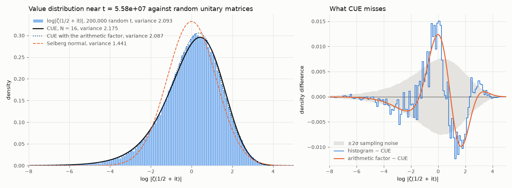

Selberg's central limit theorem says log|ζ(1/2 + it)| divided by
sqrt(½·log log T) tends to a standard normal. Keating and Snaith (2000) proposed a
much sharper model: the characteristic polynomial of a random N×N unitary matrix
(CUE) with N = log(T/2π). Its moment generating function is exact,

```
E|det(I − U)|^s = Π_{j=1..N} Γ(j)·Γ(j + s) / Γ(j + s/2)²
```

so the cumulants are κ_m = (1 − 2^(1−m))·Σ_{j≤N} ψ^(m−1)(j), and the density
comes from Fourier inversion of the product along s = iu (trapezoid rule, step
0.01). The density integrates to 1 within 1e-9, its moments match the cumulants,
and a histogram of 20,000 Haar-random 12×12 unitaries sits within 0.015 of it.

Sampling 200,000 random t in [T, 1.01·T] with T = 2π·e^N, so that N is an
integer:

| N | T | variance | κ₃ | CUE variance | CUE κ₃ | CUE + arithmetic variance | CUE + arithmetic κ₃ | Selberg ½ log log T |
|---|---|---|---|---|---|---|---|---|
| 8 | 1.87·10⁴ | 1.730 | −2.10 | 1.829 | −2.374 | 1.741 | −2.140 | 1.143 |
| 10 | 1.38·10⁵ | 1.864 | −2.20 | 1.940 | −2.393 | 1.852 | −2.159 | 1.236 |
| 12 | 1.02·10⁶ | 1.957 | −2.14 | 2.031 | −2.405 | 1.943 | −2.171 | 1.314 |
| 14 | 7.56·10⁶ | 2.019 | −2.13 | 2.108 | −2.414 | 2.020 | −2.180 | 1.381 |
| 16 | 5.58·10⁷ | 2.093 | −2.10 | 2.175 | −2.421 | 2.087 | −2.187 | 1.441 |

The means are all within 0.011 of zero. Selberg's normal is far too narrow at
these heights: the variance does grow like ½ log log T, but with 0.59 to 0.65 on
top. CUE gets the variance within 0.1 and the strong negative skew roughly right
(log|ζ| has a long left tail from the zeros), but it is too wide by 0.074 to 0.099
at every height, and that gap doesn't shrink with N.

The gap is the primes. In the moment conjecture of Keating and Snaith the CUE
moments get multiplied by an arithmetic factor,

```
a(k) = Π_p (1 − 1/p)^(k²) · E|1 − e^(iθ)/√p|^(−2k)      (θ uniform)
```

which is what you get from the hybrid Euler-Hadamard product of Gonek, Hughes and
Keating: ζ is a product over small primes times a product over nearby zeros, and
only the second part looks like a random matrix. Reading log a(s/2) as an extra
cumulant generating function gives the correction to every cumulant of log|ζ|.
Per prime, `values.arithmetic_cumulants` expands
log Σ_m ((s/2)_m / m!)² p^(−m) + (s²/4)·log(1 − 1/p) as a power series in s,
sums over the 78,498 primes below 10⁶ and adds the tail beyond them in closed form
(the p^(−2) term, −(s/2)²(s/2 − 1)²/4 · Σ_(p>P) p^(−2), with the prime sum from
E1(log P)). The result:

| | κ₂ | κ₃ | κ₄ |
|---|---|---|---|
| arithmetic factor | −0.0881 | +0.2337 | −0.0989 |

The variance correction is ½·Σ_p (Li₂(1/p) + log(1 − 1/p)), which the test suite
checks against mpmath's polylog, and κ₃, κ₄ are checked against the cumulants of
−log|1 − e^(iθ)/√p| by quadrature in θ. With it the predicted variance is within
0.015 of the data at all five heights (the sampling error of a variance here is
0.008), and the skew moves from −2.4 to −2.14..−2.19 against −2.10..−2.20 measured.
Nothing was fitted. The right panel of the chart is the histogram minus the CUE
density next to the same difference for CUE with the four arithmetic cumulants
added (`hybrid_density`): the bump at 0 and the dip near 1.7 are the primes.

The full arithmetic factor can't be Fourier-inverted on its own. Its variance is
negative, so its characteristic function grows like e^(0.044u²) and the product
with the CUE one blows up for large u. Truncating it at the fourth cumulant gives a
transform that decays (κ₄ < 0). At N = 12 the resulting density integrates to 1
within 1e−8, has the predicted variance and skew, and its most negative value is
−3e−8, in the far tail.

### Moments

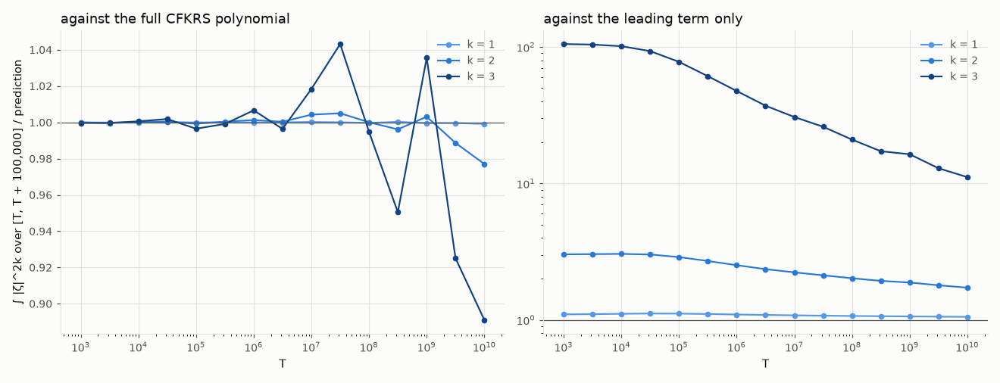

Conrey, Farmer, Keating, Rubinstein and Snaith (2005) conjectured the full
asymptotic for the 2k-th moment,

```
∫_0^T |ζ(1/2 + it)|^(2k) dt = ∫_0^T P_k(log(t/2π)) dt + O(T^(1/2 + ε))
```

with P_k a polynomial of degree k². For k = 1 it is a theorem (Ingham):
P_1(x) = x + 2γ. For k = 2 it matches Heath-Brown's fourth moment, and for k = 3 it
is a conjecture. `moments.py` has P_1 in closed form and P_2, P_3 as printed in the
paper. Their leading coefficient is a_k·G(k + 1)²/G(2k + 1), with G the Barnes
function and a_k the arithmetic factor above at integer k; computing it from the
Euler product (primes to 10⁶ plus the E1 tail) gives 1/(2π²) for k = 2 and
5.708527034652e−6 for k = 3, both within 3e−11 of the paper.

`z_power_integrals(C, D)` integrates Z(t)^(2k) with the trapezoid rule on a grid of
step 1/(2k·log(D/2π)), evaluating Z through the same Odlyzko-Schönhage windows as
the zero finder (own ζ below t = 1000). Z^(2k) is close to band-limited, with
frequencies up to k·log(t/2π), so the interior of the trapezoid rule is
spectrally accurate and all of the error sits at the two ends. An 8-point Gregory
correction at each end removes it: the weights come from solving, in exact
rationals, for the corrections that reproduce the Euler-Maclaurin endpoint terms
on polynomials of degree below 8. Against Gauss-Legendre on mpmath's `siegelz`
over 3-unit blocks at step 0.005, including the blocks around the records
Z(50626.48) = 23.7 and Z(77403.72) = 28.2 where Z⁶ passes 10⁸, the agreement is
1e−11 or better. At the default step the endpoint error is about 0.01 in absolute
terms, which is 2e−8 of a 3-unit block and nothing on a long one: halving the step
moves the integral over [50000, 60000] by 5e−12.

The paper has two tables to compare with. For the smoothed moments
∫_0^∞ |ζ|^(2k) e^(−t/10⁴) dt (`smoothed_moments(1e4)`, integrated to t = 6·10⁵):

| k | measured here | CFKRS, measured | conjecture here | CFKRS, conjecture |
|---|---|---|---|---|
| 1 | 79499.9312639 | 79499.9312635 | 79496.7897047 | 79496.7897047 |
| 2 | 5088336.51209 | 5088336.43654 | 5088332.55512 | 5088332.55512 |
| 3 | 708967539.4 | 708967359.4 | 708965694.5 | 708965694.5 |

The conjecture column uses ∫_0^∞ log(t/2π)^j e^(−t/T) dt = T·j!·[s^j] e^(as)Γ(1 + s)
with a = log(T/2π), a power series exponentiated in closed form. It agrees with
the paper to every printed digit, as long as the two numbers in the paper's k = 2
row are read the other way round: printed as is, they say the conjecture is
5088336.43654 and the measured value 5088332.55512, and my conjecture integral
matches the second one to 12 digits. For the sixth moment over blocks of 50,000:

| block | measured here | CFKRS, measured | relative gap |
|---|---|---|---|
| [0, 50000] | 7231006986.4 | 7231005642.3 | 1.9e−7 |
| [50000, 100000] | 15723925543.3 | 15723919113.6 | 4.1e−7 |
| [100000, 150000] | 21536848443.9 | 21536840937.9 | 3.5e−7 |
| [1000000, 1050000] | 70233469614.7 | 70233393177.0 | 1.1e−6 |

The paper's measured values were computed in Mathematica. The second moment agrees
to 12 digits, so the gap grows with k, which is what a fixed relative error in the
integration on their side would do. My two evaluators of Z agree with each other and
with mpmath to 1e−11 or better on the same ranges.

The chart repeats the comparison over windows [T, T + 10⁵] from T = 10³ to 10¹⁰
(470 s for all fifteen windows). The second moment stays within 8e−4 of P_1 and
the fourth within 0.5% up to 10⁹ (1.1% and 2.3% at 3·10⁹ and 10¹⁰). The sixth moment is within 0.7%
up to 3·10⁶ and then wanders by up to 11%: with |ζ|⁶ a window of 10⁵ is
dominated by a few large peaks, and CFKRS's own blocks at 10⁶ move by ±1%. The
right panel is the point of the full polynomial. Keating and Snaith's leading term
a_k g_k (log T)^(k²) / (k²)! is off by a factor 11 for k = 3 even at 10¹⁰, and the
ratio shrinks only like a polynomial in 1/log T.

### The maximum in a short interval

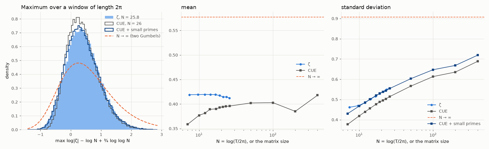

Fyodorov, Hiary and Keating (2012) predicted the largest value of |ζ| on a
window of fixed length near height T. With N = log(T/2π), the number of zeros in a
window of length 2π,

```
max_(0 ≤ h ≤ 2π) log|ζ(1/2 + i(T + h))| = log N − ¾ log log N + y
```

where y has a limit law with density 4e^(−2y) K₀(2e^(−y)), the law of half the sum
of two independent standard Gumbel variables. The −¾ log log N (rather than the
−¼ that independent values would give) and the y·e^(−2y) right tail come from the
logarithmic correlations of log|ζ|, the same structure as branching random walks.
The leading order is a theorem (Arguin, Belius, Bourgade, Radziwiłł and
Soundararajan 2019), and Arguin, Bourgade and Radziwiłł proved the −¾ term with
tight tails (2020, 2023). The limit law itself is open.

`maxima.py` computes K₀ and K₁ from ∫_0^∞ e^(−x cosh s) cosh(νs) ds with the
trapezoid rule, which converges double-exponentially (1e−12 against mpmath), so
the limit density and its CDF 2e^(−y) K₁(2e^(−y)) need nothing outside numpy. The
law has mean γ and variance π²/12, and 200,000 simulated pairs of Gumbels sit within
the KS noise of the CDF.

`zeta_maxima(T, count)` takes consecutive windows [T + 2πk, T + 2π(k + 1)],
evaluates Z on 16 points per mean zero spacing through the Odlyzko-Schönhage
windows, with the grid aligned to the window edges, and then runs golden-section
search on every grid cell whose higher end is within 0.02 of its window's best
grid value. The grid misses the top of a typical peak by about 0.005, a quarter
of that margin, so the cell holding the true maximum qualifies. Against scans with 100,001 points per
window the maxima agree to 1e−8. 50,000 windows take 52 s at 10⁴ and 124 s at 10¹².

The random-matrix side is the maximum of log|p_N(θ)| = Σ log|2 sin((θ − φ_j)/2)|
over the circle for Haar unitaries (QR of a complex Ginibre matrix with the phases
of R's diagonal divided out). Each term is concave between eigenangles, so the
maximum on each gap is the unique root of ½Σ cot((θ − φ_j)/2), found by Newton with
a bisection safeguard. My first version evaluated p_N by FFT of its coefficients,
which is fine for N = 26 and useless at N = 100: the coefficients sum to 2^N in
absolute value and the rounding error swamps |p_N| (it reported a mean of 17).

Over 50,000 windows at each height:

| T | N | ζ mean | CUE mean | ζ variance | CUE variance | CUE + primes | KS: CUE, + primes, limit |
|---|---|---|---|---|---|---|---|
| 10⁴ | 7.4 | 0.419 | 0.361 | 0.213 | 0.146 | 0.189 | 0.093, 0.068, 0.168 |
| 10⁵ | 9.7 | 0.419 | 0.375 | 0.220 | 0.172 | 0.215 | 0.065, 0.049, 0.165 |
| 10⁶ | 12.0 | 0.420 | 0.381 | 0.234 | 0.193 | 0.235 | 0.063, 0.048, 0.159 |
| 10⁷ | 14.3 | 0.419 | 0.389 | 0.253 | 0.210 | 0.253 | 0.052, 0.035, 0.153 |
| 10⁸ | 16.6 | 0.419 | 0.390 | 0.266 | 0.225 | 0.268 | 0.049, 0.034, 0.147 |
| 10⁹ | 18.9 | 0.417 | 0.393 | 0.280 | 0.237 | 0.280 | 0.042, 0.029, 0.143 |
| 10¹⁰ | 21.2 | 0.415 | 0.394 | 0.291 | 0.247 | 0.290 | 0.039, 0.028, 0.140 |
| 10¹¹ | 23.5 | 0.414 | 0.395 | 0.302 | 0.255 | 0.298 | 0.037, 0.024, 0.137 |
| 10¹² | 25.8 | 0.412 | 0.396 | 0.309 | 0.264 | 0.307 | 0.034, 0.022, 0.135 |

The CUE columns are interpolated between integer N from 100,000 matrices per
size. The data are nowhere near the limit law: the mean is
0.41 against γ = 0.577 and the variance 0.31 against 0.82 at 10¹², and the KS
distance to the limit only falls from 0.168 to 0.135 across eight decades. Random
matrices show the same lag well past any height ζ can reach: at N = 100, 200 and
400 (20,000, 5,000 and 1,000 matrices) the CUE mean is 0.403, 0.385 and 0.418 and
the variance 0.376, 0.404 and 0.474. The slow convergence belongs to the
log-correlated field, not to ζ. FHK met the same
thing at 10²⁸ and rescaled their data to the predicted variance before comparing.

ζ's maxima also spread more than CUE's at every height, by 0.045 in variance at
10¹². That excess is arithmetic. A random matrix has no structure on scales longer
than the circle, but ζ has primes, and p^(−1/2−it) with small p changes slowly
enough to lift or sink a whole window. Averaged over a window of length L the prime
sum Re Σ_p p^(−1/2−it) has amplitude p^(−1/2)·|sin(½L log p)/(½L log p)| for each
p, and since the log p are linearly independent the phases behave like independent
uniforms over many windows, so the shift has variance
Σ_p sin²(½L log p) / (2p·(½L log p)²) = 0.0430 for L = 2π (0.0420 from p ≤ 30). It
correlates with the measured maximum at 0.42 to 0.44 at every height. Adding it to
the CUE variance, with nothing fitted, lands within 0.0041 of ζ's variance from 10⁶
up (0.005 at 10⁵ and 0.024 at 10⁴), and adding an independent sample of the shift
to the CUE maxima cuts the KS distance to the data by 27 to 37%. What is left is a mean offset that shrinks from
0.058 at 10⁴ to 0.017 at 10¹²; with both means removed, the KS distance between
ζ and CUE plus primes is 0.010 to 0.017 from 10⁵ up.

### Li's criterion

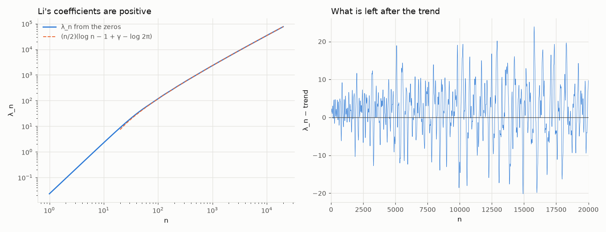

Li (1997) showed that RH holds if and only if

```
λ_n = Σ_ρ [1 − (1 − 1/ρ)^n]
```

is positive for every n ≥ 1. On the critical line 1 − 1/ρ has modulus 1, so the
pair ρ, ρ̄ contributes 4·sin²(n·arctan(1/(2γ))) ≥ 0, which is why the criterion
works. The same numbers are Taylor coefficients at the point s = 1:
Σ_n λ_n z^n / n = log ξ(1/(1 − z)).

`li.li_exact` takes the second route with no zeros at all. A zero ρ of ξ sits at
z = 1 − 1/ρ, which is on the unit circle when ρ is on the line, and an off-line
zero at height γ would land within about 1/γ² of it. So log ξ(1/(1 − z)) is
analytic well past |z| = 1/2. The code samples it on that circle, unwraps the
phase, and reads the coefficients off a discrete Fourier transform at 40 digits;
the aliasing error falls like 2^(−nodes). λ_1 = 1 + γ/2 − ½ log 4π = 0.0230957089661 to 1e−15, and moving the
circle to radius 0.4 with 220 nodes changes nothing at 1e−12.

`li_coefficients(n, gamma)` takes the first route: the sum over the given zeros
plus the rest of the zeros as the smooth density θ'(t)/π beyond the last one,
∫_T^∞ 4 sin²(n arctan(1/2t)) θ'(t)/π dt, and a boundary term −f(T)·S(T) for the
difference between the true and the smooth count at T (integration by parts of
∫ f dS). The integral is done in φ = arctan(1/2t) with φ = φ_T y⁴ to soften the
logarithm of θ' at φ = 0, 200 Gauss-Legendre nodes. With the 1,000,001 zeros below
the Gram point g_(10⁶) (found by the multi-evaluation zero finder in 148 s, count
checked against the Gram point), the sum matches the Taylor route to 1.3e−12 for
every n ≤ 40. Dropping the top half of the zeros moves λ_n by at most 1.6e−7 for n
up to 10⁵, so the tail does its job.

Every λ_n for n ≤ 20,000 (160 s) is positive and increasing, and so are the 120
log-spaced values I computed up to 10⁵. The trend (n/2)(log n − 1 + γ − log 2π) is
Voros's asymptotic under RH; what is left has standard deviation 0.43
for n ≤ 100, 2.8 for 100 to 1000, 4.4 for 1000 to 5000 and 7.5 for 5000 to 20,000,
so it grows, but slower than √n. If RH failed, a zero off the line at β + iγ would
add a term growing like |1 − 1/ρ|^n, exponentially, but only once n reaches about
γ²/(2β − 1), which for any zero above the verified height is far beyond reach. This
is a check of the computation more than a test of RH.

### Jensen polynomials

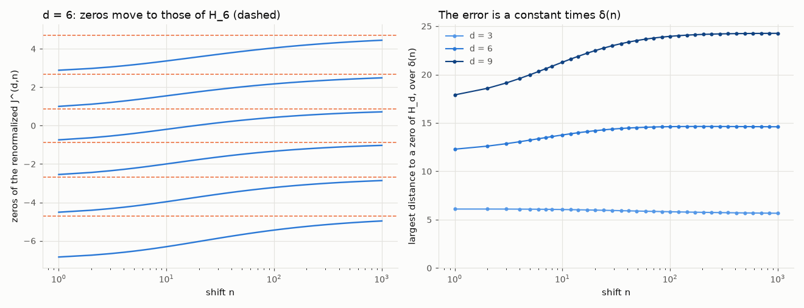

Write the completed zeta function around the center as

```
(4z² − 1)·Λ(1/2 + z) = Σ_n γ(n) z^(2n) / n!,      Λ(s) = π^(−s/2) Γ(s/2) ζ(s)
```

and attach to the sequence γ the Jensen polynomials

```
J^(d,n)(X) = Σ_(j=0..d) C(d, j) γ(n + j) X^j.
```

Pólya showed that RH holds if and only if every J^(d,n) is hyperbolic (has only
real zeros). Griffin, Ono, Rolen and Zagier (2019) proved it for d ≤ 8 and every
n, and for each d once n is large enough, by showing that after the change of
variable X → (δ(n)X − 1)/e^(A(n)) and the scaling δ(n)^(−d)/γ(n), J^(d,n) tends to
the Hermite polynomial H_d (in their normalization Σ H_d t^d/d! = e^(−t² + Xt)).

`jensen.taylor_gamma` gets γ(n) from Riemann's theta integral,
Λ(1/2 + z) = −4/(1 − 4z²) + 2∫_1^∞ t^(−3/4) cosh(z log(t)/2) θ₀(t) dt with
θ₀(t) = Σ e^(−πk²t), which turns into
γ(n) = n!/(2n)! · (32·C(2n, 2)·F(2n − 2) − F(2n)) / 2^(2n−1) with
F(m) = ∫_1^∞ (log t)^m t^(−3/4) θ₀(t) dt. All F(m) share one set of Gauss-Legendre
panels in u = log t, so a thousand of them cost one pass over the nodes; at 130
digits γ(0) to γ(1040) take 35 s. They match the paper's γ(10), γ(100) and γ(1000)
(1.6323380490e−17, 6.5777263785e−205, 3.8760340890e−2567) to every printed digit,
mpmath's Taylor series of the left side for n ≤ 3 to 1e−20, and an independent
50-digit quadrature of F(m) to 1e−35.

Hyperbolicity is decided exactly. The γ(n) are converted to rationals, J^(d,n)
is formed in `Fraction` arithmetic, and Hermite's criterion does the rest: a real
polynomial has d distinct real zeros if and only if the Hankel matrix of the
power sums of its zeros, s_(i+j) for 0 ≤ i, j < d, is positive definite. The
power sums come from Newton's identities and the pivots of Gaussian elimination
decide definiteness, so there is no rounding after the γ(n) themselves. Their
precision still matters: with 15-digit γ, J^(20,100) appears to have a pair of
complex zeros, while 60, 160 and 300 digits all give the same positive pivots.
The sweep below runs at 130 digits.

Every J^(d,n) with d ≤ 12 and n ≤ 1000 is hyperbolic (12,012 polynomials, 335 s),
and so are d = 20, 30 and 40 at n = 0, 10, 100 and 1000 (1.5, 11 and 45 s each).
That is a check, not news: Chasse showed hyperbolicity at n = 0 up to
d = 2·10¹⁷. The more interesting output is how the limit is approached. The
paper's closed form for A(n), δ(n), with L(n) the root of n = L(πe^L + 3/4)
evaluated at 2n − 2, agrees with the values read off the data
(δ² = −½·Δ² log γ(n), A = Δ log γ(n) + δ²) to 9% in δ at n = 20, 0.5% at 170 and
0.14% at 492. With the data values, the largest distance between a zero of the
renormalized J^(d,n) and the matching zero of H_d, divided by δ(n), levels off
near 5.7, 14.6 and 24.3 for d = 3, 6 and 9. So the convergence is first order in
δ(n), which falls like 1/√n up to logs, and it is slow: at n = 1000 every zero of
the d = 6 polynomial is still 0.15 to 0.25 below its Hermite limit (left panel).

### Dirichlet L-functions

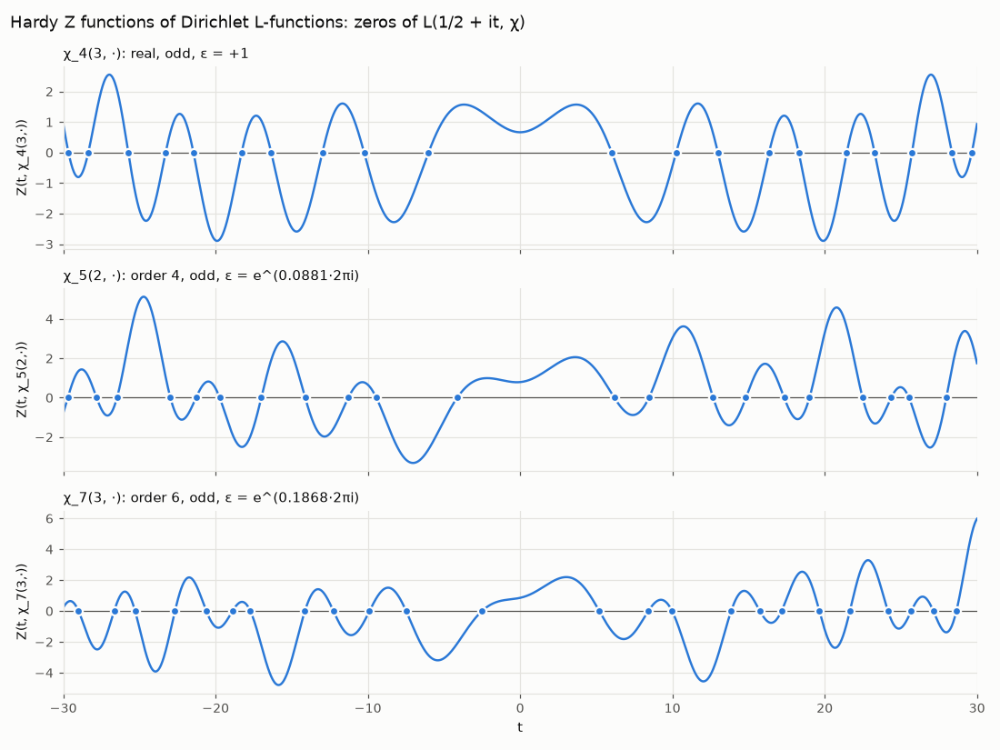

A Dirichlet character mod q is a homomorphism (Z/qZ)* → C*, extended by 0 to the
integers that share a factor with q. `conrey(q, n)` builds χ_q(n, ·) with the
Conrey labels LMFDB uses: for an odd prime p the generator g_p is the least
primitive root mod p², and with n ≡ g^a, m ≡ g^b mod p^e,
χ(m) = exp(2πi·ab/φ(p^e)). Powers of 2 use ±5^a instead, and a general q
multiplies the prime-power pieces via CRT. Values are stored as exact numerators
over the order, so χ² = 1 is an integer statement and real characters come out
exactly real. The conductor is the smallest d | q for which χ is trivial on
m ≡ 1 mod d, and `primitive()` builds the character mod d that induces χ.

For σ ≥ 0 the series is split by residue class, L(s, χ) = q^(−s) Σ_a χ(a)·ζ(s, a/q),
and each Hurwitz zeta gets the same Euler-Maclaurin tail as ζ itself, starting at
the term N = 10 + |t|/π so that about q·N terms are summed directly. The tail has
an integral term (N + a/q)^(1−s)/(s − 1), and since Σχ(a) = 0 the 1/(s − 1) parts
cancel. Writing that term as ((N + a/q)^(1−s) − 1)/(s − 1) with `expm1` removes
the cancellation before it happens, so L(1, χ) and its neighborhood come out to full
precision with no special case.

For σ < 0 the code uses the functional equation of the primitive character,

```
L(s, χ) = ε(χ)·2^s·π^(s−1)·q^(1/2−s)·Γ(1 − s)·sin(π(s + κ)/2)·L(1 − s, χ̄)
ε(χ) = τ(χ) / (i^κ·√q),   τ(χ) = Σ_a χ(a)·e^(2πia/q)
```

where κ = 0 for even and 1 for odd characters. Trivial zeros at s = −κ − 2m come out
as exact zeros. An imprimitive χ is its primitive character times the Euler factors
(1 − χ*(p)p^(−s)) for the primes that divide q but not the conductor.

On the critical line, θ(t, χ) = (t/2)·log(q/π) + arg Γ((1/2 + κ + it)/2) − arg(ε)/2
makes Z(t, χ) = e^(iθ)·L(1/2 + it, χ) real, the analogue of Riemann-Siegel Z. For a
complex χ the zeros are not symmetric about t = 0; the zeros of χ below the axis are
the zeros of χ̄ above it:

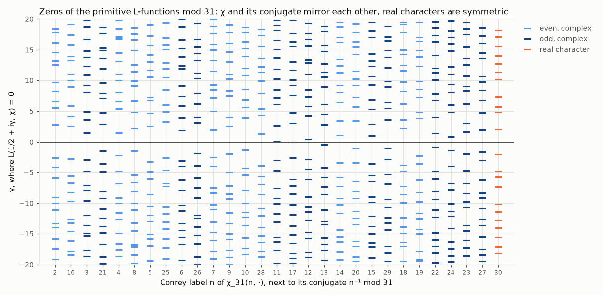

Sign changes of Z only find zeros on the line. `count_zeros_box` counts every zero
in −1/2 ≤ σ ≤ 2, |t| ≤ T with the argument principle: it follows arg L around the
rectangle, bisecting any step where the argument jumps by more than 0.5 rad, and
subtracts the trivial zeros inside the box. `verify_zeros` finds zeros on the line
and checks that both counts agree, which shows (up to floating-point error, not with
interval arithmetic) that every zero in the box is on the critical line and simple.
When the counts disagree it doubles the sampling density and tries again. That
happened for real: χ₅₉(9, ·) has two zeros at t = 14.636869 and 14.662140, 0.025
apart, with |Z| no bigger than 0.0011 between them, and the default grid stepped
over both. mpmath's `dirichlet` confirms the sign pattern.

Checks:

- L(s, χ) against mpmath's `dirichlet` at random points with −15 < σ < 15 and
  |t| < 80, for ten characters up to q = 40: relative error below 1e-12, worst
  5e-14.
- The first three zeros of χ₃(2, ·), χ₄(3, ·) and χ₅(2, ·) against LMFDB: within
  2e-15. The root number of χ₅(2, ·) matches LMFDB's root angle 0.0881040955873917.
- L(1 − k, χ) = −B_(k,χ)/k with generalized Bernoulli numbers computed from exact
  Bernoulli polynomials, k = 1 to 7 for seven characters.
- The class number formula L(1, χ_d) = 2πh/(w√|d|) for every fundamental d with
  −2000 < d < 0, with h counted from reduced binary quadratic forms: max error in h
  2e-14. For real fields L(1, χ_d)·√d/(2 log ε_d) with the fundamental unit from
  the continued fraction of (1 + √d)/2 or √(d/4) lands within 4e-15 of an integer
  for every fundamental d < 2000, and on the known class numbers 2, 2, 3, 3, 4 for
  d = 40, 60, 229, 316, 328.
- Orthogonality of the character table, the count of primitive characters
  Σ μ(q/d)φ(d), χ_q(m, ·)χ_q(n, ·) = χ_q(mn, ·), the symmetry χ_q(m, n) = χ_q(n, m),
  |τ(χ)| = √q, and ε = 1 for the quadratic characters tested (Gauss's sign of the
  quadratic Gauss sum).
- `verify_zeros` with T = 30 on every primitive character of conductor 3 to 100:
  1,815 L-functions, 80,838 zeros, all on the critical line (342 s).

### Large conductors

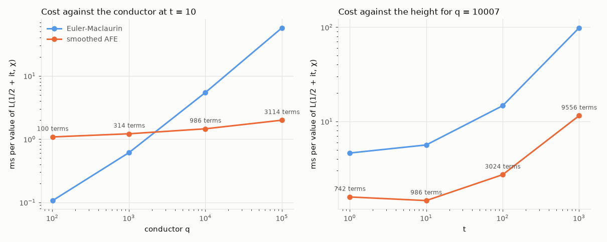

Euler-Maclaurin sums about q·(10 + |t|/π) terms, which is fine for q in the
thousands and hopeless at q = 10⁵. `afe.py` uses a smoothed approximate functional
equation in the style of Rubinstein instead. For a primitive χ with parity κ, the
completed L-function is

```
Λ(s, χ) = (q/π)^z·Γ(z)·L(s, χ) = ε(χ)·Λ(1 − s, χ̄),   z = (s + κ)/2
```

and Λ is the Mellin transform of the theta series Σ χ(n)·n^κ·exp(−πn²x/q). Split
the integral at |x| = 1 along the ray x = r·e^(iφ) instead of the positive axis, and
apply the theta transformation to the inner half. Both pieces become incomplete
gamma functions:

```
Λ(s, χ) = Σ χ(n)·(q/π)^z·n^(−s)·Γ(z, w_n) + ε·Σ χ̄(n)·(q/π)^z'·n^(s−1)·Γ(z', w̄_n)
w_n = πn²·e^(iφ)/q,   z' = (1 − s + κ)/2
```

With φ = 0 this is the classical formula, and it breaks high up. On the critical
line Γ(z) is about e^(−π|t|/4), the two sums cancel down to that size, and dividing
by Γ(z) loses every digit by t ≈ 50. Rotating fixes the scale. Along the ray,
|u^(z−1)| carries a factor e^(−φ·Im z), so with φ = sign(t)·(π/2 − θ) no term is
more than about e^(|t|θ/2) times Γ(z). The code takes |t|θ/2 = 3, which gives up
three e-folds (1.3 digits) and sets θ = 6/|t|. The terms decay like
exp(−πn²·sin θ/q), and each sum stops once that drops below e^(−43):

```
N ≈ √(43q / (π·sin θ)) ≈ √(43q|t| / 6π)
```

That is O(√(q|t|)) terms where Euler-Maclaurin needs O(q|t|). Below |t| = 3.8 the
angle stays at π/2 (no rotation) and N ≈ 3.7√q.

`gammaincc` computes Γ(z, w)/Γ(z) for z with real part 1/4 or 3/4 and imaginary part
up to t/2, and w nearly imaginary. It uses the power series of γ(z, w) when
|w| < |z| + 1 and Legendre's continued fraction (modified Lentz, with converged
entries dropped from the working set) otherwise. The fraction takes from a few to
about a hundred steps over the range the sums need. Both forms are relative to
Γ(z), the scale of the answer, so 1 − γ/Γ never cancels anything that matters. One
more rewrite keeps phases small: n^(−s)·w_n^z = n^κ·(π/q)^z·e^(izφ), so the t·log n
phase of each term cancels exactly instead of being computed and subtracted.

`dirichlet_l` picks a method per point with a cost model fit to the timings above:
the AFE when 0 < σ < 1 and q·(10 + |t|/π) > 25000 + 100·N. At t = 10 the crossover
is near q = 2000. At q = 100003 one value costs 2.0 ms against 57 ms, and at
q = 10007, t = 1000 it is 11.5 ms against 98 ms. `method="em"` forces the old path.

Checks:

- `gammaincc` against mpmath's `gammainc` at 80 random points with |Im z| ≤ 300 and
  10⁻⁴ ≤ |w| ≤ 10³: within 1e-11 (relative to max(1, |Q|)). Also Q(1, w) = e^(−w)
  and the recurrence Q(z + 1, w) = Q(z, w) + w^z·e^(−w)/Γ(z + 1).
- L against mpmath's `dirichlet` at random points of the strip with |t| < 200, for
  nine characters up to q = 97: relative error below 1e-12.
- The value cannot depend on the rotation, and a wrong formula would. At q = 1009,
  allowing 1.5, 3 or 6 e-folds of loss (which changes θ and the number of terms)
  moves L by less than 2e-12 relative at t = 0, 2, 40 and 400.
- AFE against Euler-Maclaurin for χ_(−2003) at σ = 0.2, 0.5 and 0.9: within 1e-11.
  The zeros of χ₁₀₀₀₇(2, ·) below t = 6 found both ways agree to 1e-10, and at
  q = 100003, t = 10 the two methods differ by 7e-14.

### Low-lying zeros

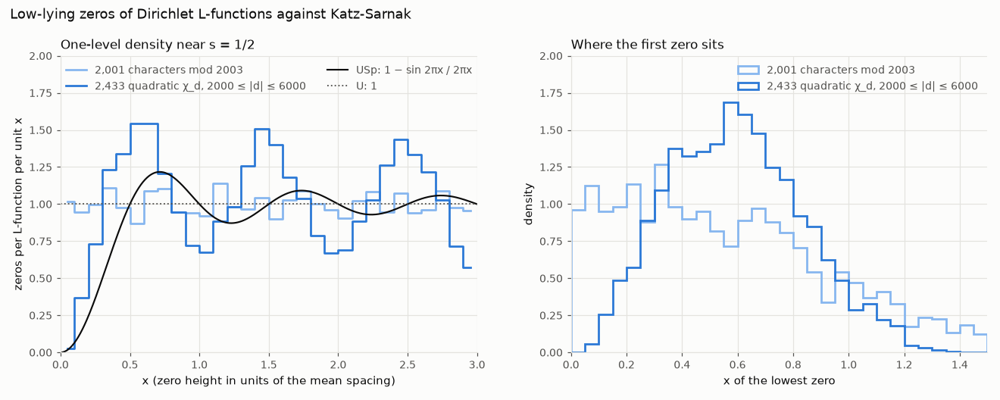

Katz and Sarnak predict that the zeros of a family of L-functions close to s = 1/2
follow the eigenvalues of a random matrix group, and that the group depends on the
family's symmetry. All characters mod a prime p form a unitary family: nothing
special happens at the central point, and the density of zeros there is flat. The
real quadratic characters χ_d form a symplectic family, and their zeros are pushed
away from s = 1/2 with density

```
W_USp(x) = 1 − sin(2πx) / (2πx)
```

`low_zeros` unfolds each zero with the L-function's own smooth count,
x = (θ(γ, χ) − θ(0, χ))/π, so every family has mean density 1 regardless of its
conductor. That needs θ to increase from t = 0, which holds when
log(q/π) + ψ((1/2 + κ)/2) > 0, i.e. q ≥ 10 for odd and q ≥ 216 for even characters.
Below that the code refuses. Only zeros with γ > 0 count; for a complex χ the zeros
below the axis belong to χ̄, which is in the family too.

The chart uses the 2,433 fundamental discriminants with 2000 ≤ |d| ≤ 6000 (both
signs) and the 2,001 nontrivial characters mod 2003, 13,347 zeros in all. The run
took 8 minutes on one process before the approximate functional equation, and 30 s
on 16 processes now. Results:

- Unitary: flat. Every bin of width 0.1 on [0, 3] is within 0.14 of 1.
- Symplectic: 0.029 zeros per L-function per unit x in [0, 0.1], where W_USp
  averages 0.022, and 0.37 in [0.1, 0.2], where it averages 0.15. Only 4.0% of the quadratic L-functions have a
  zero below x = 0.2, against 19.7% mod 2003.
- The quadratic density also oscillates with period 1 and peaks near x = 1/2, 3/2
  and 5/2, well beyond the oscillation in W_USp. This is Gram's law for L-functions.
  A real primitive χ has ε = 1, so θ(0) = 0 and the n = 1 term of
  Z(t) = Re(e^(iθ)·Σ χ(n)n^(−1/2−it)) is cos θ(t), which vanishes exactly at
  half-integer x. For complex characters x is measured from θ(0) = −arg(ε)/2, a
  phase spread around the circle, so the bias averages out. The higher terms only
  win slowly as log q grows. Stopple's experiment with about a million quadratic
  characters at |d| > 10¹² found that lower-order terms still matter at that size.

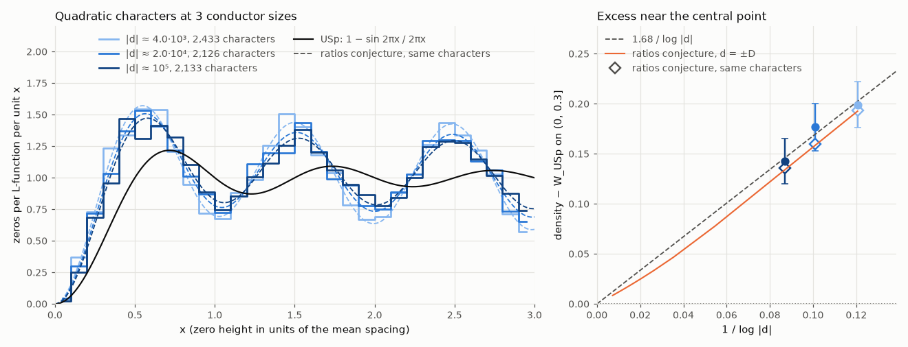

With the approximate functional equation the same experiment reaches conductors
near 10⁵. The 2,133 fundamental discriminants with 100000 ≤ |d| ≤ 103500 take 60 s
on 16 processes, and 2,000 characters mod 100003 take 42 s. The unitary family
stays flat (every bin within 0.17 of 1, 20.0% with a zero below x = 0.2). The
quadratic family moves toward W_USp, which averages 0.178 on (0, 0.3]:

| \|d\| | characters | zeros with x ≤ 3 | density on (0, 0.3] | excess over W_USp | first zero below 0.2 |
|---|---|---|---|---|---|
| 2000 to 6000 | 2,433 | 7,350 | 0.377 | 0.199 ± 0.023 | 4.0% |
| 20000 to 23500 | 2,126 | 6,394 | 0.354 | 0.177 ± 0.024 | 3.4% |
| 100000 to 103500 | 2,133 | 6,415 | 0.320 | 0.143 ± 0.022 | 2.8% |

The ± is the Poisson error of the zero count. The excess shrinks about like
1/log|d|: the weighted line through the origin, 1.68/log|d|, passes through all
three error bars. The Gram oscillation is still there at 10⁵, a little lower.

### Lower-order terms from the ratios conjecture

The dashed curves on the left of that chart are not fits. They come from the
L-functions ratios conjecture (Conrey, Farmer and Zirnbauer), which Conrey and
Snaith turned into a one-level density for quadratic characters that is exact up
to O(X^(−1/2+ε)), lower-order terms included. For one χ_d it says the zeros near the
central point have density, per unit x,

```
ρ_d(x) = 1 + Re B(t) / θ'(t),    θ(t) = πx
B(t) = ζ'/ζ(1 + 2it) + A'(it; it) − e^(−2iθ(t)) ζ(1 − 2it) A(−it; it)
A(−r; r) = Π_p (p² − p^(2r)) / (p² − 1)
A'(r; r) = Σ_p log p / ((p + 1)(p^(1+2r) − 1))
```

with θ = θ(t, χ_d), so the gamma factor and the parity κ come in through the same
θ the zeros were unfolded with. The products are over every prime, 2 included.
That relies on a property of the family which `test_family_matches_local_densities`
checks directly: among fundamental discriminants a fraction 1/(p + 1) is
divisible by p, and the rest split evenly between χ_d(p) = 1 and −1. Both poles
at t = 0 cancel, and expanding to first order gives ρ_d(0) = 0, which the code
reproduces to 1e-6 at x = 10⁻⁴.

`ratios.py` evaluates this from scratch. ζ'/ζ on the line Re s = 1 is the
derivative of the entire function (s − 1)ζ(s), taken by the trapezoidal rule on a
circle of radius 1/4 (32 points, within 1e-13 of mpmath right next to the pole).
The Euler products run over primes up to 10⁴, which moves the density by 6e-5
against 10⁵. The arithmetic depends only on t and the gamma part only on the
parity, so a whole family of 2,433 characters costs 0.5 s. The family
prediction is the average of ρ_d over the actual discriminants, each mapped
through its own θ.

Against the histograms (30 bins on [0, 3], Poisson errors):

| \|d\| | χ² against the ratios prediction | χ² against W_USp | excess on (0, 0.3], measured | predicted |
|---|---|---|---|---|
| 2000 to 6000 | 20.7 | 718.9 | 0.199 ± 0.023 | 0.194 |
| 20000 to 23500 | 15.6 | 410.8 | 0.177 ± 0.024 | 0.160 |
| 100000 to 103500 | 17.7 | 298.3 | 0.143 ± 0.022 | 0.136 |

So the bumps at half-integers, the shoulder near the origin and the slow approach
to W_USp are all lower-order terms of the ratios conjecture. Nothing in the data
at this size needs anything beyond them.

The leading correction has a closed form. As |d| → ∞ at fixed x,

```
ρ_d(x) = W_USp(x) + 2(γ − ζ'(2)/ζ(2))(1 − cos 2πx) / (log(|d|/π) + ψ(1/4 + κ/2)) + ...
```

where γ − ζ'(2)/ζ(2) = 1.1472 and the −ζ'(2)/ζ(2) is A'(0; 0). The 1 − cos 2πx
is the half-integer peak pattern from before. The denominator is where the slow
convergence comes from: ψ(1/4) = −4.23 makes it log|d| − 5.37 for even
characters, so at |d| = 4000 the "large" parameter is 2.9. The orange curve on
the right panel is the full prediction for d = ±D out to D = 10⁶⁰. It bends below
the fitted line; the excess times log D goes 1.51, 1.32, 1.23 at D = 10⁶, 10¹²,
10²⁴, on its way to 2 · 1.1472 · 0.4954 = 1.137, where 0.4954 is the average of
1 − cos 2πx over the window. `test_leading_correction_is_closed_form` checks the
expansion at |d| = 10²⁰⁰ for both parities.

### The lowest zero and Fredholm determinants

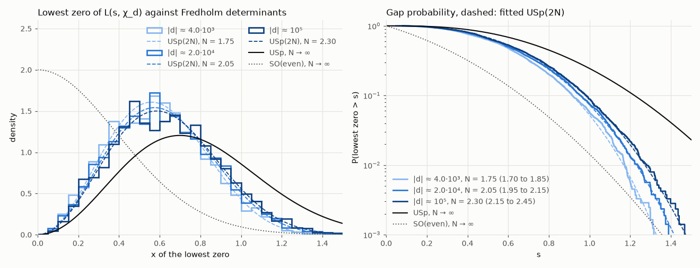

The ratios conjecture as used above gives the one-level density, not where the
lowest zero sits. For that the random matrix side needs a gap probability: the
chance that no eigenangle lands in (0, s) is a Fredholm determinant
E(s) = det(I − K) on L²(0, s), with

```
USp, N → ∞:        K(x, y) = S(x − y) − S(x + y),    S(z) = sin(πz)/(πz)
SO(even), N → ∞:   K(x, y) = S(x − y) + S(x + y)
USp(2N):           K(x, y) = D(x − y) − D(x + y),    D(z) = sin((2N + 1)πz/2N) / (2N sin(πz/2N))
```

in units where the mean spacing is 1. `rmt.py` follows Bornemann: Gauss-Legendre
nodes on (0, s), and the determinant of the 40 × 40 Nyström matrix
δ_ij − √w_i K(x_i, x_j) √w_j. The convergence is exponential; 20 and 60 nodes
agree to 1e-14 at s = 2. The density of the lowest zero is −E'(s), and instead of
a finite difference it comes from the resolvent at the endpoint,
−E'(s) = E(s)·R(s, s), where R(·, s) solves the same Nyström system with K(·, s) as
the right-hand side. That matches a central difference to 1e-8.

Checks:

- USp(2) is SU(2), one angle with density (2/π)sin²θ, so E(s) = 1 − s + sin(2πs)/2π
  in closed form. SO(2) is uniform. Both to 1e-14.
- USp(4) and SO(4) against a direct 2-D integral of the Weyl density
  (cos θ₁ − cos θ₂)²·sin²θ₁ sin²θ₂ (or without the sines): 1e-13.
- The sine kernel on (−s, s) splits into its even and odd parts, so
  E_USp(s)·E_SO(s) must equal the GUE gap on an interval of length 2s, and that
  must match Mehta's series 1 − s + π²s⁴/36 − π⁴s⁶/675 + π⁶s⁸/17640.
- Near the origin the USp lowest-zero density is 2π²s²/3, SO(even) starts at 2,
  the densities integrate to 1, and USp(2N) approaches the limit like 1/N.

The data are nowhere near the N → ∞ law. The mean lowest zero is 0.594, 0.618 and
0.635 at the three conductor sizes, against 0.783 for USp. What does fit is
USp(2N) at small N: maximum likelihood over real N (the kernel formula is smooth
in N) gives N = 1.75, 2.05 and 2.30, with likelihood-ratio 95% intervals 1.70 to
1.85, 1.95 to 2.15 and 2.15 to 2.45. The fitted laws have means 0.598, 0.621
and 0.636, and on the log-scale gap probability they follow the data down to
P ≈ 10⁻². The effective size grows by about 0.17 per unit of log|d|, a third of
the slope in the usual dictionary 2N ≈ log|d|. This is the same lesson as the one-level density: at conductors
you can compute, the arithmetic still shapes the zeros near the central point,
and a small matrix mimics it better than the limiting law does.

### Elliptic curves

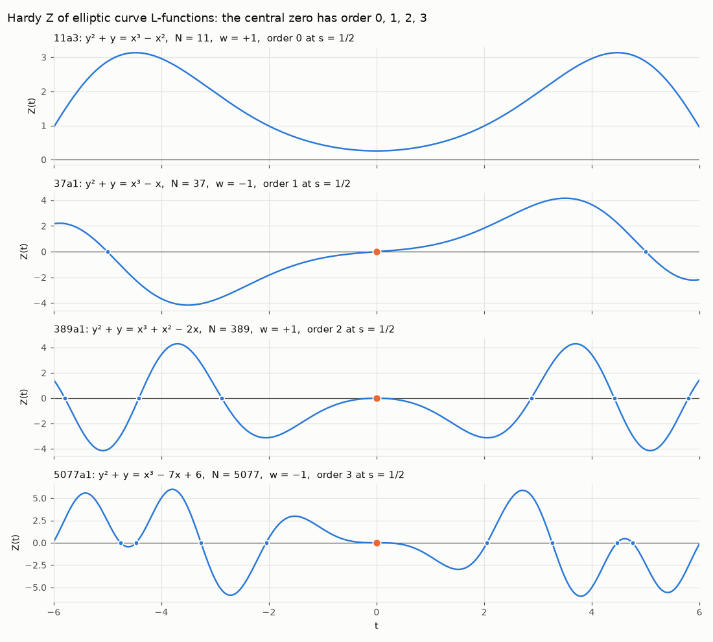

`elliptic.py` takes a Weierstrass equation y² + a₁xy + a₃y = x³ + a₂x² + a₄x + a₆
and builds its L-function from point counts. For an odd prime p, completing the
square turns the curve into Y² = f(x) = 4x³ + b₂x² + 2b₄x + b₆, so
a_p = −Σ_x (f(x)/p), one Legendre symbol lookup per x. p = 2 is counted by hand.
The same sum is right at a bad prime as long as the model is minimal there, and
it gives a_p = 1 or −1 for split or non-split multiplicative reduction. The code
only accepts semistable curves: every prime dividing Δ must leave c₄ a unit, which
also makes the model minimal. Then the conductor is the radical of Δ and the root
number is w = −∏_{p|N} (−a_p). Additive reduction would need Tate's algorithm and
raises an error. The a_n come from multiplicativity and the Hecke recursion
a_{p^(k+1)} = a_p·a_{p^k} − p·a_{p^(k−1)}.

In the analytic normalization (center at s = 1/2), Λ(s) = A^s Γ(s + 1/2) L(s)
with A = √N/2π satisfies Λ(s) = wΛ(1 − s). Splitting the Mellin integral of the
modular form at a point y₀ and folding the inner half over with the Fricke
involution gives

```
Λ(s) = Σ b_n [ (A/n)^s Γ(s + 1/2, n·y₀/A) + w (A/n)^(1−s) Γ(3/2 − s, n/(y₀·A)) ],   b_n = a_n/√n
```

for any y₀ with Re y₀ > 0. The answer can't depend on y₀, which makes a sharp
test: with the right N and w, y₀ = 1, 1.3, 0.8 and e^(0.6i) agree to 1e-12, and
flipping the root number of a twist breaks the agreement at the 1e-3 level. On the
critical line with |y₀| = 1 the two halves are complex conjugates, so
Λ(1/2 + it) = S + wS̄, and the Hardy function is 2·Re(e^(iθ)S) for w = +1 or
2·Im(e^(iθ)S) for w = −1, with θ(t) = t·log A + arg Γ(1 + it). For |t| above 6/π
the code rotates y₀ toward i, the same trick as in the Dirichlet smoothed sums,
so cancellation never costs more than a factor e³.

At the center the incomplete gamma functions collapse to the classical series
L(1/2) = 2Σ (a_n/n)·e^(−n/A) when w = +1 and L'(1/2) = 2Σ (a_n/n)·E₁(n/A) when
w = −1. E₁ is my own: the power series below 1, Legendre's continued fraction
above.

Checks:

- a_n of 11a3 against the eta product q∏(1 − qⁿ)²(1 − q¹¹ⁿ)² up to n = 300, and
  the isogenous curve 11a1 gives the same series. 37a1 against its LMFDB
  q-expansion. Hasse's bound for every p < 3000, and a_{p²} = a_p² − p.
- L(11a, 1) = 0.2538418608559107 and L'(37a, 1) = 0.3059997738340523 to 1e-14.
  The central values of 389a1 (rank 2) and 5077a1 (rank 3) come out below 1e-13.
- The first three zeros of 11a and 37a against LMFDB to 1e-11, and Z(−t) = ±Z(t)
  with the sign of w.

### Quadratic twists of 11a

For a fundamental discriminant d prime to N, the twist E_d has
a_n(E_d) = χ_d(n)·a_n(E), conductor N·d² and root number w(E)·χ_d(−N), so the
twists split by the sign of their functional equation. Katz and Sarnak predict
even orthogonal statistics for the even ones and odd orthogonal statistics for
the odd ones, where the forced central zero is set aside. I took the curve 11a3,
y² + y = x³ − x², which is the one Dueñez, Huynh, Keating, Miller and Snaith
(DHKMS, [arXiv:1107.4426](https://arxiv.org/abs/1107.4426)) use, and every
fundamental d with 5 ≤ d ≤ 6000 prime to 11: 1,674 twists, 832 even and 842 odd.
119 of the even twists have L(E_d, 1/2) = 0 (rank 2), and two odd ones, d = 1393
and d = 5777, have a triple zero (rank 3). The separation is clean: the vanishing
values come out around 1e-15, the smallest non-zero |L'(E_d, 1/2)| among the odd
twists is 0.486, and the smallest non-zero L(E_d, 1/2) is 0.082.

Finding the low zeros uses a symmetry. Λ(1/2 + it)/√w is a real entire function
of t that is even or odd, so it equals P(t²) or t·P(t²). `low_zeros` interpolates
P at Chebyshev points in u = t² up to the height of the third unfolded zero,
doubling the degree until the last coefficients fall below 1e-13 of the largest,
and takes the real roots of the Chebyshev series. The central zero is divided out
exactly, there is no sign scan, and 25 evaluations of Λ are enough at conductor
4·10⁸. On five test twists the roots agree with an Illinois search on sign
changes of Z to 1e-12. Zeros are unfolded with x = θ(γ)/π, so the mean spacing is
1. The whole family took 343 s on 12 processes.

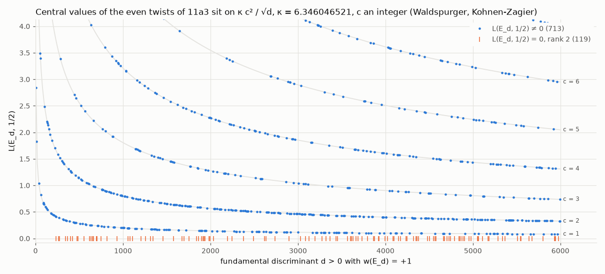

The central values are discrete. Waldspurger's theorem, in the explicit form of
Kohnen and Zagier, says L(E_d, 1/2) = κ·c(d)²/√d where c(d) is an integer (a
coefficient of a weight 3/2 modular form), and for this family DHKMS give
κ = 6.346046521. Every one of the 832 even twists lands on one of the curves
κc²/√d: the largest distance of √(√d·L/κ) from an integer is 1.6e-7, and c(d)
goes up to 16. So L(E_d, 1/2) is either 0 or at least κ/√d, never in between.

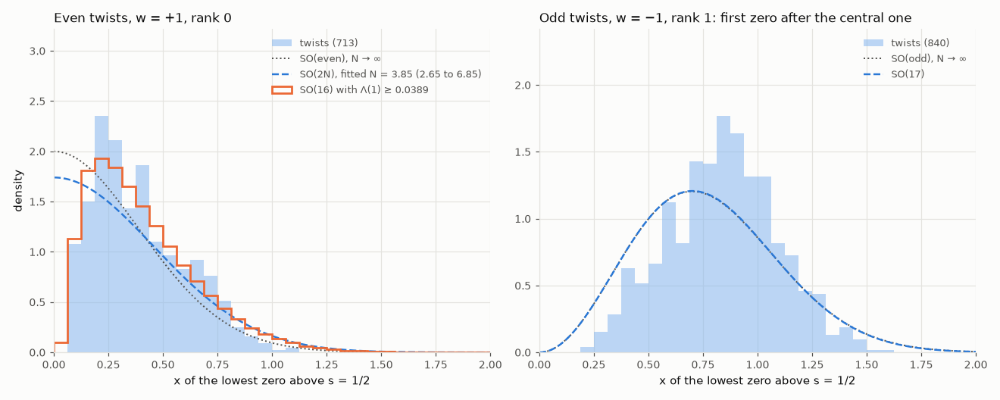

That gap is how DHKMS explain the repulsion S. J. Miller found in the lowest zero
of elliptic curve L-functions. In a random matrix model the value of the
characteristic polynomial at 1, Λ_A(1) = det(I − A), plays the part of L(1/2),
and a small central value goes with an eigenvalue close to 1. In SO(2N) nothing
stops det(I − A) from being tiny, and the lowest eigenvalue has density 2 at the
origin. The L-functions can't have tiny central values, so DHKMS drop the
matrices with Λ_A(1) < c·e^(−N/2). `rmt.so_angles` samples Haar SO(2N): QR of a
Gaussian matrix with the sign of diag(R) fixed, then one column flipped when the
determinant is −1. Its one-level density and lowest-eigenvalue law match the
Fredholm determinants above within sampling error. With N = 8, close to
log(√11·6000/2π) = 8.06, and the DHKMS constant c = 2.188, 80.7% of 300,000
matrices survive the cut (14.3% of the even twists vanish). Nothing is fitted to
my data.

| model for the 713 rank 0 even twists | χ² on 15 bins of (0, 1.5) | KS distance |
|---|---|---|
| SO(even), N → ∞ | 181.6 | |
| SO(16) | 164.6 | 0.181 |
| SO(2N), maximum likelihood N = 3.85 | 158.7 | |
| SO(16) with det(I − A) ≥ 0.0389 | 34.6 | 0.043 |

The KS distance of the excised model is under the 5% critical value of 0.051 for
713 points. Mean lowest zero: 0.394 for the twists, 0.408 excised, 0.342 for
plain SO(16). Shrinking N doesn't do it: the likelihood is flat (95% interval 2.65
to 6.85) and every SO(2N) still has density near 2 at the origin, which the data
don't.

### Odd twists and the central derivative

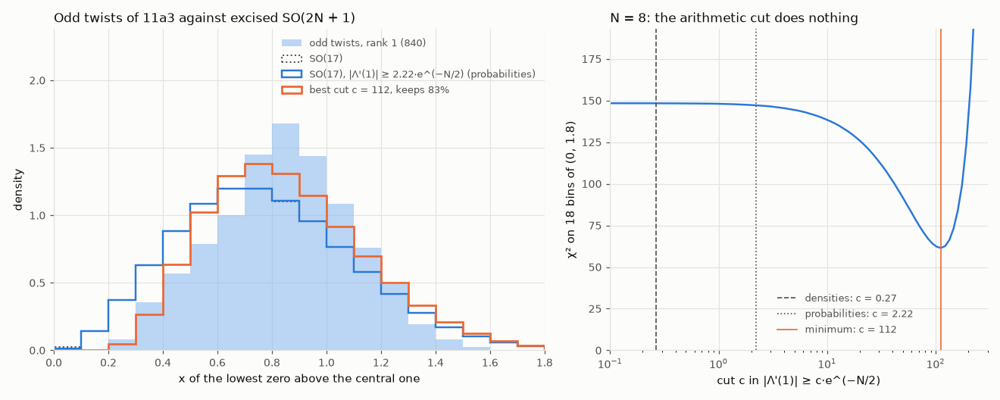

The odd twists have a forced zero at the center, and Katz-Sarnak say the next one
should follow the first nontrivial eigenvalue of SO(2N + 1), whose forced
eigenvalue at 1 plays the part of the central zero. The data disagree in the same
direction as on the even side: among the 840 rank 1 twists the lowest
non-central zero never falls below x = 0.216, while SO(17) puts 1.7% of its mass
below 0.2, and the histogram is narrower (standard deviation 0.251 against 0.325).

The even fix was a cut on Λ_A(1) at the level where L(E_d, 1/2) is discretized.
For SO(2N + 1) the characteristic polynomial vanishes at 1, so the natural
quantity is the derivative, and det(I − zA) = (1 − z)∏(1 − 2z cos θ_j + z²) gives
|Λ_A'(1)| = ∏(2 − 2 cos θ_j), the same product over the N free angles. On the
arithmetic side Gross and Zagier write L'(E_d, 1/2) as a constant times the height
of a Heegner point over √d, and heights of non-torsion points are bounded below,
so L'(E_d, 1/2) ≥ m/√d. That is the argument in Miller's paper on zero repulsion
([arXiv:1109.0224](https://arxiv.org/abs/1109.0224)). Here the smallest √d·L' is
m = 6.437, at d = 8.

To turn that floor into a matrix cut I followed DHKMS step by step. The CFKRS
recipe says the moments of the family are an arithmetic factor times the matrix
moments. `elliptic.arithmetic_factor` is the Euler product a_s(E) from their
section 5, which gives a_(−1/2) = 0.73269 for 11a with the primes below 2^14,
against their 0.732728078. `rmt.so_moment` gives E|Λ_A(1)|^s for SO(2N) and
E|Λ_A'(1)|^s for SO(2N + 1) in closed form from Selberg's integral (in
x = sin²(θ/2) the angles form a Jacobi ensemble with weight x^(∓1/2)(1 − x)^(−1/2)),
and `rmt.small_value_law` is the residue at the first pole:
P(Λ ≤ ρ) ≈ (R/α)ρ^α with α = 1/2 for SO(2N) and α = 3/2 for SO(2N + 1). That
exponent is why rank 3 is so rare among odd twists. The dictionary holds up on
this data, with N = log(√11·d/2π) rounded per twist:

| s | family mean | a_s(E) × matrix mean | ratio |
|---|---|---|---|
| even, L(E_d, 1/2), s = 1/2 | 0.9574 | 0.9845 | 0.972 |
| even, L(E_d, 1/2), s = 1 | 1.4812 | 1.4828 | 0.999 |
| odd, L'(E_d, 1/2), s = −1 | 0.1994 | 0.2375 | 0.840 |
| odd, L'(E_d, 1/2), s = −1/2 | 0.3992 | 0.3918 | 1.019 |
| odd, L'(E_d, 1/2), s = 1/2 | 3.0766 | 3.0108 | 1.022 |
| odd, L'(E_d, 1/2), s = 1 | 11.232 | 9.375 | 1.198 |

For d > 0 every odd twist has χ_d(11) = −1, and a_(−3/2)(E) = 0.2030 with that
sign. Matching densities near 0, as DHKMS do, scales the floor by a², and matching
probabilities scales it by a^(2/3). With their convention that e^(−N/2) stands for
d^(−1/2), the cut is |Λ_A'(1)| ≥ c·e^(−N/2) with c = 0.265 or c = 2.22.

Neither does anything. With N = 8 and 300,000 Haar matrices from SO(17)
(`rmt.so_angles(..., odd=True)`), c = 2.22 removes 0.13% of them. The arithmetic
floor sits deep in the tail where P(Λ' ≤ ρ) ~ ρ^(3/2) is tiny. On 18 bins of
(0, 1.8):

| model for the 840 rank 1 odd twists | kept | χ² | KS | mean |
|---|---|---|---|---|
| SO(17) | 100% | 148.4 | 0.157 | 0.781 |
| SO(17), c = 2.22 | 99.87% | 147.1 | 0.156 | 0.782 |
| SO(17), best c = 112 | 83.1% | 61.5 | 0.056 | 0.860 |
| data | | | | 0.840 |

A cut 50 times the arithmetic one removes 17% of the matrices and cuts χ² by more
than half, but the KS distance stays above the 5% critical value of 0.047, the
excised mean overshoots, and the histogram is still too wide. Smaller matrices
don't rescue it: the best cut gives χ² 74.6 for SO(5), 78.3 for SO(9) and 68.7 for
SO(13). So the odd twists repel their first zero much harder than the size of
L'(E_d, 1/2) explains, and part of the mismatch is in the bulk. DHKMS handle the
bulk on the even side with an effective N from the lower-order terms of the
one-level density (their r₁ = 2.86 for this curve). The odd family needs the same
computation before an excised model can be judged fairly.

### Rank 2 twists and the forced pair

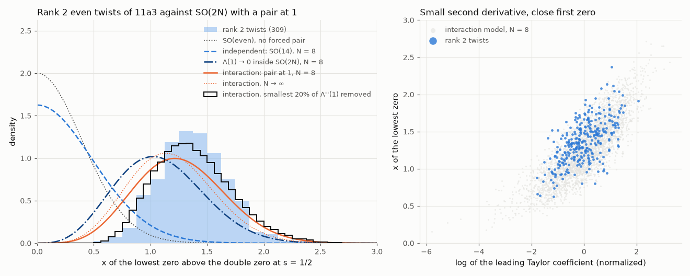

S. J. Miller ([arXiv:math/0508150](https://arxiv.org/abs/math/0508150)) found that
the first zero above the center is pushed further out in rank 2 curves than in
rank 0 ones, and noted that nobody knew which matrix model should describe them.
`ranktwo.family` collects every even twist of 11a3 with 5 ≤ d ≤ 20,000 whose central
value vanishes: 309 curves, from d = 232 to 19,761, found in 45 minutes on 16
processes. For each one it keeps the unfolded low zeros and the leading Taylor
coefficient L''(E_d, 1/2)/2.

That coefficient comes from the series
L''(1/2) = 4 Σ a_n/n · g₂(n/A), where g₂ is the second derivative kernel of the
smoothed functional equation. `elliptic.g2` sums a series in x and log x below 2
and uses 60-point Gauss-Laguerre above. It matches mpmath quadrature to 1e-13,
gives 0.759316500288427 for 389a1 (the value LMFDB lists for its rank 2 leading
coefficient) to 1e-14, and agrees with a Richardson-extrapolated −2Z(t)/t² for the
twist d = 232 to 1e-5.

There are three ways to put a double eigenvalue at 1 in SO(2N), and they give
different laws for the next one. With x = cos θ, the N − 1 free angles have a Jacobi
weight (1 − x)^α (1 + x)^(−1/2):

- independent (α = −1/2): drop the pair and take SO(2N − 2) as it is;
- interaction (α = 3/2): fix θ_N = 0 and keep its repulsion ∏(1 − cos θ_j)² on the
  others;
- conditioned (α = 1): ask for det(I − A) < ε and let ε go to 0. The pair only
  needs θ_N ≲ √(ε/∏(2 − 2cos θ_j)), which gives back a factor ∏(2 − 2cos θ_j)^(−1/2).
  This is the Borel paradox: the limit depends on how you approach it.

`rmt.jacobi_n` builds the finite-N kernel for any α and β from the three-term
recurrence of the orthonormal Jacobi polynomials, so the gap probabilities are
Fredholm determinants as before. With (α, β) = (∓1/2, −1/2) and (1/2, 1/2) it
reproduces the SO(even), SO(odd) and USp kernels to 1e-13. For N = 2 and 3 it
matches closed forms and the Weyl integral, the density of the first point
vanishes like x^(2α+1), and as N grows the kernel goes to the hard-edge Bessel
kernel J_(α+1/2) with an error that falls like 1/N (ten times smaller
from N = 40 to 400). Monte Carlo
draws Haar SO(2N − 1) and resamples by ∏(2 − 2cos θ_j)^(α − 1/2); those first
eigenvalues pass a KS test against the Fredholm side for all three models.

With N = 8 (the mean log A of the family is 8.15) and 12 bins of (0, 2.4):

| model for the 309 rank 2 twists | χ² | KS | mean lowest zero |
|---|---|---|---|
| independent, SO(14) | 16,905 | 0.894 | 0.395 |
| conditioned, α = 1 | 195.5 | 0.359 | 1.091 |
| interaction, α = 3/2 | 62.6 | 0.182 | 1.268 |
| interaction, smallest 20% of Λ''(1)/2 removed | | 0.054 | 1.377 |
| data | | | 1.370 |

The independent model is not close: the twists never put a zero below x = 0.62,
while SO(14) puts 79% of its first eigenvalues there. The pair's repulsion is the
right mechanism, and the interaction model gets most of the way, but its KS
distance is more than twice the 5% critical value of 0.077. The maximum
likelihood N for it is 4, half the conductor's value, which is the same pattern as
the rank 0 twists.

The right panel shows why an excision is the natural next step. In the
interaction model Λ''(1)/2 = ∏(2 − 2cos θ_j) over the free angles, and a small
value goes with a close first eigenvalue (rank correlation 0.82). The twists show
the same thing with log L''(1/2)/2 (rank correlation 0.59). Their leading
coefficients stay above 5.10 (d = 697), and there is no Waldspurger formula here
to say why. Birch and Swinnerton-Dyer would tie them to the regulator of a rank 2
lattice of rational points, which cannot be small. Cutting the matrices with the
smallest 20% of Λ''(1)/2 brings the KS distance under the critical value and the
mean within 0.007. The cut is fitted (scanning 0 to 95% in steps of 5%), and the
fit is not perfect: the excised law still has a standard deviation of 0.342
against 0.291 in the data, the same excess width the odd twists showed.

Miller also conjectured that the extra repulsion fades as the conductor grows.
Splitting the family at the median |d|, the mean lowest zero goes from 1.395 ± 0.023
(d ≤ 8,380, mean log A 7.42) to 1.345 ± 0.024 (d ≥ 8,449, mean log A 8.87). The
interaction model at the matching N drops by only 0.021 over the same range. The
data move in his direction, by about 1.5 standard errors.

### The ratios conjecture for twists, and an effective N

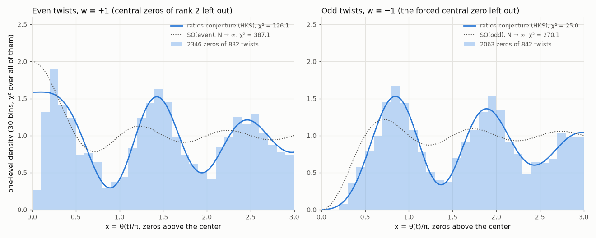

Huynh, Keating and Snaith ([arXiv:0811.2304](https://arxiv.org/abs/0811.2304))
ran the ratios recipe on the even quadratic twists of an elliptic curve with prime
conductor M. I redid it for both parities, because the root number only changes
one sign. Replace L(1/2 + α, d) by both halves of its approximate functional
equation, 1/L(1/2 + γ, d) by its Dirichlet series, and average χ_d over the family.
With x = p^(−1/2−α), y = p^(−1/2−γ) and λ(p) = a_p/√p, the Euler factor for p ∤ M
is

```
G_p(α, γ) = 1 + p/(p + 1) · ( [F(x)H(y) + F(−x)H(−y)]/2 − 1 )
F(x) = 1/(1 − λx + x²),   H(y) = 1 − λy + y²
```

(the even part, since χ_d(p^(m+h)) averages to p/(p + 1) when m + h is even and to
0 otherwise), and at p = M it is (1 − ηλy)/(1 − ηλx) with η = χ_d(M), which is
fixed across the family. The conjecture is R(α, γ) ≈ G(α, γ) + w·X(1/2 + α)·G(−α, γ),
and the log derivative at α = γ = it gives the density per unit x = θ_d(t)/π as

```
ρ_d(x) = 1 + Re B(t) / θ_d'(t)
B(t) = −ζ'/ζ(1 + 2it) + L'/L(sym² E, 1 + 2it) + A₁(it)
       − w·e^(−2iθ_d(t)) ζ(1 + 2it) L(sym² E, 1 − 2it)/L(sym² E, 1) A(−it, it)
```

with w the root number of the twist. A₁ and A are what is left of the Euler
product after ζ and the symmetric square take out the parts that only converge
conditionally on Re s = 1. Both converge like Σ 1/p². For the odd family the
two terms of B carry poles 1/(2it) with the same sign, so B has a pole with
residue 1: the forced central zero falls out of the recipe on its own, as a purely
imaginary term that drops out of Re B. For the even family the poles cancel.

All of that needs L(sym² E, s) on the 1-line, where its Euler product does not
converge. `symsquare.py` builds it from scratch: coefficients from the local
factors 1/(1 − (λ² − 1)X + (λ² − 1)X² − X³) and 1/(1 − X/M) at the bad prime,
conductor M², gamma factor Γ_R(s + 1)Γ_C(s + 1), and a smoothed approximate
functional equation

```
L(s) = Σ a_n n^(−s) V₁(n) + q^(1/2−s) Σ a_n n^(s−1) V₂(n)
V₁(n) = (1/2πi) ∫ (n/√q)^(−u) G(u) γ(s + u)/γ(s) du/u,   G(u) = e^(u²/b − iβu)
```

with V₂ the same using G(−u) and γ(1 − s + u). Nothing requires G to be even. The
rotation β cancels the e^(3π|v|/4) that the degree 3 gamma ratio would otherwise
pick up along the contour, and shrinks to 0 near the real axis, where the full
rotation would kill the decay of V in n. The integrals are trapezoid sums on
Re u = max(Re s, 1 − Re s) + 1/2, and L'(s) comes from the same sums with one more
factor. Checks:

- Changing the weight (b = 14, 30, 60) moves L by 1e-15 at the real axis and at
  most 1e-11 at height 40. A wrong gamma factor or conductor breaks that by 6e-3
  to 0.4, so this pins the functional equation.
- The Euler product at s = 2 agrees to 2e-9 (truncation at 2^16).
- Rankin-Selberg: Σ λ(n)² e^(−n/X) with X = 500 is 295.38109. The main term
  X·L(sym², 1)·(6/π²)·(11/12) + L(sym², 0)/2 gives 294.97700, and the 0.40371 left
  over comes from poles I did not expect at first: the factor 1/(1 + 11^(−w)) from
  the bad prime has poles at w = iπ(2k + 1)/log 11 on Re w = 0. With those residues
  the two sides agree to 1.3e-6, the size of the terms from the zeros of ζ(2w).
- L'(s) against a 32-point Cauchy integral to 1e-11.

L(sym² 11a, 1) = 1.0575992446 and L'/L(sym², 1) = 0.19741.

As the conductor grows at fixed x,

```
ρ_d(x) = 1 ± sin(2πx)/(2πx) − r₁(1 ± cos 2πx) / (log A_d − γ) + O(1/log² A_d)
r₁ = γ − L'/L(sym² E, 1) − A₁(0)
```

with + for the even twists and − for the odd ones, using A₁(0) = −½ d/dr A(−r, r) at
0. The tests check that identity between the two Euler products to 1e-7, and the
expansion at log A = 60 and 400, where the remainder stays under 76/log² A. For
11a, r₁ = 1.28360 when χ_d(11) = +1 (the even twists with d > 0) and 0.84398 when
χ_d(11) = −1 (the odd ones). DHKMS scale every zero by the top of the family,
L = log(√11·X/2π), instead of by each twist's own log A_d − γ. That adds γ plus the
average of log(X/d), which is 1, so their constant is 1.28360 + 1.57722 = 2.8608,
against their printed 2.8600. Their N_eff = 2.14 at X = 400,000 follows.

The zeros are the 1,674 twists from before, recomputed up to x = 3.5 (330 s on 14
processes); the predictions average ρ_d over the actual discriminants (47 s and
29 s). On 30 bins of [0, 3]:

| family | zeros | χ² ratios | χ² N → ∞ limit | χ² ratios, x ≥ 0.2 | χ² limit, x ≥ 0.2 |
|---|---|---|---|---|---|
| even, 832 twists | 2346 | 126.1 | 387.1 | 30.8 | 250.2 |
| odd, 842 twists | 2063 | 25.0 | 270.1 | 22.2 | 256.8 |

The odd family is fit everywhere, including the wide empty zone near the center
and the peaks near x = 0.85 and 1.9. On the even side the ratios density gets the
oscillations right but predicts 1.59 at the origin where the data have 0.26 in the
first bin. That is the gap HKS and DHKMS describe: the discreteness of
L(E_d, 1/2) is invisible to the ratios conjecture, and it is what the excised
ensemble is for.

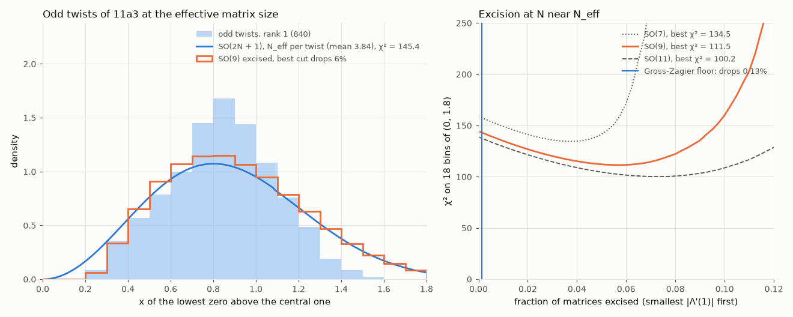

For the matrices, SO(2N + 1) has to be unfolded by N + 1/2, not N. Its
characteristic polynomial has 2N + 1 zeros on the circle, the one at 1 included,
and θ_d(t)/π counts the central zero of L(E_d, s) the same way. Scaling by N would
also leave the one-level density 1 − sin(2πN y/N)/(2N sin(πy/N)) with no 1/N term at
all, so there would be nothing to match. With y = (N + 1/2)θ/π,

```
SO(2N + 1):  1 − sin(2πy)/(2πy) − (1 − cos 2πy)/(2N) + O(1/N²)
```

and matching the 1/log term gives N_eff = (log A_d − γ)/(2r₁), the same formula as
DHKMS's SO(2N) case. `rmt.odd_orthogonal_half` is that kernel, checked against
Haar SO(7) and against ∫ρ = N. For the 840 rank 1 odd twists N_eff runs from 2.65
to 4.40 (5% to 95%, median 4.02, mean 3.84; the twists d = 8, 13 and 17 fall under
1 and are clipped). Fitting N to the whole ratios density instead of only its 1/log
term gives 4.00, so the two agree.

Then the first zero, on 18 bins of (0, 1.8) (5% KS critical value 0.047):

| model for the 840 rank 1 odd twists | χ² | KS | mean |
|---|---|---|---|
| SO(2N_eff + 1), N_eff per twist, Fredholm | 145.4 | 0.121 | 0.881 |
| SO(9), N + 1/2 | 144.5 | 0.113 | 0.875 |
| SO(9), best cut, drops 6% | 111.5 | 0.129 | 0.911 |
| SO(11), best cut | 100.2 | | |
| data | | | 0.840 |

Matching probabilities, the Gross-Zagier floor removes the same 0.13% of the
matrices at any N, so the arithmetic cut still does nothing. The fitted cuts help a
little and push the mean further off. The effective size does what it should for
the mean on the even side (SO(2N_eff) gives 0.3949 against 0.3941 for the 713 rank 0
even twists), but for the odd twists the first zero is much narrower than any
SO(2N + 1) law: the data put 3.0% of their mass above 1.3, the models 11.6 to 13.4%.
The one-level density is a sum over all zeros; the first zero depends on all the
correlation functions, and here the arithmetic that the ratios conjecture puts into
ρ(x) does not reach them through a single N.

### Chebyshev's bias

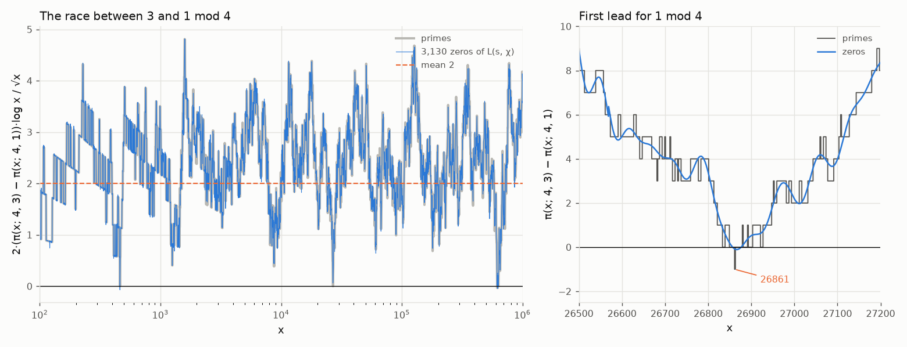

Chebyshev noticed in 1853 that primes ≡ 3 (mod 4) seem to outnumber primes ≡ 1.
Counting confirms it: π(x; 4, 3) ≥ π(x; 4, 1) for every x below 26861, and up to
10⁸ the 1 class leads at only 1,940 primes. Rubinstein and Sarnak explained why,
assuming GRH and the linear independence of the zero ordinates (LI). With
E(x) = φ(q)·(π(x; q, a) − π(x; q, b))·log x / √x, the explicit formula for each
L(s, χ) gives

E(x) = c(q, b) − c(q, a) − Σ_χ (χ̄(a) − χ̄(b)) Σ_γ x^(iγ) / (1/2 + iγ) + o(1),

where c(q, a) + 1 is the number of square roots of a mod q. The constant is the
whole bias: prime squares are all quadratic residues, so the residue class pays
for them and starts behind by c(q, b) − c(q, a). As log x runs, LI makes the
phases γ log x equidistribute on a torus, so E(x) behaves like
X = C + Σ r_γ cos θ_γ with independent uniform θ_γ and r_γ = 2|χ(a) − χ(b)|/|ρ|.
Its characteristic function is e^(iCt) ∏ J₀(r_γ t), and the share of log x where
a leads is

δ(q; a, b) = P(X > 0) = 1/2 + (1/π) ∫₀^∞ sin(Ct)/t · ∏ J₀(r_γ t) dt.

```python
from zeta_explorer.bias import race, prime_race

R = race(4, 3, 1)                      # zeros of L(s, χ₋₄) up to T = 1000
len(R.gamma), R.bias, R.variance       # 868, 2.0, 0.6223
R.density()                            # 0.9959279226422321
p, d = prime_race(4, 3, 1, 30_000)
p[d < 0]                               # [26861]
```

`race` collects the zeros below T of every character with χ(a) ≠ χ(b), one per
conjugate pair (a complex χ contributes its zeros on both sides of the real axis,
which are the positive zeros of χ and χ̄). Zeros above T are not dropped: their
total weight Σ 1/(1/4 + γ²) has a closed form, log(q/π) + ψ((1 + κ)/2) +
2 Re L'/L(1, χ), so the tail variance is exact and enters as a Gaussian factor in
the product. L'(1, χ) comes from a 48-point Cauchy integral around s = 1, and J₀
from the midpoint rule on (1/π)∫ cos(z sin θ) dθ, which matches mpmath to 1e-14
with about z/2 + 15 nodes. The integral is a trapezoid sum; the integrand is
analytic and even, so the only error is aliasing, the mass of X beyond 2π/h, and h
is chosen so that is 40 standard deviations away.

| race | zeros (T = 1000) | δ here | Fiorilli-Martin | Var X | log share, 10³ to 10⁸ |
|---|---:|---:|---:|---:|---:|
| 3 vs 2 mod 3 (2 ahead) | 823 | 0.9990632 | 0.999063 | 0.4529 | 1.00000 |
| 3 vs 1 mod 4 | 868 | 0.9959279 | 0.995928 | 0.6223 | 0.99894 |
| 2 vs 1 mod 5 | 2,712 | 0.9521746 | 0.952175 | 1.4391 | 0.97730 |
| 3 vs 1 mod 8 | 1,847 | 0.9995688 | 0.999569 | 1.5640 | 1.00000 |
| 5 vs 1 mod 8 | 1,956 | 0.9973946 | 0.997395 | 2.2060 | 1.00000 |
| 7 vs 1 mod 8 | 1,845 | 0.9989378 | 0.998939 | 1.8866 | 1.00000 |
| 5 vs 1 mod 12 | 1,864 | 0.9992059 | 0.999206 | 1.7736 | 1.00000 |
| 7 vs 1 mod 12 | 1,909 | 0.9986061 | 0.998606 | 1.9429 | 1.00000 |
| 11 vs 1 mod 12 | 1,691 | 0.9999766 | 0.999977 | 1.0752 | 1.00000 |
| 5 vs 1 mod 24 | 3,820 | 0.9999875 | 0.999988 | 3.9796 | 1.00000 |
| 11 vs 1 mod 24 | 3,823 | 0.9999826 | 0.999983 | 4.2257 | 1.00000 |
| 23 vs 1 mod 24 | 3,820 | 0.9998886 | 0.999889 | 5.5277 | 1.00000 |

All twelve agree with Table 8 of Fiorilli and Martin (2013) to the six digits they
print, and the tests check eight of them with T = 200, which already lands within
5e-7 of the printed values. Feuerverger and Martin (2000) give 0.952140 for the mod 5 race and say their
complex-character computation interpolated between grid points; the value here
matches the later 0.952175. Their table of Σ_{γ>0} 1/(1/4 + γ²) for χ₋₃, χ₋₄,
χ₋₈ and χ₁₂ is matched to all six digits. As an independent check on the Fourier
inversion, 400,000 draws of X with random phases land within 4σ of the computed
density, and the density integrates to 1 with mean C. The last column is what
the primes actually do up to 10⁸, which is far from the limit for the mod 5 race
(1 leads after 300,619 of the primes below 10⁸), while the races mod 3, 8, 12 and
24 show no reversal at all in that range.

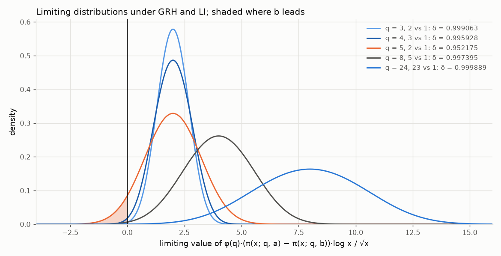

`Race.explicit(x)` rebuilds E(x) itself from the zeros, with Riemann's Li(x^ρ)
for each zero. The plain sum is off by about one prime at small x because the
explicit formula for Π(x, χ) has a constant, log L(0, χ) for odd χ and
log L'(0, χ) − γ − log log x for even χ (L(0, χ) = 0 there), and π needs the
Möbius sum over Π(x^(1/k), χ^k). Those k ≥ 2 terms only involve primes up to √x,
so they are counted directly. Two details matter for complex characters: the
branch of log L(0, χ) comes from following L(σ, χ) along the real axis from
σ = 4, and Li(x^ρ) has to be the integral from −∞, which is Ei(ρ log x) minus
iπ·sign(γ). With Ei alone the error flips sign as T crosses each zero, because
zeros above and below the axis no longer pair up. After both fixes the mean error
over 200 ≤ x ≤ 10⁵ is at most 0.013 in E for the mod 4, 5, 8, 12 and 24 races. With
the 3,130 zeros below T = 3000 the rebuilt curve goes negative for x between
about 26857 and 26876, around the actual first lead change at 26861 (the right panel
of the first chart).

### Ramanujan's Δ and the Sato-Tate law

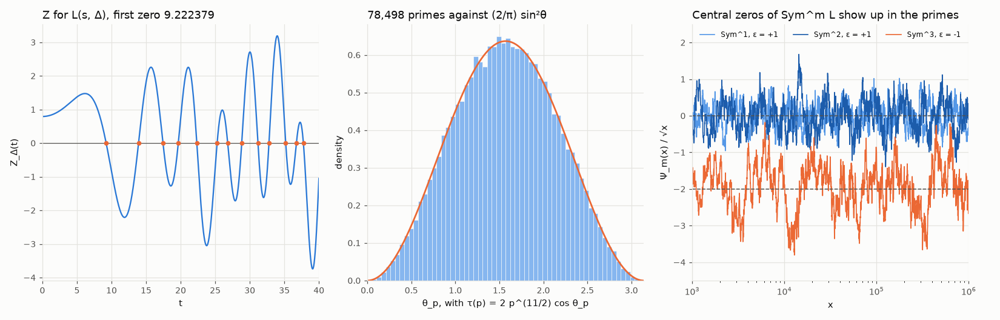

Δ(q) = q ∏(1 − qⁿ)²⁴ = Σ τ(n) qⁿ is the weight 12 cusp form of level 1, and its
L-function L(s, Δ) = Σ τ(n) n^(−11/2) n^(−s) is the simplest degree 2 L-function
that has nothing to do with elliptic curves. `delta.py` computes it from scratch.

The coefficients are exact. Jacobi's identity η³ = Σ (−1)^k (2k + 1) q^(k(k+1)/2)
has only √(2N) nonzero terms below q^N, so Δ/q = (η³)⁸ is one sparse square and six
sparse products, each a few hundred shifted array additions. That runs modulo four
primes just below 2³¹ (enough because |τ(n)| ≤ d(n) n^(11/2) < 2n⁶) and Garner's
algorithm turns the residues back into integers. τ(n) for n ≤ 2²⁰ takes under a
minute. The tests compare against FLINT's own power series for ∏(1 − qⁿ)²⁴, check
Ramanujan's congruence τ(n) ≡ σ₁₁(n) (mod 691) up to 3,000, the Hecke relations
τ(mn) = τ(m)τ(n) and τ(p²) = τ(p)² − p¹¹, and Deligne's bound τ(p)² < 4p¹¹ in
exact integers for p < 2¹⁵. None of the first million τ(n) is zero (Lehmer's
question).

L(s, Δ) uses the same smoothed functional equation as the elliptic curves, with
Λ(s) = (2π)^(−s) Γ(s + 11/2) L(s) = Λ(1 − s) and the split point rotated toward the
imaginary axis at large t so the Γ(6 + it) decay doesn't eat the precision. Z(t)
matches a 110 digit mpmath evaluation to 3e−14 at t = 100, the first ten zeros
match LMFDB to 13 digits (9.2223793999211, 13.9075498613921, ...), and
L(1/2, Δ) = 0.79212283864603 against LMFDB's 0.7921228386. The sharpest check is
Manin's period theorem: the critical values C(10, n)·Λ(n − 9/2) for even n come out
proportional to 36/691 : 1 : 3 : 3 : 1 : 36/691 and for odd n to 4 : 25 : 42 : 25 : 4,
the coefficients of Δ's period polynomial, to 12 digits.

Deligne's bound lets us write τ(p) = 2p^(11/2) cos θ_p. Sato-Tate (proved for Δ by
Barnet-Lamb, Geraghty, Harris and Taylor) says θ_p is distributed like
(2/π) sin²θ. For the 78,498 primes below 10⁶ the even moments of 2 cos θ_p are
0.9987, 1.9939, 4.9772, 13.9204 and 41.725, against the Catalan numbers 1, 2, 5,
14, 42, and the Kolmogorov distance to the Sato-Tate law is 0.0023
(√n·D = 0.65, an unremarkable value for a true null).

The right panel is the part I found most interesting. Sato-Tate is a statement
about the symmetric power L-functions: Σ_p U_m(cos θ_p) log p is the prime part
of the Chebyshev function of L(s, Sym^m Δ), and its explicit formula has a term
−2r√x for a zero of order r at the center. Level 1 means the root number is the
archimedean one, i^(Σ (w_j + 1)) over the gamma factors Γ_C(s + w_j/2) with
w_j = (m − 2j)·11 (plus i^δ from a Γ_R factor when m is even), and that is −1 for
m = 3 and m = 5. So L(s, Sym³ Δ) must vanish at the center. Summing over prime
powers as well, Ψ_m(x)/√x between 10³ and 10⁶ averages −0.005, −0.013, −1.957,
−0.068 and −1.841 for m = 1 to 5, against the predicted 0, 0, −2, 0, −2. The sum
over primes alone is biased by the prime squares, with the sign of the
Frobenius-Schur indicator: it averages +1.02 for m = 1 and −1.30 for m = 2.

```python
from zeta_explorer import delta

delta.tau(6)                    # [0 1 -24 252 -1472 4830 -6048]
delta.zeros(15.0)               # [ 9.2223794  13.90754986]
st = delta.sato_tate(10**6)     # 78,498 primes
st.moment(4)                    # 1.9939
delta.root_number(3)            # -1
```

### Symmetric powers, Turing's method, and a whole line from one transform

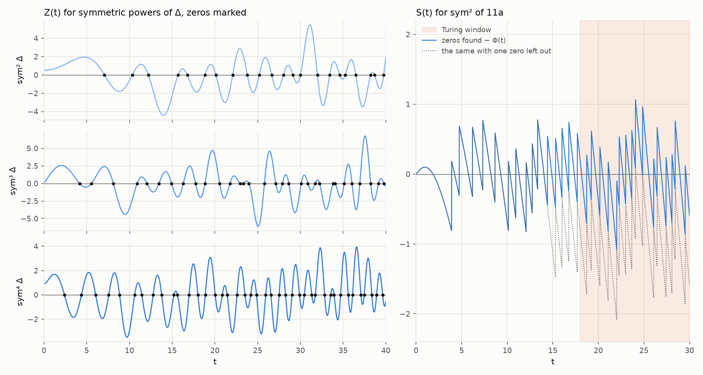

`selfdual.py` is the smoothed functional equation from the symmetric square section
with the curve taken out: any L-function with real coefficients, conductor q, gamma
factor ∏ Γ_R(s + μ_j) and sign ε. `sympower.py` feeds it the symmetric powers of Δ.
At a prime with τ(p) = 2p^(11/2) cos θ_p the local factor of sym^m is
∏ (1 − e^(i(m − 2j)θ_p) p^(−s))^(−1) over j = 0..m, and the gamma shifts come from
pairing the Hodge types: (1, 11, 12) for sym², (5.5, 6.5, 16.5, 17.5) for sym³,
(0, 11, 12, 22, 23) for sym⁴. Level 1 means q = 1, and the sign is +1, −1, +1.
Automorphy is known up to m = 4 (Gelbart-Jacquet, Kim-Shahidi, Kim), so those are
the ones the module offers.

The check that the data is right is that the functional equation holds: two
different smoothing weights agree to 1e−11 for every m, and flipping ε or moving one
shift by 1 breaks that at the 1e−4 level. Then the zeros against Yoshida's 1994
tables (arXiv:math/9411213), who summed the Dirichlet series with an experimental
acceleration: his ten zeros of sym³ below 19 (4.1558656464, 5.5491219562, ...) agree
to his ten digits, his fourteen of sym⁴ (2.3864500, 4.3752457, ..., 18.874) to the
three to seven digits he gives. L(sym³ Δ, 1/2) = 0 to machine precision, as the sign
forces.

For sym² there are exact values. Rankin's method gives
L(sym² Δ, 1) = 2²³ π¹³ (Δ, Δ)/11!, and Zagier showed
L(sym² Δ, s)/(π^(2s + 11) (Δ, Δ)) is rational at s = 1, 3, ..., 11. The Petersson
norm is computed here from the q-expansion over the fundamental domain
(1.03536205680432e−6, 30 digits against the published value). The values at 1 and 3
agree to 12 digits through the functional equation, and those at 5 to 11 are
recognized blind by continued fractions from 30 digit Euler products. The rationals
run from 2¹⁵/(3⁴·5²·7·11) at s = 1 to 2²⁴/(3⁹·5⁴·7²·11·13·17·19·23·691) at s = 11,
with Ramanujan's 691 in the last denominator.

A sign-change scan can miss a close pair of zeros, and nothing in the scan says so.
Turing's method does. With N(t) = Φ(t) + S(t), where Φ comes from the gamma factor
and the conductor, the integral of S over a window [t₁, t₂] is bounded (Booker 2006,
arXiv:math/0507502, for a general L-function). A list that misses k zeros below t₁
overestimates that integral by k(t₂ − t₁), so a window longer than the bound rules
out k ≥ 1. On [30, 40] the bound allows at most 0.53, 0.79 and 0.97 missing zeros for
sym², sym³ and sym⁴ of Δ, so the 13, 19 and 27 zeros below 30 are all of them, and
deleting any one of those pushes the figure past 1. For sym² of 11a (conductor 121) the
window [18, 30] gives 0.56 with 15 zeros below 18. The right panel shows why it
works: S(t) hovers around 0 for the full list and sits a whole unit low once a zero
is left out. This runs in floating point, so it is a check and not a proof.

The pointwise code is slow: one value of sym⁴ Δ near t = 40 is a 579 node contour
integral over about 2,100 coefficients, and the 41 zeros below 40 take 30 seconds. `mellin.py`
gets the whole line at once. Λ(1/2 + it) is the Fourier transform of
g(u) = e^(u/2) Σ a_n K(n e^u/√q), where K is the inverse Mellin transform of the
gamma factor, and g itself is one FFT of the Dirichlet polynomial times the gamma
factor along Re s = 1. Sample g once and every Z(t) is a dot product. The catch is
that Λ decays like e^(−πdt/4), so in double precision the values drown. Booker's
fix is to move the u contour to u + iθ, which multiplies the transform by e^(θt).
Here θ is chosen per window as the slope of log|γ(1/2 + it)| at the window's peak,
so that e^(θt)|γ| stays within e⁸ of its maximum across the window; two windows
cover [0, 40] for sym⁴. The functional equation g(−u) = ε g(u) supplies the negative
half, so the truncated Dirichlet sum only has to be right for u ≥ 0.

| L-function | T | zeros | pointwise | one transform | terms |
| --- | --- | --- | --- | --- | --- |
| sym² Δ | 40 | 22 | 4.5 s | 0.04 s | 81 |
| sym³ Δ | 40 | 31 | 11.4 s | 0.07 s | 621 |
| sym⁴ Δ | 40 | 41 | 32.1 s | 0.14 s | 2,239 |
| sym² 11a | 30 | 31 | 26.0 s | 0.09 s | 1,228 |
| sym² Δ | 200 | 240 | | 0.33 s | 804 |
| sym² 11a | 150 | 271 | | 2.5 s | 13,302 |

The two methods agree on every zero in the first four rows to 8e−12 or better, and
each list in the table passes the Turing check on its last 12 units.

```python
from zeta_explorer.mellin import MellinLine
from zeta_explorer.selfdual import turing
from zeta_explorer.sympower import critical_ratio, delta_power

L = delta_power(3)
L(0.5)                               # 0j
z = MellinLine(L, 100.0).zeros()     # 122 zeros, 4.15586565, 5.54912196, ...
turing(L, z, 88.0, 100.0).missing    # 0.627
critical_ratio(1)                    # 0.210152316818984 = 2^15/(3^4 5^2 7 11)
```

### Dedekind zeta of quadratic fields

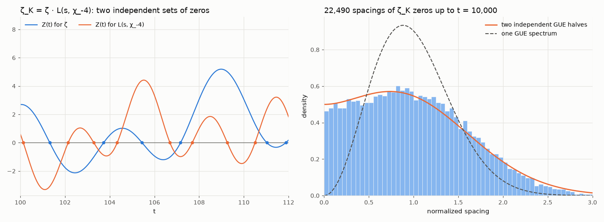

For a quadratic field K of discriminant D, ζ_K(s) = ζ(s) L(s, χ_D), and the
coefficient of n^(−s) counts ideals of norm n: a_n = Σ_{d | n} χ_D(d). For D < 0
`form_counts` counts representations by each reduced form of discriminant D by
brute force, and their total is w·a_n (Dirichlet's formula; for Q(i) it is
Jacobi's r₂(n) = 4 Σ χ₋₄(d)). ζ_K(0) = −h/w for imaginary fields and
ζ_K′(0) = −h·log ε/2 for real ones, both to 1e−8 or better.

Real class numbers come from Gauss's reduction of indefinite forms. A form
(a, b, c) with b² − 4ac = D is reduced when 0 < b < √D and
√D − b < 2|a| < √D + b, all checked in integers. The reduction operator ρ
permutes the finitely many reduced forms in cycles, one cycle per narrow class,
and h = h⁺ when the fundamental unit has norm −1, h⁺/2 otherwise. For every
fundamental D < 3000 this agrees with √D·L(1, χ_D)/(2 log ε) to 1e−8, including
Q(√229), Q(√401), Q(√577) with h = 3, 5, 7 and Q(√1957) with h = 3, h⁺ = 6.
ζ_K(−1) is a rational number. Siegel's formula
ζ_K(−1) = (1/60) Σ_{b² < D, b ≡ D (2)} σ₁((D − b²)/4) and the generalized
Bernoulli number B₂,χ/24 agree exactly as fractions for every D < 1500, and the
complex-analytic ζ_K(−1) matches both to 1e−12 (1/30 for Q(√5), 1/12 for Q(√2)).

The zeros of ζ_K are the zeros of ζ together with those of L(s, χ_D), and the two
sets know nothing about each other. Rudnick and Sarnak proved, for test functions
of restricted support, that the zeros of a product of distinct primitive
L-functions correlate like independent GUE spectra laid on top of each other. If each half is a GUE
spectrum at half the density, the gap probability of the union is E(s/2)², with E
the sine-kernel Fredholm determinant, so the spacing density is
(E′(s/2)² + E(s/2)E″(s/2))/2. It starts at 1/2 instead of 0: there is no
repulsion between a zero of ζ and a zero of L. For Q(i) up to t = 10,000 (10,142
zeros of ζ and 12,349 of L(s, χ₋₄)), the 22,490 spacings have Kolmogorov distance
0.018 to that law and 0.139 to a single GUE. The 0.018 is the usual finite height
effect: each family alone sits 0.029 and 0.035 from GUE at these heights. Among
the first 2,000 zeros of each, the closest ζ zero and L zero are 0.00052 apart.

Counting the L zeros caught a real bug. With 8 grid points per mean spacing the
zero finder missed 4 close pairs between t = 3000 and 9000, visible as N(T) − θ(T)/π
drifting to −3.6. With 16 and 32 points the counts agree and match the smooth
count to within 0.5, so `dedekind.zeros` uses 32.

```python
from zeta_explorer import dedekind

dedekind.real_class_number(229)        # 3
dedekind.zeta_minus_one_siegel(5)      # Fraction(1, 30)
dedekind.form_counts(-4, 10)[1:]       # [4 4 0 4 8 0 0 4 4 8]
```

### Davenport-Heilbronn: when the functional equation isn't enough

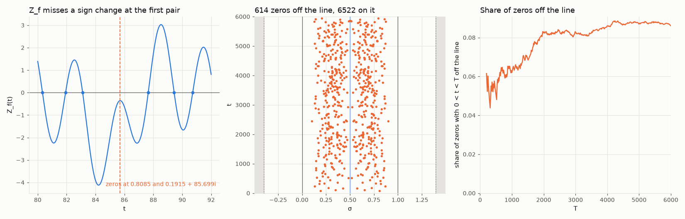

Take the two characters mod 5 with χ(2) = ±i and mix them:

```
f(s) = (1 − iκ)/2 · L(s, χ) + (1 + iκ)/2 · L(s, χ̄),   κ = (√(10 − 2√5) − 2)/(√5 − 1) ≈ 0.284079
```

The Dirichlet coefficients are real and periodic, 1, κ, −κ, −1, 0, and κ is the
one value that makes (1 + iκ)/(1 − iκ) equal the root number of χ. Then
Λ(s) = (5/π)^((s+1)/2) Γ((s+1)/2) f(s) satisfies Λ(s) = Λ(1 − s), the same shape as
Riemann's. What f lacks is an Euler product, and RH fails for it.

`davenport.py` builds f out of the existing L(s, χ) code, so it works anywhere in
the plane and switches to the approximate functional equation at large height.
The tests compare it with Arb's Hurwitz zeta to 1e−11 (including σ < 0) and check
Λ(s) = Λ(1 − s) with mpmath's Γ.

Where can the zeros be? For σ > 1, |f(s)| ≥ 1 − Σ_{n≥2} |a_n| n^(−σ), and that
stays positive for σ > σ₀ = 1.395136 (`zero_free_sigma`, a root of a Hurwitz zeta
equation). By the functional equation the only zeros with σ < 1 − σ₀ are the
trivial ones at −1, −3, −5, .... So the nontrivial zeros live in a strip of width
1.79 instead of 1. Since f(s̄) is the conjugate of f(s), a zero ρ off the line
always comes with its mirror 1 − ρ̄.

`zeros_in_window(t₁, t₂)` counts every zero in the box
[1 − σ₀ − 0.25, σ₀ + 0.25] × [t₁, t₂] with the argument principle. It finds the
zeros on the line as sign changes of Z_f(t) = e^(iθ(t)) f(1/2 + it), seeds complex
Newton from the local minima of |f| on a grid right of the line, and mirrors
each hit. It only returns when the zeros it found add up to the box count; on a
mismatch it refines the Z_f grid first (the usual cause is a close pair of zeros on
the line) and then the |f| grid.

```python
from zeta_explorer.davenport import zeros_in_window

w = zeros_in_window(80, 90)
w.total, len(w.line)   # (7, 5)
w.off                  # [0.19148282+85.69934849j, 0.80851718+85.69934849j]
```

In windows of 10 from t = 1 to 6001 there are 7,136 zeros: 6,522 on the line and
614 off it. The first four pairs match the six digits Spira printed in 1994
(heights 85.699, 114.163, 166.479, 176.702). Real parts right of the line run from
0.5061 (t ≈ 5861.53) to 0.8978 (t ≈ 2442.53). None has σ > 1 below 6001, although
Davenport and Heilbronn proved there are at least cT of them up to height T. The
share of zeros off the line rises from 5% at T = 500 to 8.3% at 2000 and stays
around 8.6% out to 6000.

A few arXiv preprints argue that these off-line zeros are numerical artifacts.
`certified.krawczyk` checks that claim for the first four. It evaluates f and f′
in Arb as balls, over a box B of radius 1e−10 around each Newton root, and forms
the Krawczyk operator K = m − f(m)/f′(m) + (1 − f′(B)/f′(m))(B − m). If K lies
inside B, then B contains exactly one zero. All four pass, the boxes come back with
radius under 1e−15, and every real part is above 0.57. These zeros really are
off the line.

### The de Bruijn-Newman heat flow

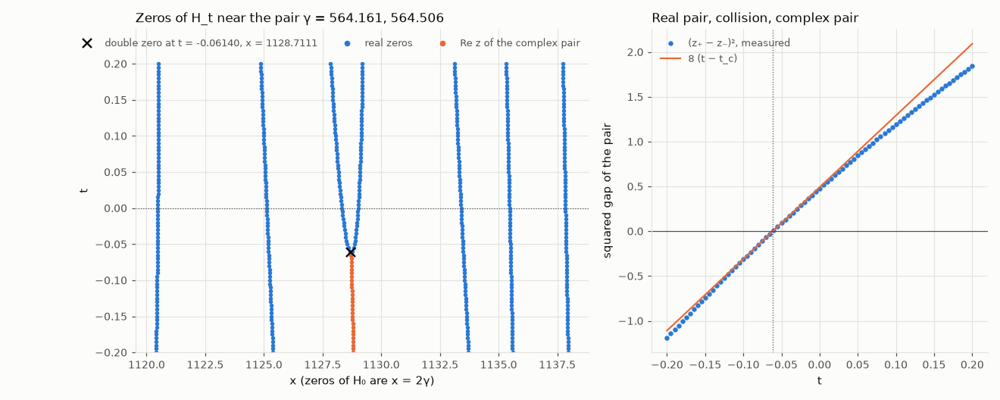

Following Pólya and de Bruijn, put

```
Φ(u) = Σ_{n≥1} (2π²n⁴e^(9u) − 3πn²e^(5u)) exp(−πn²e^(4u))
H_t(z) = ∫_0^∞ e^(tu²) Φ(u) cos(zu) du
```

Then H_0(z) = ξ(1/2 + iz/2)/8 and ∂H/∂t = −∂²H/∂z². The de Bruijn-Newman constant
Λ is the smallest t for which H_t has only real zeros, so RH is Λ ≤ 0. Rodgers and
Tao proved Λ ≥ 0 in 2018 and Polymath 15 brought the upper bound to 0.22.

The integral is easy to write and hard to evaluate: H_0(x) decays like e^(−πx/8)
while the integrand is of size 1, so at x = 100 the cosine integral cancels 17
digits. `heat.ht` moves the contour. Φ is analytic and super-exponentially small in
the strip |Im u| < π/8, so the integral over the real line can be taken along
Im u = θ = π/8 − δ, which pulls out a factor e^(−θz) and leaves cancellation of only
e^(δx). With δ = (π/8)·min(1, 4/x) that factor is at most e^(π/2). Φ is even and
real, so the half of the line with u < 0 is the conjugate of the other half, and
what is left is a trapezoid sum over u > 0. On a line inside an analytic strip the
trapezoid rule is exact up to an aliasing error of order e^(−2πδ/h), so a step of
δ/8 is plenty, and the Φ sum stops once πn²e^(4u)·sin 4δ passes 40. At x = 1130
that is 11,700 nodes and 50 terms.

Checks:

- H_0(z) = ξ(1/2 + iz/2)/8 to 2e-12 relative for real and complex z up to x = 400.
  At x = 1128, where H is 5.4e-191, the agreement is 2.6e-11.
- Against mpmath's quadrature of the defining integral itself at 30 digits, for
  t = −1, −0.3, 0 and 0.25: 1e-10 relative.
- The backward heat equation by finite differences, Φ(u) = Φ(−u) (which is
  Jacobi's theta identity), H_t(z̄) = conj H_t(z), and the zeros of H_0 at exactly
  2γ for the first five zeros of ζ.

The zeros move. Write H_t = c∏(1 − z²/x_j²) over its zeros ±x_j. Differentiating
H(x_k(t), t) = 0 and using the heat equation gives ẋ_k = H''/H' at the zero, and
the product turns that into

```
dx_k/dt = 2 Σ_{j≠k} 1/(x_k − x_j) + 2 Σ_j 1/(x_k + x_j)
```

so as t grows the zeros repel like charges, and running t backwards pulls close
pairs together. `heat.velocities` evaluates the sum from a list of zeros plus the
smooth density log(x/4π)/4π beyond the last one. For the seven zeros of H_0 with
1119 < x < 1139 it matches `heat.zero_velocity` (H''/H' from the integral, no
differencing) to 6.8e-7 using the first 4,000 zeros of ζ:

| x_k = 2γ_k | 1120.48 | 1125.12 | 1128.32 | 1129.01 | 1133.40 | 1135.46 | 1137.85 |
|---|---|---|---|---|---|---|---|
| dx_k/dt at t = 0 | 0.23730 | −1.31979 | −3.44762 | 2.00431 | −1.49289 | −0.68430 | −0.55859 |

The third and fourth columns are the closest pair below γ = 600, γ = 564.1609 and
564.5061. Backwards in t they collide. `heat.collision` follows the critical point
of H_t between them and solves for the t where its value crosses zero, which lands
at t_c = −0.0614041 and x_c = 1128.71107, where H and H' both vanish to 1e-13
relative. Near a double zero H_t ≈ (z − x_c)² − 2(t − t_c), which solves the heat
equation exactly, so the squared gap of the pair should be 8(t − t_c) on both
sides: real for t > t_c and −4(Im z)² after. At t_c ± 10⁻⁴ the ratios are 0.99995
and 1.00005, and the right panel shows how the other zeros bend the line further
out. The other zeros hold the pair apart a little: an isolated pair with the same
gap would collide sooner, at −Δx²/8 = −0.0596.

This is the mechanism behind the old lower bounds on Λ. For a Lehmer pair,
Csordas, Smith and Varga show the collision time cannot be below
λ = [(1 − 5Δ²g/4)^(4/5) − 1]/(8g), and `lehmer.newman_bound` gives λ = −0.0616036
for this pair (Δ²g = 0.238). The real collision is only 2.0·10⁻⁴ above it.

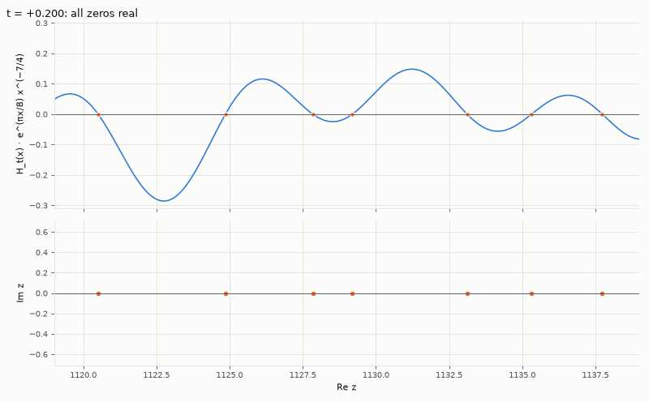

`heat.zero_paths` tracks every zero in a window as t decreases: real zeros by
sign changes and Illinois steps, and when two real zeros disappear between steps
it starts Newton from their midpoint with an imaginary part of half their old gap,
then follows the complex zero by Newton. Over t ∈ [−0.2, 0.2] the other five zeros
in the window stay real and the pair reaches Im z = 0.545 at t = −0.2. Each of the
81 frames takes about 1.6 s.

### Polymath 15's effective approximation

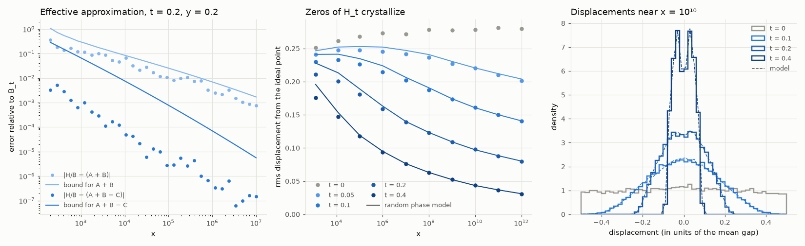

The contour integral in `heat.ht` costs O(x) nodes and underflows past x ≈ 5600,
where H_t is below 10⁻³⁰⁸. Polymath 15 (Res. Math. Sci. 2019) replaced it with a
Riemann-Siegel formula for H_t. Write s = (1 + y − ix)/2 and

```
M_0(s) = (1/8) (s(s−1)/2) π^(−s/2) √(2π) exp((s/2 − 1/2) log(s/2) − s/2)
α(s)   = 1/(2s) + 1/(s−1) + (1/2) log(s/2π)
B_t(x + iy) = exp((t/4) α(s)²) M_0(s)
s*     = s + (t/2) α(s),   b_n = exp((t/4) log² n),   N = ⌊√(x/4π + t/16)⌋
f_t    = Σ_{n≤N} b_n n^(−s*) + γ Σ_{n≤N} n^y b_n n^(−conj(s*) − κ)
```

with γ the ratio of M_t at the reflected point and κ a small correction. Their
Theorem 1.3 says H_t/B_t = f_t + O(e_A + e_B + e_C,0) for 0 < t ≤ 1/2, 0 ≤ y ≤ 1,
x ≥ 200, with every constant explicit. B_t carries the whole e^(−πx/8) decay, so
`effective.ratio` returns H_t/B_t, which is of size 1 at any height. Subtracting
their C term (the C_0(p) correction of Riemann-Siegel, moved through the heat
flow) gives A + B − C with a smaller bound e_C.

The approximation needs a check that does not share its derivation, and the heat
equation gives one. ∂H/∂t = −∂²H/∂z² is solved by a Gaussian average in the
imaginary direction:

```
H_t(z) = E[H_0(z + iv)],   v ~ N(0, 2t)
```

since averaging cos((z + iv)u) over v gives e^(tu²) cos(zu). `kernel_ratio`
evaluates ξ off the critical line with mpmath at 48 Gauss-Hermite nodes. At
x = 300 it agrees with the contour integral to 3e−14 for five (t, y) pairs, and
at x = 10⁴ it changes by less than 1e−14 between 32 and 64 nodes. Against it, with
t = y = 0.2:

| x | A + B error | its bound | A + B − C error | its bound |
|---|---|---|---|---|
| 250 | 0.144 | 0.778 | 1.85e−3 | 0.236 |
| 10⁴ | 4.21e−2 | 8.54e−2 | 7.47e−5 | 7.63e−3 |
| 10⁵ | 1.35e−2 | 2.54e−2 | 1.31e−5 | 7.78e−4 |
| 10⁶ | 4.97e−3 | 6.96e−3 | 1.29e−6 | 7.01e−5 |
| 10⁷ | 1.33e−3 | 1.69e−3 | 1.99e−7 | 5.58e−6 |

Every bound holds at every point tested, for t from 0.05 to 0.5 and y from 0 to 1.
The C,0 bound is tight to within a factor of 2 at large x. The C term buys a factor
of 80 at x = 250 and 6,700 at 10⁷, and its bound is 30 to 130 times loose. At t = 0 the same code is
the Riemann-Siegel formula with its first correction: H_0(x)/|B_0(x)| = −Z(x/2) to
1.5e−4 at x = 2·10⁴.

Two numerical details. The C term's phase is the difference of two numbers of
size x log x, so in floats it carries an error of 10⁻³ at x = 10¹². Written out,
everything cancels except 3π/2 − arctan T′ + arg C_0(p), and the amplitude
simplifies the same way, so `c_amplitude` never forms a large number. C_0 has
removable singularities at p = ±1/2 where it equals (1 − i)/4.

On the real axis γ = e^(2iϑ_t) and κ = 0, so H_t(x)/|B_t(x)| = 2 Re(e^(−iϑ_t)A) − C,
with A = Σ b_n n^(−s*) and ϑ_t = −arg B_t. That is a Hardy Z function for H_t.
`effective.zt` evaluates it directly; `HtWindow` evaluates it the way
`multieval.ZWindow` evaluates Z. The coefficients of A depend on x only through
s*, and inside a window s*(x) = s*(x_0) − i(x − x_0)/2 + ε(x) with
ε = (t/2)(α(s) − α(s_0)) of order t(x − x_0)/x. Expanding n^(−ε) to the order where
(ε ln N)^K/K! drops below 10⁻¹⁶ turns A into K band-limited sums (two at 10¹², five
for a window of width 400 at 3·10⁴), each one nonuniform FFT. The phases t_0 log n
come from mpmath and ϑ_t is assembled from Riemann-Siegel θ, the Stirling tail and
(t/4) α², never from a float of size 10¹³. `multieval.BandSum` is the interpolator
that ZWindow used inline, now shared. Against `zt` the window agrees to 7e−9 at
10⁶ (where the direct sum is still accurate), and at t = 0 near the 10¹²th zero it
finds Odlyzko's ten zeros to 2.2e−9, inside his stated 3e−9. A window of 2,000
zeros at x = 2·10¹² takes 4 s to build, mostly the 400,000 mpmath phases, and 0.2 s
to search.

### Crystallization

For t > 0 the sum A tends to 1 as x grows: Re s* ≈ 1/2 + (t/4) log(x/4π), so every
term past n = 1 decays like a power of x. Then H_t ≈ 2|B_t| cos ϑ_t and the zeros
sit at the ideal points ϑ_t = (n − 1/2)π, an arithmetic progression in ϑ. Ki, Kim
and Lee proved that for t > 0 all but finitely many zeros are real and simple;
numerically they also line up. The phase ϑ_t − ϑ_0 tends to (t/16)π log(x/4π),
which is the t/16 log x term in the zero count of H_t.

`displacement` measures how far each zero sits from its ideal point, in units of
the local gap, and up to the C term the result is arg(A)/π at the zero. That suggests a
model: by Kronecker's theorem the phases x/2 · log p are equidistributed for
distinct primes, so A behaves like Σ b_n n^(−Re s*) e^(iθ_n) with independent
uniform θ_p and θ_n additive over the factorization of n. `phase_model` samples
that sum. Weighting by zeros instead of by x adds only a boundary term, so the
model's arg/π should match the displacement law. The window searches give, for
2,000 zeros at each height (183 at 10³):

| x | t = 0 | t = 0.05 (model) | t = 0.1 (model) | t = 0.2 (model) | t = 0.4 (model) |
|---|---|---|---|---|---|
| 10³ | 0.251 | 0.241 (0.246) | 0.230 (0.241) | 0.211 (0.228) | 0.176 (0.196) |
| 10⁴ | 0.261 | 0.248 (0.252) | 0.233 (0.241) | 0.201 (0.213) | 0.147 (0.153) |
| 10⁵ | 0.268 | 0.247 (0.253) | 0.226 (0.235) | 0.181 (0.189) | 0.118 (0.119) |
| 10⁶ | 0.273 | 0.245 (0.252) | 0.215 (0.224) | 0.159 (0.163) | 0.094 (0.095) |
| 10⁷ | 0.272 | 0.241 (0.247) | 0.202 (0.206) | 0.139 (0.140) | 0.076 (0.076) |
| 10⁸ | 0.278 | 0.236 (0.241) | 0.188 (0.191) | 0.123 (0.123) | 0.063 (0.063) |
| 10⁹ | 0.278 | 0.227 (0.230) | 0.174 (0.174) | 0.109 (0.109) | 0.052 (0.052) |
| 10¹⁰ | 0.278 | 0.221 (0.221) | 0.161 (0.161) | 0.098 (0.097) | 0.044 (0.043) |
| 10¹¹ | 0.281 | 0.210 (0.212) | 0.150 (0.150) | 0.088 (0.088) | 0.037 (0.037) |
| 10¹² | 0.280 | 0.202 (0.204) | 0.140 (0.141) | 0.080 (0.080) | 0.031 (0.031) |

At t = 0 the displacement stays near the uniform value 1/√12 = 0.289, and about 30%
of consecutive zeros do not get consecutive indices: that is Gram's law failing,
seen from the midpoints of the Gram intervals. For t > 0 the model and the
measurement agree to 0.003 or better in every column from 10⁹ up. Below that the
zeros sit up to 0.02 closer than the model says, at heights where the C term,
which the model leaves out, is still of size 10⁻². At t = 0.4 every Gram interval of
H_t holds exactly one zero in all ten windows, and no zero is more than 0.43 gaps
from its ideal point. At t = 0.05 there are still 22 exceptions among 2,000 zeros
at 10¹². The convergence is slow: the n = 2 term shrinks like (x/4π)^(−(t/4) ln 2),
so from 10⁶ to 10¹² the rms halves at t = 0.2 and falls by three at t = 0.4.

The right panel has a feature the rms hides. Near 10¹⁰ at t = 0.4 the n = 2 term
has r = 0.18 and the next one 0.07, and arg(1 + r e^(iθ)) with θ uniform piles up
at its extremes ±arcsin r, which is ±0.057 after dividing by π. The smaller terms
blur that into two peaks near ±0.035 with a dip at zero, in the data and in the
model alike.

### The Mertens conjecture

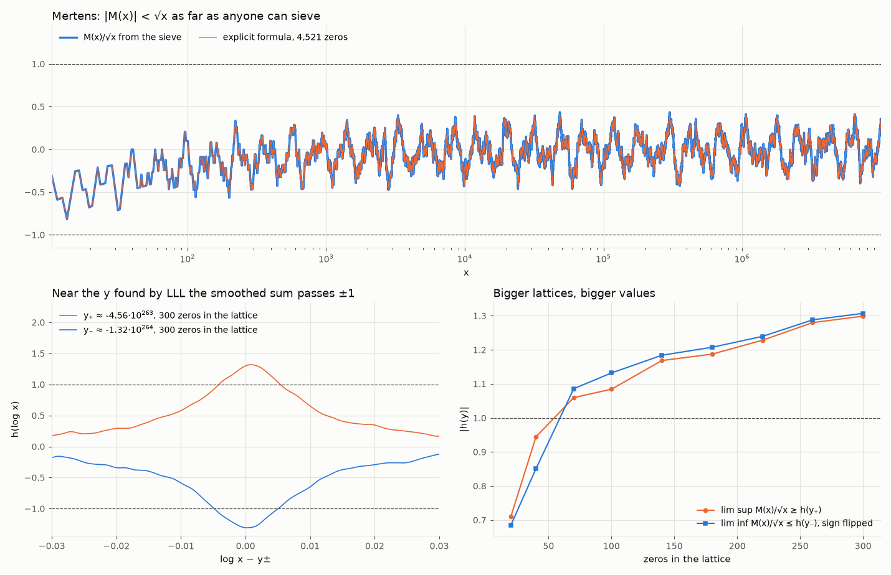

The Mertens function M(x) = Σ_{n ≤ x} μ(n) moves like a random walk with steps
−1, 0, +1, and for every x anyone has computed, |M(x)| < √x. Mertens conjectured in 1897
that this holds for all x > 1. It would imply RH, and Odlyzko and te Riele showed
in 1985 that it is false, without ever exhibiting an x.

Two ways to compute M are in `mertens.py`. `mertens_table(n)` sieves μ up to n
and takes a cumulative sum. `mertens(x)` uses the identity Σ_{d ≤ x} M(x/d) = 1:
values of M below u ≈ x^(2/3)/4 come from the sieve, the x/u large values
M(x/k) are filled in from k = x/u down to 1, and each one splits its sum at √v
into a direct part and a part grouped by the quotient q = v/d, all vectorized in
numpy. Every power of ten agrees with OEIS A084237:

| x     | M(x)    | time   |
|-------|---------|--------|
| 10⁹   | −222    | 0.10 s |
| 10¹⁰  | −33722  | 0.37 s |
| 10¹¹  | −87856  | 1.45 s |
| 10¹²  | 62366   | 6.6 s  |
| 10¹³  | 599582  | 36 s   |

Under RH with simple zeros, the explicit formula gives

```
M(x)/√x = 2 Σ_{γ > 0} cos(γ log x − ψ_γ) / |ρ ζ′(ρ)| + O(x^(−1/2)),   ψ_γ = arg(ρ ζ′(ρ))
```

plus a −2 and a rapidly convergent sum over the trivial zeros. The top panel
overlays this sum over the first 4,521 zeros on the sieve up to 10⁷. For
x > 1000 the two differ by 0.006 rms and 0.024 at worst, most of it the Gibbs
ringing a truncated sum has at each jump of M.

Ingham's theorem turns this into a disproof strategy. With the kernel
f(u) = (1 − u) cos πu + sin(πu)/π, which is nonnegative on [0, 1],

```
h(y) = 2 Σ_{γ ≤ T} f(γ/T) cos(γ y − ψ_γ) / |ρ ζ′(ρ)|
```

satisfies lim inf M(x)/√x ≤ h(y) ≤ lim sup M(x)/√x for every real y. The
theorem does not assume RH: if RH fails, or a zero is multiple, M(x)/√x is
unbounded anyway. So it is enough to find one y with |h(y)| > 1, which means
making the phases γy − ψ_γ of the zeros with the largest weights all close to
multiples of 2π at once. That is an inhomogeneous simultaneous Diophantine
approximation problem, and LLL solves it approximately. Following Odlyzko-te
Riele and Hurst's 2018 setup, the basis has one row per chosen zero with entry
⌊2π √a_i 2^ν⌋, one row with ⌊√a_i γ_i 2^(ν−10)⌋ (whose coefficient becomes the
integer z with y = z/2¹⁰), and one row with −⌊√a_i ψ_i 2^ν⌋ and a huge marker. A
short vector containing the marker has small entries √a_i (γ_i y − ψ_i − 2πm_i),
so the heavy cosines are near 1. Shifting ψ by π looks for large negative h.

The weights need many digits: y comes out near 2^ν, so γ_i y mod 2π is only
meaningful if γ_i is known to well over ν bits. `certified_zeros(T, bits)` gets
every zero below T from the Turing-certified Gram blocks of `certified.py`, refines
each one by Newton on ζ(s) with the precision doubling up to `bits`, proves the
zero lies in a ball of radius 2^(−bits)·γ by a certified sign change of Z at both
ends, and then evaluates ζ′(ρ) on that ball with `acb_series`, so a_γ and ψ_γ come
with rigorous error bounds. With 4,521 zeros to t = 5000 at 2048 bits (7 minutes),
h(y) itself is an Arb ball:

| zeros in the lattice | ν   | h(y₊)  | h(y₋)   | log₁₀ abs(y) | LLL + h |
|----------------------|-----|--------|---------|-------------|---------|
| 20                   | 60  | 0.7099 | −0.6846 | 13          | 0.02 s  |
| 40                   | 120 | 0.9444 | −0.8509 | 30          | 0.1 s   |
| 70                   | 210 | 1.0598 | −1.0858 | 57          | 0.5 s   |
| 100                  | 300 | 1.0843 | −1.1321 | 84          | 2.7 s   |
| 140                  | 420 | 1.1685 | −1.1841 | 120         | 7.7 s   |
| 180                  | 540 | 1.1874 | −1.2075 | 156         | 20 s    |
| 220                  | 660 | 1.2283 | −1.2395 | 191         | 42 s    |
| 260                  | 780 | 1.2801 | −1.2882 | 224         | 70 s    |
| 300                  | 900 | 1.2989 | −1.3072 | 263         | 125 s   |

The 70-zero lattice already gives 1.0598 and −1.0858. Odlyzko and te Riele also
used 70 zeros (the ones with the largest weights among the first 400) and 2,000
zeros in h, and got 1.06 and −1.009; FLINT's LLL does that size in half a second.
Their paper has a sanity check worth reproducing: 2 Σ a_γ over those 70 weights is
1.0787, the most any h could reach with them, and the running sum first passes 1 at
the 54th weight. Both come out the same here and are in the tests.

Each h in the table is a ball of radius below 1e−35, so both bounds are proofs,
given that the list of zeros is complete, which Turing's method supplies. Hurst
got 1.826 and −1.838 with 800 zeros in the lattice, 14,400 in h and 35 days of
fplll. The y's come out negative or positive at random, and that is fine: h is
almost periodic, so a value it takes near y it takes again near arbitrarily large
y. The bottom left panel shows h around y± for the 300-zero lattice. The peak is
about 0.01 wide in log x, set by the height of the last zero (t = 5000), and more
than 0.005 away from y± the sum stays below 1.04 in absolute value.

```python
from zeta_explorer import mertens

mertens.mertens(10**12)                 # 62366
zs = mertens.certified_zeros(200, 256)  # 79 zeros, balls of radius ~1e-75
r = mertens.search(zs, 20)
float(r.h.mid()), float(r.h.rad())      # (0.58149694297398, 1.42e-37)
```

### Where π(x) first beats li(x)

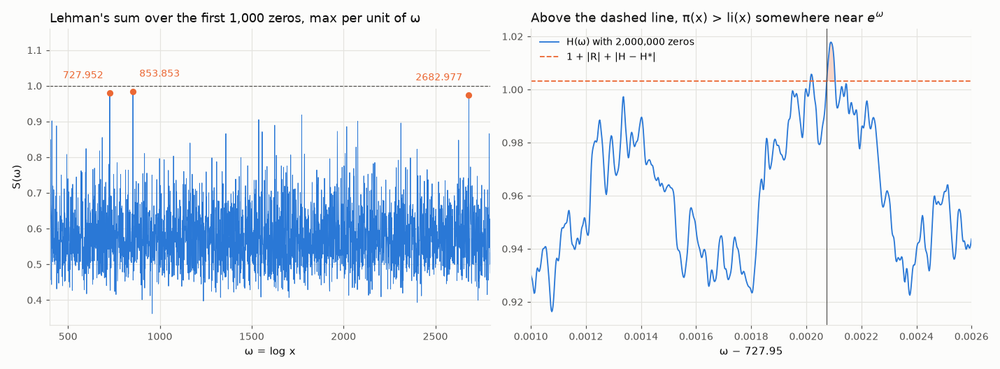

π(x) < li(x) for every x anyone has checked, but Littlewood proved in 1914 that
the difference changes sign infinitely often. Lehman's 1966 theorem makes this
computable. With a Gaussian K of variance 1/α,

```
I(ω, η) = ∫_{ω−η}^{ω+η} K(u − ω) u e^(−u/2) (π(e^u) − li(e^u)) du
        = −1 − Σ_{0 < |γ| ≤ T} e^(iγω) e^(−γ²/2α) / ρ + R
```

where |R| ≤ s₁ + … + s₆ is fully explicit as long as RH has been verified up to
some height A and α, η, ω satisfy 4A/ω ≤ α ≤ A² and 2A/α ≤ η ≤ ω/2. If the zero
sum H beats 1 + |R|, then I > 0, and because K > 0 there is an x in
[e^(ω−η), e^(ω+η)] with π(x) > li(x).

`skewes.py` has the pieces: `lehman_sum` evaluates the sum (vectorized over a
grid of ω in blocks), `lehman_errors` the six error terms in mpmath, with Chao and
Plymen's sharper s₁ = 2.1457/(ω − η) from Panaitopol's bounds on π(x), and
`zero_error` a mean-value bound on how much H moves if every γ is off by δ.

Without the Gaussian, the sum over the first 1000 zeros (left panel) has a few
spikes close to 1. Lehman found 727.952, 853.853 and 2682.977 this way. The scan
over ω ∈ [400, 2800] in steps of 4·10⁻⁴ finds exactly those three, at 727.951
(0.980), 853.853 (0.984) and 2682.977 (0.973), and nothing else above 0.92. At
the two values near 10¹⁹⁰ in Chao and Plymen's table 3 the sum is 0.88258736 and
0.88873670, against their 0.88258736 and 0.88873669.

Chao and Plymen's proof near e^727.952 needs the first two million zeros.
`bulk_zeros(2_000_000)` gets them in under 4 minutes from `zeros_fast` windows of
20,000 Gram intervals, each padded on both sides because a window only returns
zeros between its first and last good Gram points. γ₂₀₀₀₀₀₀ = 1131944.4718248623,
and they list 1131944.4718. With their parameters ω = 727.952074, η = 0.000198219, α = 7.86·10¹⁰, A = 7.79·10⁶:

|                        | here                       | Chao and Plymen          |
|------------------------|----------------------------|--------------------------|
| H                      | 1.0031960526               | 1.0031960183             |
| bound on abs(H − H*)   | 2.69·10⁻⁵ (δ = 2·10⁻⁹)     | 2.06·10⁻⁵ (δ = 10⁻⁹)     |
| s₁                     | 0.0029476                  | 0.0030163                |
| s₂                     | 5.93·10⁻⁵⁰                 | 5.93·10⁻⁵⁰               |
| s₅                     | 6.8205·10⁻⁵                | 6.8205·10⁻⁵              |
| s₆                     | 9.7500·10⁻⁵                | 9.7500·10⁻⁵              |
| abs(R)                 | 0.0031133                  | 0.0031207                |
| I(ω, η) >              | 5.58·10⁻⁵                  | 6.21·10⁻⁵                |

The two values of H differ by 3.4·10⁻⁸, well inside either error bound. So
I(ω, η) > 5.58·10⁻⁵, and since K integrates to 1, some x in
[1.39792136·10³¹⁶, 1.39847567·10³¹⁶] has π(x) − li(x) > 5.58·10⁻⁵ · e^(u/2)/u,
which is more than 9.07·10¹⁵⁰. The right panel shows H(ω) around their ω with the
threshold. H clears it for ω between 727.952016 and 727.952104 and peaks at 1.0178
near 727.95209, so their ω sits inside a window about 9·10⁻⁵ wide.

Two small things in the paper. Their Theorem 3.1 has s₁ = 2.1457/(ω − η), but
the number they plug in, 0.003016271, is 2.1957/(ω − η). The smaller constant is
the right one (3·0.71523279), so their bound was a little pessimistic. And their
"s₃ < 10⁻⁶⁷⁴, s₄ < 10⁻⁶⁶⁷" are really 3.6·10⁻⁶⁷³ and 5.6·10⁻⁶⁶⁷, which changes
nothing. A = 7.8·10⁶, the value written in their s₆ line, would violate
2A/α ≤ η; 7.79·10⁶ satisfies it and reproduces their s₆ to six digits.

The float zeros from `zeros_fast` are not certified, so this is a reproduction
rather than a new proof. `polish` moves each one by a secant step on Z between
γ ± 10⁻⁷ (and refuses a zero without a sign change there). Against 256-bit Arb
zeros at 840 random indices the largest error is then 1.2·10⁻⁹, against 2.9·10⁻⁹
before polishing, so the table uses δ = 2·10⁻⁹.

### In the browser

`web/` is a static page with no build step and no dependencies. `web/js/zeta.js`
is a port of the Python numerics: Euler-Maclaurin with Backlund's stopping rule,
the reflection formula through log χ, Stirling's log Γ, θ, Gram points, and the
Riemann-Siegel formula with C0 to C4. The Bernoulli numbers are exact BigInt
fractions. The C_k polynomials come precomputed in `web/data/rs.json`, trimmed to
the terms that still matter at |z| ≤ 1/2 (39 to 45 coefficients instead of 90; the
dropped tail changes nothing above 1e-16). Z uses Euler-Maclaurin below t = 200
and Riemann-Siegel above, same as the Python side.

The phase portrait is drawn by up to eight module workers, each rendering a band
of rows, first in 8×8 blocks and then at full resolution. A 948×474 frame of the
default view takes about 1 s on one core (2.2 μs per pixel), so it arrives in
roughly 150 ms. While the new frame renders, the old one is stretched to the new
view so panning stays smooth. The Z explorer samples Z once per pixel, takes zeros
from a table of the first 10,000 and finds the rest by sign changes and Illinois
refinement, and colors a Gram point orange when (−1)ⁿZ(g_n) < 0. At t = 10⁹ each Z
costs about 0.37 ms (12,615 terms), so the sample count is capped by a budget of
4·10⁶ terms per frame. Above 10⁸ or so the phases t·log n lose about 1e-6 radians
in doubles; the windowed evaluator would fix that, but the curve is fine for
looking at. The explicit formula keeps a running sum per x, so moving the slider
up only adds the new zeros.

Dirichlet L-functions have their own port. `web/js/characters.js` builds Conrey
characters the same way as `characters.py` (a generator per odd prime that is
primitive mod p², the ±5^k split for powers of 2) and reads off order, parity,
conductor, the Gauss sum and the root number. `web/js/lfunction.js` evaluates
L(s, χ) as q^(−s) Σ χ(a) ζ(s, a/q) with the head summed directly up to N·q,
N = 10 + ⌊|t|/π⌋, and an Euler-Maclaurin tail per residue class. The tail's
w^(1−s)/(s − 1) term is written as −log w · expm1(u)/u with u = (1 − s) log w; since
Σ χ(a) = 0 the dropped 1/(s − 1) cancels, and the first version, which skipped that
step, lost 9e-8 to cancellation at s = 1 + 1e-9. The terms χ(n) n^(−σ) are cached per
character, so one Z(t, χ) on the critical line costs 12 μs for q = 13 at t = 20,
96 μs for q = 163 and 265 μs for q = 199 at t = 100. For q ≤ 200 and |t| ≤ 1000 that
is well inside the range where the Python dispatcher also picks Euler-Maclaurin
over the smoothed approximate functional equation.

The section plots Z(t, χ) for the chosen character and, below it, the zeros with
|t| < 20 of every primitive character mod q, one row each. Z(−t, χ) = Z(t, χ̄), so a
complex pair is computed once and the second row is the mirror image. The rows go to
a pool of up to four workers: mod 163 there are 161 primitive characters and 81
distinct rows, which take 6.3 s on one thread and arrive in about 2.3 s.

`python -m zeta_explorer.site` writes the three data files: the trimmed
Riemann-Siegel coefficients, the first 10,000 zeros, and the spacing histogram and
pair correlation of 40,000 zeros from n = 10¹² (computed with `zeros_fast`, 13 s
for all three). A test checks that the committed coefficients and the first 200
zeros still match what the code produces.

The JavaScript has its own tests under `web/test`, run with `node --test`. They
compare ζ at 18 points across the plane, Z at 13 heights, θ, Gram points and the
first 29 zeros with mpmath values stored in `reference.json` (written by
`reference.py`), check that the live zero finder agrees with the table, and check
the explicit formula against the Python version and against ψ(x) itself.

Those tests caught a real bug in the Python zero table. `zeros_between` stopped
the Illinois iteration once a step fell below 1e-12 relative, which is 1e-8 in
absolute terms at t = 10⁴. The stopping step is usually much larger than the
remaining error, but not always: 635 of the first 10,000 zeros were off by more
than 5e-10, the worst by 4.5e-9. `first_zeros` now refines to 1e-15 relative and
28 zeros sampled across the table agree with mpmath's `zetazero` to 3e-11. Just above t = 200 the
Riemann-Siegel truncation error (3e-9 in Z) still limits zeros to about 1.5e-9.

## Development

```bash
pip install -e ".[dev]"
pytest
ruff check .
cd web && npm test
python -m http.server -d web 8000
```

## License

MIT
