# zeta-explorer

[](https://github.com/louisbelot/zeta-explorer/actions/workflows/tests.yml)


The Riemann Hypothesis says every non-trivial zero of ζ(s) sits on the line
Re(s) = 1/2. On that line ζ is complex, but multiply it by the phase e^(iθ(t)) and
you get the real-valued Riemann-Siegel Z function, which changes sign at every zero.
This repo computes θ, Z, ζ(s) itself, the zeros and the Gram points straight from
the formulas, checks the results against mpmath, and uses Turing's method to prove
the zero count is complete: all 138,069 zeros of ζ with 0 < Im s ≤ 100000 are on
the critical line and simple. It also draws ζ over the complex plane, compares
100,000 zeros near t = 5·10⁶ with the eigenvalue statistics of large random
Hermitian matrices, rebuilds π(x) from the first 1000 zeros, hunts for Lehmer
pairs (the near misses that bound the de Bruijn-Newman constant), and checks the
value distribution of log|ζ(1/2 + it)| against random unitary matrices. A
simplified Odlyzko-Schönhage evaluator (one nonuniform FFT per window, then
band-limited interpolation) makes Z cost 2.6 μs per point at any height and
reproduces Odlyzko's published zeros near the 10¹²th zero to 3e-9. Hiary's
FFT-free alternative is here too, with its T^(1/4) cost per point measured.

The same machinery extends to Dirichlet L-functions: characters with LMFDB's
Conrey labels, L(s, χ) anywhere in the plane, zeros checked against LMFDB and
verified complete with the argument principle, the class number formula, a
smoothed approximate functional equation that needs O(√(q|t|)) terms instead of
O(q|t|), and the low-lying zeros of quadratic characters up to conductor 10⁵.
Those zeros are compared with the symplectic prediction of Katz and Sarnak, with
the lower-order terms of the ratios conjecture (which fit the histograms with
χ² of 16 to 21 on 30 bins, against 298 to 719 for the limit law), and, for the lowest
zero, with gap probabilities of random symplectic matrices computed as Fredholm
determinants.

Elliptic curves come next: L-functions built from point counts, central zeros of
order 0 to 3 for the curves 11a, 37a, 389a and 5077a, and 1,674 quadratic twists
of 11a. Their central values sit exactly on Waldspurger's curves κc²/√d, and that
discreteness explains why their lowest zeros stay away from the center: SO(16)
random matrices with the matching cut on det(I − A) fit the even twists with χ² of
34.6 on 15 bins, against 159 to 182 without the cut. The odd twists repel their
first zero too, but the analogous cut on the central derivative, sized by Gross
and Zagier's height formula and the CFKRS arithmetic factor, removes 0.13% of the
matrices and changes nothing. Fitting the cut instead lands at 50 times that size
and still misses. With the symmetric square L-function of 11a computed from
scratch on the line Re s = 1, the ratios conjecture gives the one-level density of
the odd twists with χ² of 25.0 on 30 bins (270.1 for the SO(odd) limit), and its
1/log term sets an effective matrix size near 4. At that size excised SO(9) still
misses the first zero.

Heat flow came next. H_t(z), the heat-flow deformation of ξ behind the
de Bruijn-Newman constant, is computed from its defining integral on a shifted
contour, which keeps double precision at heights where H is 10⁻¹⁹¹. Running the
flow backwards, the close pair of zeros at γ = 564.161 and 564.506 collides at
t = −0.0614041 and leaves the real line, 2·10⁻⁴ above the bound Csordas, Smith and
Varga's criterion gives for that pair. The zeros move like charged particles: the
velocity of each one, predicted from the positions of 4,000 others, matches the
measured motion to 7·10⁻⁷. Past x ≈ 5600 the integral underflows, so
Polymath 15's effective Riemann-Siegel formula for H_t takes over. It is checked
against an independent heat-kernel average of ξ, stays inside the paper's error
bounds at every point tested, and runs in an Odlyzko-Schönhage window out to
x = 2·10¹². There the zeros of H_t for t > 0 line up on an arithmetic progression,
as close as a random-phase model built from the primes predicts. The same
machinery recomputes Polymath's proof that Λ ≤ 0.22: the barrier at x = 6·10¹⁰ is
crossed in 269 time steps with winding number 0 at each, and the Euler-mollified
bounds clear every edge of the zero-free region. One printed constant in the paper,
A ≤ 1.88, comes out as 1.906 here, which still leaves room.

The zeros also settle prime races. Under GRH and LI the share of log x where
primes ≡ 3 (mod 4) lead primes ≡ 1 is 0.9959279, computed from 868 zeros of
L(s, χ₋₄) and an exact tail, and the same code reproduces Fiorilli and Martin's
densities for twelve races mod 3 to 24 to six digits. With 3,130 zeros the
explicit formula rebuilds π(x; 4, 3) − π(x; 4, 1) closely enough to see the first
lead change at x = 26861.

Moments and positivity close the loop on the value distribution. The arithmetic
factor of the moment conjecture, read as a correction to the cumulants of
log|ζ|, accounts for the whole gap between the data and random unitary matrices
(variance within 0.015 at five heights, nothing fitted). Integrals of |ζ|^(2k) up
to t = 10¹⁰ follow the full CFKRS polynomials, while their leading term is still
off by a factor 11 for the sixth moment, and recomputing the paper's own tables
turned up a swapped pair of numbers in one row. Li's coefficients λ_n, summed over
the first million zeros and checked against Taylor coefficients of log ξ to
1e−12, are positive for every n tried up to 10⁵.

The extremes of ζ behave like those of a log-correlated field. Over 50,000
windows of length 2π at each height up to 10¹², the maximum of log|ζ| sits far
from the Fyodorov-Hiary-Keating limit law, and so do random unitary matrices of
the same size, even at N = 400. What separates ζ from them is arithmetic: the
window average of the sum over small primes has variance 0.043, and adding it to
the random-matrix variance matches the data to 0.004 from 10⁶ up, with nothing
fitted. Every Jensen polynomial of ξ with degree up to 12 and shift up to 1000
(and degree 40 at a few shifts) is decided hyperbolic in exact rational
arithmetic, as RH requires, and their zeros approach the Hermite limit of
Griffin, Ono, Rolen and Zagier at rate exactly δ(n).

Two newer pieces test the hypothesis from the outside. The Davenport-Heilbronn
function has a functional equation of exactly Riemann's shape but no Euler
product, and 614 of its first 7,136 zeros are off the critical line; the first
four pairs are proved to exist with Krawczyk boxes in Arb. For ζ itself the zero
count is redone in ball arithmetic, so RH up to t = 30,000 (35,673 zeros) comes
with a proof that has no floating-point step in it.

Ramanujan's τ(n) is computed exactly to
n = 2²⁰, and L(s, Δ) reproduces LMFDB's zeros and Manin's period ratios
36/691 : 1 : 3. The angles of τ(p) for the 78,498 primes below 10⁶ follow the
Sato-Tate law, and the Chebyshev functions of Sym^m L(s, Δ) sit near −2√x
exactly when the root number forces a central zero (m = 3 and 5). Dedekind zeta
functions of quadratic fields get real class numbers from cycles of reduced
indefinite forms, exact values of ζ_K(−1) two ways, and zero spacings that follow
two independent GUE spectra instead of one. Blocks of Platt's zeros near the
10⁹th, 10¹⁰th and 10¹¹th zero are proved to be zeros, complete and correctly
numbered in ball arithmetic.

The zeros also settle two old conjectures about primes, both against.
Mertens' |M(x)| < √x fails: 4,521 zeros computed to 2048 bits in ball
arithmetic, with ζ′(ρ) at each, feed an LLL lattice that finds a y with
h(y) = 1.2989 and another with h(y) = −1.3072, and Ingham's theorem turns each into
a bound on lim sup and lim inf of M(x)/√x. And with two million zeros, Lehman's
theorem reproduces Chao and Plymen's proof that π(x) > li(x) somewhere in
[1.39792136·10³¹⁶, 1.39847567·10³¹⁶].

Over F_q(t) the L-functions are polynomials and the random matrix is literal. For
the quadratic twists of the Legendre curve every L-polynomial is computed exactly,
Birch and Swinnerton-Dyer returns |Sha| (a perfect square in all 14,336 rank 0
twists tried), and a full 2-descent gives the Selmer group. The Selmer ranks
approach a model of random residue symbols as q grows, the odd part of Sha drifts
slowly toward the Bhargava-Kane-Lenstra-Poonen-Rains prediction, and the diagonal
of the moment recipe converges to the exact first moment at the rate q^(−deg D/2).
For the hyperelliptic ensemble the Andrade-Keating first moment matches the exact
average over all 1,062,882 genus 6 curves over F_3 to 5·10⁻⁵.

The same numerics also run in the browser at
[louisbelot.github.io/zeta-explorer](https://louisbelot.github.io/zeta-explorer/):
a phase portrait you can pan and zoom, a Z(t) explorer that marks zeros and Gram
points up to t = 10⁹, the explicit formula building ψ(x) one zero at a time,
Z(t, χ) with its zeros for every primitive Dirichlet character up to modulus 200,
and Z(t) for any semistable elliptic curve with its central order and the central
values of its quadratic twists.

## Install

```bash
pip install "zeta-explorer[plot] @ git+https://github.com/louisbelot/zeta-explorer"
```

## Quick start

```python
from zeta_explorer.riemann_siegel import theta, z_rs, z_exact
from zeta_explorer.zeros import find_zeros, gram_point

find_zeros(10, 30)   # [14.134725141734695, 21.022039638771552, 25.01085758014569]
len(find_zeros(10, 100))   # 29
gram_point(0)        # 17.845599540410863, where theta(t) = 0
z_rs(1000.0)         # 0.9977946375478818 (mpmath: 0.9977946375215866)
z_rs(1000.0, corrections=0)   # 0.9976696568809473, C0 only

from zeta_explorer.zeta import zeta
zeta(-1)             # -1/12
zeta(2 + 3j)         # (0.7980219851462759-0.1137443080529385j)

from zeta_explorer.turing import verify_zeros
verify_zeros(10_000)
# Verification(n=10143, g_n=10000.881777216977, zeros=10144, blocks_after=2)

import numpy as np
zeta(np.array([-3, 0.5 + 14.134725141734693j]))   # vectorized: [1/120, ~1e-16]

from zeta_explorer.spacing import zeros_between, normalized_spacings
z = zeros_between(10**6, 10**6 + 5)   # zeros between Gram points g_1000000 and g_1000005
# [600270.74787059, 600271.48637367, 600271.76148043, 600272.00103217, 600273.02653325]

from zeta_explorer.multieval import zeros_fast
win, u = zeros_fast(10**12 - 2, 10**12 + 4)   # zeros as offsets u from win.t0
win.t0 - 267653395647 + u
# [1.62594824, 1.84752313, 2.36236697, 2.68163092, 2.86198994]
# Odlyzko's table: zero number 10^12 + 1 is at 267653395647 + 1.8475231278

from zeta_explorer.spacing import first_zeros
from zeta_explorer.explicit import pi_from_zeros, riemann_r
gamma = first_zeros(1000)  # the first 1000 zeros, 14.1347 to 1419.4225
pi_from_zeros(np.array([100.5, 10_000.5]), gamma)   # [25.026, 1229.54]; π = 25, 1229
riemann_r(1e15)      # 29844570495886.9

from zeta_explorer.lehmer import lehmer_pairs
pairs = lehmer_pairs(gamma[:700])   # pairs with Δ²g < 4/5
pairs[0]   # LehmerPair(n=34, gamma=111.0295..., delta=0.8451..., gap=0.3868..., score=0.5699..., bound=-0.3954...)

from zeta_explorer.plot import plot_z, plot_domain, plot_spiral, plot_spacing
plot_z(0, 60).savefig("z.png")
plot_domain().savefig("domain.png")

from zeta_explorer.characters import conrey, quadratic, class_number
from zeta_explorer.lfunction import dirichlet_l, l_zeros, verify_zeros
chi = conrey(5, 2)   # LMFDB label 5.2: order 4, odd, conductor 5
chi.root_number()    # (0.85065080835204+0.5257311121191335j)
dirichlet_l(0.5 + 10j, chi)   # (2.1249968234507937+2.163859185370417j)
l_zeros(chi, 0, 13)  # [6.1835782, 8.45722917, 12.67494642]
dirichlet_l(1, quadratic(-23)), class_number(-23)   # 1.9652 = 3π/√23, 3
verify_zeros(conrey(101, 2), 50).ok   # 90 zeros on the line, 90 in the box

from zeta_explorer.afe import l_afe
big = conrey(100003, 2)
l_afe(0.5 + 10j, big)   # (3.9151561336603864-8.036122558438148j), 1557 terms per sum
l_zeros(big, 0, 1.5)    # [0.60517956, 1.49288041]

from zeta_explorer.ratios import quadratic_density
quadratic_density([-100003, 100001], [0.1, 0.5, 1.0])   # [0.1216, 1.4173, 0.8240]

from zeta_explorer.rmt import gap, first_density, symplectic, symplectic_n
gap(symplectic, 0.5), gap(symplectic_n(2), 0.5)   # 0.79479, 0.65935: P(no angle in (0, 1/2))

from zeta_explorer.effective import HtWindow, error, ratio
ratio(1e6 + 0.1, 0.2, 0.2)   # H_t/B_t at x + iy: (1.16407368-2.39967030j)
error(1e6 + 0.1, 0.2, 0.2)   # Polymath 15's bound on that: 7.0e-5
w = HtWindow(2e12, 2e12 + 100, 0.4)
u = w.zeros()                # 205 zeros of H_0.4, as offsets from w.t0 = x/2
w.displacement(u[:3])        # indices 3945951430273.., displacements 0.034, 0.031, 0.027

from zeta_explorer.barrier import Barrier, far_bound, lower_edge
steps = Barrier().verify()   # 269 steps over 0 <= t <= 0.2, winding 0 at each, 14 s
far_bound(1.5e6, 0.2, 0.2, 69098)   # (A, B) = (1.906, 0.0740)
lower_edge(69098, 80000)     # 0.0308, needs to beat 0.00215
```

## The math

### Theta

From Stirling's series for log Γ:

```
θ(t) = t/2·log(t/2π) − t/2 − π/8 + 1/(48t) + 7/(5760t³) + …
```

accurate to about 1e-13 for t ≥ 10.

### Riemann-Siegel formula

With a = sqrt(t/2π), N = ⌊a⌋ and p = a − N:

```
Z(t) ≈ 2·Σ_{n=1..N} cos(θ(t) − t·log n)/sqrt(n)  +  (−1)^(N−1)·a^(−1/2)·Σ_{k=0..4} C_k(p)·a^(−k)
```

Only about sqrt(t/2π) terms are needed, so at t = 10⁶ that's 398 terms. The
corrections come from Ψ(p) = cos(2π(p² − p − 1/16)) / cos(2πp) and its
derivatives:

```
C0 = Ψ
C1 = −Ψ⁽³⁾/(96π²)
C2 = Ψ⁽²⁾/(64π²) + Ψ⁽⁶⁾/(18432π⁴)
C3 = −Ψ⁽¹⁾/(64π²) − Ψ⁽⁵⁾/(3840π⁴) − Ψ⁽⁹⁾/(5308416π⁶)
C4 = Ψ/(128π²) + 19Ψ⁽⁴⁾/(24576π⁴) + 11Ψ⁽⁸⁾/(5898240π⁶) + Ψ⁽¹²⁾/(2038431744π⁸)
```

Twelve derivatives of a ratio of cosines is not something to do by hand. Ψ looks
singular at p = 1/4 and 3/4, but the numerator vanishes there too and Ψ is in fact
entire. So the code expands Ψ(1/2 + z) = −cos(2πz² − 5π/8)/cos(2πz) as a Taylor
series in z by dividing the two cosine series. That division runs at 110 digits
in mpmath, because 1/cos has poles at |z| = 1/4 and rounding errors grow like 4^j.
Derivatives of a power series are shifted coefficients, so each C_k becomes a
degree-90 polynomial in z, evaluated with Horner in doubles, and the removable
singularities need no special case. The tests rebuild C1 to C4 from mpmath's
numerical derivatives of Ψ and agree to 1e-15.


Each extra term should buy another factor of t^(−1/2). Over t in [200, 2000], the
largest value of |error|·t^((2k+3)/4) is:

| terms | error order | measured constant |
|---|---|---|
| C0 | t^(−3/4) | 0.119 |
| C0 to C1 | t^(−5/4) | 0.052 |
| C0 to C2 | t^(−7/4) | 0.0090 |
| C0 to C3 | t^(−9/4) | 0.029 |
| C0 to C4 | t^(−11/4) | 0.015 |

The constants come out about the same over [20, 200], which is the real check that
each C_k is right: a wrong coefficient would leave the previous order behind.
The bottom right of the chart is a different story. Past t ≈ 3000 the C3 and C4
curves hit a floor near 3e-11 set by doubles: the phases θ(t) − t·log n are around
10⁵ radians there, so each cosine is only good to about 1e-11. Gabcke (1979)
proved explicit bounds of this form for t ≥ 200, which is why the code trusts
z_rs from t = 200 up and calls mpmath below.

### ζ(s) everywhere

`zeta.py` has no mpmath in the loop. For Re s ≥ 0 it uses Euler-Maclaurin:

```
ζ(s) = Σ_{n<N} n^(−s) + N^(1−s)/(s−1) + N^(−s)/2
       + Σ_{k=1..M} B_2k/(2k)! · s(s+1)…(s+2k−2) · N^(−s−2k+1) + R
```

with Backlund's bound: |R| is at most |s+2M+1|/(σ+2M+1) times the first omitted
term, for σ > −(2M+1). N = 10 + ⌊|t|/π⌋ makes the Bernoulli terms shrink
geometrically, and M grows until the bound drops below 1e-16 relative. The
Bernoulli numbers are exact `Fraction`s. For Re s < 0 it switches to the
functional equation ζ(s) = χ(s)ζ(1 − s), with
χ(s) = 2^s·π^(s−1)·sin(πs/2)·Γ(1 − s) assembled in log space, since at large |t|
the sine overflows and Γ underflows. log Γ is Stirling's series after shifting
|z| past 15, summing the logs of the shifts so the imaginary part stays on the
continuous branch.

Against mpmath on 300 random points with |Re s| ≤ 30 and |Im s| ≤ 200 the
relative error stays under 1e-12. On the critical line at t = 10⁴ the absolute
error is 1.4e-11 (the same phase floor as above). The tests also check
ζ(1 − 2k) = −B_2k/(2k) for k up to 11, that Backlund's bound really bounds the
error and is within 50x of it, that χ(1/2 + it) = e^(−2iθ(t)), and that
e^(iθ)ζ(1/2 + it) is real and equals the Riemann-Siegel Z.

### Phase portrait

The picture at the top is `plot_domain()`: ζ(σ + it) for −5 ≤ σ ≤ 6 and
0 ≤ t ≤ 60, about 600,000 points. Hue is the argument of ζ, and the brightness
ramps up and resets every time |ζ| doubles, so the shading edges are level curves
of |ζ| (Wegert's enhanced phase portrait). A zero is a point where every color
meets, going around once counterclockwise; the pole at s = 1 goes the other way.
All the zeros in the strip sit on the dashed line σ = 1/2, the trivial zeros at
−2 and −4 sit on the left edge, and to the right of σ = 2 the picture is almost
flat red because ζ(s) is close to 1 there.

This needed ζ on arrays. `zeta`, `chi` and `loggamma` now take any array shape:
every point keeps its own N = 10 + ⌊|t|/π⌋, the main sums are one masked
(points × n) matrix built in chunks, and the Euler-Maclaurin tail drops each point
out of the loop as soon as its Backlund bound is small enough. The whole grid
takes 1.05 s, against 6.5 s for a Python loop over the old scalar version.

### Landscape and a sweep across the strip


`plot_landscape()` draws log₁₀|ζ(σ + it)| over −0.5 ≤ σ ≤ 2 and 0 ≤ t ≤ 40,
clipped to [−1.5, 1]. The pole at s = 1 is the plateau at the back left, and each
zero is a narrow pit on σ = 1/2. The t grid includes the zeros themselves, so each
pit reaches the floor.


`sweep_sigma()` moves σ from 0.1 to 0.9 and back as σ = 0.5 + 0.4·sin³(2πk/60),
so it lingers near the critical line. Off the line the curve winds around the
origin without touching it and |ζ| stays above 0. At σ = 1/2 both panels touch
zero at the same six heights.

### Analytic continuation


Σ n^(−s) only converges for σ > 1, and at the first zero s = 1/2 + 14.1347i the
partial sums spiral outward like N^(1/2)/|s − 1|. Two cheap fixes both land on
ζ(s) = 0. The alternating series η(s) = Σ (−1)^(n−1) n^(−s) converges for σ > 0,
and ζ = η/(1 − 2^(1−s)), but its error only falls like N^(−1/2). Adding the
first two Euler-Maclaurin terms N^(1−s)/(s−1) + N^(−s)/2 to the raw partial sum
gives an error of order |s|·N^(−σ−1), N^(−3/2) on the critical line, and it works
anywhere with σ > −1. The tests check both rates.

The functional equation is easiest to see through
ξ(s) = ½s(s − 1)π^(−s/2)Γ(s/2)ζ(s), which cancels the pole and the trivial zeros.
`xi(s)` evaluates it from the right half plane and reflects with ξ(s) = ξ(1 − s);
the tests check it against mpmath, check ξ(0) = ξ(1) = 1/2 and ξ(2) = π/6, and
check that it is real on the critical line.


On the critical line itself, ζ(1/2 + it) traces loops that pass through the
origin once per zero. It starts at ζ(1/2) = −1.4604, and between t = 0 and 40 it
goes through 0 six times.

### Zeros


Sign changes of Z on a grid, refined with the Illinois method
(regula falsi that halves a stuck endpoint's weight). All 29 zeros below t = 100
match mpmath's `zetazero` to 1e-9, and z_rs finds the same 29 to within 4e-6.

### Gram points and Gram's law

These solve θ(g_n) = nπ. θ is increasing and convex there, so Newton's method
started to the right of the root slides monotonically onto it. It's vectorized:
the first 100,001 Gram points take 0.12 s.


At g_n, e^(iθ) = (−1)^n, so if Z behaved like a cosine with one zero per Gram
interval we would always have (−1)^n Z(g_n) > 0. That's Gram's law. It first
fails at g_126 (Hutchinson, 1925). Up to n = 1000, 95.8% of Gram points are good;
up to 10,000, 91.8%; up to 100,000 (t ≈ 74,922), 88.9%.

A Gram block is a run [g_j, g_k) between consecutive good points. Rosser's rule
says a block of length k − j contains at least k − j zeros. The checker samples Z
inside each block, doubling the density until it sees enough sign changes. Up to
n = 100,000 every block passes:

| block length | 1 | 2 | 3 | 4 | 5 |
|---|---|---|---|---|---|
| count | 78,694 | 9,445 | 778 | 19 | 1 |

Rosser's rule does fail eventually; Brent found the first failure near
g_13999525. The signs come from z_rs with all four corrections. Any |Z| below 1e-6
is recomputed with mpmath before it's trusted, and below t = 200 mpmath is used
throughout.

### Turing's method

Sign changes of Z give a lower bound on N(T), the number of zeros with
0 < Im s ≤ T. A zero off the critical line, or a double zero, wouldn't show up as
a sign change. The upper bound comes from S(t) = N(t) − θ(t)/π − 1: Lehman proved
|∫ S(t) dt| ≤ 1.7 + 0.114·log(t₂/2π) over any [t₁, t₂] above 168π, so S can't stay
positive for long. Brent turned that into a block count. If K consecutive Gram
blocks [g_n, g_p) obey Rosser's rule and

```
K ≥ (0.114/6π)·log² g_p + ((1.7 − 0.114·log 2π)/6π)·log g_p   (≈ 0.0061 log² + 0.08 log)
```

then N(g_n) ≤ n + 1. `verify_zeros(T)` finds a good Gram point g_n ≥ T, counts
n + 1 sign changes of Z below it, and finds the K blocks past it. The two bounds
meet, so every zero up to g_n is a sign change, which means it is on the line and
simple. For T = 100,000 it runs in 9 seconds, needs K = 2 blocks, and stops at
g_138068 ≈ 100000.29 with N = 138,069 (mpmath's `nzeros` agrees). The tests
cross-check smaller heights the same way.

### Certified counts in ball arithmetic

`verify_zeros` decides the sign of Z with floating point. If Z(t) were 3e-12 and
the Riemann-Siegel remainder larger than that, a sign could be wrong and the count
would quietly stop being a proof. `certified.py` redoes the whole argument in ball
arithmetic with python-flint (Arb), where every number is a midpoint plus a radius
that provably contains the true value. A sign only counts once the entire ball is
on one side of 0.

θ(t) = Im log Γ(1/4 + it/2) − (t/2)·log π and Z(t) = Re(e^(iθ) ζ(1/2 + it)) are
evaluated as balls, and `z_sign` starts at 64 bits and doubles the precision until
the ball excludes 0. Gram points get a one-dimensional Krawczyk test: Newton gives
a midpoint m, a box B goes around it, and K = m − (θ(m) − nπ)/θ'(B). If K lies
inside B, the exact g_n is in K. Z is then evaluated on that whole ball, so its
sign holds at the true Gram point and not just near it. The block count uses
Trudgian's 2011 bound |∫ S(t) dt| ≤ 2.067 + 0.059·log t₂ for t₂ > t₁ > 168π, which
asks for K ≥ log g·(2.067 + 0.059·log g)/6π good blocks.

```python
from zeta_explorer.certified import certify, z_ball

z_ball(1000.0)        # [0.997794637521587 +/- 7.01e-16]
c = certify(30_000)   # 42 s
c.zeros, c.n          # (35673, 35672)
c.log()               # every Gram block with its sample points and certified signs
```

That proves all 35,673 zeros with 0 < t ≤ g_35672 ≈ 30000.27 are simple and on
the line, with no floating-point step in the argument. Arb's own certified
`zeta_nzeros` gives the same count at 1,000, 3,000, 10,000 and 30,000. The JSON log
for T = 30,000 is 4 MB: 32,109 Gram blocks, 3,365 of them longer than one interval.

The balls also grade the float code. Over 13 points near each height, `z_rs`
is off by at most 1.8e-9 at t = 250 (where the truncated Riemann-Siegel series is
the limit), 3e-11 at 10³ and 10⁴, and 1.6e-10 at 10⁵ (rounding in the main sum).

### Platt's zeros, checked in ball arithmetic

Platt computed the first 10¹¹ zeros of ζ rigorously and LMFDB serves them to
about 31 significant digits. `platt.py` takes a block of them (fetched once from
`lmfdb.org/zeros/zeta/list`, saved under `tests/data`) and checks three things
with Arb, none of which trusts the listed numbers:

1. Each listed γ is a zero: Z(γ − 10⁻²⁵) and Z(γ + 10⁻²⁵) have opposite signs as
   256-bit balls, and the secant through those two values gives the root to far
   more digits than LMFDB prints.
2. The block is complete: good Gram points g_a below the block and g_b above it,
   with enough Rosser blocks below g_a and above g_b for Brent's form of Turing's
   method, prove N(g_a) ≥ a + 1 and N(g_b) ≤ b + 1. Finding b − a sign changes in
   between then pins both counts, so every zero in the window is simple and on the
   line.
3. The numbering is right: the k-th sign change after g_a is zero number a + 1 + k,
   and each listed zero sits in the interval its LMFDB index says.

| block | height | sign changes in window | largest root − listed | time |
|---|---|---|---|---|
| zeros 10⁹ to 10⁹ + 49 | 3.7·10⁸ | 51 = b − a | 2.3e−31 | 1.0 s |
| zeros 10¹⁰ to 10¹⁰ + 49 | 3.3·10⁹ | 51 = b − a | 2.2e−31 | 2.1 s |
| zeros 10¹¹ to 10¹¹ + 49 | 2.95·10¹⁰ | 51 = b − a | 1.9e−31 | 6.2 s |

The differences of 2e−31 are the rounding of the listed values (Platt's
accuracy is 2⁻¹⁰² ≈ 2e−31). The tests also change one digit near the 20th decimal
place, which makes the zero fail to isolate at δ = 10⁻²⁸, and drop a zero from the
middle of a block while keeping the numbering consecutive, which the index check
catches.

```python
from zeta_explorer import platt

c = platt.check(platt.fetch(10**11, 50))
c.all_isolated, c.window.complete, c.indices_match   # (True, True, True)
c.max_diff                                           # 1.87e-31
```

### Many values of Z at once


Every value of Z costs about √(t/2π) terms: 399 at t = 10⁶, 206,393 near the
10¹²th zero. Odlyzko and Schönhage (1988) noticed that the main sum
F(t) = Σ n^(−1/2) e^(−it log n) is the same Dirichlet polynomial for every t in a
window, so its values on an evenly spaced grid can come out of one FFT and
everything in between can be interpolated. `ZWindow(t_lo, t_hi)` is a simplified
version of that.

The grid comes first. With a center t₀ and a spacing δ,
F(t₀ + jδ) = Σ b_n e^(−ij·δ log n) where b_n = n^(−1/2) e^(−it₀ log n). That is a
type-1 nonuniform FFT: arbitrary frequencies δ log n, integer outputs j. `nufft`
does it by Gaussian gridding (Dutt-Rokhlin, Greengard-Lee): spread each term onto
a 2x oversampled grid with a periodic Gaussian, run one FFT, and divide out the
Gaussian's Fourier coefficients e^(−τk²). With w grid points on each side and
τ = πw/(3m²), aliasing costs e^(−2πw/3) and cutting the Gaussian off costs
e^(−3πw/4), both relative to Σ|b_n|, so w = 15 is enough for 1e-13. The tests
compare it with the direct sum at three sizes and three tolerances.

Then interpolation. Multiplied by e^(iβt) with β = ½ log N, F has its spectrum in
[−β, β]. The grid samples at δ = π/α with α = 2β, twice the Nyquist rate. A sinc
of bandwidth α times a Gaussian e^(−ε²u²/2) rebuilds F from the K nearest samples
on each side. Two errors compete: the Gaussian smears the sinc's spectrum, which
lets in e^(−(α − β)²/2ε²) from the aliased copies, and stopping the sum at
distance L = Kδ loses e^(−ε²L²/2). Choosing ε² = (α − β)/L makes both
e^(−(α − β)L/2) = e^(−πK/4), so K = 36 gives 1e-12, and every Z(t) costs 73
multiply-adds whatever t is.

Precision turned out to matter as much as speed. At t = 10¹², t·log n is about
10¹³ radians, and in doubles that has an absolute error near 10⁻³. That is why the
direct sum is off by 3.5e-3 up there (left panel). The window only needs
t₀ log n mod 2π and θ(t₀) once, so those come from mpmath at about 36 digits, and
everything else works with the offset u = t − t₀:

```
θ(t₀ + u) − θ(t₀) = (u/2)·log(t₀/2π) + (t/2)·log1p(u/t₀) − u/2 + (Stirling tail difference)
```

All of those terms are moderate in size. Zeros and Gram points come back as
offsets too, because a double near 2.7·10¹¹ only resolves 6e-5. N goes up by one
each time t passes 2πk², so the grid uses the largest N in the window and the
extra term is subtracted directly for points below the jump.

On this machine, once the window is built, each Z costs 2.6 μs at any height. The
direct sum costs 7.4 μs at t = 10⁶, 795 μs at 10¹⁰ and 7.7 ms at 10¹². Building the
window takes 0.07 s at 10¹⁰ and 0.6 s at 10¹², half of it for the phases.
Against mpmath's `siegelz`, the window's error stays between 8e-14 and 3e-13 from
t = 10⁴ to 10¹², while the direct sum's grows from 1e-11 to 3.5e-3.

The check that convinced me was Odlyzko's published table of zeros number
10¹² + 1 to 10¹² + 10⁴. `zeros_fast(10**12 - 2, 10**12 + 10**4 + 2)` finds all of
them in 1.5 s with the same numbering, and the largest difference from his values
is 2.8e-9 (RMS 7e-10; his file promises 1e-8).

Up there Gram blocks start breaking Rosser's rule. The block
[g_(10¹²+13452), g_(10¹²+13454)) has no zeros at all: Z reaches 98 inside it, and
its two zeros sit in the previous block, which is a single Gram interval holding
three. The block finder now deals with that. When a block still comes up short
after sampling it 1024 times more finely, it is merged with the block before it,
then with the blocks after it, until the union has as many sign changes as Gram
intervals. In 100,000 Gram intervals from n = 10¹² that happened 4 times; from
n = 10⁹, never. 20.1% of the Gram points near 10¹² are bad, against 17.5% near
10⁹.

The phases t₀ log n mod 2π used to be one mpmath call per n, 400,000 of them at
10¹², and that was most of every window's setup. n^(−it) is completely
multiplicative, so only the primes need mpmath: `log_phases` sieves the smallest
prime factor p of each n and sets φ(n) = φ(p) + φ(n/p) mod 2π, one Ω(n) level at a
time. Done in plain doubles that would add up to Ω(n) roundings, so the phases are
kept as double-double pairs (Knuth's two-sum) and only rounded at the end. The
result is bit-for-bit the same array as before. At t₀ = 10¹² + 500 it takes 0.32 s
instead of 2.22 s (33,776 primes up to 398,942 instead of every n).

### Hiary's amortized method

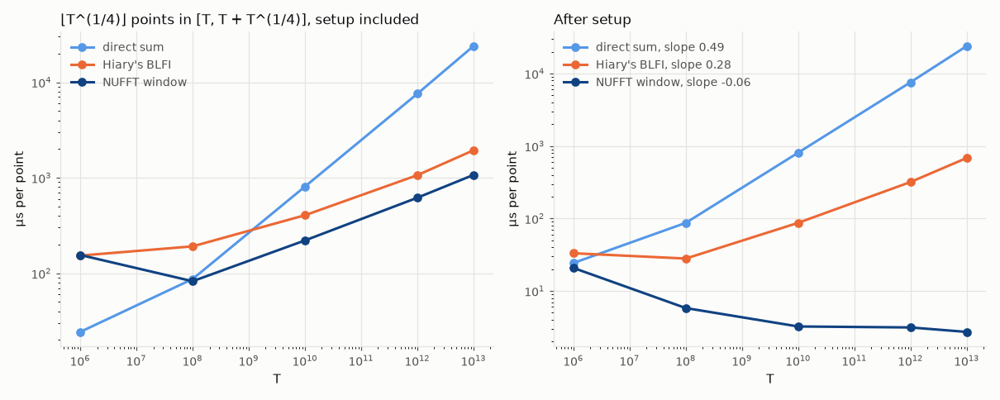

Hiary (Math. Comp. 80, 2011, arXiv:1002.2443) gets to many values in a short
interval without any FFT. His claim: any ⌊T^(1/4)⌋ points in [T, T + T^(1/4)] in an
average of T^(1/4+o(1)) operations each. `BLFIWindow(t_lo, t_hi)` follows the paper.

The main sum F(t) = Σ_(n≤n₂) n^(−1/2) e^(it log n) is cut at M = ⌈T^(1/4)⌉. The
terms below M are summed directly. Above it, dyadic levels [2ˡM, 2ˡ⁺¹M) are each
split into M blocks of length 2ˡ, and what is left of the range takes blocks of the
top length. A block starting at v factors as

```
Σ_(k<K) (v + k)^(−1/2) e^(it log(v + k)) = e^(it log v) · F_v(t),
F_v(t) = Σ_(k<K) (v + k)^(−1/2) e^(it log(1 + k/v))
```

and since K/v ≤ 1/M on every block, every F_v has its spectrum inside [0, 1/M].
That is the whole trick: F_v changes on a scale of M, so it can be stored on a
grid of spacing about M and interpolated. Centered by e^(−it/2M), the spectrum fits
in [−τ, τ] with τ = 1/2M, and the paper's formula with β = 3τ, λ = 2τ, ε = τ is

```
G(t) = (λ/β) Σ_j G(jπ/β) · sinc(λ(t − jπ/β)) · Ĥ(t − jπ/β),
Ĥ(u) = (c/sinh c) · sinh√(c² − ε²u²) / √(c² − ε²u²)
```

Ĥ is the Fourier transform of a Kaiser-Bessel bump of width ε, which is what lets
the smoothed indicator be exactly 1 on the spectrum and 0 past the Nyquist band.
Keeping only |t − jπ/β| < c/ε costs at most 6·sup|G|·e^(−c). Summed over all
blocks, sup|G| adds up to at most 2√n₂, so c = log(24√n₂/tol) keeps Z within tol.

All blocks share the same grid, which matters more than the paper lets on. The
table is one matrix (blocks × grid), and for a batch of points the block sums
become a single matrix product: A · table, where A[i, v] = e^(it_i log v), then
weighted by the kernel and summed. At t = 10¹² with M = 1,000 there are 8,559
blocks instead of 398,942 terms, the grid has 65 samples 2,094 apart, and c = 32.7.

The first version was accurate to 1.4e-12 at 10¹², worse than the NUFFT window,
whatever the tolerance. The culprit was u·log v for an offset u of a few hundred:
the product is around 6,500 radians and a double near 6,500 is only good to 9e-13.
`spin` fixes that without extra transcendentals. log v is split into a head on a
2⁻¹⁶ grid and a tail of at most 2⁻¹⁷, u is rounded to the same grid, and the head
product is then exact in a double (21 + 32 bits). It is reduced mod 2π with a
34-bit 2π and a correction, the way libm does Cody-Waite reduction, and only the
small reduced angle goes to cos and sin. That brought the error at 10¹² to 1.1e-13.

Against mpmath's `siegelz` the default window (tol = 1e-10) is off by 2.5e-13 at
10⁴, 3.3e-13 at 10⁸, 7.3e-13 at 10¹⁰ and 1.1e-13 at 10¹². The tolerance is honest
but loose: asking for 1e-2, 1e-6 and 1e-8 at 10⁸ gives 6e-6, 3e-9 and 9e-12.

The chart uses Hiary's setting. After setup the direct sum costs T^0.49 per point
and BLFI T^0.28, the predicted T^(1/4) times the growing number of dyadic levels.
At 10¹² one value costs 7.6 ms directly and 0.32 ms from BLFI; with setup spread
over the 1,000 points it is 1.06 ms. The NUFFT window is never slower (3 μs per
point, 0.62 ms with setup), which Hiary expected: his own rough extrapolation put BLFI about 485 times behind Gourdon's Odlyzko-Schönhage run
of 2·10⁹ zeros. What BLFI buys is simplicity. There is no FFT and no rational function
evaluation, the precomputation is a direct O(c√T) evaluation, and the cost per
point does not depend on how long the window is.

```python
from zeta_explorer.blfi import BLFIWindow
win = BLFIWindow(1e12, 1e12 + 1000)   # t0 = 1e12 + 500, 8559 blocks, 65 grid samples
win.z([0.0, 250.0])                   # [-0.30336436, -2.95095492], as mpmath
win.zeta(0.0)                         # ζ(1/2 + i·t0) = 0.25632826+0.16225215j
```

### Zero spacings and random matrices


Montgomery conjectured in 1973 that the pair correlation of the zeros, measured in
units of the mean spacing, is 1 − (sin πu/πu)². Dyson recognized it as the pair
correlation of eigenvalues of large random Hermitian matrices (GUE), and Odlyzko's
computations from 1987 on confirmed it numerically.

`zeros_between(n_lo, n_hi)` finds every zero between two good Gram points. It
evaluates Z at the Gram points, samples each Gram block more finely until it has as
many sign changes as the block has intervals, then refines every bracket at once
with a vectorized Illinois method on z_rs. Between n = 10⁷ and 10⁷ + 100,000 it
finds exactly 100,000 zeros in 18 s. That count matters for the statistics: a
missed pair of close zeros would hide exactly the small spacings the plot is
about. The zeros are unfolded with x = θ(γ)/π, which makes the mean spacing 1.

The GUE curve is the exact sine-kernel answer, not the Wigner surmise. The
probability of no eigenvalue in an interval of length s is the Fredholm
determinant E(s) = det(I − K) with K(x, y) = sin π(x − y)/(π(x − y)) on [0, s].
Following Bornemann (2010), Gauss-Legendre quadrature with 40 nodes turns it into
an ordinary 40×40 determinant, and the error falls exponentially with the node
count (20 and 60 nodes agree to 1e-12). The spacing density is p(s) = E''(s); E
is entire, so the code interpolates it with a degree-80 Chebyshev series on
[0, 6] and differentiates the series twice. Checks: p(s) matches
π²s²/3 − 2π⁴s⁴/45 + π⁶s⁶/315 for small s, the derivatives agree with 30-digit
mpmath to 3e-10, p integrates to 1 with mean 1, and the variance comes out
0.17999 (the Wigner surmise gives 3π/8 − 1 = 0.1781). An independent check
samples 300 random 120×120 GUE matrices: the KS distance between their bulk
spacings and the sine-kernel CDF is 0.0044, against 0.28 for Poisson.

The zeros fit GUE well, but not perfectly, and the gap shrinks with height. For
100,000 consecutive zeros starting at five heights (the last two from
`zeros_fast`, which takes 11 s for the n = 10⁷ row against 18 s for
`zeros_between`, and gives the same numbers; at 10⁹ and 10¹² the range between
the outermost good Gram points holds 99,997 and 99,998 zeros):

| first zero | t range | spacing variance | KS distance to GUE | R₂ − Montgomery, 0.3 < u < 0.9 |
|---|---|---|---|---|
| n = 10⁵ | 74,924 to 139,503 | 0.1636 | 0.0174 | −0.012 |
| n = 10⁶ | 600,271 to 654,852 | 0.1668 | 0.0138 | −0.013 |
| n = 10⁷ | 4,992,382 to 5,038,615 | 0.1693 | 0.0110 | −0.013 |
| n = 10⁹ | 371,870,206 to 371,905,313 | 0.1725 | 0.0081 | −0.010 |
| n = 10¹² | 267,653,395,649 to 267,653,421,320 | 0.1763 | 0.0045 | −0.007 |
| GUE | | 0.1800 | 0 | 0 |

The zeros are more regular than GUE at these heights: smaller variance, a taller
peak in the histogram, and slightly fewer close pairs. The variance and the KS
distance move toward GUE as t grows. The dip in the pair correlation barely moves
up to 10⁷, then halves by 10¹². This is the finite-height
effect Bogomolny, Keating and coauthors explained by matching the zeros at height
t to unitary matrices of effective size log(t/2π)/√(12Λ), where Λ ≈ 1.573, which is
only about 3 at t = 5·10⁶. It decays like 1/log² t, so it is still visible in
Odlyzko's data near zero number 10²³.

### The explicit formula


Riemann's 1859 formula writes the prime counting function as a smooth main term
minus a sum over the zeros. The cleanest version is for Chebyshev's
ψ(x) = Σ_{p^k ≤ x} log p:

```
ψ(x) = x − Σ_ρ x^ρ/ρ − log 2π − ½·log(1 − x⁻²)
```

For π(x) it goes through J(x) = Σ_k π(x^(1/k))/k, which jumps by 1/k at every
prime power p^k:

```
J(x) = li(x) − Σ_ρ li(x^ρ) − log 2 + ∫_x^∞ dt / (t(t² − 1) log t)
π(x) = Σ_n μ(n)/n · J(x^(1/n))
```

The sum over n stops once x^(1/n) < 2, since J is 0 there. Both sums over ρ pair
each zero with its conjugate and run in order of height. At a jump both formulas
converge to the midpoint, so the code gives ψ(97) − ½·log 97 for ψ(97) and 24.5
for π(97).

The awkward part is li(x^ρ). Taking li of the complex number x^ρ lands on the
wrong branch as soon as γ·log x passes π, so it has to be Ei(ρ·log x). `ei(w)` is
written from scratch with three regimes: the power series for |w| < 4, the
continued fraction for E₁ (backward recurrence, depth 20 to 140 depending on |w|)
out to |w| = 40, and the asymptotic series beyond that. It matches mpmath to
1.5e-15 relative on 2,851 random points. The one region it refuses is
4 ≤ |w| < 40 within π/4 of the positive real axis, where neither the continued
fraction nor the series is accurate in doubles. The explicit formula never goes
there, because ρ·log x sits next to the imaginary axis. li(x) for real x, Riemann's
R(x) from the Gram series Σ (log x)^k/(k·k!·ζ(k+1)), and the tail integral
(40-node Gauss-Laguerre after substituting t = e^v) are all checked against
mpmath.

With the first 1000 zeros, on the half-integers 2.5 ≤ x ≤ 100.5:

| zeros | max error ψ | RMS error ψ | max error π | RMS error π |
|---|---|---|---|---|
| 100 | 0.96 | 0.28 | 0.21 | 0.069 |
| 1000 | 0.148 | 0.050 | 0.033 | 0.012 |

π(x) from 1000 zeros also rounds to the right integer at every half-integer from
1000.5 to 1099.5 (worst error 0.35), and π(10000.5) comes out as 1229.54 against
the true 1229. The left panel, 3000 values of x and 1000 zeros, takes 3.3 s. The
zeros come from `first_zeros(n)`, which sign-scans mpmath's Z below the good Gram
point g₇₉ ≈ 201.5 and uses `zeros_between` above it.

### Lehmer pairs


In 1956 Lehmer found two zeros near t = 7005 only 0.0377 apart, with Z rising to
just 0.004 between them. Close pairs like this used to give lower bounds on the
de Bruijn-Newman constant Λ (Rodgers and Tao proved Λ ≥ 0 in 2018). In the
convention of Csordas, Smith and Varga the zeros are x = 2γ, the zeros of
H₀(x) = Ξ(x/2)/8. A pair x_k < x_(k+1) with Δ = x_(k+1) − x_k and

```
g = Σ_{j ≠ k, k+1} [ 1/(x_j − x_k)² + 1/(x_j − x_(k+1))² ]     (j over positive and negative zeros)
```

is a Lehmer pair if Δ²g < 4/5, and then

```
Λ ≥ λ = [ (1 − 5Δ²g/4)^(4/5) − 1 ] / (8g)
```

Δ²g doesn't depend on the scale, so the code works with γ directly and divides
by 2g instead of 8g. `lehmer_sums` adds the 500 nearest zeros on each side
exactly, the mirrored negative zeros exactly over the first 500, and everything
further out through the smooth density log(t/2π)/2π, integrated in closed form.
That density integrates to the main term of θ(t)/π + 1 when it starts from
T₀ = 9.6769, where the smooth count is zero.

The real check doesn't use any list of zeros. Ξ(t) is even with real zeros ±γ,
so −(log Ξ)''(t) = Σ_j [1/(t − γ_j)² + 1/(t + γ_j)²]. Removing the two singular
terms leaves g in terms of Z', Z'' and Z''' at the two zeros plus a trigamma term
from the Gamma factor, all of which mpmath computes directly. The two agree to
3e-6 relative, both on the first pair and on Lehmer's.

Results:

- Below t = 1000 there are exactly 29 Lehmer pairs among the 649 zeros, the count
  Stopple reports in "Lehmer pairs revisited" (2017).
- Lehmer's pair (zeros 6709 and 6710): Δ = 0.0376985 in γ, Δ²g = 0.006933 and
  λ = −7.112e-4. The maximum of Z between them is 0.00397 at t = 7005.0818554,
  next to the zero of ζ' that Stopple lists at 7005.08185555.
- Up to t = 10⁵, 8,262 of the 138,068 consecutive pairs (6.0%) are Lehmer pairs.
  The tightest is zeros 95,248 and 95,249 near t = 71,732.90: 0.0147 apart (0.022
  mean spacings), with Δ²g = 0.0020 and λ = −1.08e-4.
- Starting at t ≈ 10⁶, 7,384 of 114,660 consecutive pairs qualify. Stopple counts
  7,398 of 114,661 near the same height, presumably over a slightly different
  window.
- Csordas, Odlyzko, Smith and Varga (1993) give Δ = 2.171392e-4 in x units for the
  pair van de Lune, te Riele and Winter found near t = 3.9·10⁸. `newman_bound`
  turns that into −5.894e-9; their published bound is −5.895e-9. That pair is out
  of reach here: Z peaks at about 1e-8 between the two zeros, below the rounding
  floor of z_rs at that height.

### Large values and the value distribution

`z_extrema(gamma)` finds the extremum of Z between each pair of consecutive zeros
with a vectorized golden-section search (Z is unimodal between consecutive zeros
in practice). Over all 138,068 gaps below t = 10⁵ (26 s), the running record of
|Z| ends with

| t | Z(t) |
|---|---|
| 50,626.478 | 23.747 |
| 55,104.583 | −24.830 |
| 63,751.863 | −26.073 |
| 74,956.025 | −27.694 |
| 77,403.722 | 28.216 |

and each of those values matches mpmath's `siegelz` to 1e-10.

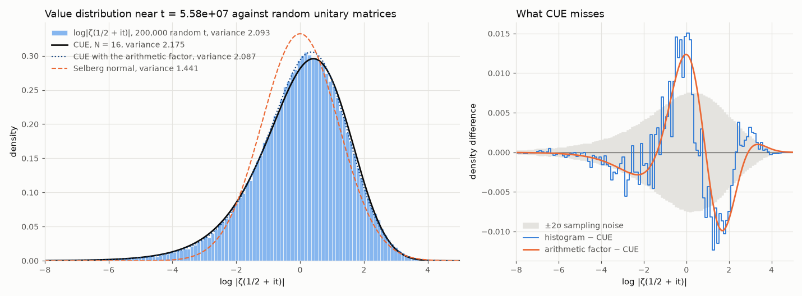

Selberg's central limit theorem says log|ζ(1/2 + it)| divided by
sqrt(½·log log T) tends to a standard normal. Keating and Snaith (2000) proposed a
much sharper model: the characteristic polynomial of a random N×N unitary matrix
(CUE) with N = log(T/2π). Its moment generating function is exact,

```
E|det(I − U)|^s = Π_{j=1..N} Γ(j)·Γ(j + s) / Γ(j + s/2)²
```

so the cumulants are κ_m = (1 − 2^(1−m))·Σ_{j≤N} ψ^(m−1)(j), and the density
comes from Fourier inversion of the product along s = iu (trapezoid rule, step
0.01). The density integrates to 1 within 1e-9, its moments match the cumulants,
and a histogram of 20,000 Haar-random 12×12 unitaries sits within 0.015 of it.

Sampling 200,000 random t in [T, 1.01·T] with T = 2π·e^N, so that N is an
integer:

| N | T | variance | κ₃ | CUE variance | CUE κ₃ | CUE + arithmetic variance | CUE + arithmetic κ₃ | Selberg ½ log log T |
|---|---|---|---|---|---|---|---|---|
| 8 | 1.87·10⁴ | 1.730 | −2.10 | 1.829 | −2.374 | 1.741 | −2.140 | 1.143 |
| 10 | 1.38·10⁵ | 1.864 | −2.20 | 1.940 | −2.393 | 1.852 | −2.159 | 1.236 |
| 12 | 1.02·10⁶ | 1.957 | −2.14 | 2.031 | −2.405 | 1.943 | −2.171 | 1.314 |
| 14 | 7.56·10⁶ | 2.019 | −2.13 | 2.108 | −2.414 | 2.020 | −2.180 | 1.381 |
| 16 | 5.58·10⁷ | 2.093 | −2.10 | 2.175 | −2.421 | 2.087 | −2.187 | 1.441 |

The means are all within 0.011 of zero. Selberg's normal is far too narrow at
these heights: the variance does grow like ½ log log T, but with 0.59 to 0.65 on
top. CUE gets the variance within 0.1 and the strong negative skew roughly right
(log|ζ| has a long left tail from the zeros), but it is too wide by 0.074 to 0.099
at every height, and that gap doesn't shrink with N.

The gap is the primes. In the moment conjecture of Keating and Snaith the CUE
moments get multiplied by an arithmetic factor,

```
a(k) = Π_p (1 − 1/p)^(k²) · E|1 − e^(iθ)/√p|^(−2k)      (θ uniform)
```

which is what you get from the hybrid Euler-Hadamard product of Gonek, Hughes and
Keating: ζ is a product over small primes times a product over nearby zeros, and
only the second part looks like a random matrix. Reading log a(s/2) as an extra
cumulant generating function gives the correction to every cumulant of log|ζ|.
Per prime, `values.arithmetic_cumulants` expands
log Σ_m ((s/2)_m / m!)² p^(−m) + (s²/4)·log(1 − 1/p) as a power series in s,
sums over the 78,498 primes below 10⁶ and adds the tail beyond them in closed form
(the p^(−2) term, −(s/2)²(s/2 − 1)²/4 · Σ_(p>P) p^(−2), with the prime sum from
E1(log P)). The result:

| | κ₂ | κ₃ | κ₄ |
|---|---|---|---|
| arithmetic factor | −0.0881 | +0.2337 | −0.0989 |

The variance correction is ½·Σ_p (Li₂(1/p) + log(1 − 1/p)), which the test suite
checks against mpmath's polylog, and κ₃, κ₄ are checked against the cumulants of
−log|1 − e^(iθ)/√p| by quadrature in θ. With it the predicted variance is within
0.015 of the data at all five heights (the sampling error of a variance here is
0.008), and the skew moves from −2.4 to −2.14..−2.19 against −2.10..−2.20 measured.
Nothing was fitted. The right panel of the chart is the histogram minus the CUE
density next to the same difference for CUE with the four arithmetic cumulants
added (`hybrid_density`): the bump at 0 and the dip near 1.7 are the primes.

The full arithmetic factor can't be Fourier-inverted on its own. Its variance is
negative, so its characteristic function grows like e^(0.044u²) and the product
with the CUE one blows up for large u. Truncating it at the fourth cumulant gives a
transform that decays (κ₄ < 0). At N = 12 the resulting density integrates to 1
within 1e−8, has the predicted variance and skew, and its most negative value is
−3e−8, in the far tail.

### Moments

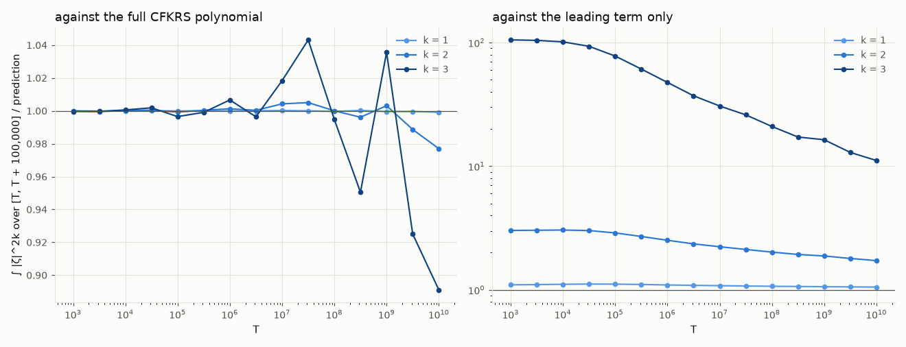

Conrey, Farmer, Keating, Rubinstein and Snaith (2005) conjectured the full
asymptotic for the 2k-th moment,

```
∫_0^T |ζ(1/2 + it)|^(2k) dt = ∫_0^T P_k(log(t/2π)) dt + O(T^(1/2 + ε))
```

with P_k a polynomial of degree k². For k = 1 it is a theorem (Ingham):
P_1(x) = x + 2γ. For k = 2 it matches Heath-Brown's fourth moment, and for k = 3 it
is a conjecture. `moments.py` has P_1 in closed form and P_2, P_3 as printed in the
paper. Their leading coefficient is a_k·G(k + 1)²/G(2k + 1), with G the Barnes
function and a_k the arithmetic factor above at integer k; computing it from the
Euler product (primes to 10⁶ plus the E1 tail) gives 1/(2π²) for k = 2 and
5.708527034652e−6 for k = 3, both within 3e−11 of the paper.

`z_power_integrals(C, D)` integrates Z(t)^(2k) with the trapezoid rule on a grid of
step 1/(2k·log(D/2π)), evaluating Z through the same Odlyzko-Schönhage windows as
the zero finder (own ζ below t = 1000). Z^(2k) is close to band-limited, with
frequencies up to k·log(t/2π), so the interior of the trapezoid rule is
spectrally accurate and all of the error sits at the two ends. An 8-point Gregory
correction at each end removes it: the weights come from solving, in exact
rationals, for the corrections that reproduce the Euler-Maclaurin endpoint terms
on polynomials of degree below 8. Against Gauss-Legendre on mpmath's `siegelz`
over 3-unit blocks at step 0.005, including the blocks around the records
Z(50626.48) = 23.7 and Z(77403.72) = 28.2 where Z⁶ passes 10⁸, the agreement is
1e−11 or better. At the default step the endpoint error is about 0.01 in absolute
terms, which is 2e−8 of a 3-unit block and nothing on a long one: halving the step
moves the integral over [50000, 60000] by 5e−12.

The paper has two tables to compare with. For the smoothed moments
∫_0^∞ |ζ|^(2k) e^(−t/10⁴) dt (`smoothed_moments(1e4)`, integrated to t = 6·10⁵):

| k | measured here | CFKRS, measured | conjecture here | CFKRS, conjecture |
|---|---|---|---|---|
| 1 | 79499.9312639 | 79499.9312635 | 79496.7897047 | 79496.7897047 |
| 2 | 5088336.51209 | 5088336.43654 | 5088332.55512 | 5088332.55512 |
| 3 | 708967539.4 | 708967359.4 | 708965694.5 | 708965694.5 |

The conjecture column uses ∫_0^∞ log(t/2π)^j e^(−t/T) dt = T·j!·[s^j] e^(as)Γ(1 + s)
with a = log(T/2π), a power series exponentiated in closed form. It agrees with
the paper to every printed digit, as long as the two numbers in the paper's k = 2
row are read the other way round: printed as is, they say the conjecture is
5088336.43654 and the measured value 5088332.55512, and my conjecture integral
matches the second one to 12 digits. For the sixth moment over blocks of 50,000:

| block | measured here | CFKRS, measured | relative gap |
|---|---|---|---|
| [0, 50000] | 7231006986.4 | 7231005642.3 | 1.9e−7 |
| [50000, 100000] | 15723925543.3 | 15723919113.6 | 4.1e−7 |
| [100000, 150000] | 21536848443.9 | 21536840937.9 | 3.5e−7 |
| [1000000, 1050000] | 70233469614.7 | 70233393177.0 | 1.1e−6 |

The paper's measured values were computed in Mathematica. The second moment agrees
to 12 digits, so the gap grows with k, which is what a fixed relative error in the
integration on their side would do. My two evaluators of Z agree with each other and
with mpmath to 1e−11 or better on the same ranges.

The chart repeats the comparison over windows [T, T + 10⁵] from T = 10³ to 10¹⁰
(470 s for all fifteen windows). The second moment stays within 8e−4 of P_1 and
the fourth within 0.5% up to 10⁹ (1.1% and 2.3% at 3·10⁹ and 10¹⁰). The sixth moment is within 0.7%
up to 3·10⁶ and then wanders by up to 11%: with |ζ|⁶ a window of 10⁵ is
dominated by a few large peaks, and CFKRS's own blocks at 10⁶ move by ±1%. The
right panel is the point of the full polynomial. Keating and Snaith's leading term
a_k g_k (log T)^(k²) / (k²)! is off by a factor 11 for k = 3 even at 10¹⁰, and the
ratio shrinks only like a polynomial in 1/log T.

### The maximum in a short interval

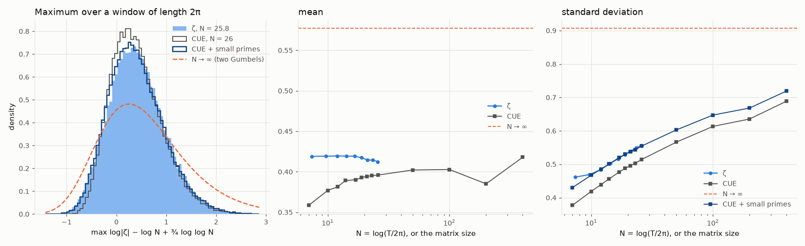

Fyodorov, Hiary and Keating (2012) predicted the largest value of |ζ| on a
window of fixed length near height T. With N = log(T/2π), the number of zeros in a
window of length 2π,

```
max_(0 ≤ h ≤ 2π) log|ζ(1/2 + i(T + h))| = log N − ¾ log log N + y
```

where y has a limit law with density 4e^(−2y) K₀(2e^(−y)), the law of half the sum
of two independent standard Gumbel variables. The −¾ log log N (rather than the
−¼ that independent values would give) and the y·e^(−2y) right tail come from the
logarithmic correlations of log|ζ|, the same structure as branching random walks.
The leading order is a theorem (Arguin, Belius, Bourgade, Radziwiłł and
Soundararajan 2019), and Arguin, Bourgade and Radziwiłł proved the −¾ term with
tight tails (2020, 2023). The limit law itself is open.

`maxima.py` computes K₀ and K₁ from ∫_0^∞ e^(−x cosh s) cosh(νs) ds with the
trapezoid rule, which converges double-exponentially (1e−12 against mpmath), so
the limit density and its CDF 2e^(−y) K₁(2e^(−y)) need nothing outside numpy. The
law has mean γ and variance π²/12, and 200,000 simulated pairs of Gumbels sit within
the KS noise of the CDF.

`zeta_maxima(T, count)` takes consecutive windows [T + 2πk, T + 2π(k + 1)],
evaluates Z on 16 points per mean zero spacing through the Odlyzko-Schönhage
windows, with the grid aligned to the window edges, and then runs golden-section
search on every grid cell whose higher end is within 0.02 of its window's best
grid value. The grid misses the top of a typical peak by about 0.005, a quarter
of that margin, so the cell holding the true maximum qualifies. Against scans with 100,001 points per
window the maxima agree to 1e−8. 50,000 windows take 52 s at 10⁴ and 124 s at 10¹².

The random-matrix side is the maximum of log|p_N(θ)| = Σ log|2 sin((θ − φ_j)/2)|
over the circle for Haar unitaries (QR of a complex Ginibre matrix with the phases
of R's diagonal divided out). Each term is concave between eigenangles, so the
maximum on each gap is the unique root of ½Σ cot((θ − φ_j)/2), found by Newton with
a bisection safeguard. My first version evaluated p_N by FFT of its coefficients,
which is fine for N = 26 and useless at N = 100: the coefficients sum to 2^N in
absolute value and the rounding error swamps |p_N| (it reported a mean of 17).

Over 50,000 windows at each height:

| T | N | ζ mean | CUE mean | ζ variance | CUE variance | CUE + primes | KS: CUE, + primes, limit |
|---|---|---|---|---|---|---|---|
| 10⁴ | 7.4 | 0.419 | 0.361 | 0.213 | 0.146 | 0.189 | 0.093, 0.068, 0.168 |
| 10⁵ | 9.7 | 0.419 | 0.375 | 0.220 | 0.172 | 0.215 | 0.065, 0.049, 0.165 |
| 10⁶ | 12.0 | 0.420 | 0.381 | 0.234 | 0.193 | 0.235 | 0.063, 0.048, 0.159 |
| 10⁷ | 14.3 | 0.419 | 0.389 | 0.253 | 0.210 | 0.253 | 0.052, 0.035, 0.153 |
| 10⁸ | 16.6 | 0.419 | 0.390 | 0.266 | 0.225 | 0.268 | 0.049, 0.034, 0.147 |
| 10⁹ | 18.9 | 0.417 | 0.393 | 0.280 | 0.237 | 0.280 | 0.042, 0.029, 0.143 |
| 10¹⁰ | 21.2 | 0.415 | 0.394 | 0.291 | 0.247 | 0.290 | 0.039, 0.028, 0.140 |
| 10¹¹ | 23.5 | 0.414 | 0.395 | 0.302 | 0.255 | 0.298 | 0.037, 0.024, 0.137 |
| 10¹² | 25.8 | 0.412 | 0.396 | 0.309 | 0.264 | 0.307 | 0.034, 0.022, 0.135 |

The CUE columns are interpolated between integer N from 100,000 matrices per
size. The data are nowhere near the limit law: the mean is
0.41 against γ = 0.577 and the variance 0.31 against 0.82 at 10¹², and the KS
distance to the limit only falls from 0.168 to 0.135 across eight decades. Random
matrices show the same lag well past any height ζ can reach: at N = 100, 200 and
400 (20,000, 5,000 and 1,000 matrices) the CUE mean is 0.403, 0.385 and 0.418 and
the variance 0.376, 0.404 and 0.474. The slow convergence belongs to the
log-correlated field, not to ζ. FHK met the same
thing at 10²⁸ and rescaled their data to the predicted variance before comparing.

ζ's maxima also spread more than CUE's at every height, by 0.045 in variance at
10¹². That excess is arithmetic. A random matrix has no structure on scales longer
than the circle, but ζ has primes, and p^(−1/2−it) with small p changes slowly
enough to lift or sink a whole window. Averaged over a window of length L the prime
sum Re Σ_p p^(−1/2−it) has amplitude p^(−1/2)·|sin(½L log p)/(½L log p)| for each
p, and since the log p are linearly independent the phases behave like independent
uniforms over many windows, so the shift has variance
Σ_p sin²(½L log p) / (2p·(½L log p)²) = 0.0430 for L = 2π (0.0420 from p ≤ 30). It
correlates with the measured maximum at 0.42 to 0.44 at every height. Adding it to
the CUE variance, with nothing fitted, lands within 0.0041 of ζ's variance from 10⁶
up (0.005 at 10⁵ and 0.024 at 10⁴), and adding an independent sample of the shift
to the CUE maxima cuts the KS distance to the data by 27 to 37%. What is left is a mean offset that shrinks from
0.058 at 10⁴ to 0.017 at 10¹²; with both means removed, the KS distance between
ζ and CUE plus primes is 0.010 to 0.017 from 10⁵ up.

### Li's criterion

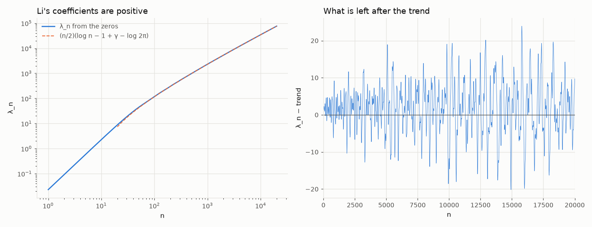

Li (1997) showed that RH holds if and only if

```
λ_n = Σ_ρ [1 − (1 − 1/ρ)^n]
```

is positive for every n ≥ 1. On the critical line 1 − 1/ρ has modulus 1, so the
pair ρ, ρ̄ contributes 4·sin²(n·arctan(1/(2γ))) ≥ 0, which is why the criterion
works. The same numbers are Taylor coefficients at the point s = 1:
Σ_n λ_n z^n / n = log ξ(1/(1 − z)).

`li.li_exact` takes the second route with no zeros at all. A zero ρ of ξ sits at
z = 1 − 1/ρ, which is on the unit circle when ρ is on the line, and an off-line
zero at height γ would land within about 1/γ² of it. So log ξ(1/(1 − z)) is
analytic well past |z| = 1/2. The code samples it on that circle, unwraps the
phase, and reads the coefficients off a discrete Fourier transform at 40 digits;
the aliasing error falls like 2^(−nodes). λ_1 = 1 + γ/2 − ½ log 4π = 0.0230957089661 to 1e−15, and moving the
circle to radius 0.4 with 220 nodes changes nothing at 1e−12.

`li_coefficients(n, gamma)` takes the first route: the sum over the given zeros
plus the rest of the zeros as the smooth density θ'(t)/π beyond the last one,
∫_T^∞ 4 sin²(n arctan(1/2t)) θ'(t)/π dt, and a boundary term −f(T)·S(T) for the
difference between the true and the smooth count at T (integration by parts of
∫ f dS). The integral is done in φ = arctan(1/2t) with φ = φ_T y⁴ to soften the
logarithm of θ' at φ = 0, 200 Gauss-Legendre nodes. With the 1,000,001 zeros below
the Gram point g_(10⁶) (found by the multi-evaluation zero finder in 148 s, count
checked against the Gram point), the sum matches the Taylor route to 1.3e−12 for
every n ≤ 40. Dropping the top half of the zeros moves λ_n by at most 1.6e−7 for n
up to 10⁵, so the tail does its job.

Every λ_n for n ≤ 20,000 (160 s) is positive and increasing, and so are the 120
log-spaced values I computed up to 10⁵. The trend (n/2)(log n − 1 + γ − log 2π) is
Voros's asymptotic under RH; what is left has standard deviation 0.43
for n ≤ 100, 2.8 for 100 to 1000, 4.4 for 1000 to 5000 and 7.5 for 5000 to 20,000,
so it grows, but slower than √n. If RH failed, a zero off the line at β + iγ would
add a term growing like |1 − 1/ρ|^n, exponentially, but only once n reaches about
γ²/(2β − 1), which for any zero above the verified height is far beyond reach. This
is a check of the computation more than a test of RH.

### Jensen polynomials

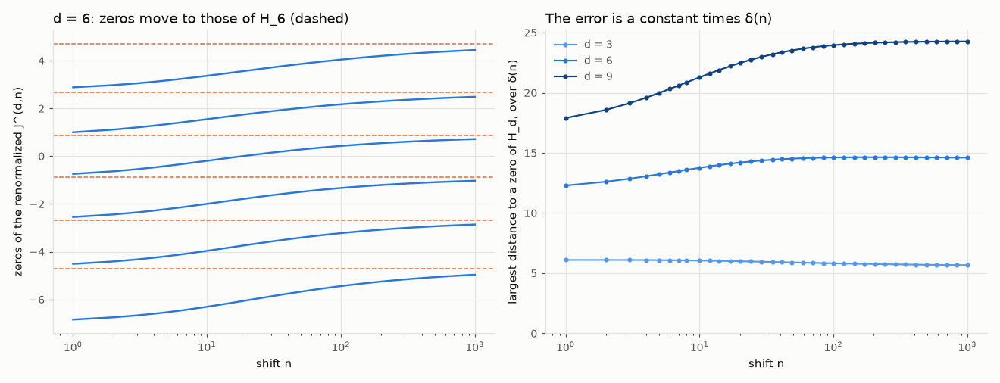

Write the completed zeta function around the center as

```
(4z² − 1)·Λ(1/2 + z) = Σ_n γ(n) z^(2n) / n!,      Λ(s) = π^(−s/2) Γ(s/2) ζ(s)
```

and attach to the sequence γ the Jensen polynomials

```
J^(d,n)(X) = Σ_(j=0..d) C(d, j) γ(n + j) X^j.
```

Pólya showed that RH holds if and only if every J^(d,n) is hyperbolic (has only
real zeros). Griffin, Ono, Rolen and Zagier (2019) proved it for d ≤ 8 and every
n, and for each d once n is large enough, by showing that after the change of
variable X → (δ(n)X − 1)/e^(A(n)) and the scaling δ(n)^(−d)/γ(n), J^(d,n) tends to
the Hermite polynomial H_d (in their normalization Σ H_d t^d/d! = e^(−t² + Xt)).

`jensen.taylor_gamma` gets γ(n) from Riemann's theta integral,
Λ(1/2 + z) = −4/(1 − 4z²) + 2∫_1^∞ t^(−3/4) cosh(z log(t)/2) θ₀(t) dt with
θ₀(t) = Σ e^(−πk²t), which turns into
γ(n) = n!/(2n)! · (32·C(2n, 2)·F(2n − 2) − F(2n)) / 2^(2n−1) with
F(m) = ∫_1^∞ (log t)^m t^(−3/4) θ₀(t) dt. All F(m) share one set of Gauss-Legendre
panels in u = log t, so a thousand of them cost one pass over the nodes; at 130
digits γ(0) to γ(1040) take 35 s. They match the paper's γ(10), γ(100) and γ(1000)
(1.6323380490e−17, 6.5777263785e−205, 3.8760340890e−2567) to every printed digit,
mpmath's Taylor series of the left side for n ≤ 3 to 1e−20, and an independent
50-digit quadrature of F(m) to 1e−35.

Hyperbolicity is decided exactly. The γ(n) are converted to rationals, J^(d,n)
is formed in `Fraction` arithmetic, and Hermite's criterion does the rest: a real
polynomial has d distinct real zeros if and only if the Hankel matrix of the
power sums of its zeros, s_(i+j) for 0 ≤ i, j < d, is positive definite. The
power sums come from Newton's identities and the pivots of Gaussian elimination
decide definiteness, so there is no rounding after the γ(n) themselves. Their
precision still matters: with 15-digit γ, J^(20,100) appears to have a pair of
complex zeros, while 60, 160 and 300 digits all give the same positive pivots.
The sweep below runs at 130 digits.

Every J^(d,n) with d ≤ 12 and n ≤ 1000 is hyperbolic (12,012 polynomials, 335 s),
and so are d = 20, 30 and 40 at n = 0, 10, 100 and 1000 (1.5, 11 and 45 s each).
That is a check, not news: Chasse showed hyperbolicity at n = 0 up to
d = 2·10¹⁷. The more interesting output is how the limit is approached. The
paper's closed form for A(n), δ(n), with L(n) the root of n = L(πe^L + 3/4)
evaluated at 2n − 2, agrees with the values read off the data
(δ² = −½·Δ² log γ(n), A = Δ log γ(n) + δ²) to 9% in δ at n = 20, 0.5% at 170 and
0.14% at 492. With the data values, the largest distance between a zero of the
renormalized J^(d,n) and the matching zero of H_d, divided by δ(n), levels off
near 5.7, 14.6 and 24.3 for d = 3, 6 and 9. So the convergence is first order in
δ(n), which falls like 1/√n up to logs, and it is slow: at n = 1000 every zero of
the d = 6 polynomial is still 0.15 to 0.25 below its Hermite limit (left panel).

### Dirichlet L-functions

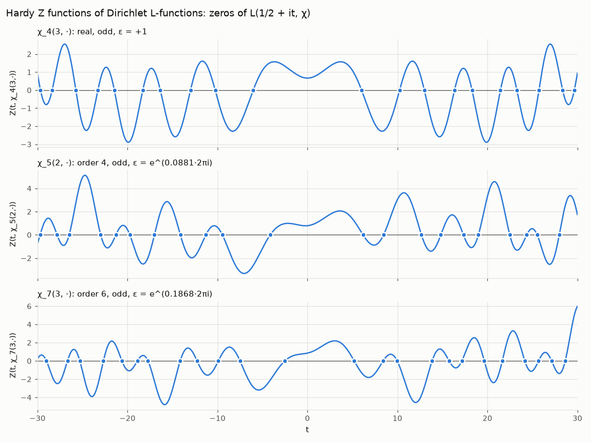

A Dirichlet character mod q is a homomorphism (Z/qZ)* → C*, extended by 0 to the
integers that share a factor with q. `conrey(q, n)` builds χ_q(n, ·) with the
Conrey labels LMFDB uses: for an odd prime p the generator g_p is the least
primitive root mod p², and with n ≡ g^a, m ≡ g^b mod p^e,
χ(m) = exp(2πi·ab/φ(p^e)). Powers of 2 use ±5^a instead, and a general q
multiplies the prime-power pieces via CRT. Values are stored as exact numerators
over the order, so χ² = 1 is an integer statement and real characters come out
exactly real. The conductor is the smallest d | q for which χ is trivial on
m ≡ 1 mod d, and `primitive()` builds the character mod d that induces χ.

For σ ≥ 0 the series is split by residue class, L(s, χ) = q^(−s) Σ_a χ(a)·ζ(s, a/q),
and each Hurwitz zeta gets the same Euler-Maclaurin tail as ζ itself, starting at
the term N = 10 + |t|/π so that about q·N terms are summed directly. The tail has
an integral term (N + a/q)^(1−s)/(s − 1), and since Σχ(a) = 0 the 1/(s − 1) parts
cancel. Writing that term as ((N + a/q)^(1−s) − 1)/(s − 1) with `expm1` removes
the cancellation before it happens, so L(1, χ) and its neighborhood come out to full
precision with no special case.

For σ < 0 the code uses the functional equation of the primitive character,

```
L(s, χ) = ε(χ)·2^s·π^(s−1)·q^(1/2−s)·Γ(1 − s)·sin(π(s + κ)/2)·L(1 − s, χ̄)
ε(χ) = τ(χ) / (i^κ·√q),   τ(χ) = Σ_a χ(a)·e^(2πia/q)
```

where κ = 0 for even and 1 for odd characters. Trivial zeros at s = −κ − 2m come out
as exact zeros. An imprimitive χ is its primitive character times the Euler factors
(1 − χ*(p)p^(−s)) for the primes that divide q but not the conductor.

On the critical line, θ(t, χ) = (t/2)·log(q/π) + arg Γ((1/2 + κ + it)/2) − arg(ε)/2
makes Z(t, χ) = e^(iθ)·L(1/2 + it, χ) real, the analogue of Riemann-Siegel Z. For a
complex χ the zeros are not symmetric about t = 0; the zeros of χ below the axis are
the zeros of χ̄ above it:

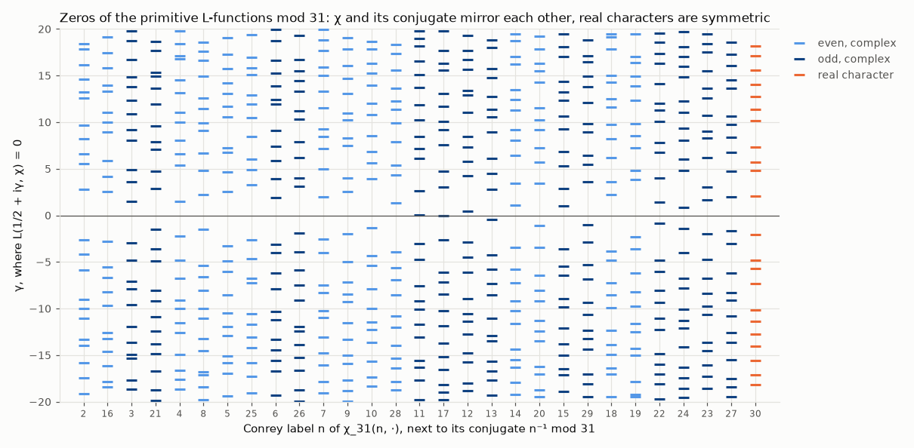

Sign changes of Z only find zeros on the line. `count_zeros_box` counts every zero
in −1/2 ≤ σ ≤ 2, |t| ≤ T with the argument principle: it follows arg L around the
rectangle, bisecting any step where the argument jumps by more than 0.5 rad, and
subtracts the trivial zeros inside the box. `verify_zeros` finds zeros on the line
and checks that both counts agree, which shows (up to floating-point error, not with
interval arithmetic) that every zero in the box is on the critical line and simple.
When the counts disagree it doubles the sampling density and tries again. That
happened for real: χ₅₉(9, ·) has two zeros at t = 14.636869 and 14.662140, 0.025
apart, with |Z| no bigger than 0.0011 between them, and the default grid stepped
over both. mpmath's `dirichlet` confirms the sign pattern.

Checks:

- L(s, χ) against mpmath's `dirichlet` at random points with −15 < σ < 15 and
  |t| < 80, for ten characters up to q = 40: relative error below 1e-12, worst
  5e-14.
- The first three zeros of χ₃(2, ·), χ₄(3, ·) and χ₅(2, ·) against LMFDB: within
  2e-15. The root number of χ₅(2, ·) matches LMFDB's root angle 0.0881040955873917.
- L(1 − k, χ) = −B_(k,χ)/k with generalized Bernoulli numbers computed from exact
  Bernoulli polynomials, k = 1 to 7 for seven characters.
- The class number formula L(1, χ_d) = 2πh/(w√|d|) for every fundamental d with
  −2000 < d < 0, with h counted from reduced binary quadratic forms: max error in h
  2e-14. For real fields L(1, χ_d)·√d/(2 log ε_d) with the fundamental unit from
  the continued fraction of (1 + √d)/2 or √(d/4) lands within 4e-15 of an integer
  for every fundamental d < 2000, and on the known class numbers 2, 2, 3, 3, 4 for
  d = 40, 60, 229, 316, 328.
- Orthogonality of the character table, the count of primitive characters
  Σ μ(q/d)φ(d), χ_q(m, ·)χ_q(n, ·) = χ_q(mn, ·), the symmetry χ_q(m, n) = χ_q(n, m),
  |τ(χ)| = √q, and ε = 1 for the quadratic characters tested (Gauss's sign of the
  quadratic Gauss sum).
- `verify_zeros` with T = 30 on every primitive character of conductor 3 to 100:
  1,815 L-functions, 80,838 zeros, all on the critical line (342 s).

### Large conductors

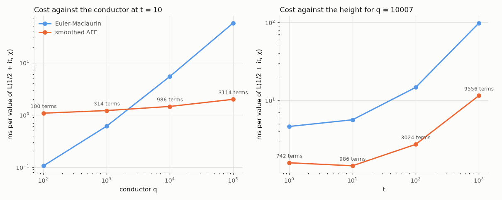

Euler-Maclaurin sums about q·(10 + |t|/π) terms, which is fine for q in the
thousands and hopeless at q = 10⁵. `afe.py` uses a smoothed approximate functional
equation in the style of Rubinstein instead. For a primitive χ with parity κ, the
completed L-function is

```
Λ(s, χ) = (q/π)^z·Γ(z)·L(s, χ) = ε(χ)·Λ(1 − s, χ̄),   z = (s + κ)/2
```

and Λ is the Mellin transform of the theta series Σ χ(n)·n^κ·exp(−πn²x/q). Split
the integral at |x| = 1 along the ray x = r·e^(iφ) instead of the positive axis, and
apply the theta transformation to the inner half. Both pieces become incomplete
gamma functions:

```
Λ(s, χ) = Σ χ(n)·(q/π)^z·n^(−s)·Γ(z, w_n) + ε·Σ χ̄(n)·(q/π)^z'·n^(s−1)·Γ(z', w̄_n)
w_n = πn²·e^(iφ)/q,   z' = (1 − s + κ)/2
```

With φ = 0 this is the classical formula, and it breaks high up. On the critical
line Γ(z) is about e^(−π|t|/4), the two sums cancel down to that size, and dividing
by Γ(z) loses every digit by t ≈ 50. Rotating fixes the scale. Along the ray,
|u^(z−1)| carries a factor e^(−φ·Im z), so with φ = sign(t)·(π/2 − θ) no term is
more than about e^(|t|θ/2) times Γ(z). The code takes |t|θ/2 = 3, which gives up
three e-folds (1.3 digits) and sets θ = 6/|t|. The terms decay like
exp(−πn²·sin θ/q), and each sum stops once that drops below e^(−43):

```
N ≈ √(43q / (π·sin θ)) ≈ √(43q|t| / 6π)
```

That is O(√(q|t|)) terms where Euler-Maclaurin needs O(q|t|). Below |t| = 3.8 the
angle stays at π/2 (no rotation) and N ≈ 3.7√q.

`gammaincc` computes Γ(z, w)/Γ(z) for z with real part 1/4 or 3/4 and imaginary part
up to t/2, and w nearly imaginary. It uses the power series of γ(z, w) when
|w| < |z| + 1 and Legendre's continued fraction (modified Lentz, with converged
entries dropped from the working set) otherwise. The fraction takes from a few to
about a hundred steps over the range the sums need. Both forms are relative to
Γ(z), the scale of the answer, so 1 − γ/Γ never cancels anything that matters. One
more rewrite keeps phases small: n^(−s)·w_n^z = n^κ·(π/q)^z·e^(izφ), so the t·log n
phase of each term cancels exactly instead of being computed and subtracted.

`dirichlet_l` picks a method per point with a cost model fit to the timings above:
the AFE when 0 < σ < 1 and q·(10 + |t|/π) > 25000 + 100·N. At t = 10 the crossover
is near q = 2000. At q = 100003 one value costs 2.0 ms against 57 ms, and at
q = 10007, t = 1000 it is 11.5 ms against 98 ms. `method="em"` forces the old path.

Checks:

- `gammaincc` against mpmath's `gammainc` at 80 random points with |Im z| ≤ 300 and
  10⁻⁴ ≤ |w| ≤ 10³: within 1e-11 (relative to max(1, |Q|)). Also Q(1, w) = e^(−w)
  and the recurrence Q(z + 1, w) = Q(z, w) + w^z·e^(−w)/Γ(z + 1).
- L against mpmath's `dirichlet` at random points of the strip with |t| < 200, for
  nine characters up to q = 97: relative error below 1e-12.
- The value cannot depend on the rotation, and a wrong formula would. At q = 1009,
  allowing 1.5, 3 or 6 e-folds of loss (which changes θ and the number of terms)
  moves L by less than 2e-12 relative at t = 0, 2, 40 and 400.
- AFE against Euler-Maclaurin for χ_(−2003) at σ = 0.2, 0.5 and 0.9: within 1e-11.
  The zeros of χ₁₀₀₀₇(2, ·) below t = 6 found both ways agree to 1e-10, and at
  q = 100003, t = 10 the two methods differ by 7e-14.

### Low-lying zeros

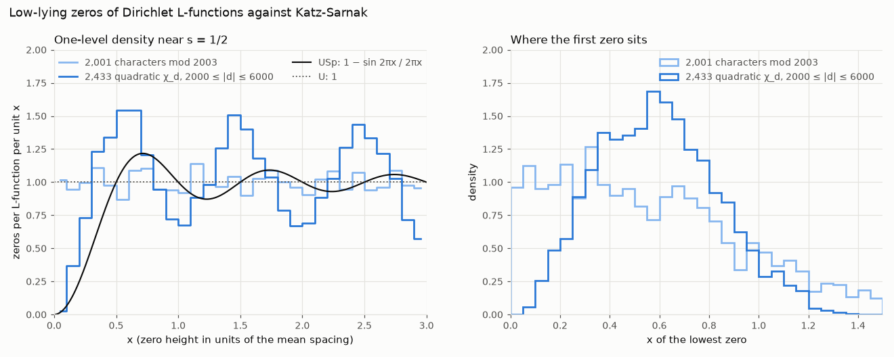

Katz and Sarnak predict that the zeros of a family of L-functions close to s = 1/2
follow the eigenvalues of a random matrix group, and that the group depends on the
family's symmetry. All characters mod a prime p form a unitary family: nothing
special happens at the central point, and the density of zeros there is flat. The
real quadratic characters χ_d form a symplectic family, and their zeros are pushed
away from s = 1/2 with density

```
W_USp(x) = 1 − sin(2πx) / (2πx)
```

`low_zeros` unfolds each zero with the L-function's own smooth count,
x = (θ(γ, χ) − θ(0, χ))/π, so every family has mean density 1 regardless of its
conductor. That needs θ to increase from t = 0, which holds when
log(q/π) + ψ((1/2 + κ)/2) > 0, i.e. q ≥ 10 for odd and q ≥ 216 for even characters.
Below that the code refuses. Only zeros with γ > 0 count; for a complex χ the zeros
below the axis belong to χ̄, which is in the family too.

The chart uses the 2,433 fundamental discriminants with 2000 ≤ |d| ≤ 6000 (both
signs) and the 2,001 nontrivial characters mod 2003, 13,347 zeros in all. The run
took 8 minutes on one process before the approximate functional equation, and 30 s
on 16 processes now. Results:

- Unitary: flat. Every bin of width 0.1 on [0, 3] is within 0.14 of 1.
- Symplectic: 0.029 zeros per L-function per unit x in [0, 0.1], where W_USp
  averages 0.022, and 0.37 in [0.1, 0.2], where it averages 0.15. Only 4.0% of the quadratic L-functions have a
  zero below x = 0.2, against 19.7% mod 2003.
- The quadratic density also oscillates with period 1 and peaks near x = 1/2, 3/2
  and 5/2, well beyond the oscillation in W_USp. This is Gram's law for L-functions.
  A real primitive χ has ε = 1, so θ(0) = 0 and the n = 1 term of
  Z(t) = Re(e^(iθ)·Σ χ(n)n^(−1/2−it)) is cos θ(t), which vanishes exactly at
  half-integer x. For complex characters x is measured from θ(0) = −arg(ε)/2, a
  phase spread around the circle, so the bias averages out. The higher terms only
  win slowly as log q grows. Stopple's experiment with about a million quadratic
  characters at |d| > 10¹² found that lower-order terms still matter at that size.

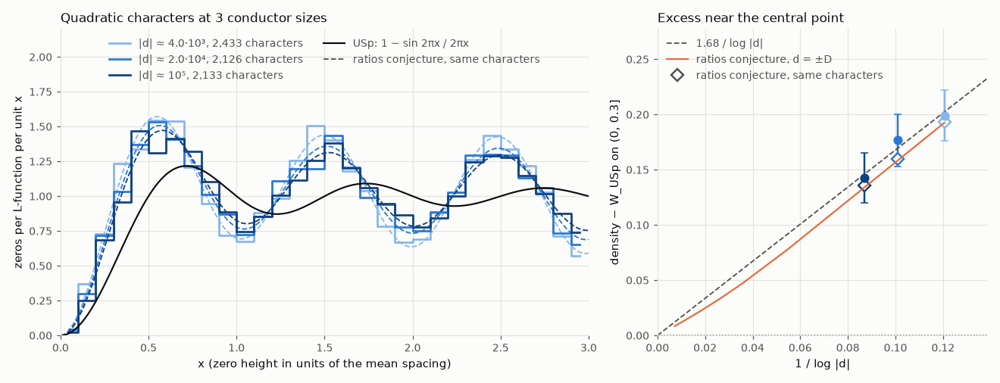

With the approximate functional equation the same experiment reaches conductors
near 10⁵. The 2,133 fundamental discriminants with 100000 ≤ |d| ≤ 103500 take 60 s
on 16 processes, and 2,000 characters mod 100003 take 42 s. The unitary family
stays flat (every bin within 0.17 of 1, 20.0% with a zero below x = 0.2). The
quadratic family moves toward W_USp, which averages 0.178 on (0, 0.3]:

| \|d\| | characters | zeros with x ≤ 3 | density on (0, 0.3] | excess over W_USp | first zero below 0.2 |
|---|---|---|---|---|---|
| 2000 to 6000 | 2,433 | 7,350 | 0.377 | 0.199 ± 0.023 | 4.0% |
| 20000 to 23500 | 2,126 | 6,394 | 0.354 | 0.177 ± 0.024 | 3.4% |
| 100000 to 103500 | 2,133 | 6,415 | 0.320 | 0.143 ± 0.022 | 2.8% |

The ± is the Poisson error of the zero count. The excess shrinks about like
1/log|d|: the weighted line through the origin, 1.68/log|d|, passes through all
three error bars. The Gram oscillation is still there at 10⁵, a little lower.

### Lower-order terms from the ratios conjecture

The dashed curves on the left of that chart are not fits. They come from the
L-functions ratios conjecture (Conrey, Farmer and Zirnbauer), which Conrey and
Snaith turned into a one-level density for quadratic characters that is exact up
to O(X^(−1/2+ε)), lower-order terms included. For one χ_d it says the zeros near the
central point have density, per unit x,

```
ρ_d(x) = 1 + Re B(t) / θ'(t),    θ(t) = πx
B(t) = ζ'/ζ(1 + 2it) + A'(it; it) − e^(−2iθ(t)) ζ(1 − 2it) A(−it; it)
A(−r; r) = Π_p (p² − p^(2r)) / (p² − 1)
A'(r; r) = Σ_p log p / ((p + 1)(p^(1+2r) − 1))
```

with θ = θ(t, χ_d), so the gamma factor and the parity κ come in through the same
θ the zeros were unfolded with. The products are over every prime, 2 included.
That relies on a property of the family which `test_family_matches_local_densities`
checks directly: among fundamental discriminants a fraction 1/(p + 1) is
divisible by p, and the rest split evenly between χ_d(p) = 1 and −1. Both poles
at t = 0 cancel, and expanding to first order gives ρ_d(0) = 0, which the code
reproduces to 1e-6 at x = 10⁻⁴.

`ratios.py` evaluates this from scratch. ζ'/ζ on the line Re s = 1 is the
derivative of the entire function (s − 1)ζ(s), taken by the trapezoidal rule on a
circle of radius 1/4 (32 points, within 1e-13 of mpmath right next to the pole).
The Euler products run over primes up to 10⁴, which moves the density by 6e-5
against 10⁵. The arithmetic depends only on t and the gamma part only on the
parity, so a whole family of 2,433 characters costs 0.5 s. The family
prediction is the average of ρ_d over the actual discriminants, each mapped
through its own θ.

Against the histograms (30 bins on [0, 3], Poisson errors):

| \|d\| | χ² against the ratios prediction | χ² against W_USp | excess on (0, 0.3], measured | predicted |
|---|---|---|---|---|
| 2000 to 6000 | 20.7 | 718.9 | 0.199 ± 0.023 | 0.194 |
| 20000 to 23500 | 15.6 | 410.8 | 0.177 ± 0.024 | 0.160 |
| 100000 to 103500 | 17.7 | 298.3 | 0.143 ± 0.022 | 0.136 |

So the bumps at half-integers, the shoulder near the origin and the slow approach
to W_USp are all lower-order terms of the ratios conjecture. Nothing in the data
at this size needs anything beyond them.

The leading correction has a closed form. As |d| → ∞ at fixed x,

```
ρ_d(x) = W_USp(x) + 2(γ − ζ'(2)/ζ(2))(1 − cos 2πx) / (log(|d|/π) + ψ(1/4 + κ/2)) + ...
```

where γ − ζ'(2)/ζ(2) = 1.1472 and the −ζ'(2)/ζ(2) is A'(0; 0). The 1 − cos 2πx
is the half-integer peak pattern from before. The denominator is where the slow
convergence comes from: ψ(1/4) = −4.23 makes it log|d| − 5.37 for even
characters, so at |d| = 4000 the "large" parameter is 2.9. The orange curve on
the right panel is the full prediction for d = ±D out to D = 10⁶⁰. It bends below
the fitted line; the excess times log D goes 1.51, 1.32, 1.23 at D = 10⁶, 10¹²,
10²⁴, on its way to 2 · 1.1472 · 0.4954 = 1.137, where 0.4954 is the average of
1 − cos 2πx over the window. `test_leading_correction_is_closed_form` checks the
expansion at |d| = 10²⁰⁰ for both parities.

### The lowest zero and Fredholm determinants

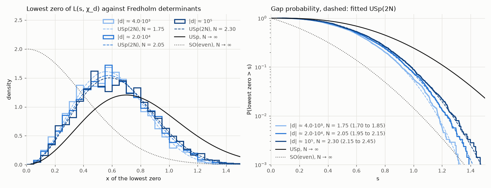

The ratios conjecture as used above gives the one-level density, not where the
lowest zero sits. For that the random matrix side needs a gap probability: the
chance that no eigenangle lands in (0, s) is a Fredholm determinant
E(s) = det(I − K) on L²(0, s), with

```
USp, N → ∞:        K(x, y) = S(x − y) − S(x + y),    S(z) = sin(πz)/(πz)
SO(even), N → ∞:   K(x, y) = S(x − y) + S(x + y)
USp(2N):           K(x, y) = D(x − y) − D(x + y),    D(z) = sin((2N + 1)πz/2N) / (2N sin(πz/2N))
```

in units where the mean spacing is 1. `rmt.py` follows Bornemann: Gauss-Legendre
nodes on (0, s), and the determinant of the 40 × 40 Nyström matrix
δ_ij − √w_i K(x_i, x_j) √w_j. The convergence is exponential; 20 and 60 nodes
agree to 1e-14 at s = 2. The density of the lowest zero is −E'(s), and instead of
a finite difference it comes from the resolvent at the endpoint,
−E'(s) = E(s)·R(s, s), where R(·, s) solves the same Nyström system with K(·, s) as
the right-hand side. That matches a central difference to 1e-8.

Checks:

- USp(2) is SU(2), one angle with density (2/π)sin²θ, so E(s) = 1 − s + sin(2πs)/2π
  in closed form. SO(2) is uniform. Both to 1e-14.
- USp(4) and SO(4) against a direct 2-D integral of the Weyl density
  (cos θ₁ − cos θ₂)²·sin²θ₁ sin²θ₂ (or without the sines): 1e-13.
- The sine kernel on (−s, s) splits into its even and odd parts, so
  E_USp(s)·E_SO(s) must equal the GUE gap on an interval of length 2s, and that
  must match Mehta's series 1 − s + π²s⁴/36 − π⁴s⁶/675 + π⁶s⁸/17640.
- Near the origin the USp lowest-zero density is 2π²s²/3, SO(even) starts at 2,
  the densities integrate to 1, and USp(2N) approaches the limit like 1/N.

The data are nowhere near the N → ∞ law. The mean lowest zero is 0.594, 0.618 and
0.635 at the three conductor sizes, against 0.783 for USp. What does fit is
USp(2N) at small N: maximum likelihood over real N (the kernel formula is smooth
in N) gives N = 1.75, 2.05 and 2.30, with likelihood-ratio 95% intervals 1.70 to
1.85, 1.95 to 2.15 and 2.15 to 2.45. The fitted laws have means 0.598, 0.621
and 0.636, and on the log-scale gap probability they follow the data down to
P ≈ 10⁻². The effective size grows by about 0.17 per unit of log|d|, a third of
the slope in the usual dictionary 2N ≈ log|d|. This is the same lesson as the one-level density: at conductors
you can compute, the arithmetic still shapes the zeros near the central point,
and a small matrix mimics it better than the limiting law does.

### Elliptic curves

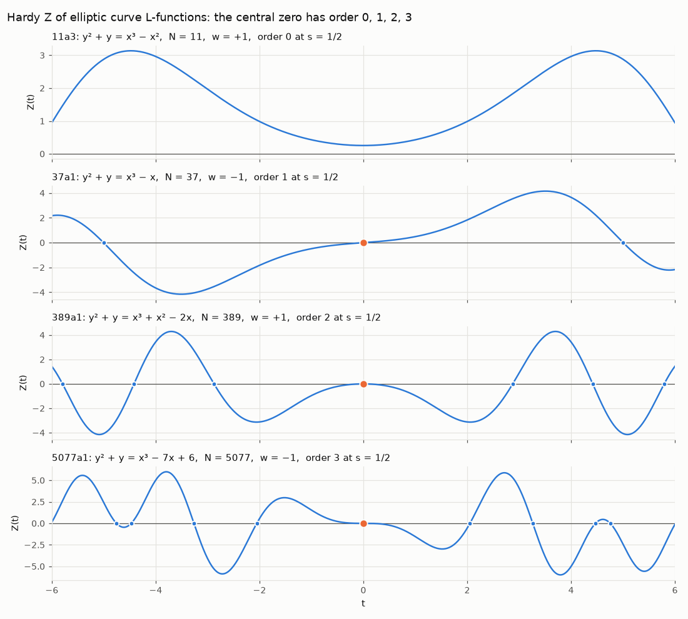

`elliptic.py` takes a Weierstrass equation y² + a₁xy + a₃y = x³ + a₂x² + a₄x + a₆
and builds its L-function from point counts. For an odd prime p, completing the
square turns the curve into Y² = f(x) = 4x³ + b₂x² + 2b₄x + b₆, so
a_p = −Σ_x (f(x)/p), one Legendre symbol lookup per x. p = 2 is counted by hand.
The same sum is right at a bad prime as long as the model is minimal there, and
it gives a_p = 1 or −1 for split or non-split multiplicative reduction. The code
only accepts semistable curves: every prime dividing Δ must leave c₄ a unit, which
also makes the model minimal. Then the conductor is the radical of Δ and the root
number is w = −∏_{p|N} (−a_p). Additive reduction would need Tate's algorithm and
raises an error. The a_n come from multiplicativity and the Hecke recursion
a_{p^(k+1)} = a_p·a_{p^k} − p·a_{p^(k−1)}.

In the analytic normalization (center at s = 1/2), Λ(s) = A^s Γ(s + 1/2) L(s)
with A = √N/2π satisfies Λ(s) = wΛ(1 − s). Splitting the Mellin integral of the
modular form at a point y₀ and folding the inner half over with the Fricke
involution gives

```
Λ(s) = Σ b_n [ (A/n)^s Γ(s + 1/2, n·y₀/A) + w (A/n)^(1−s) Γ(3/2 − s, n/(y₀·A)) ],   b_n = a_n/√n
```

for any y₀ with Re y₀ > 0. The answer can't depend on y₀, which makes a sharp
test: with the right N and w, y₀ = 1, 1.3, 0.8 and e^(0.6i) agree to 1e-12, and
flipping the root number of a twist breaks the agreement at the 1e-3 level. On the
critical line with |y₀| = 1 the two halves are complex conjugates, so
Λ(1/2 + it) = S + wS̄, and the Hardy function is 2·Re(e^(iθ)S) for w = +1 or
2·Im(e^(iθ)S) for w = −1, with θ(t) = t·log A + arg Γ(1 + it). For |t| above 6/π
the code rotates y₀ toward i, the same trick as in the Dirichlet smoothed sums,
so cancellation never costs more than a factor e³.

At the center the incomplete gamma functions collapse to the classical series
L(1/2) = 2Σ (a_n/n)·e^(−n/A) when w = +1 and L'(1/2) = 2Σ (a_n/n)·E₁(n/A) when
w = −1. E₁ is my own: the power series below 1, Legendre's continued fraction
above.

Checks:

- a_n of 11a3 against the eta product q∏(1 − qⁿ)²(1 − q¹¹ⁿ)² up to n = 300, and
  the isogenous curve 11a1 gives the same series. 37a1 against its LMFDB
  q-expansion. Hasse's bound for every p < 3000, and a_{p²} = a_p² − p.
- L(11a, 1) = 0.2538418608559107 and L'(37a, 1) = 0.3059997738340523 to 1e-14.
  The central values of 389a1 (rank 2) and 5077a1 (rank 3) come out below 1e-13.
- The first three zeros of 11a and 37a against LMFDB to 1e-11, and Z(−t) = ±Z(t)
  with the sign of w.

### Quadratic twists of 11a

For a fundamental discriminant d prime to N, the twist E_d has
a_n(E_d) = χ_d(n)·a_n(E), conductor N·d² and root number w(E)·χ_d(−N), so the
twists split by the sign of their functional equation. Katz and Sarnak predict
even orthogonal statistics for the even ones and odd orthogonal statistics for
the odd ones, where the forced central zero is set aside. I took the curve 11a3,
y² + y = x³ − x², which is the one Dueñez, Huynh, Keating, Miller and Snaith
(DHKMS, [arXiv:1107.4426](https://arxiv.org/abs/1107.4426)) use, and every
fundamental d with 5 ≤ d ≤ 6000 prime to 11: 1,674 twists, 832 even and 842 odd.
119 of the even twists have L(E_d, 1/2) = 0 (rank 2), and two odd ones, d = 1393
and d = 5777, have a triple zero (rank 3). The separation is clean: the vanishing
values come out around 1e-15, the smallest non-zero |L'(E_d, 1/2)| among the odd
twists is 0.486, and the smallest non-zero L(E_d, 1/2) is 0.082.

Finding the low zeros uses a symmetry. Λ(1/2 + it)/√w is a real entire function
of t that is even or odd, so it equals P(t²) or t·P(t²). `low_zeros` interpolates
P at Chebyshev points in u = t² up to the height of the third unfolded zero,
doubling the degree until the last coefficients fall below 1e-13 of the largest,
and takes the real roots of the Chebyshev series. The central zero is divided out
exactly, there is no sign scan, and 25 evaluations of Λ are enough at conductor
4·10⁸. On five test twists the roots agree with an Illinois search on sign
changes of Z to 1e-12. Zeros are unfolded with x = θ(γ)/π, so the mean spacing is
1. The whole family took 343 s on 12 processes.

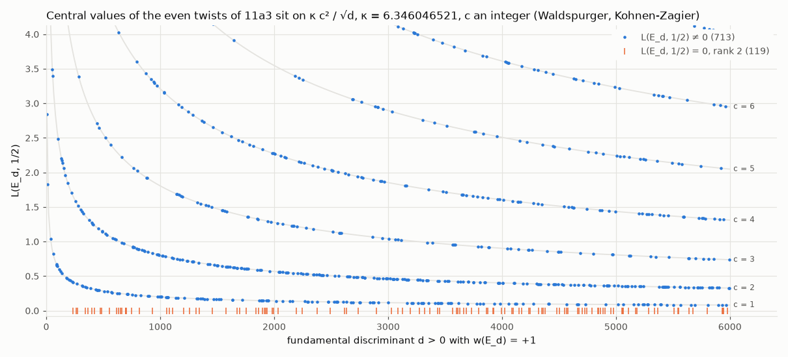

The central values are discrete. Waldspurger's theorem, in the explicit form of
Kohnen and Zagier, says L(E_d, 1/2) = κ·c(d)²/√d where c(d) is an integer (a
coefficient of a weight 3/2 modular form), and for this family DHKMS give
κ = 6.346046521. Every one of the 832 even twists lands on one of the curves
κc²/√d: the largest distance of √(√d·L/κ) from an integer is 1.6e-7, and c(d)
goes up to 16. So L(E_d, 1/2) is either 0 or at least κ/√d, never in between.

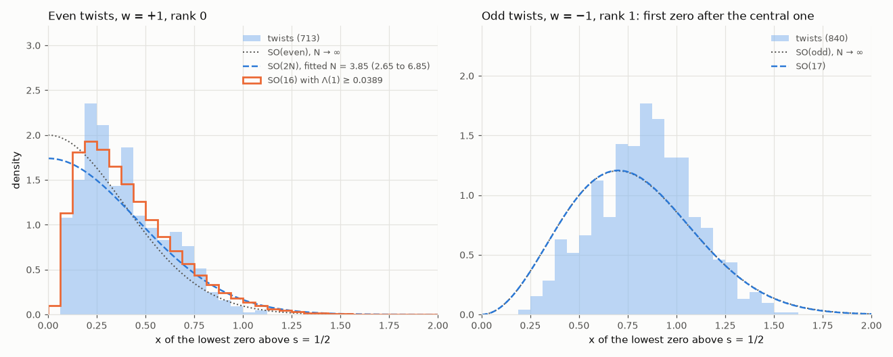

That gap is how DHKMS explain the repulsion S. J. Miller found in the lowest zero
of elliptic curve L-functions. In a random matrix model the value of the
characteristic polynomial at 1, Λ_A(1) = det(I − A), plays the part of L(1/2),
and a small central value goes with an eigenvalue close to 1. In SO(2N) nothing
stops det(I − A) from being tiny, and the lowest eigenvalue has density 2 at the
origin. The L-functions can't have tiny central values, so DHKMS drop the
matrices with Λ_A(1) < c·e^(−N/2). `rmt.so_angles` samples Haar SO(2N): QR of a
Gaussian matrix with the sign of diag(R) fixed, then one column flipped when the
determinant is −1. Its one-level density and lowest-eigenvalue law match the
Fredholm determinants above within sampling error. With N = 8, close to
log(√11·6000/2π) = 8.06, and the DHKMS constant c = 2.188, 80.7% of 300,000
matrices survive the cut (14.3% of the even twists vanish). Nothing is fitted to
my data.

| model for the 713 rank 0 even twists | χ² on 15 bins of (0, 1.5) | KS distance |
|---|---|---|
| SO(even), N → ∞ | 181.6 | |
| SO(16) | 164.6 | 0.181 |
| SO(2N), maximum likelihood N = 3.85 | 158.7 | |
| SO(16) with det(I − A) ≥ 0.0389 | 34.6 | 0.043 |

The KS distance of the excised model is under the 5% critical value of 0.051 for
713 points. Mean lowest zero: 0.394 for the twists, 0.408 excised, 0.342 for
plain SO(16). Shrinking N doesn't do it: the likelihood is flat (95% interval 2.65
to 6.85) and every SO(2N) still has density near 2 at the origin, which the data
don't.

### Odd twists and the central derivative

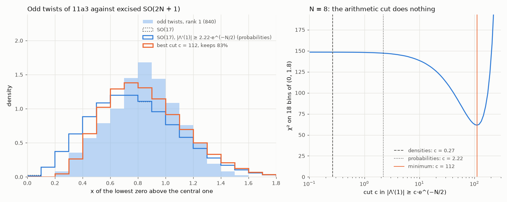

The odd twists have a forced zero at the center, and Katz-Sarnak say the next one
should follow the first nontrivial eigenvalue of SO(2N + 1), whose forced
eigenvalue at 1 plays the part of the central zero. The data disagree in the same
direction as on the even side: among the 840 rank 1 twists the lowest
non-central zero never falls below x = 0.216, while SO(17) puts 1.7% of its mass
below 0.2, and the histogram is narrower (standard deviation 0.251 against 0.325).

The even fix was a cut on Λ_A(1) at the level where L(E_d, 1/2) is discretized.
For SO(2N + 1) the characteristic polynomial vanishes at 1, so the natural
quantity is the derivative, and det(I − zA) = (1 − z)∏(1 − 2z cos θ_j + z²) gives
|Λ_A'(1)| = ∏(2 − 2 cos θ_j), the same product over the N free angles. On the
arithmetic side Gross and Zagier write L'(E_d, 1/2) as a constant times the height
of a Heegner point over √d, and heights of non-torsion points are bounded below,
so L'(E_d, 1/2) ≥ m/√d. That is the argument in Miller's paper on zero repulsion
([arXiv:1109.0224](https://arxiv.org/abs/1109.0224)). Here the smallest √d·L' is
m = 6.437, at d = 8.

To turn that floor into a matrix cut I followed DHKMS step by step. The CFKRS
recipe says the moments of the family are an arithmetic factor times the matrix
moments. `elliptic.arithmetic_factor` is the Euler product a_s(E) from their
section 5, which gives a_(−1/2) = 0.73269 for 11a with the primes below 2^14,
against their 0.732728078. `rmt.so_moment` gives E|Λ_A(1)|^s for SO(2N) and
E|Λ_A'(1)|^s for SO(2N + 1) in closed form from Selberg's integral (in
x = sin²(θ/2) the angles form a Jacobi ensemble with weight x^(∓1/2)(1 − x)^(−1/2)),
and `rmt.small_value_law` is the residue at the first pole:
P(Λ ≤ ρ) ≈ (R/α)ρ^α with α = 1/2 for SO(2N) and α = 3/2 for SO(2N + 1). That
exponent is why rank 3 is so rare among odd twists. The dictionary holds up on
this data, with N = log(√11·d/2π) rounded per twist:

| s | family mean | a_s(E) × matrix mean | ratio |
|---|---|---|---|
| even, L(E_d, 1/2), s = 1/2 | 0.9574 | 0.9845 | 0.972 |
| even, L(E_d, 1/2), s = 1 | 1.4812 | 1.4828 | 0.999 |
| odd, L'(E_d, 1/2), s = −1 | 0.1994 | 0.2375 | 0.840 |
| odd, L'(E_d, 1/2), s = −1/2 | 0.3992 | 0.3918 | 1.019 |
| odd, L'(E_d, 1/2), s = 1/2 | 3.0766 | 3.0108 | 1.022 |
| odd, L'(E_d, 1/2), s = 1 | 11.232 | 9.375 | 1.198 |

For d > 0 every odd twist has χ_d(11) = −1, and a_(−3/2)(E) = 0.2030 with that
sign. Matching densities near 0, as DHKMS do, scales the floor by a², and matching
probabilities scales it by a^(2/3). With their convention that e^(−N/2) stands for
d^(−1/2), the cut is |Λ_A'(1)| ≥ c·e^(−N/2) with c = 0.265 or c = 2.22.

Neither does anything. With N = 8 and 300,000 Haar matrices from SO(17)
(`rmt.so_angles(..., odd=True)`), c = 2.22 removes 0.13% of them. The arithmetic
floor sits deep in the tail where P(Λ' ≤ ρ) ~ ρ^(3/2) is tiny. On 18 bins of
(0, 1.8):

| model for the 840 rank 1 odd twists | kept | χ² | KS | mean |
|---|---|---|---|---|
| SO(17) | 100% | 148.4 | 0.157 | 0.781 |
| SO(17), c = 2.22 | 99.87% | 147.1 | 0.156 | 0.782 |
| SO(17), best c = 112 | 83.1% | 61.5 | 0.056 | 0.860 |
| data | | | | 0.840 |

A cut 50 times the arithmetic one removes 17% of the matrices and cuts χ² by more
than half, but the KS distance stays above the 5% critical value of 0.047, the
excised mean overshoots, and the histogram is still too wide. Smaller matrices
don't rescue it: the best cut gives χ² 74.6 for SO(5), 78.3 for SO(9) and 68.7 for
SO(13). So the odd twists repel their first zero much harder than the size of
L'(E_d, 1/2) explains, and part of the mismatch is in the bulk. DHKMS handle the
bulk on the even side with an effective N from the lower-order terms of the
one-level density (their r₁ = 2.86 for this curve). The odd family needs the same
computation before an excised model can be judged fairly.

### Rank 2 twists and the forced pair

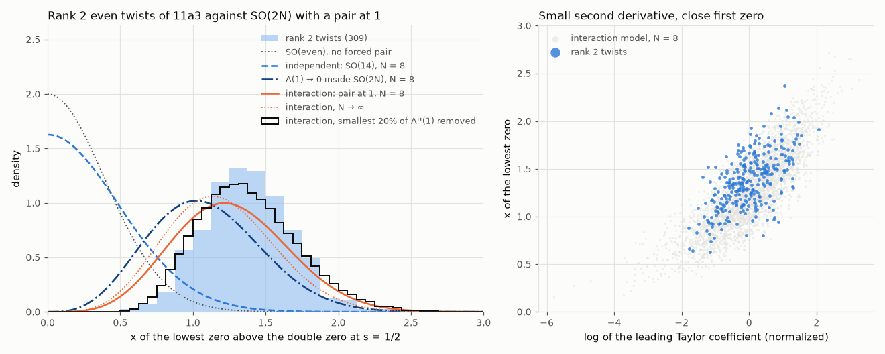

S. J. Miller ([arXiv:math/0508150](https://arxiv.org/abs/math/0508150)) found that
the first zero above the center is pushed further out in rank 2 curves than in
rank 0 ones, and noted that nobody knew which matrix model should describe them.
`ranktwo.family` collects every even twist of 11a3 with 5 ≤ d ≤ 20,000 whose central
value vanishes: 309 curves, from d = 232 to 19,761, found in 45 minutes on 16
processes. For each one it keeps the unfolded low zeros and the leading Taylor
coefficient L''(E_d, 1/2)/2.

That coefficient comes from the series
L''(1/2) = 4 Σ a_n/n · g₂(n/A), where g₂ is the second derivative kernel of the
smoothed functional equation. `elliptic.g2` sums a series in x and log x below 2
and uses 60-point Gauss-Laguerre above. It matches mpmath quadrature to 1e-13,
gives 0.759316500288427 for 389a1 (the value LMFDB lists for its rank 2 leading
coefficient) to 1e-14, and agrees with a Richardson-extrapolated −2Z(t)/t² for the
twist d = 232 to 1e-5.

There are three ways to put a double eigenvalue at 1 in SO(2N), and they give
different laws for the next one. With x = cos θ, the N − 1 free angles have a Jacobi
weight (1 − x)^α (1 + x)^(−1/2):

- independent (α = −1/2): drop the pair and take SO(2N − 2) as it is;
- interaction (α = 3/2): fix θ_N = 0 and keep its repulsion ∏(1 − cos θ_j)² on the
  others;
- conditioned (α = 1): ask for det(I − A) < ε and let ε go to 0. The pair only
  needs θ_N ≲ √(ε/∏(2 − 2cos θ_j)), which gives back a factor ∏(2 − 2cos θ_j)^(−1/2).
  This is the Borel paradox: the limit depends on how you approach it.

`rmt.jacobi_n` builds the finite-N kernel for any α and β from the three-term
recurrence of the orthonormal Jacobi polynomials, so the gap probabilities are
Fredholm determinants as before. With (α, β) = (∓1/2, −1/2) and (1/2, 1/2) it
reproduces the SO(even), SO(odd) and USp kernels to 1e-13. For N = 2 and 3 it
matches closed forms and the Weyl integral, the density of the first point
vanishes like x^(2α+1), and as N grows the kernel goes to the hard-edge Bessel
kernel J_(α+1/2) with an error that falls like 1/N (ten times smaller
from N = 40 to 400). Monte Carlo
draws Haar SO(2N − 1) and resamples by ∏(2 − 2cos θ_j)^(α − 1/2); those first
eigenvalues pass a KS test against the Fredholm side for all three models.

With N = 8 (the mean log A of the family is 8.15) and 12 bins of (0, 2.4):

| model for the 309 rank 2 twists | χ² | KS | mean lowest zero |
|---|---|---|---|
| independent, SO(14) | 16,905 | 0.894 | 0.395 |
| conditioned, α = 1 | 195.5 | 0.359 | 1.091 |
| interaction, α = 3/2 | 62.6 | 0.182 | 1.268 |
| interaction, smallest 20% of Λ''(1)/2 removed | | 0.054 | 1.377 |
| data | | | 1.370 |

The independent model is not close: the twists never put a zero below x = 0.62,
while SO(14) puts 79% of its first eigenvalues there. The pair's repulsion is the
right mechanism, and the interaction model gets most of the way, but its KS
distance is more than twice the 5% critical value of 0.077. The maximum
likelihood N for it is 4, half the conductor's value, which is the same pattern as
the rank 0 twists.

The right panel shows why an excision is the natural next step. In the
interaction model Λ''(1)/2 = ∏(2 − 2cos θ_j) over the free angles, and a small
value goes with a close first eigenvalue (rank correlation 0.82). The twists show
the same thing with log L''(1/2)/2 (rank correlation 0.59). Their leading
coefficients stay above 5.10 (d = 697), and there is no Waldspurger formula here
to say why. Birch and Swinnerton-Dyer would tie them to the regulator of a rank 2
lattice of rational points, which cannot be small. Cutting the matrices with the
smallest 20% of Λ''(1)/2 brings the KS distance under the critical value and the
mean within 0.007. The cut is fitted (scanning 0 to 95% in steps of 5%), and the
fit is not perfect: the excised law still has a standard deviation of 0.342
against 0.291 in the data, the same excess width the odd twists showed.

Miller also conjectured that the extra repulsion fades as the conductor grows.
Splitting the family at the median |d|, the mean lowest zero goes from 1.395 ± 0.023
(d ≤ 8,380, mean log A 7.42) to 1.345 ± 0.024 (d ≥ 8,449, mean log A 8.87). The
interaction model at the matching N drops by only 0.021 over the same range. The
data move in his direction, by about 1.5 standard errors.

### The ratios conjecture for twists, and an effective N

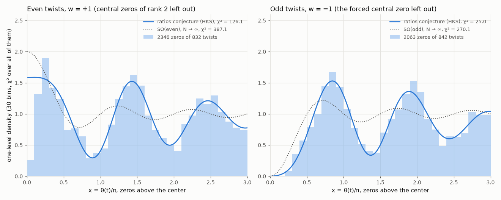

Huynh, Keating and Snaith ([arXiv:0811.2304](https://arxiv.org/abs/0811.2304))
ran the ratios recipe on the even quadratic twists of an elliptic curve with prime
conductor M. I redid it for both parities, because the root number only changes
one sign. Replace L(1/2 + α, d) by both halves of its approximate functional
equation, 1/L(1/2 + γ, d) by its Dirichlet series, and average χ_d over the family.
With x = p^(−1/2−α), y = p^(−1/2−γ) and λ(p) = a_p/√p, the Euler factor for p ∤ M
is

```
G_p(α, γ) = 1 + p/(p + 1) · ( [F(x)H(y) + F(−x)H(−y)]/2 − 1 )
F(x) = 1/(1 − λx + x²),   H(y) = 1 − λy + y²
```

(the even part, since χ_d(p^(m+h)) averages to p/(p + 1) when m + h is even and to
0 otherwise), and at p = M it is (1 − ηλy)/(1 − ηλx) with η = χ_d(M), which is
fixed across the family. The conjecture is R(α, γ) ≈ G(α, γ) + w·X(1/2 + α)·G(−α, γ),
and the log derivative at α = γ = it gives the density per unit x = θ_d(t)/π as

```
ρ_d(x) = 1 + Re B(t) / θ_d'(t)
B(t) = −ζ'/ζ(1 + 2it) + L'/L(sym² E, 1 + 2it) + A₁(it)
       − w·e^(−2iθ_d(t)) ζ(1 + 2it) L(sym² E, 1 − 2it)/L(sym² E, 1) A(−it, it)
```

with w the root number of the twist. A₁ and A are what is left of the Euler
product after ζ and the symmetric square take out the parts that only converge
conditionally on Re s = 1. Both converge like Σ 1/p². For the odd family the
two terms of B carry poles 1/(2it) with the same sign, so B has a pole with
residue 1: the forced central zero falls out of the recipe on its own, as a purely
imaginary term that drops out of Re B. For the even family the poles cancel.

All of that needs L(sym² E, s) on the 1-line, where its Euler product does not
converge. `symsquare.py` builds it from scratch: coefficients from the local
factors 1/(1 − (λ² − 1)X + (λ² − 1)X² − X³) and 1/(1 − X/M) at the bad prime,
conductor M², gamma factor Γ_R(s + 1)Γ_C(s + 1), and a smoothed approximate
functional equation

```
L(s) = Σ a_n n^(−s) V₁(n) + q^(1/2−s) Σ a_n n^(s−1) V₂(n)
V₁(n) = (1/2πi) ∫ (n/√q)^(−u) G(u) γ(s + u)/γ(s) du/u,   G(u) = e^(u²/b − iβu)
```

with V₂ the same using G(−u) and γ(1 − s + u). Nothing requires G to be even. The
rotation β cancels the e^(3π|v|/4) that the degree 3 gamma ratio would otherwise
pick up along the contour, and shrinks to 0 near the real axis, where the full
rotation would kill the decay of V in n. The integrals are trapezoid sums on
Re u = max(Re s, 1 − Re s) + 1/2, and L'(s) comes from the same sums with one more
factor. Checks:

- Changing the weight (b = 14, 30, 60) moves L by 1e-15 at the real axis and at
  most 1e-11 at height 40. A wrong gamma factor or conductor breaks that by 6e-3
  to 0.4, so this pins the functional equation.
- The Euler product at s = 2 agrees to 2e-9 (truncation at 2^16).
- Rankin-Selberg: Σ λ(n)² e^(−n/X) with X = 500 is 295.38109. The main term
  X·L(sym², 1)·(6/π²)·(11/12) + L(sym², 0)/2 gives 294.97700, and the 0.40371 left
  over comes from poles I did not expect at first: the factor 1/(1 + 11^(−w)) from
  the bad prime has poles at w = iπ(2k + 1)/log 11 on Re w = 0. With those residues
  the two sides agree to 1.3e-6, the size of the terms from the zeros of ζ(2w).
- L'(s) against a 32-point Cauchy integral to 1e-11.

L(sym² 11a, 1) = 1.0575992446 and L'/L(sym², 1) = 0.19741.

As the conductor grows at fixed x,

```
ρ_d(x) = 1 ± sin(2πx)/(2πx) − r₁(1 ± cos 2πx) / (log A_d − γ) + O(1/log² A_d)
r₁ = γ − L'/L(sym² E, 1) − A₁(0)
```

with + for the even twists and − for the odd ones, using A₁(0) = −½ d/dr A(−r, r) at
0. The tests check that identity between the two Euler products to 1e-7, and the
expansion at log A = 60 and 400, where the remainder stays under 76/log² A. For
11a, r₁ = 1.28360 when χ_d(11) = +1 (the even twists with d > 0) and 0.84398 when
χ_d(11) = −1 (the odd ones). DHKMS scale every zero by the top of the family,
L = log(√11·X/2π), instead of by each twist's own log A_d − γ. That adds γ plus the
average of log(X/d), which is 1, so their constant is 1.28360 + 1.57722 = 2.8608,
against their printed 2.8600. Their N_eff = 2.14 at X = 400,000 follows.

The zeros are the 1,674 twists from before, recomputed up to x = 3.5 (330 s on 14
processes); the predictions average ρ_d over the actual discriminants (47 s and
29 s). On 30 bins of [0, 3]:

| family | zeros | χ² ratios | χ² N → ∞ limit | χ² ratios, x ≥ 0.2 | χ² limit, x ≥ 0.2 |
|---|---|---|---|---|---|
| even, 832 twists | 2346 | 126.1 | 387.1 | 30.8 | 250.2 |
| odd, 842 twists | 2063 | 25.0 | 270.1 | 22.2 | 256.8 |

The odd family is fit everywhere, including the wide empty zone near the center
and the peaks near x = 0.85 and 1.9. On the even side the ratios density gets the
oscillations right but predicts 1.59 at the origin where the data have 0.26 in the
first bin. That is the gap HKS and DHKMS describe: the discreteness of
L(E_d, 1/2) is invisible to the ratios conjecture, and it is what the excised
ensemble is for.

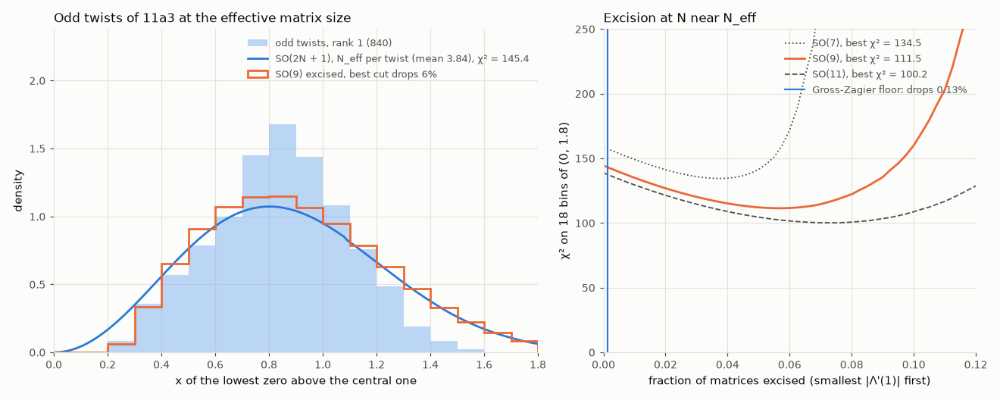

For the matrices, SO(2N + 1) has to be unfolded by N + 1/2, not N. Its
characteristic polynomial has 2N + 1 zeros on the circle, the one at 1 included,
and θ_d(t)/π counts the central zero of L(E_d, s) the same way. Scaling by N would
also leave the one-level density 1 − sin(2πN y/N)/(2N sin(πy/N)) with no 1/N term at
all, so there would be nothing to match. With y = (N + 1/2)θ/π,

```
SO(2N + 1):  1 − sin(2πy)/(2πy) − (1 − cos 2πy)/(2N) + O(1/N²)
```

and matching the 1/log term gives N_eff = (log A_d − γ)/(2r₁), the same formula as
DHKMS's SO(2N) case. `rmt.odd_orthogonal_half` is that kernel, checked against
Haar SO(7) and against ∫ρ = N. For the 840 rank 1 odd twists N_eff runs from 2.65
to 4.40 (5% to 95%, median 4.02, mean 3.84; the twists d = 8, 13 and 17 fall under
1 and are clipped). Fitting N to the whole ratios density instead of only its 1/log
term gives 4.00, so the two agree.

Then the first zero, on 18 bins of (0, 1.8) (5% KS critical value 0.047):

| model for the 840 rank 1 odd twists | χ² | KS | mean |
|---|---|---|---|
| SO(2N_eff + 1), N_eff per twist, Fredholm | 145.4 | 0.121 | 0.881 |
| SO(9), N + 1/2 | 144.5 | 0.113 | 0.875 |
| SO(9), best cut, drops 6% | 111.5 | 0.129 | 0.911 |
| SO(11), best cut | 100.2 | | |
| data | | | 0.840 |

Matching probabilities, the Gross-Zagier floor removes the same 0.13% of the
matrices at any N, so the arithmetic cut still does nothing. The fitted cuts help a
little and push the mean further off. The effective size does what it should for
the mean on the even side (SO(2N_eff) gives 0.3949 against 0.3941 for the 713 rank 0
even twists), but for the odd twists the first zero is much narrower than any
SO(2N + 1) law: the data put 3.0% of their mass above 1.3, the models 11.6 to 13.4%.
The one-level density is a sum over all zeros; the first zero depends on all the
correlation functions, and here the arithmetic that the ratios conjecture puts into
ρ(x) does not reach them through a single N.

### Twists over F_q(t), where the matrix is literal

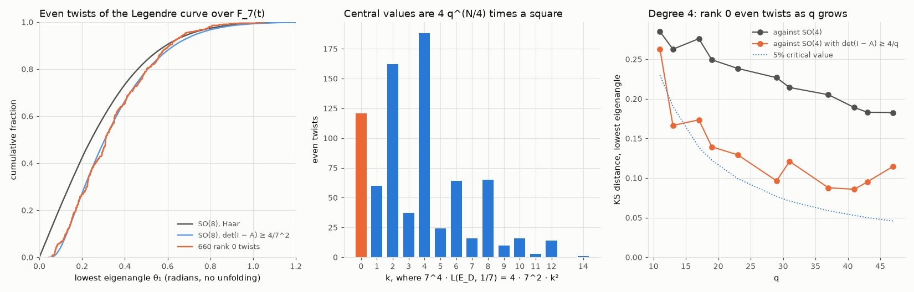

Over Q the orthogonal matrices of Katz and Sarnak are a model. Over F_q(t) they are
real: the L-function of an elliptic curve is a polynomial in T = q^(−s), it equals
det(1 − T·Frob) on a cohomology group, and its zeros are the eigenvalues of an actual
orthogonal matrix. There is no height to unfold by and no conductor to estimate.
`gf.py` and `funcfield.py` compute those polynomials exactly from point counts.

A curve is y² = x³ + a₂(t)x² + a₄(t)x + a₆(t) with a_i in F_p[t], p an odd prime.
Taking the log of the Euler product, the coefficient of T^m/m is
S_m = Σ a_t(m) over the points t of P¹(F_(p^m)), where a_t(m) = −Σ_x χ(f_t(x)) is the
Frobenius trace of the fiber over t. The same sum gives ±1 at a node and 0 at a cusp,
so bad fibers need no special case as long as the model is minimal there. The
degree comes from Grothendieck-Ogg-Shafarevich, deg L = deg(conductor) − 4, with
each multiplicative place counting once and each additive place twice. Those are
read off rad(Δ) and rad(gcd(Δ, c₄)), whose degrees come from distinct-degree
factorization, and off the model in s = 1/t at infinity. Newton's identities
k c_k = Σ S_m c_(k−m) give c₀ to c_(N/2+1), and the functional equation
c_(N−k) = ε q^(N−2k) c_k gives the rest and the root number (a nonzero c_(N/2) already
forces ε = +1). So the work stops at F_(q^(N/2+1)).

F_(p^m) is a pair of tables: powers of a primitive element (the polynomial is found
by testing the order of t modulo it, then the table is built by repeated squaring of
the companion matrix) and their logarithms. Elements are integers whose base-p
digits are polynomial coefficients, so addition is digitwise. Traces are constant
on Frobenius orbits, so only one point per orbit is counted. For the Legendre curve
y² = x(x − 1)(x − t) there is a better trick: a_t = −Σ_x χ(x(x − 1)) χ(x − t) is a
correlation over the additive group (Z/p)^m, so all p^m fibers cost one
m-dimensional FFT. A quadratic twist D y² = f(x) has a_t^D = χ(D(t)) a_t at every
finite t, so one table of a_t serves a whole family, and D(t) at every t for a block
of twists is one matrix product between their coefficients and the digits of t^j.
The 1,573 twists of degree 4 over F_7 take about 4 s, and the 2,071 twists of degree
2 over F_47 about 3 s.

The checks against things I did not compute:

- The Legendre curve is a rational elliptic surface, so L = 1. S₁ = S₂ = S₃ = 0 for
  p = 5, 7, 11 and 13.
- Ulmer ([arXiv:math/0109163](https://arxiv.org/abs/math/0109163), Theorem 9.2)
  proves BSD for y² + xy = x³ − t^d when d divides p + 1 and gives the rank as a sum
  of φ(e)/o_e(q) over divisors e of d plus corrections at 2 and 3. Section 10 gives
  deg L = d − 1, or d − 3 when 6 divides d. The computed degree and the order of
  vanishing at T = 1/q agree with both for all nine curves below. Every one of
  these L-functions turns out to be a product of factors 1 − qT and 1 + qT.

| p | d | deg L | rank (Ulmer) | order at T = 1/q |
|---|---|---|---|---|
| 5 | 2, 3, 6 | 1, 2, 3 | 1, 1, 2 | 1, 1, 2 |
| 7 | 2, 4, 8 | 1, 3, 7 | 0, 1, 3 | 0, 1, 3 |
| 11 | 3, 4, 6 | 2, 3, 3 | 1, 1, 1 | 1, 1, 1 |

- Computing S_m out to N + 2 instead of stopping at N/2 + 1 gives c_(N+1) = c_(N+2) = 0
  and the same c₀ to c_N, so the conductor is right.
- Across 17 families of Legendre twists (q = 3 to 47, 11,741 twists) every reciprocal
  root has |γ| = q to 2e-8, and to 4e-15 except where a root is repeated and
  np.roots loses half the digits. The root number is (−1)^rank in every one of them.
- Underneath: field axioms, the quadratic character, a₂ = a₁² − 2p and
  a₃ = a₁³ − 3p·a₁ on single curves, and the FFT correlation against the direct sum.

The family is the Legendre curve twisted by every monic squarefree D of even degree
n prime to t(t − 1). The fibers are I₂ at 0 and 1, I₂* at infinity and I₀* at the
roots of D, so N = 2n. Over F_7 with n = 4 there are 1,573 twists: 781 have ε = +1 and
792 have ε = −1, and the ranks are 0 (660), 1 (789), 2 (121) and 3 (3).

The central value L(E_D, 1/q) is det(I − A) for the Frobenius matrix A, and the
functional equation makes q^(N/2) L(1/q) an integer. It is more than that: in every
even twist of all 17 families (q = 3 to 47, N = 4, 8 and 12) it equals
4·q^(N/4)·k² for an integer k, the function field version of Waldspurger's formula.
A square is what Birch and Swinnerton-Dyer suggests (Sha has square order), and the
next section derives the 4 from the Tamagawa numbers. It means the smallest nonzero
central value is 4·q^(−N/4), far above the q^(−N/2) that integrality alone allows,
and the excised ensemble gets its cut with nothing fitted: SO(N) with
det(I − A) ≥ 4·q^(−N/4).

| q | N | rank 0 even twists | KS against SO(N) | KS, excised | 5% critical | cut removes | central zeros |
|---|---|---|---|---|---|---|---|
| 7 | 8 | 660 | 0.179 | 0.040 | 0.053 | 21.0% | 15.5% |
| 5 | 8 | 135 | 0.205 | 0.117 | 0.117 | 28.5% | 20.1% |
| 3 | 12 | 114 | 0.278 | 0.113 | 0.127 | 31.6% | 14.3% |
| 23 | 4 | 188 | 0.238 | 0.129 | 0.099 | 22.1% | 14.9% |
| 47 | 4 | 887 | 0.183 | 0.115 | 0.046 | 15.6% | 12.4% |

"Central zeros" is the share of even twists with L(1/q) = 0, which the cut should
roughly match. The lowest eigenangle is in radians, with no unfolding of any kind.

Over F_7 at N = 8 the excised model passes, and Haar SO(8) lands at 3.4 times the
critical value.
At N = 4 neither passes. As q grows the distance to Haar SO(4) falls slowly (0.285
at q = 11, 0.183 at q = 47), as Katz's equidistribution theorem says it must in the
limit, but the excised distance stalls near 0.09 to
0.12 after q = 29 while the critical value keeps falling. The histogram of k shows
one reason the single cut is too crude: odd k are rarer than even (60 twists at
k = 1, 162 at k = 2, 37 at k = 3, 188 at k = 4 over F_7), so most twists carry an
extra factor of 4 and their own floor is four times higher. The cut also removes
more matrices than there are central zeros at every q. The next section gives each
twist its own floor from its Tamagawa numbers and 2-Selmer group. The odd twists' free angles live in O⁻(N), whose nontrivial eigenangles follow
USp(N − 2) (`rmt.o_minus_angles`, checked against the symplectic Fredholm
determinant); the rank 1 odd twists pass against it at N = 4 for q = 43 and 47 (KS
0.036 and 0.038) and fail over F_7 at N = 8 (0.084 against 0.048).

### Birch and Swinnerton-Dyer for the twists, and a floor for each one

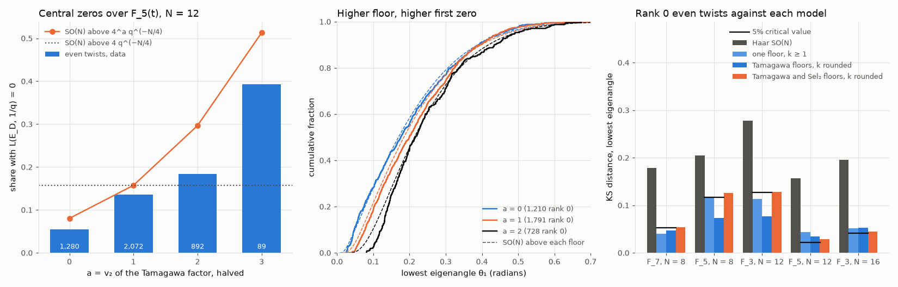

Over F_q(t) the leading term of the L-function at the center is

L*(E, 1) = |Sha| · Reg · τ · q / (H · |E(K)_tors|²),

where τ is the product of the Tamagawa numbers c_v and H = q^(deg Δ_min / 12) is the
differential height (the form in Griffon, [arXiv:1706.07728](https://arxiv.org/abs/1706.07728),
equation 2.6). For a twist of analytic rank 0 this is a theorem: the rank is at most
the order of vanishing, equality is equivalent to Sha being finite (Tate, Milne), and
Kato and Trihan get the whole formula from there. `funcfield.py` already has
L(E_D, 1/q) as an exact rational, so once the local data are known, BSD hands back
|Sha|. `bsd.py` computes the local data and, independently, the 2-Selmer group.

**Fibers.** Every twist has full 2-torsion, y² = (x − e₁)(x − e₂)(x − e₃) with
e = (0, D, tD). With the residue characteristic odd, the Kodaira type at a place
depends only on the valuations of the three differences e_i − e_j. Two of them are
equal and minimal (call it m) and the third is M. Replacing x by π²x lowers all
three by 2, so the reduced model has m = 0 or 1. If m is even the fiber is good
(M = m) or I_(2(M−m)), split when e_i − e_k is a square in the residue field (e_i
and e_j being the pair that collide). If m is odd it is I*_(2(M−m)), and then
c_v = 4 with no case analysis: the identity component of the Néron model has no
2-torsion in odd residue characteristic, so E(K_v)[2] = (Z/2)² injects into the
component group, which has order 4 for every I_n*. A multiplicative fiber has
c_v = n when split and 2 when not (n is always even here). For the Legendre twists
this gives I₂ at t = 0 and 1, I₀* at every irreducible factor of D, and I₂* at
infinity (I₂ when deg D is odd). A place of degree d counts d times in the conductor
and in the discriminant, and the conductor degree matches the independent count in
`funcfield.Curve` for every twist tested.

**Torsion.** A point of order 4 over (0, 0), (D, 0) or (tD, 0) would need t, 1 − t or
t(t − 1) to be a square in F_q(t), so the 2-part of E_D(K) is exactly (Z/2)². Odd
torsion injects into E(k_v) at every good place, and the gcd of the point counts over
places of degree 1 and 2 (more degrees over F_3) leaves nothing odd in any twist I ran.

**2-descent.** The map P ↦ (x − e₁, x − e₂) sends E(K)/2E(K) into (K*/K*²)². The
2-Selmer group is the set of pairs, unramified outside the bad places and infinity,
whose image at each bad place v lands in the local image W_v. Unramified outside S
means spanned by one nonsquare constant and the monic irreducibles in S. A class at
v is the valuation mod 2 and the quadratic character of the leading residue,
u^((q^deg v − 1)/2) mod P. In odd residue characteristic |W_v| = |E(K_v)[2]| = 4,
so `local_image` starts from the images of the 2-torsion points and, when those span
less than four classes, samples x = a/P^j until they do. f(x) is a square in K_v
exactly when its valuation is even and its leading residue is a square (Hensel), so
every sample is checked exactly. Sel₂ is then the kernel of a small matrix over F₂,
and dim Sel₂ = rank + 2 + dim Sha[2].

The checks, none of which can be passed by construction:

- Over 22 families (q = 3 to 47, deg D = 2 to 8, 19,324 twists, 14,336 of analytic
  rank 0), |Sha| from BSD is a positive integer and a perfect square in every rank 0
  twist, from 1 up to 784 = 28². A wrong Tamagawa number shows up as a stray factor
  of 2: with c = 1 at nonsplit I₂, every twist where exactly one of the fibers at 0
  and 1 is nonsplit would come out with |Sha| twice a square.
- The descent never looks at the L-function, and it agrees with it everywhere:
  dim Sel₂ − rank − 2 is even (Sha[2] has square order), |Sha| is odd exactly when
  that difference is 0, and 2^(dim Sel₂ − rank − 2) divides |Sha|. Among rank 0 twists dim Sel₂
  is 2, 4 or 6 for 8,498, 5,802 and 36 of them; every higher rank twist has
  dim Sel₂ = rank + 2 or rank + 4.
- The conductor degree from the fibers equals the count in `funcfield.Curve` and
  deg L + 4, and deg Δ_min is a multiple of 12.
- The residue character equals the character of the norm, χ((−1)^d P(0)), for every
  monic irreducible of degree 2 to 4 tried, and `gf.factor` (distinct-degree, then
  Cantor-Zassenhaus) finds the number of irreducibles the necklace formula gives.

**What it says about k.** For the degree 4 twists the Tamagawa product is
2 · 2 · 4 · 4^ω (I₂, I₂, I₂* and ω fibers I₀*, one per irreducible factor of D),
H = q³ and the torsion is 4, so q⁴ L(1/q) = 4q²k² becomes

k² = 4^(ω−1) · |Sha|.

That is the constant 4 from the previous section: 2 · 2 · 4 · 4 / 4² with a single I₀*
fiber. In general v₂(k) = a + v₂|Sha| / 2 with a = v₂(τ / (4 · |tors|²)) / 2, and
since |Sha| is divisible by |Sha[2]| = 2^(dim Sel₂ − rank − 2), local data alone give
the floor k ≥ 2^(a + dim Sha[2]/2). It is exact unless Sha[2^∞] has an element of
order 4: for 88.2% of the rank 0 twists over F_7 at N = 8, 84.3% over F_5 at N = 12.
Odd k, which looked rare in the histogram above, are the twists with D irreducible
and |Sha| odd.

**A floor per twist.** The first attempt conditioned SO(N) on
det(I − A) ≥ 4^(1+a)·q^(−N/4), the literal floor k ≥ 2^a. It was worse than one
global cut (KS 0.123 against 0.040 over F_7). Splitting the twists by a shows why
the idea is right and the cut is not. Over F_5 at N = 12:

| a | even twists | central zeros | predicted | mean θ₁, data | mean θ₁, model |
|---|---|---|---|---|---|
| 0 | 1,280 | 5.5% | 8.0% | 0.200 | 0.198 |
| 1 | 2,072 | 13.6% | 15.7% | 0.219 | 0.213 |
| 2 | 892 | 18.4% | 29.7% | 0.248 | 0.240 |
| 3 | 89 | 39.3% | 51.3% | 0.278 | 0.288 |

The columns "predicted" and "model" are already the second version. Vanishing gets
more common and the first zero moves up as a grows, which no single cut can produce.
The truncated floors pushed both too far (predicted vanishing 15.7%, 29.7%, 51.3%,
76.5%). The second version treats the matrix value as the continuous quantity and
rounds √(det(I − A) / floor) to the nearest integer k, so a twist vanishes when
det(I − A) < floor/4 and the conditioning is on det(I − A) ≥ 4^a·q^(−N/4). That is
the discretization of Conrey, Keating, Rubinstein and Snaith
([arXiv:math/0012043](https://arxiv.org/abs/math/0012043)) with the arithmetic
factor read off the fibers instead of fitted. Nothing in it is tuned to the data.

| q | N | rank 0 even twists | Haar SO(N) | one floor, k ≥ 1 | Tamagawa floors | Tamagawa and Sel₂ | 5% critical | central zeros | predicted, one floor | predicted, own floors |
|---|---|---|---|---|---|---|---|---|---|---|
| 7 | 8 | 660 | 0.179 | 0.040 | 0.047 | 0.054 | 0.053 | 15.5% | 21.0% | 19.8% |
| 5 | 8 | 135 | 0.205 | 0.117 | 0.074 | 0.125 | 0.117 | 20.1% | 28.5% | 24.9% |
| 3 | 12 | 114 | 0.278 | 0.113 | 0.077 | 0.129 | 0.127 | 14.3% | 31.6% | 27.6% |
| 5 | 12 | 3,783 | 0.157 | 0.044 | 0.035 | 0.028 | 0.022 | 12.7% | 15.7% | 17.1% |
| 3 | 16 | 1,063 | 0.196 | 0.052 | 0.053 | 0.044 | 0.042 | 13.2% | 21.6% | 21.7% |
| 29 | 4 | 313 | 0.227 | 0.096 | 0.118 | 0.110 | 0.077 | 14.2% | 19.7% | 14.5% |
| 47 | 4 | 887 | 0.183 | 0.115 | 0.106 | 0.127 | 0.046 | 12.4% | 15.6% | 11.6% |

"One floor" is the cut from the previous section. The per-twist floors win in four of
the five families at N ≥ 8, and the Selmer information helps exactly where there are
enough twists for it to show (3,783 over F_5, 1,063 over F_3). Over F_5 at N = 12 the
distance falls from 0.044 to 0.028; the critical value there is 0.022, so it still
does not pass. The predicted
share of central zeros is too high in most families with either kind of floor. At
N = 4 nothing changes much: none of the models pass, and the stall noted above is not
about the 2-adic factor.

### Rank 1: generators, Néron-Tate heights and Sha

For a twist of analytic rank 1 the regulator is the height of a generator, so BSD
only hands back |Sha| · Reg. `heights.py` finds the generator and computes its
height, and then |Sha| comes out on its own:

|Sha| = L*(E_D) · q^(χ−1) · |tors|² / (τ · ⟨P, P⟩),

with L*(E_D) = g(1/q) where L(E_D, T) = (1 − qT) g(T), and χ = deg Δ_min / 12. This
is the normalization of Ulmer ([arXiv:1806.01961](https://arxiv.org/abs/1806.01961),
section 2.1): the height pairing is the canonical height divided by log q, and the
log q from the derivative cancels against it.

**Heights.** Shioda's formula gives

⟨P, P⟩ = 2χ + 2(P·O) − Σ_v deg(v) · contr_v(P),

where (P·O) counts the poles of x (each double pole at a place of degree d adds d,
and at ∞ the pole is measured against t^(2χ)), and contr_v is ½ at the non-identity
component of an I₂ fiber, 1 at any non-identity component of I₀*, and 1 or 3/2 at
the near or far components of I₂*. The code doesn't look up components. It computes
the local Néron height through the duplication formula,

λ_v(P) = (λ_v(2P) − v(2y(P)) + v(Δ)/4) / 4,

which is exact here because every component group in the family is killed by 2, so
2P always lands on the identity component where λ_v(2P) = ½ max(0, −v(x(2P))) +
v(Δ)/12. Only x is needed: v(2y) = v(f(x))/2. Then contr_v = max(0, −v(x)) + v(Δ)/6
− 2λ_v. That the result always lands in Shioda's table is a test, not an assumption.

**Search.** Every point has its 2-descent image δ(P) = (x − e₁, x − e₂) mod squares
in the 2-Selmer group, which `bsd.py` already computes; `heights.selmer_classes`
turns the dimension into the actual classes (a GF(2) kernel). In a class (d₁, d₂),
x = λ² d₁ u² / w² with u, w monic, and a point with (P·O) ≤ B has deg w ≤ B and
deg(λ² d₁ u²) ≤ 2χ + 2B. The search runs over (λ, u, w), throws out almost every
candidate by checking that d₂(x − e₂) and d₁d₂(x − e₃) are not non-squares at 24
points of F_(q^m) (vectorized over all u at once), and confirms the survivors with an
exact square root in F_q[t].

**Proof that it is a generator.** The rank is at most the analytic rank (Tate), so
E_D(K) = Z·G ⊕ E[2], and a point P found in a class outside δ(E[2]) is mG + T with
m odd. If m ≥ 3 then some G + T′ in the same class has height ⟨P, P⟩/9 or less. Any
point with (Q·O) > B has height at least 2χ + 2(B + 1) − Σ deg(v) max contr_v, so
once ⟨P, P⟩/9 is below that, G + T′ would have shown up in the exhaustive search of
that class with a smaller height. The search stops at the first P of minimal height
in its class for which this holds.

Results:

| q | deg D | rank 1 twists | generator proven | ⟨P, P⟩ | \|Sha\| |
|---|---|---|---|---|---|
| 5, 7, 11, 13 | 1 | all | all | 1/2 | 1 |
| 5 | 2 | 8 | 8 | 3/2 to 8 | 1 |
| 3 | 3 | 5 | 5 | 5/2 to 17/2 | 1 |
| 3 | 4 | 16 | 11 with (P·O) ≤ 4 | 2 to 12 | 1 |
| 5 | 3 | 37 | 23 with (P·O) ≤ 3 | 1 to 17/2 | 1 |
| 7, 5 | 3, 4 | the 11 with dim Sel₂ = 5 | 11 | 2 to 9/2 | 4 |

- At deg D = 1 the surface is rational with fibers I₀* + 3 I₂. Its trivial lattice is
  D₄ ⊕ A₁³ of rank 7 and determinant 32, so the Mordell-Weil lattice has rank 1 and
  determinant |tors|²/32 = 1/2 (Oguiso and Shioda's table). Every rank 1 twist over
  F_5, F_7, F_11 and F_13 has a generator of height exactly 1/2, and L = 1 − qT gives
  |Sha| = 1, as it must for a rational surface. A factor of 2 in the height
  normalization would have made |Sha| = 2 here.
- |Sha| is a perfect square every time, and its 2-part matches the descent: 1 when
  dim Sel₂ = 3, and exactly 4 for all 11 rank 1 twists with dim Sel₂ = 5, which
  is the first nontrivial Sha this repo has seen from both sides.
- Per generator: the local contributions from duplication are in Shioda's table and
  are positive exactly when P reduces to the singular point; ⟨2P, 2P⟩ = 4⟨P, P⟩,
  ⟨4P, 4P⟩ = 16⟨P, P⟩, and translating by each 2-torsion point keeps the height;
  δ(P + T) = δ(P)δ(T) and δ(2P) = 1.
- On three twists over F_3 the filtered search returns exactly the points a brute
  force over every A of degree ≤ 2χ + 2 and every w of degree ≤ 1 finds.

The search gets expensive fast. Its cost is about q^(χ + 2B), and the generators get
big: BSD predicts |Sha| · ⟨P, P⟩ up to 57/2 over F_5 at deg D = 3, which would need
(P·O) around 14. Over F_7 at deg D = 2 the fourth twist ran for more than half an
hour at (P·O) ≤ 4 without a proof. That growth is the next section.

### Brauer-Siegel for the twists

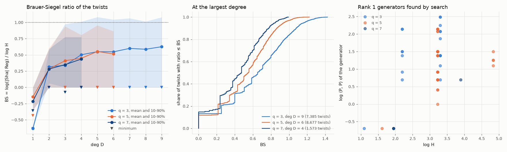

Hindry and Pacheco measure how big |Sha| · Reg is against the height H = q^χ:

BS(E) = log(|Sha| · Reg) / log H.

They show 0 ≤ liminf BS ≤ limsup BS = 1 as H grows, over all non-constant curves
(assuming Sha finite), and conjecture that the liminf is 0 along the quadratic twists
of one curve; Griffon ([arXiv:1706.07728](https://arxiv.org/abs/1706.07728)) proved
lim BS = 1 for the Legendre family E_d: y² = x(x + 1)(x + t^d). BSD gives |Sha| · Reg
from the L-function for every twist, whatever the rank:

|Sha| · Reg = L*(E_D) · q^(χ−1) · |tors|² / τ,

which is `brauer.ratio`. In rank 0 it is |Sha| from `bsd.arith`, and in rank 1 it is
|Sha| · ⟨P, P⟩ from the search above; the tests check both.

| q | deg D | χ | twists | mean BS | max BS | share of rank 0 with \|Sha\| = 1 |
|---|---|---|---|---|---|---|
| 3 | 5 | 3 | 93 | 0.549 | 1.300 | 0.600 |
| 3 | 7 | 4 | 823 | 0.599 | 1.381 | 0.401 |
| 3 | 9 | 5 | 7,385 | 0.626 | 1.424 | 0.298 |
| 5 | 4 | 3 | 345 | 0.447 | 1.017 | 0.452 |
| 5 | 6 | 4 | 8,677 | 0.514 | 1.223 | 0.271 |
| 7 | 4 | 3 | 1,573 | 0.435 | 0.992 | 0.352 |

- The minimum is 0 at every degree past the first: there are always rank 0 twists
  with |Sha| = 1, and then BS is exactly 0. Their share falls slowly (1.0, 0.60, 0.40,
  0.30 over F_3 at deg D = 3, 5, 7, 9), which is the direction the Hindry-Pacheco conjecture
  needs and says nothing yet about the limit.
- At deg D = 1, χ = 1 and the rank 1 twists have Reg = 1/2, so BS = −log 2 / log q is
  negative; the bound liminf ≥ 0 is asymptotic. Over F_7 at deg D = 3 one rank 1 twist
  has |Sha| · Reg = 3/4.
- The mean climbs slowly toward 1. Writing
  BS = 1 − 1/χ + (log L* + log 16 − log τ) / log H shows why: τ = 4^ω · 8 or 4^ω · 16
  grows with the number ω of prime factors of D, and the mean of log τ / log H is still
  0.87 over F_3 at deg D = 9 and 0.85 over F_5 at deg D = 6 (it was 1.75 and 1.27 at
  deg D = 3).
- The ratio is quantized at small heights (|Sha| is a square, the Tamagawa product a
  power of 2), which is the staircase in the middle panel.

### Rank 2 and 3: Mordell-Weil bases, regulators and Sha

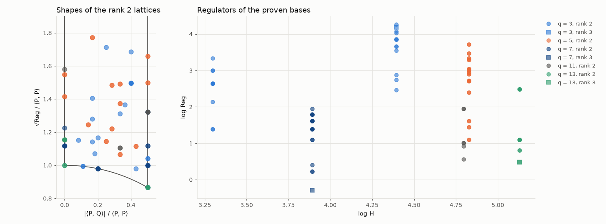

In rank 2 and up, |Sha| · Reg from the L-function no longer splits by itself:
Reg = det⟨P_i, P_j⟩ needs a basis of E_D(K)/tors and the pairing between different
points. `mordellweil.py` adds both.

**Group law.** `heights.py` only kept x = A/w². The y-coordinate comes back as
y = C/w³ with C the exact square root of (A − e₁w²)(A − e₂w²)(A − e₃w²) in F_q[t],
and the chord rule x₃ = λ² − a₂ − x₁ − x₂ runs on polynomials. Each C is fixed up to
sign, so `add` returns P + Q or P − Q; nothing downstream cares, since the
determinant does not see the sign of ⟨P, Q⟩. The pairing is
⟨P, Q⟩ = (⟨P + Q⟩ − ⟨P⟩ − ⟨Q⟩)/2 with Shioda's height from before, so every entry of
the Gram matrix is an exact fraction.

**Search.** Heights don't change under translation by E[2], so it is enough to search
one Selmer class per coset of δ(E[2]): 3 classes in rank 2 instead of 12. All points
with (P·O) ≤ B are collected, sorted by height, and taken greedily whenever the Gram
determinant stays positive.

**Proof that they are a basis.** Let λ be a lower bound for the height of every
non-torsion point: the smallest height found, or the bound 2χ + 2(B + 1) − Σ max
contr_v for points outside the box, whichever is smaller. A point in a class of
δ(E[2]) is 2R + T with height 4⟨R⟩, so it is covered too. Two arguments close it.

- Successive minima. If the r-th chosen height is below the outside bound, every point
  up to that height was found, and the chosen points realize the successive minima.
  Minkowski's second theorem and Hadamard's inequality bound the index of the lattice
  they span by γ_r^(r/2): 2/√3 in rank 2 and √2 in rank 3, both below 2. So they are a
  basis. In rank 4 the bound is 2 and the D₄ lattice breaks it, which is why `basis`
  refuses rank 4.
- Index bound (Siksek's argument). If the chosen points span a sublattice of index n,
  the true regulator is Reg/n², and Hermite's constant gives λ^r ≤ γ_r^r Reg/n², so
  n² ≤ γ_r^r Reg / λ^r. If the classes δ(P_i) are independent modulo δ(E[2]), n is
  odd, and n² < 9 already forces n = 1. In rank 1 this is exactly the ⟨P⟩/9 rule of
  the previous section.

The index bound does almost all the work. With the minima rule alone, the four slowest
twists over F_13 needed (P·O) ≤ 2 and 54 s each; the index bound proves them at
(P·O) ≤ 1, and all 12 twists of that family take 1.7 s.

Once r independent points exist, the rank is at least r, and it is at most the
analytic rank by Tate. Equality means Sha is finite and BSD holds (Tate, Milne), so

|Sha| = L*(E_D) · q^(χ−1) · |tors|² / (τ · Reg)

is a theorem here, and it has to come out as a perfect square.

Every rank 2 and rank 3 Legendre twist in eight families, with the search box capped
at (P·O) ≤ 3 (≤ 4 for the two twists over F_3 at deg D = 4):

| q | deg D | χ | rank 2 twists | proven | rank 3 twists | proven | Reg | \|Sha\| |
|---|---|---|---|---|---|---|---|---|
| 7 | 2 | 2 | 2 | 2 | 0 | | 3/2 to 7 | 1 |
| 7 | 3 | 2 | 16 | 16 | 1 | 1 | 3/4 to 6 | 1 |
| 11 | 2 | 2 | 6 | 6 | 0 | | 7/4 to 7 | 1 |
| 13 | 2 | 2 | 10 | 10 | 2 | 2 | 13/8 to 12 | 1 |
| 3 | 4 | 3 | 2 | 2 | 0 | | 17/2 to 28 | 1 |
| 3 | 5 | 3 | 8 | 8 | 0 | | 4 to 20 | 1 |
| 5 | 4 | 3 | 34 | 28 | 0 | | 3 to 41 | 1 |
| 3 | 6 | 4 | 19 | 12 | 1 | 1 | 47/4 to 71 | 1 |

- |Sha| = 1 for all 88 proven bases, an exact integer every time. In each of these
  twists dim Sel₂ = rank + 2, so the descent already said Sha[2] = 0, and the odd part
  is trivial too. A height normalization off by any factor, or a basis of index 3,
  would have shown up here as a non-square.
- 86 proofs come from the index bound and 2 from the successive minima. 70 bases sit
  at (P·O) ≤ 1.
- After reduction every rank 2 lattice lands in the fundamental domain |x| ≤ 1/2,
  |τ| ≥ 1, as the left panel shows. Six are hexagonal (τ = e^(iπ/3), a scaled A₂) and
  two are square.
- The rank 3 lattice over F_7 at D = t³ + 2t² + 2t + 1 has Gram matrix
  [[1, 0, 1/2], [0, 1, 0], [1/2, 0, 1]], a scaled A₂ next to a line, with Reg = 3/4.
  The two over F_13 have Reg = 13/8, and the one over F_3 at deg D = 6 has Reg = 66.
- Regulators grow with H = q^χ, from about 1 on the K3 surfaces (χ = 2) to 71 at
  χ = 4, which is the Brauer-Siegel growth of the previous section, now with Sha and
  Reg separated.
- Not proven: 6 twists over F_5 at deg D = 4 and 7 over F_3 at deg D = 6 need a box
  past (P·O) = 3, where the cost of the search (about q^(χ + 2B)) runs to minutes per
  twist.

The tests check the group law against the chord rule on the reduction to good fibers
E_(t₀)(F_q), the parallelogram law ⟨P + Q⟩ + ⟨P − Q⟩ = 2⟨P⟩ + 2⟨Q⟩, that adding a
2-torsion point matches `Model.translate`, that the pairing ignores torsion, that
Reg · |Sha| equals `brauer.ratio`, and that `solve` gives back the rank 1 generators
of `heights.py`.

### 2-Selmer groups and the odd part of Sha

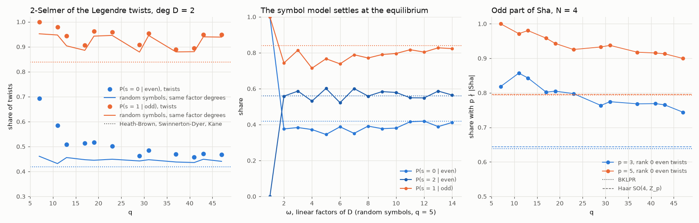

The descent gives dim Sel₂ for every twist, so the distribution of
s = dim Sel₂ − 2 over a family can be compared with models. For curves with full
2-torsion the classical answer is Heath-Brown's, first for the congruent number
curves. Swinnerton-Dyer explained it as a Markov chain and Kane extended it to every
curve with full 2-torsion: each new prime factor of D moves s up by one with
probability 2^(−s) and down otherwise, and on each parity class the chain settles at

P(s = n) = 2 · ∏_{j≥0} (1 + 2^(−j))^(−1) · 2^n / ∏_{j=1}^n (2^j − 1),

which gives P(s = 0 | s even) = 0.4194 and E[2^s] = 3. Poonen-Rains is the same law
without the parity split (`selmer.poonen_rains`, with mean |Sel_p| = p + 1).

Over F_q(t) every input to the descent other than q itself is a quadratic residue
symbol: the symbols (P_i/P_j) between the prime factors of D, and the classes of
P_i at t and at t − 1. `selmer.symbolic_rank` rebuilds the Selmer matrix from those
bits alone and agrees with the full descent on every twist of five families (q = 3
to 13). That gives a model with no arithmetic left in it: keep the degrees of the
factors of D, draw the symbols at random subject to reciprocity,
(P/Q)(Q/P) = (−1)^((q−1)/2 · deg P · deg Q), and recompute the rank. For a fixed
deg D the symbols of the actual twists equidistribute as q grows, the regime of
Park and Wang's large q results on Selmer averages
([arXiv:2102.00549](https://arxiv.org/abs/2102.00549)). The left panel is
deg D = 2, and the total variation distance between the twists and the symbol model
falls with q:

| q | twists | TV to the symbol model | TV between two model samples of that size |
|---|---|---|---|
| 7 | 31 | 0.161 | |
| 13 | 133 | 0.063 | 0.053 |
| 23 | 463 | 0.044 | |
| 31 | 871 | 0.029 | |
| 47 | 2,071 | 0.022 | 0.015 |

At deg D = 3 the distance goes from 0.087 (q = 5) to 0.021 (q = 23, 10,691 twists),
still above the noise there: the twists average E[2^s] = 2.12 against 2.21 for the
model. The model itself flows to the Kane equilibrium as the number of prime factors
grows (middle panel: P(s = 1 | s odd) climbs from 0.74 at ω = 2 to 0.82 at ω = 14,
against 0.838, and E[2^s] reaches 3.07). Real families with deg D ≤ 4 have at most
four factors, so they sit far from the equilibrium: P(s = 0 | s even) is about 0.47
at deg D = 2 for every q above 29.

For odd p, |Sha| has the same p-part as q^N L(1/q). The Tamagawa numbers here are 2
and 4, the torsion is (Z/2)² and H is a power of q, so BSD leaves nothing else, and
`test_odd_part_of_sha_is_the_odd_part_of_q_n_l` checks it against `bsd.arith` for
every rank 0 twist over F_5 at deg D = 4. The BKLPR model (Bhargava, Kane, Lenstra,
Poonen and Rains, [arXiv:1304.3971](https://arxiv.org/abs/1304.3971)) takes
Sha[p^∞] to be the cokernel of a random alternating matrix over Z_p, which for rank 0
gives P(p ∤ |Sha|) = ∏_{j≥1} (1 − p^(1−2j)), so 0.6390 for p = 3 and 0.7933 for
p = 5, and P(|Sha[p^∞]| = p²) = p/(p² − 1) times that, Delaunay's |G|/|Sp(G)|
weight. `bklpr.py` checks both against 24 × 24 alternating matrices over Z/3⁶
(determinant valuations by Gaussian elimination with minimal valuation pivots), and
checks the limit against MacWilliams' count of alternating matrices of each rank.
For a function field the matching random matrix is Frobenius itself, acting
orthogonally on a Z_p-lattice in H², so the large q model is Haar measure on
SO(N, Z_p) with v_p det(I − g) in place of v_p |Sha|. The sampler multiplies random
reflections over Z/p^K and is tested against exact enumeration of SO(2, Z/9) and
SO(3, Z/3). At N = 4 it already gives 0.644 for p = 3, next to BKLPR's 0.639.

The twists are far from both at the sizes reachable here. Share of rank 0 even
twists with p ∤ |Sha| at N = 4:

| q | twists | p = 3 | p = 5 | p = 7 |
|---|---|---|---|---|
| 11 | 35 | 0.857 | 0.971 | 1 |
| 17 | 96 | 0.802 | 0.958 | 0.990 |
| 23 | 188 | 0.798 | 0.926 | 0.979 |
| 31 | 368 | 0.774 | 0.938 | 0.967 |
| 47 | 887 | 0.744 | 0.900 | 0.959 |
| BKLPR | | 0.639 | 0.793 | 0.855 |

Over F_7 at N = 8 (660 twists) the shares are 0.811 and 0.939 for p = 3 and 5. The
direction is right and the movement is slow. |Sha| is bounded in terms of the height
of the twist, so at small q there is little room for a factor of 9 or 25.

### Moments of the twists

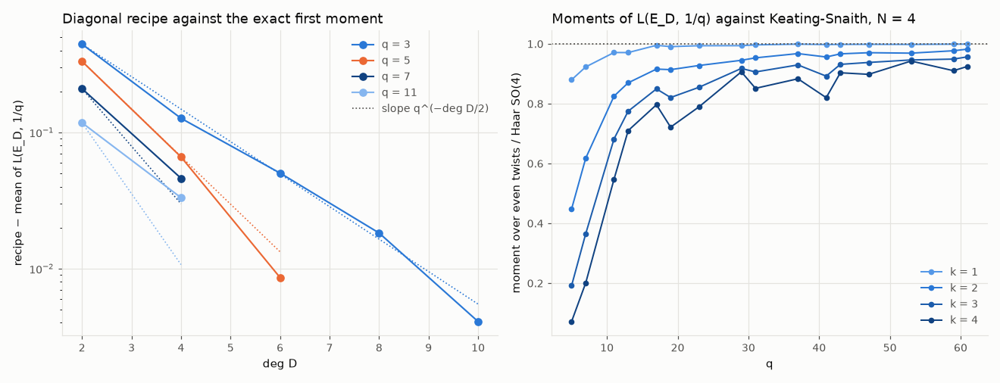

The first moment of L(E_D, 1/q) over a family can be computed exactly from
`funcfield.family`, and it can also be predicted the way the moment recipe of
Conrey, Farmer, Keating, Rubinstein and Snaith predicts it, by keeping only the
diagonal. Over F_q(t) every step of that prediction is a finite computation.

The approximate functional equation is exact here. L(E_D, u) = Σ c_j(D) u^j has
degree N = 2 deg D and c_{N−j} = ε q^(N−2j) c_j, so

L(E_D, 1/q) = (1 + ε) Σ_{j<N/2} c_j q^(−j) + c_{N/2} q^(−N/2),

and the odd twists drop out by themselves. The root number of every even degree
twist is ε_D = χ(D(0))·χ(D(1)), the product of the symbols of D at t and t − 1
(checked on every twist over F_5 and F_7 at deg D = 4), so
(1 + ε_D)χ_D(f) = χ_D(f) + χ_D(t(t − 1)f). The coefficients are
c_j(D) = Σ_{deg f = j} a(f) χ_D(f), with a(f) from the Euler factors of the Legendre
curve itself: 1 − a_P u^d + q^d u^(2d) at good places and a₀ = χ(−1), a₁ = 1 at
the two multiplicative fibers. The recipe keeps the f for which the character is
trivial (f or t(t − 1)f a square) and replaces χ_D(f) by the exact probability that a
squarefree D of that degree is coprime to f. `twistmoments.diagonal` does this as one
generating function in two variables, an Euler product over places of degree up to
deg D / 2 in which the coprimality condition divides out a factor 1 + u^d at each.
It matches a brute-force sum over every monic f and every D for q = 3 and 5, and for
q = 3, deg D = 2 it gives 8/9, which is also what the sum gives by hand (the true
mean is 4/9).

The only thing the recipe throws away is the off-diagonal. χ_D(f) for f not a
square sums to zero over all monic D of a given degree, so whatever survives comes
from the squarefree condition. Bui, Florea, Keating and Roditty-Gershon prove the
first moment of a twist family with an error of q^(−g+εg) for deg D = 2g + 1
([arXiv:1902.00568](https://arxiv.org/abs/1902.00568)), and the exact gap here
falls the same way:

| q | deg D | twists | mean of L(E_D, 1/q) | recipe | gap |
|---|---|---|---|---|---|
| 3 | 2 | 3 | 0.4444 | 0.8889 | 0.444 |
| 3 | 4 | 29 | 0.6897 | 0.8165 | 0.127 |
| 3 | 6 | 271 | 0.7227 | 0.7730 | 0.0503 |
| 3 | 8 | 2,457 | 0.7403 | 0.7586 | 0.0183 |
| 3 | 10 | 22,139 | 0.7382 | 0.7423 | 0.0041 |
| 5 | 4 | 345 | 0.9030 | 0.9690 | 0.066 |
| 5 | 6 | 8,677 | 0.9046 | 0.9132 | 0.0086 |
| 11 | 4 | 11,181 | 0.9182 | 0.9514 | 0.033 |

Over F_3 the gap shrinks by a factor of 2.5 to 4.5 every two degrees, close to the
q^(−deg D/2) line in the chart, and over F_5 by 5 and then 7.7. The true mean sits
below the diagonal in every case.

In the other limit, fixed degree and q → ∞, equidistribution (Katz and Sarnak; for
these twist families Hall, Keating and Roditty-Gershon) makes Frobenius Haar in
SO(N), so the moments of the even twists should approach the Keating-Snaith values
E det(I − A)^k, which are 2, 10, 70 and 588 for SO(4). They do, from below, and
slowly for high k. Ratios to SO(4):

| q | even twists | k = 1 | k = 2 | k = 3 | k = 4 |
|---|---|---|---|---|---|
| 13 | 61 | 0.971 | 0.870 | 0.775 | 0.710 |
| 29 | 365 | 0.994 | 0.945 | 0.918 | 0.907 |
| 47 | 1,013 | 0.999 | 0.971 | 0.938 | 0.898 |
| 61 | 1,741 | 0.999 | 0.983 | 0.957 | 0.925 |

The high moments are carried by rare twists with det(I − A) near its maximum of 16,
so they converge last and are noisy at these family sizes.

### The second moment, against Bui, Florea, Keating and Roditty-Gershon

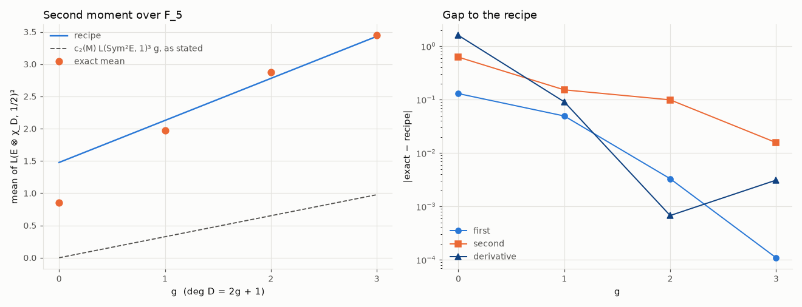

Bui, Florea, Keating and Roditty-Gershon
([arXiv:1902.00568](https://arxiv.org/abs/1902.00568)) average over monic squarefree
D of degree 2g + 1 coprime to Δ, with q ≡ 1 mod 4. Their Theorem 1.1 gets the first
moment of L(E ⊗ χ_D, 1/2) with an error of q^(−g+εg), and Theorem 1.2 states the
second moment as c₂(M) L(Sym²E, 1)³ g + O(g^(1/2+ε)), with c₂(M) built from an Euler
product in their (3.8), (3.9) and (6.2).

The Legendre twists don't fit that setup directly. With deg D odd the place at ∞
ramifies in χ_D, the I₂* fiber of the Legendre curve at ∞ turns into I₂, and the sum
over monic f in the paper is then missing an Euler factor at ∞. So the curve here is
the Legendre curve twisted once more by t, y² = x(x − t)(x − t²)
(`funcfield.twisted_legendre`). It has I₂* at 0, I₂ at 1 and I₂ at ∞, every twist by
an odd-degree D is additive at ∞, and L(E ⊗ χ_D, u) is the paper's polynomial
exactly, of degree N = 4g + 3. Its traces are χ(t) times the Legendre traces, so
`funcfield.family` stays fast. Over F_5 every twist has root number
ε_D = −χ(D(1)), which is the paper's ε_{2g+1} ε(E) χ_D(M) with M = t − 1, and the
twists with ε_D = −1 vanish at the center because N is odd.

`bfkrg.py` evaluates the CFKRS recipe for this family. With x = q^(−α) and
y = q^(−β), the diagonal of the shifted second moment is

A(N₀; x, y) = Σ_{N₀fh = □} λ(f) λ(h) x^(deg f) y^(deg h) |fh|^(−1/2) Π_{P | fh, P ∤ Δ} (1 + 1/|P|)^(−1),

with N₀ = 1 or M, and the functional equation L(1/2 + α) = ε q^(−Nα) L(1/2 − α)
gives four terms:

R(α, β) = A(1; x, y) + ε₀ x^N A(M; 1/x, y) + ε₀ y^N A(M; x, 1/y) + (xy)^N A(1; 1/x, 1/y).

Each A has a simple pole at xy = 1, so write A = H / (1 − xy). The pairs cancel
the poles and at α = β = 0

R = (N + 1) H₁ − 2 ∂ₓH₁ + ε₀ ((N + 1) H_M − 2 ∂ₓH_M),

everything at x = y = 1. H is an Euler product whose factor at a good place comes
from the even (or odd) part of 1 / ((1 − λX + X²)(1 − λY + Y²)). It converges only
conditionally at (1, 1), so `h2` divides each local factor by the Sym² factors at
x², y² and xy, multiplies the exact polynomial L(Sym²E) back in (it is 1 here, as
for the Legendre curve), and the rest converges like q^(−d). Places of degree up to
9 fix the recipe to about 10^(−6) over F_5. The x-derivative is a complex step, x = 1 + 10^(−30) i,
which is exact to rounding because every factor is rational in x.

The leading coefficient of R in N is H₁ + ε₀H_M = 0.16281 over F_5, so the recipe
grows by 4 × 0.16281 = 0.651 per unit of g. In the paper's notation that is
2 c₂(M) L(Sym²E, 1)³ g, twice the main term in the statement of Theorem 1.2: the
last display of their Section 6 is c₂(M) L(Sym²E, 1)³ X with X = 2g − 100 log g, so
the factor of 2 goes missing between that display and the theorem. The exact data settle it. The
stated term gives 0.98 at g = 3 against an exact mean of 3.446.

Everything is checked three ways before it meets the data. The Euler product's
coefficients up to degree 3 in each variable equal a brute-force sum over pairs
of monic f, h over F_5 to 10^(−9). The Sym² bookkeeping gives the raw product
back to 10^(−9) at (0.3, 0.2). The closed-form limit agrees with R(α, β) at
α, β = ±10^(−6) to 10^(−4). The same machinery gives the first moment, H₁ + ε₀H_M at
y = 0, and the mean of L′(1/2) over the twists with ε_D = −1, which is
log q (N B/2 − B′) with B = H₁ − ε₀H_M at y = 0.

Exact means over F_5, every twist enumerated:

| g | twists | L(1/2) | recipe | L(1/2)² | recipe | L′(1/2), odd | recipe |
|---|---|---|---|---|---|---|---|
| 0 | 3 | 0.53333 | 0.66280 | 0.8533 | 1.4768 | 1.7167 | 3.3101 |
| 1 | 71 | 0.71211 | 0.66280 | 1.9759 | 2.1281 | 6.6010 | 6.5103 |
| 2 | 1,739 | 0.65951 | 0.66280 | 2.8782 | 2.7793 | 9.7099 | 9.7105 |
| 3 | 43,407 | 0.66291 | 0.66280 | 3.4462 | 3.4305 | 12.9077 | 12.9108 |

The first-moment gap falls by 2.6, 15 and 30 from one g to the next, the q^(−g)
of Theorem 1.1. The second-moment gap falls more slowly, 0.62, 0.15, 0.099 and
0.016, and at g = 3 it is 0.46% of the mean. The exact step from g = 2 to 3 is
0.568 against the recipe's 0.651. The L′ gap is 7×10^(−4) at g = 2 and 3×10^(−3)
at g = 3, still 0.024% of the mean, so it doesn't shrink monotonically. g = 3 took
534 s, and g = 4 would be about 600 times that.

At g = 1 and larger q:

| q | twists | L(1/2) | recipe | L(1/2)² | recipe | L′(1/2), odd | recipe |
|---|---|---|---|---|---|---|---|
| 13 | 1,751 | 0.8379 | 0.8568 | 4.382 | 4.689 | 9.567 | 9.535 |
| 17 | 4,127 | 0.8925 | 0.8887 | 5.174 | 5.343 | 10.435 | 10.393 |
| 29 | 22,007 | 0.9271 | 0.9333 | 6.108 | 6.290 | 12.130 | 12.123 |

The recipe sits above the exact second moment by 3 to 7% at g = 1. As q → ∞ at a
fixed N every H tends to 1 and H_M to 0, so the recipe tends to 1 and N + 1 = 8.
Those are half of E det(I − A) and E det(I − A)² over O⁻(7), the half of the
orthogonal group with the forced eigenvalue −1 (a Monte Carlo over 10⁵ Haar
matrices gives 2.02 and 16.4). Half because only the ε_D = +1 twists contribute.

### The hyperelliptic ensemble

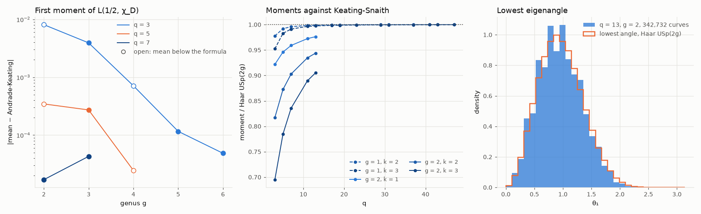

The simplest family over F_q[t] is the quadratic characters themselves: χ_D for
monic squarefree D of degree 2g + 1, whose L-function is the numerator of the zeta
function of the curve y² = D(x), a polynomial of degree 2g with
c_j = Σ_{deg f = j} χ_D(f). `hyperelliptic.lpolys` gets c_1 to c_g from the point
counts over F_q to F_{q^g} (one vectorized character sum per field,
`gf.character_sums`, shared with the elliptic twists) and the rest from the
functional equation c_{2g−j} = q^(g−j) c_j. The tests rebuild c_1 and c_2 from the
Dirichlet series with residue symbols computed independently, and check that every
root has absolute value q^(−1/2).

Andrade and Keating ([arXiv:1208.1131](https://arxiv.org/abs/1208.1131)) proved

(1/|H|) Σ_D L(1/2, χ_D) = (P(1)/2) · (2g + 2 + (4/log q)·(P′/P)(1)) + error,
P(s) = ∏_P (1 − 1/((|P| + 1)|P|^s)),

with a relative error of size |D|^(−1/4 + log_q(2)/2), and Florea
([arXiv:1505.03094](https://arxiv.org/abs/1505.03094)) found a secondary term of
relative size about g·q^(−(4g+2)/3) behind it. Both assume q ≡ 1 (mod 4); the
formula fits q = 3 and 7 just as well. The exact averages over every curve:

| q | g | curves | mean of L(1/2, χ_D) | Andrade-Keating | difference | diagonal only |
|---|---|---|---|---|---|---|
| 3 | 2 | 162 | 2.765432 | 2.773533 | −8.1e−3 | 2.753086 |
| 3 | 3 | 1,458 | 3.511660 | 3.507734 | +3.9e−3 | 3.500686 |
| 3 | 4 | 13,122 | 4.241223 | 4.241935 | −7.1e−4 | 4.237718 |
| 3 | 5 | 118,098 | 4.976251 | 4.976135 | +1.2e−4 | 4.975032 |
| 3 | 6 | 1,062,882 | 5.710384 | 5.710336 | +4.8e−5 | 5.709681 |
| 5 | 2 | 2,500 | 2.838400 | 2.838746 | −3.5e−4 | 2.833600 |
| 5 | 3 | 62,500 | 3.667712 | 3.667440 | +2.7e−4 | 3.666688 |
| 5 | 4 | 1,562,500 | 4.496110 | 4.496134 | −2.5e−5 | 4.495729 |
| 7 | 3 | 705,894 | 3.750206 | 3.750163 | +4.3e−5 | 3.750002 |

At genus 6 over F_3 the formula is right to 5·10⁻⁵ on a mean of 5.71. The proven
error bound is no help there: for q = 3 the exponent −1/4 + log_3(2)/2 is positive.
The sign of the difference follows g mod 3, which the next section traces to
genus 10 against Florea's constant. "Diagonal only" is the
same finite recipe as for the elliptic twists: the AFE truncated at degree g with
exact coprimality counts and nothing off the diagonal. It is below the true mean in
every case and further from it than the asymptotic formula. At genus 1 the mean is
exactly 2 for every q: c_1 = Σ_a χ(D(a)) averages to zero by translating and
rescaling D.

For fixed g and q → ∞ the curves equidistribute in USp(2g), and the Keating-Snaith
moments are E det(I − A)^k = 2^(2gk) ∏_{j=1}^g Γ(1+g+j)Γ(1/2+k+j) / (Γ(1/2+j)Γ(1+k+g+j))
(2 and 5 for USp(2), tested against a Monte Carlo of USp(4)). At genus 2 the ratios
of the first three moments climb to 0.976, 0.944 and 0.905 at q = 13, and at genus 1
they are 1, 1, 1 to three digits by q = 31. At fixed q the ratios fall as g grows
(0.82, 0.56 and 0.31 at q = 3, g = 6). That is the arithmetic factor random matrices
do not see: for k = 1 the USp(2g) moment is g + 1 and the Andrade-Keating mean is
about P(1)(g + 1), so the ratio should settle at P(1) = 0.734 for q = 3. The lowest eigenangle over F_13 at genus 2 has mean 0.953 against 0.969 for
USp(4). Its histogram is jagged because the L-polynomials take few values (a
lattice of (c_1, c_2) pairs), which also makes a KS distance against the continuous
law meaningless here. At genus 1 over F_47 the most common value of c_1 is shared by
10.6% of the curves, so the KS distance cannot go below half of that, and it sits at
0.054.

### Florea's moments and the term behind Andrade-Keating

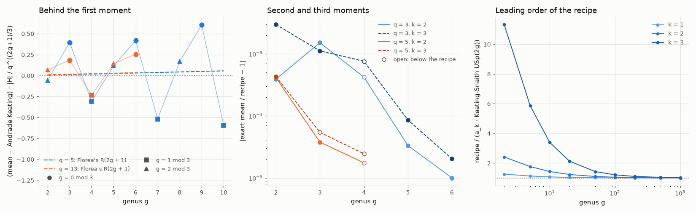

Brute force over every curve stops at genus 6 over F_3 and genus 4 over F_5.
`hypermoments.dual_coefficients` gets the same first moment much further by
swapping the order of summation. The coefficient sums T_j = Σ_D c_j(D) are
Σ_{deg f = j} Σ_{D ∈ H} χ_D(f), and for fixed f the inner sum is a coefficient of
the rational function

Σ_{D squarefree} ψ_f(D) u^deg D = L(u, ψ_f) / L(u², ψ_f²),  ψ_f(D) = (D/f).

Writing f = f₀h² with f₀ squarefree, this is L(u, ψ_{f₀})·(1 − qu²) divided by
∏_{P | f₀}(1 − u^(2 deg P)) and by ∏_{P | h, P ∤ f₀}(1 + ψ_{f₀}(P) u^(deg P)).
By reciprocity L(u, ψ_{f₀}) is the L-polynomial of y² = f₀(x) with u replaced by
±u, so the whole first moment at genus g needs L-polynomials of squarefree f₀ of
degree at most g instead of 2g + 1. The squarefree f₀ come with their
factorizations from a depth-first product over irreducibles, which are built as
minimal polynomials of field elements. Genus 9 over F_5 (1.5·10¹³ curves) takes
46 seconds and genus 10 about five minutes. The tests check T_j against the brute
force column sums and the means against every curve, to 13 digits.

Florea ([arXiv:1505.03094](https://arxiv.org/abs/1505.03094), Theorem 1.1) proves
that behind the Andrade-Keating main term sits q^((2g+1)/3)·R(2g + 1) with R linear,
given in her (6.13). `hypermoments.florea_R` evaluates it. The table and the left
panel show N = (mean − Andrade-Keating)·|H|/q^((2g+1)/3):

| g | q = 5: mean | difference | N | R(2g + 1) | q = 13: N | R(2g + 1) |
|---|---|---|---|---|---|---|
| 2 | 2.838400 | −3.5e−4 | −0.059 | 0.007 | +0.069 | 0.011 |
| 3 | 3.667712 | +2.7e−4 | +0.398 | 0.013 | +0.187 | 0.017 |
| 4 | 4.496110 | −2.5e−5 | −0.307 | 0.019 | −0.232 | 0.023 |
| 5 | 5.324829 | +1.1e−6 | +0.117 | 0.026 | +0.143 | 0.028 |
| 6 | 6.153523 | +4.6e−7 | +0.421 | 0.032 | +0.257 | 0.034 |
| 7 | 6.982217 | −6.6e−8 | −0.517 | 0.038 | | |
| 8 | 7.810911 | +2.5e−9 | +0.167 | 0.045 | | |
| 9 | 8.639605 | +1.1e−9 | +0.606 | 0.051 | | |
| 10 | 9.468299 | −1.2e−10 | −0.593 | 0.057 | | |

The size is right. Over eight genera the difference falls by six orders of
magnitude and N stays between −0.6 and 0.6, so the term really is of order
q^((2g+1)/3), and the error O(q^(g/2)) has not swamped it. The shape is not. N
follows g mod 3: negative and growing for g ≡ 1, positive for g ≡ 0, small for
g ≡ 2, and R is ten times smaller than N in most rows. Over F_17 (g = 2 to 5) and
over F_3 (g = 2 to 13, outside Florea's q ≡ 1 mod 4) the same three-step pattern
appears. Averaged over three consecutive genera, N is 0.011, 0.007 and 0.060 for
g = 2..4, 5..7 and 8..10 over F_5, against R = 0.013, 0.032 and 0.051 at the
middle genus.

The paper shows where a period of 3 could come from. In (6.11) the residue is taken
at the double pole z = q^(−4/3) of an integrand with the factor (1 − q⁴z³)² in the
denominator, which also vanishes at the two complex cube roots ωq^(−4/3) and ω̄q^(−4/3).
Their residues carry ω^g. I evaluated the printed integrand for S_{g−1}(V = □)
numerically: over F_5 the two complex residues are 4.6 to 5.2 times larger than the real
one at every genus from 4 to 9. The matching integrand for S_g is not printed, so I
cannot add up the full correction, but missing residues at ωq^(−4/3) fit both the
sizes and the period.

A second, smaller point: in (6.13) the closed form given for
q^(−4/3)·(d/dz) log ∏_P D_P(z, qz) at z = q^(−4/3) does not match the derivative of
the D_P printed in Lemma 6.3 (by a factor of 2.6 at degree 1 primes), while the
closed form for ∏_P D_P(q^(−4/3), q^(−1/3)) matches it exactly. Using the derivative
of D_P changes R by about 5% (`euler_dlog`), which does not affect the comparison.

For the higher moments, `hypermoments.recipe` evaluates the CFKRS recipe of
Andrade and Keating ([arXiv:1302.3249](https://arxiv.org/abs/1302.3249)) for
Σ_D L(1/2, χ_D)^k. The shifted moment is a sum over 2^k sign patterns of
q^(−2g·Σ flipped α) times an Euler product with factors
1 + (|P|/(|P| + 1))·((∏(1 − x_i)⁻¹ + ∏(1 + x_i)⁻¹)/2 − 1), x_i = |P|^(−1/2−α_i),
from which ∏_{i≤j} ζ_A(1 + α_i + α_j) is pulled out so the rest converges. The sum
is analytic at α = 0 while each term has a pole there, so the value at 0 is the mean
over a small circle α = t·(1, 2, ..., k), computed at 60 digits. The tests check that
k = 1 gives the Andrade-Keating formula to 12 digits, that the k = 2 and 3 values
are polynomials in g of degree 3 and 6, and that the leading order is the arithmetic
factor times the Keating-Snaith USp(2g) moment (right panel; the ratio is
1 + O(1/g)).

Florea ([arXiv:1507.02640](https://arxiv.org/abs/1507.02640)) proves the second
moment with error O(q^(g(1+ε))) and the third with O(q^(3g/2(1+ε))), and her
second moment agrees with this recipe. Exact averages over every curve:

| q | g | curves | mean L² | recipe | ratio − 1 | mean L³ | recipe | ratio − 1 |
|---|---|---|---|---|---|---|---|---|
| 3 | 4 | 13,122 | 35.4993 | 35.5143 | −4.2e−4 | 427.966 | 428.291 | −7.6e−4 |
| 3 | 5 | 118,098 | 54.5012 | 54.4994 | +3.3e−5 | 914.284 | 914.206 | +8.6e−5 |
| 3 | 6 | 1,062,882 | 79.0198 | 79.0190 | +1.0e−5 | 1770.145 | 1770.109 | +2.0e−5 |
| 5 | 3 | 62,500 | 23.9304 | 23.9295 | +3.8e−5 | 215.487 | 215.499 | −5.4e−5 |
| 5 | 4 | 1,562,500 | 41.1481 | 41.1488 | −1.8e−5 | 564.268 | 564.282 | −2.5e−5 |
| 7 | 3 | 705,894 | 25.3314 | 25.3314 | −7.6e−7 | 239.651 | 239.655 | −1.6e−5 |
| 13 | 2 | 342,732 | 13.2148 | 13.2147 | +8.2e−6 | 76.0384 | 76.0384 | −2.8e−7 |

The third moment agrees with the full recipe polynomial, lower-order terms
included, to 2·10⁻⁵ at genus 6 over F_3. Diaconu
([arXiv:1801.00486](https://arxiv.org/abs/1801.00486)) proves a secondary term of
size q^(3(2g+1)/4) in the cubic moment, relative size q^(−(2g+1)/4), which is
0.03 at genus 6 over F_3 before its constant; these genera are too small to
separate it from the rest of the error.

### Low-lying zeros of the twists, with the lower-order terms

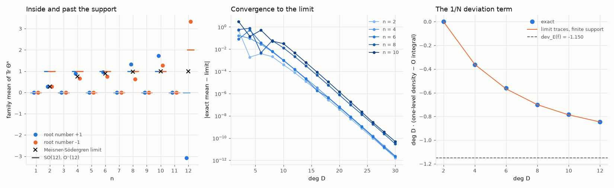

The one-level density of a family is a linear combination of the family means of
Tr Θⁿ, where Θ is the unitarized Frobenius of L(E_D, u) = det(1 − quΘ). Katz-Sarnak
says those means tend to the orthogonal value η₂(n) (1 for even n, 0 for odd).
Meisner and Södergren ([arXiv:2110.00102](https://arxiv.org/abs/2110.00102),
Theorem 1.3) give the next terms for the quadratic twists of a fixed E over F_q(t):

⟨Tr Θⁿ⟩ = η₂(n)·(1 + Tr Θ^(n/2)_{sym² E} / q^(n/4) + 𝒟(n) / q^(n/2)) + error,

where 𝒟(n) collects 1/(|P| + 1) corrections from squarefree D avoiding P and the
places of bad reduction. This refines Comeau-Lapointe
([arXiv:2012.09947](https://arxiv.org/abs/2012.09947)). `onelevel.py` computes the
family mean exactly, with no enumeration of D, and checks the theorem against it.

The exact mean comes from writing the trace of each twist point by point:
a_x(E_D) = χ(D(x))·a_x(E) over F_{q^n}. For a place P of degree d, k = n/d, the
average of χ_D(P)^k over squarefree monic D of degree N coprime to Δ is a
coefficient of a rational function. If k is even it is the share of D prime to P,
from (1 − qu²)/(1 − qu) divided by (1 + u^d) and the bad places. If k is odd it is
Σ_D (D/P), from L(u, (·/P))·(1 − qu²)/(1 − u^(2d)) with the same divisions twisted
by (Q/P), and the L-polynomial comes from `hypermoments.lpoly`. Splitting by the
root number multiplies in (D/M), M the multiplicative places. So the mean at
degree N costs one pass over the places of degree up to n, and N = 20 takes 0.1 s.
The tests check it against `family` (every twist, L-polynomials from point counts)
as exact fractions over F_3 and F_5 and for a second curve, both for the full family
and for each root number. Over F_3 the character (D/M) equals the root number for
every N from 1 to 7. Over F_5 they differ by (−1)^N.

The sym² term needs L(u, sym² E) over F_q(t). Its local factors at good places are
(1 − α²u)(1 − qu)(1 − β²u), so a_x(sym²) = a_x² − q^m, and at a place of
potentially multiplicative reduction (I_n or I_n*) sym² is unipotent with a
one-dimensional invariant line on which Frobenius acts by 1. Grothendieck-Ogg-Shafarevich
then gives degree 2·(number of bad places) − 6. For the Legendre curve (I_2, I_2,
I_2*) that is 0, and indeed the point counts give L(u, sym² E) = 1: Σ_x a_x(sym²)
vanishes over F_{3^m}, F_{5^m}, F_{7^m} for m = 1 to 5. For y² = x(x − 1)(x − t²)
over F_3 it is 1 + 4u + 27u², and for y² = x(x − 1)(x − t³) over F_5 it is
1 − 74u² + 15625u⁴, both with roots on |u| = q^(−3/2) and power sums from Newton's
identities matching the point counts past the degree.

Letting N → ∞ in the exact formula leaves the diagonal with weights |P|/(|P| + 1),
and `ms_traces` writes the same number in Meisner and Södergren's form with the sym²
L-polynomial. They agree as exact fractions once one term is added for the place at
infinity, which the theorem does not have: (a_∞(sym²) − a_∞(E_D, q^n))/q^n. Over
F_3 the limit for the Legendre family is far from the orthogonal value at small n:

| n | 2 | 4 | 6 | 8 | 10 | 12 |
|---|---|---|---|---|---|---|
| limit | 0.2778 | 0.7420 | 0.8782 | 0.9722 | 0.9857 | 0.9968 |
| degree 6, root number +1 | 0.2774 | 0.8885 | 0.9488 | 1.3204 | 1.7252 | −3.0746 |
| degree 6, root number −1 | 0.2705 | 0.6541 | 0.7384 | 0.6272 | 1.2656 | 3.3260 |

At n = 2 the limit is exactly 5/18. The middle panel shows the exact mean reaching
it: at n = 2 the gap falls from 0.46 at deg D = 2 to 1.7e−12 at deg D = 30, a factor
of about 7.6 for every two degrees, or q^(−0.90N) from deg D = 14 on. Meisner and Södergren's error
term is q^(n/2)/q^((1−ε)N), and the curves for larger n do sit higher. At deg D = 6
(L of degree 12) that error is already 1/3 at n = 10, and the table shows it.
At n = 12 = deg L the family leaves the ensembles altogether: −3.07 and 3.33 against
0 for SO(12) and 2 for O⁻(12).

Over F_3 the odd-n means are exactly zero whenever deg D is even, and over F_5 they
are not. The reason is a symmetry of the Legendre curve: t ↦ 1 − t turns it into its
twist by −1, so D(t) ↦ D(1 − t) maps the family to itself and multiplies Tr Θⁿ by
χ(−1)ⁿ, which is −1 for odd n when q ≡ 3 mod 4.

The one-level density for an even f with f̂ supported in (−σ, σ) is
f̂(0) + (2/deg L)·Σ_n f̂(n/deg L)·Tr Θⁿ, and Meisner and Södergren's Corollary 1.5
says it differs from the orthogonal integral by dev_E(f)/N + O(N^(−2+ε)). With the
exact means, dev_E(f) = f̂(0)·Σ_n (limit_n − η₂(n)), which is −1.150 over F_3 and
−0.626 over F_5. The right panel uses the Fejér f̂(u) = (1 − 2|u|)₊ (σ = 1/2) over
F_3:

| deg D | 4 | 6 | 8 | 10 | 12 |
|---|---|---|---|---|---|
| deg D · (density − O integral), exact | −0.362 | −0.561 | −0.701 | −0.784 | −0.847 |
| same with the limit traces | −0.361 | −0.567 | −0.701 | −0.787 | −0.846 |

The exact values sit on the curve given by the limit traces to within 0.007. Both
approach −1.150 slowly, because the next term is −(1/N)·Σ_n n·(limit_n − η₂(n)) = 3.65/N
from the slope of f̂, which is not small at q = 3. The orthogonal integral uses
∫_{O(m)} Tr Uⁿ = η₂(n). `rmt_trace` gives the four components separately:
for SO(2m) the mean is η₂(n) up to n = 2m − 2 and 0 after, for O⁻(2m) it is 1, 2 or 0
by the same split, and the odd sizes follow the same way from their one-point densities. A Haar Monte
Carlo of O(6) and O(7) checks all of them.

### Cubic twists over F_q(t)


For q ≡ 1 mod 6 there are cubic residue symbols (D/P)₃ on F_q[t], and two families
of twists come with them. The first twists a curve with j = 0, Ẽ: y² = x³ + B, into
Ẽ_D: y² = x³ + BD², for D monic, cube-free, prime to B, with deg rad D = N and
3 | deg D (Meisner and Södergren, [arXiv:2110.00102](https://arxiv.org/abs/2110.00102),
section 1.3). The second twists any E by the character χ_D = (D/·)₃ over the same D,
which is Comeau-Lapointe's unitary family. `cubic.py` has the symbols, an exact
Eisenstein-integer type for values in Z[ω], and L(u, (·/P)₃) from character sums.
`cubictwist.py` builds both families from point counts and computes their exact
means without listing D.

The key local fact is a Jacobi sum. For P ∤ B of degree d, with α a root of P,
Λ_P = Σ_{f ∈ F_{q^d}} χ₃(f² − B(α)) satisfies a_P(Ẽ) = −(Λ_P + Λ̄_P), and twisting
by D multiplies Λ_P by (D/P)₃². Writing f² = y turns Λ_P into
χ₃(−B(α))·η(−B(α))·J(χ₃, η), so |Λ_P|² = q^d exactly: the normalized λ_P always has
absolute value 1. The test suite checks this for every P of degree up to 3 and three
choices of B, along with −(Λ_P + Λ̄_P) = a_P from point counts. Over F_7 with
B = t² + 1 the average (m/q^m)·Σ_{deg P = m} |λ_P|² is 1.000, 0.816, 0.980, 0.980,
0.9996 for m = 1 to 5, which is the prime count, not the 1/2 of Corollary 1.9 there.

That changes what the family looks like. Ẽ has CM by Z[ω], and
L(Ẽ_D, u) = H(πu)·H̄(π̄u), where H is the L-function of the sextic character
χ₃η(BD²) and π = −Σ_f χ₃(f² − 1) is a Jacobi sum of norm q (−3 − 2ω over F_7).
`hecke_split` computes H from character sums, and the tests check the product
against L(Ẽ_D, u) coefficient by coefficient for every twist with N = 2. So the
eigenangles come as {θⱼ + φ} ∪ {−θⱼ − φ}, with the θⱼ from a family of
characters, which is unitary. The orthogonal value η₂(n)
comes from the diagonal term a_P(E_D)² − 2 averaged over D, which needs E without
CM: here a*_{P²} = λ_D² + λ̄_D² carries (D/P)₃⁴ = (D/P)₃ and averages to almost
nothing. So the means go to 0 at n = 2, 4 and the only diagonal left is at 3 | n,
the (λ_P³ + λ̄_P³) term of Theorem 1.7. Theorem 1.6 and Conjecture 1.10 put η₂(n)
on top of it, and the exact means say otherwise (left panel):

| n | 1 | 2 | 3 | 4 | 5 | 6 |
|---|---|---|---|---|---|---|
| Ẽ_D, N = 3 | 0.00000 | −0.05305 | 0.06912 | 0.03077 | 0.15613 | −0.18941 |
| Ẽ_D, N = 9 | −0.00000 | 0.00002 | 0.04867 | 0.00022 | 0.00006 | −0.00458 |
| Ẽ_D, N = 12 | 0.00000 | −0.00000 | 0.04811 | −0.00000 | 0.00000 | −0.00480 |
| Legendre ⊗ χ_D, N = 12 | 0.00000 | −0.00000 | 0.00000 | 0.00000 | 0.00000 | 0.03567 |
| O(2N) | 0 | 1 | 0 | 1 | 0 | 1 |

At n = 3 the term (n/3)·Σ_{deg P = 1} (λ_P³ + λ̄_P³)/q^(n/2) of Theorem 1.7 is 0.0583,
and the exact diagonal is 0.0481: the difference is the share of D prime to each P,
which is the D̃₂ correction. The first term of Theorem 1.7 needs |λ_P| ≠ 1 and so
only sees the places dividing B. The zeros agree (middle panel): over the 1,430
twists with deg rad D = 4 (L of degree 10), the 14,300 eigenangles are flat on
[0, π] with no bump at either end, unlike SO(10). 159 of the twists vanish at the
centre, always to even order (152 to order 2, 7 to order 4), because the two
conjugate factors vanish together, and every root number is +1.

Both families have the same mean formula. A place P of degree d dividing n with
k = n/d contributes d·(α_P^k + β_P^k) times the average of (D/P)₃^k (or ^(2k)) over
the family. When 3 | k that is the share of D prime to P; otherwise it is
W(P) = Σ_D (D/P)₃, and W(P) is an integer because D₁D₂² ↦ D₂D₁² sends χ_D to its
conjugate and keeps the family. So the Eisenstein parts cancel and the twisted
family and the CM family of a j = 0 curve have identical means, which the tests
check by brute force. W(P) is a coefficient of a product over primes R:

Σ_{D₁, D₂} ξ(D₁) ξ̄(D₂) x^(deg D₁) z^(deg D₁D₂) = ∏_R (1 + (x^(deg R) ξ(R) + ξ̄(R)) z^(deg R)),

with ξ = (·/P)₃, filtered to deg D₁ ≡ 2N mod 3 by summing x over the cube roots of
unity. Its logarithm only needs prime sums of ξ, ξ² and the principal character
mod P, and those come from L(u, (·/P)₃) by Möbius inversion over degrees. That
L-polynomial has degree d − 1 and its coefficients are character sums
Σ_{x ∈ F_{q^m}} χ₃(P(x)) by cubic reciprocity, which holds without a sign here
since (q − 1)/3 is even. The tests check reciprocity on pairs of primes, the
coefficients against direct sums over monic A, the Riemann hypothesis for them
(roots on |u| = q^(−1/2), plus the trivial zero u = 1 when 3 | d), each weight
against Σ_D (D/P)₃ for every D, and the exact means against both families as exact
fractions for N = 2, 3 and two choices of B.

The right panel is the off-diagonal part, exact mean minus diagonal. At n = 6 it
falls from 0.63 at N = 2 to 7.5e−5 at N = 9, faster than q^(−N/2). For B = t the
means vanish exactly unless 6 | n (at N = 5 they are 0 for n ≤ 5 and −30970/1294139
at n = 6): t ↦ ct maps the family to itself and multiplies the degree-n terms by
ψ(c)ⁿ for a sextic character ψ, which is why the figure uses B = t² + 1. Over F_7
the computation stops at n = 6, where the L-polynomials of the 19,594 primes of
degree 6 are the cost; N = 12 takes 49 s.

### Sextic and quartic twists

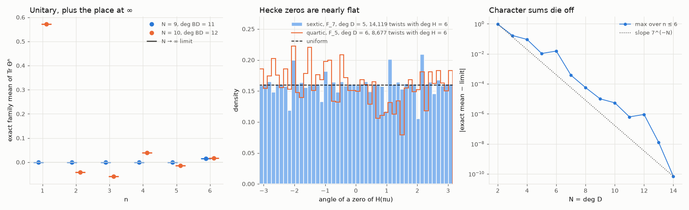

A curve y² = x³ + c has CM by Z[ω], and for q ≡ 1 mod 6 its twists over F_q(t) are
the sextic twists y² = x³ + BD, with D monic, sixth-power-free and prime to B. For
q ≡ 1 mod 4 the curve y² = x³ + cx has CM by Z[i] and the quartic twists
y² = x³ + ADx play the same role. `cmtwist.py` builds both families, splits every
L-function into two Hecke L-functions, and computes exact family means of Tr Θⁿ for
any deg D without listing D. Values in Z[i] use a small exact `Gauss` type next to
the existing `Eis`; sextic values live in Z[ω] already, since ζ₆ = 1 + ω.

Counting points over F_Q splits into Jacobi sums. For y² = x³ + c,
a = −(Λ + Λ̄) with Λ = χ̄₆(c)·J(χ₃, η), where χ₃ = χ₆². For y² = x³ + cx the same
count gives Λ = χ₄(−1)·χ̄₄(c)·J(χ₄, η). The Hasse-Davenport relation says
−J over F_{q^d} equals (−J over F_q)^d, so at a place P of degree d the Frobenius is
α_P = χ̄_P(c)·π^d with a single π for the whole family: π = −J(χ₃, η) = −3 − 2ω
over F_7, and π = −χ₄(−1)J(χ₄, η) = 1 + 2i over F_5. Hence

L(E_c, u) = H(πu)·H̄(π̄u),   H(u) = ∏_P (1 − χ̄_P(c) u^(deg P))^(−1),

with the place at infinity included, at the value χ̄(lead c), exactly when 6 | deg c
(or 4 | deg c). The tests check Hasse-Davenport for m ≤ 3 in four (q, order) pairs,
π + π̄ against point counts, and the product against L(E_c, u) from point counts
coefficient by coefficient for ten curves over F_5, F_7, F_13 and F_17, including
repeated factors and good reduction at infinity.

For the means, a place P of degree d with k = n/d contributes d·2 Re(π^n
χ̄_P(B)^k W) to the family sum of the traces, with W = Σ_D χ̄_P(D)^k. For a character
ψ mod P of order dividing 6, the Euler product over sixth-power-free D is

Σ_D ψ(D) u^(deg D) = L(u, ψ)·∏_{R | B} (1 − ψ(R) u^(deg R))·(1 − q u⁶) / ∏_{R | BP} (1 − u^(6 deg R)),

and the principal case swaps L(u, ψ) for (1 − u^d)/(1 − qu). L(u, ψ) has degree
d − 1 and comes from character sums Σ_{x ∈ F_{q^m}} χ₆(P(x)) by sixth-power
reciprocity. Unlike the cubic case this carries a sign, (−1)^(((q − 1)/6)·deg A·deg P),
and over F_7 the exponent (q − 1)/6 = 1 is odd. The tests check L(u, ψ) against
direct sums over monic A, the family against a brute-force scan of monic D, and the
exact means against brute-force means from point counts (no Hecke characters
involved) as exact fractions for eight choices of q, order, B and deg D.

As deg D → ∞ only two kinds of term survive: the principal ones, where 6 | k, and
the place at infinity. The first gives the share of D prime to P,
(1 − q^(−d))/(1 − q^(−6d)); the second appears only when 6 | deg BD, and then it is
the same for every twist, because every member has good reduction at infinity with
Frobenius χ̄(lead B)·π. `limit_traces` writes the limit in closed form. For
B = t² + 1 over F_7 (left panel):

| n | 1 | 2 | 3 | 4 | 5 | 6 |
|---|---|---|---|---|---|---|
| deg D = 9, exact | 0.00000 | 0.00000 | 0.00000 | −0.00001 | 0.00000 | 0.01459 |
| deg D = 9, limit | 0 | 0 | 0 | 0 | 0 | 143/9804 = 0.01459 |
| deg D = 10, exact | 0.57143 | −0.04082 | −0.05831 | 0.03915 | −0.01404 | 0.01702 |
| deg D = 10, limit | 4/7 | −0.04082 | −0.05831 | 0.03915 | −0.01404 | 0.01702 |
| U(N) | 0 | 0 | 0 | 0 | 0 | 0 |

At deg D = 10 the family has 276,693,984 twists and the mean of Tr Θ is 4/7 = −tr(π)/q.
The unitary value 0 is the q → ∞ limit of Katz and Sarnak; at fixed q the means
converge in deg D to these arithmetic numbers instead, of size q^(−n/2) from the
shared factor at infinity and q^(1 − n/2) from the principal terms. The distance
to the limit (right panel, the max over n ≤ 6) falls from 0.94 at deg D = 2 to
6.8e−11 at deg D = 14, close to q^(−N). The quartic family over F_5 behaves the same
way: with B = t² + 1 the means at deg D = 12 are 0 except 0.05385 at n = 4 and
0.05829 at n = 8, and at deg D = 10, where 4 | deg BD, the mean of Tr Θ is
−tr(π)/5 = −0.4.

The zeros of H (middle panel) spread over the whole circle with no point of
repulsion, as a unitary family should. With deg H = 6 the bins still wobble, between
0.66 and 1.31 times 1/(2π) over F_7 (48 bins) and 0.50 and 1.40 over F_5. The central order
is always even: L(E, 1/q) = |H(π/q)|² ≥ 0, so the two factors vanish together and
every root number is +1. Over F_7 with deg D = 5 the 16,464 sextic twists vanish to
order 0, 2 and 4 in 15,036, 1,399 and 29 cases; over F_5 with deg D = 6 the 9,952
quartic twists split 8,283, 1,604 and 65.

The cost is the L-polynomials of the primes of degree up to n. Over F_7 the sextic
means to n = 6 take 6 s for those and then about 3 s per deg D; the quartic means
over F_5 to n = 8 take a minute, mostly for the 48,750 primes of degree 8.

### Chebyshev's bias

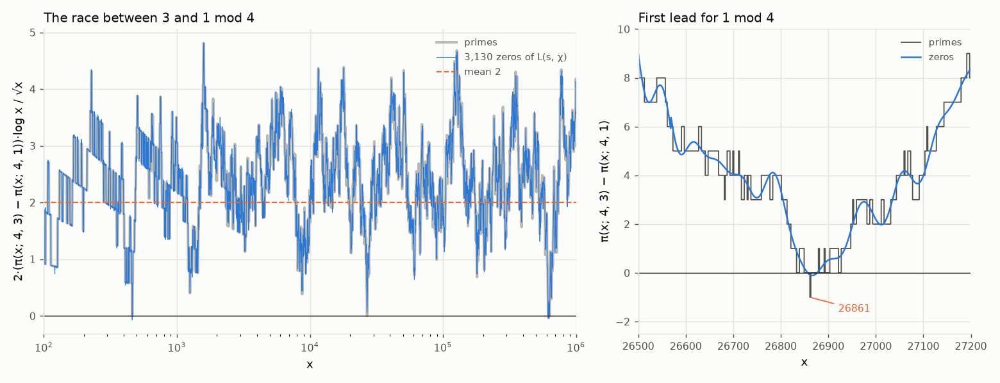

Chebyshev noticed in 1853 that primes ≡ 3 (mod 4) seem to outnumber primes ≡ 1.
Counting confirms it: π(x; 4, 3) ≥ π(x; 4, 1) for every x below 26861, and up to
10⁸ the 1 class leads at only 1,940 primes. Rubinstein and Sarnak explained why,
assuming GRH and the linear independence of the zero ordinates (LI). With
E(x) = φ(q)·(π(x; q, a) − π(x; q, b))·log x / √x, the explicit formula for each
L(s, χ) gives

E(x) = c(q, b) − c(q, a) − Σ_χ (χ̄(a) − χ̄(b)) Σ_γ x^(iγ) / (1/2 + iγ) + o(1),

where c(q, a) + 1 is the number of square roots of a mod q. The constant is the
whole bias: prime squares are all quadratic residues, so the residue class pays
for them and starts behind by c(q, b) − c(q, a). As log x runs, LI makes the
phases γ log x equidistribute on a torus, so E(x) behaves like
X = C + Σ r_γ cos θ_γ with independent uniform θ_γ and r_γ = 2|χ(a) − χ(b)|/|ρ|.
Its characteristic function is e^(iCt) ∏ J₀(r_γ t), and the share of log x where
a leads is

δ(q; a, b) = P(X > 0) = 1/2 + (1/π) ∫₀^∞ sin(Ct)/t · ∏ J₀(r_γ t) dt.

```python
from zeta_explorer.bias import race, prime_race

R = race(4, 3, 1)                      # zeros of L(s, χ₋₄) up to T = 1000
len(R.gamma), R.bias, R.variance       # 868, 2.0, 0.6223
R.density()                            # 0.9959279226422321
p, d = prime_race(4, 3, 1, 30_000)
p[d < 0]                               # [26861]
```

`race` collects the zeros below T of every character with χ(a) ≠ χ(b), one per
conjugate pair (a complex χ contributes its zeros on both sides of the real axis,
which are the positive zeros of χ and χ̄). Zeros above T are not dropped: their
total weight Σ 1/(1/4 + γ²) has a closed form, log(q/π) + ψ((1 + κ)/2) +
2 Re L'/L(1, χ), so the tail variance is exact and enters as a Gaussian factor in
the product. L'(1, χ) comes from a 48-point Cauchy integral around s = 1, and J₀
from the midpoint rule on (1/π)∫ cos(z sin θ) dθ, which matches mpmath to 1e-14
with about z/2 + 15 nodes. The integral is a trapezoid sum; the integrand is
analytic and even, so the only error is aliasing, the mass of X beyond 2π/h, and h
is chosen so that is 40 standard deviations away.

| race | zeros (T = 1000) | δ here | Fiorilli-Martin | Var X | log share, 10³ to 10⁸ |
|---|---:|---:|---:|---:|---:|
| 3 vs 2 mod 3 (2 ahead) | 823 | 0.9990632 | 0.999063 | 0.4529 | 1.00000 |
| 3 vs 1 mod 4 | 868 | 0.9959279 | 0.995928 | 0.6223 | 0.99894 |
| 2 vs 1 mod 5 | 2,712 | 0.9521746 | 0.952175 | 1.4391 | 0.97730 |
| 3 vs 1 mod 8 | 1,847 | 0.9995688 | 0.999569 | 1.5640 | 1.00000 |
| 5 vs 1 mod 8 | 1,956 | 0.9973946 | 0.997395 | 2.2060 | 1.00000 |
| 7 vs 1 mod 8 | 1,845 | 0.9989378 | 0.998939 | 1.8866 | 1.00000 |
| 5 vs 1 mod 12 | 1,864 | 0.9992059 | 0.999206 | 1.7736 | 1.00000 |
| 7 vs 1 mod 12 | 1,909 | 0.9986061 | 0.998606 | 1.9429 | 1.00000 |
| 11 vs 1 mod 12 | 1,691 | 0.9999766 | 0.999977 | 1.0752 | 1.00000 |
| 5 vs 1 mod 24 | 3,820 | 0.9999875 | 0.999988 | 3.9796 | 1.00000 |
| 11 vs 1 mod 24 | 3,823 | 0.9999826 | 0.999983 | 4.2257 | 1.00000 |
| 23 vs 1 mod 24 | 3,820 | 0.9998886 | 0.999889 | 5.5277 | 1.00000 |

All twelve agree with Table 8 of Fiorilli and Martin (2013) to the six digits they
print, and the tests check eight of them with T = 200, which already lands within
5e-7 of the printed values. Feuerverger and Martin (2000) give 0.952140 for the mod 5 race and say their
complex-character computation interpolated between grid points; the value here
matches the later 0.952175. Their table of Σ_{γ>0} 1/(1/4 + γ²) for χ₋₃, χ₋₄,
χ₋₈ and χ₁₂ is matched to all six digits. As an independent check on the Fourier
inversion, 400,000 draws of X with random phases land within 4σ of the computed
density, and the density integrates to 1 with mean C. The last column is what
the primes actually do up to 10⁸, which is far from the limit for the mod 5 race
(1 leads after 300,619 of the primes below 10⁸), while the races mod 3, 8, 12 and
24 show no reversal at all in that range.

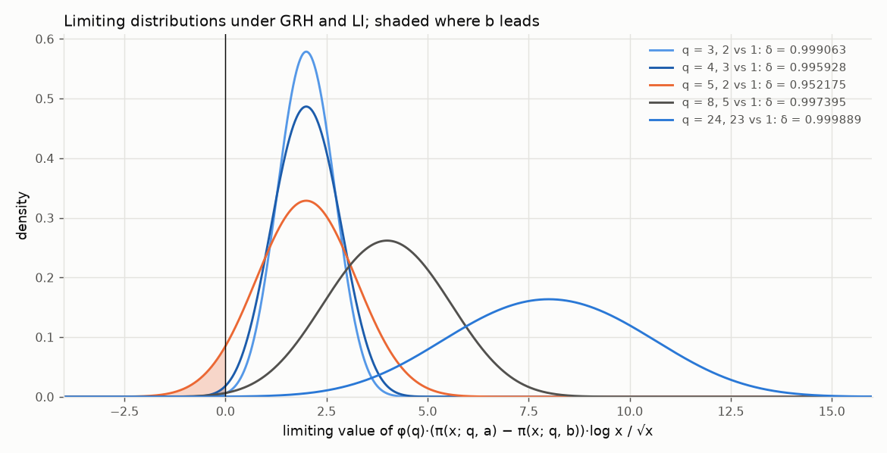

`Race.explicit(x)` rebuilds E(x) itself from the zeros, with Riemann's Li(x^ρ)
for each zero. The plain sum is off by about one prime at small x because the
explicit formula for Π(x, χ) has a constant, log L(0, χ) for odd χ and
log L'(0, χ) − γ − log log x for even χ (L(0, χ) = 0 there), and π needs the
Möbius sum over Π(x^(1/k), χ^k). Those k ≥ 2 terms only involve primes up to √x,
so they are counted directly. Two details matter for complex characters: the
branch of log L(0, χ) comes from following L(σ, χ) along the real axis from
σ = 4, and Li(x^ρ) has to be the integral from −∞, which is Ei(ρ log x) minus
iπ·sign(γ). With Ei alone the error flips sign as T crosses each zero, because
zeros above and below the axis no longer pair up. After both fixes the mean error
over 200 ≤ x ≤ 10⁵ is at most 0.013 in E for the mod 4, 5, 8, 12 and 24 races. With
the 3,130 zeros below T = 3000 the rebuilt curve goes negative for x between
about 26857 and 26876, around the actual first lead change at 26861 (the right panel
of the first chart).

### Ramanujan's Δ and the Sato-Tate law

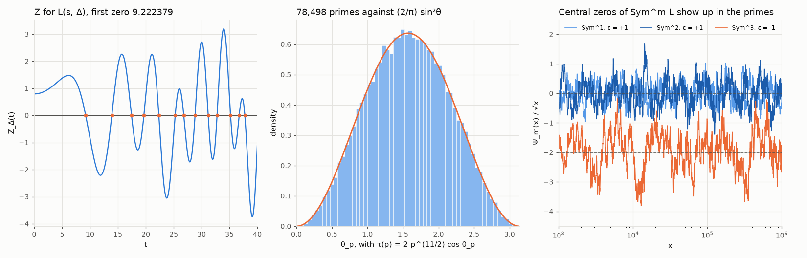

Δ(q) = q ∏(1 − qⁿ)²⁴ = Σ τ(n) qⁿ is the weight 12 cusp form of level 1, and its
L-function L(s, Δ) = Σ τ(n) n^(−11/2) n^(−s) is the simplest degree 2 L-function
that has nothing to do with elliptic curves. `delta.py` computes it from scratch.

The coefficients are exact. Jacobi's identity η³ = Σ (−1)^k (2k + 1) q^(k(k+1)/2)
has only √(2N) nonzero terms below q^N, so Δ/q = (η³)⁸ is one sparse square and six
sparse products, each a few hundred shifted array additions. That runs modulo four
primes just below 2³¹ (enough because |τ(n)| ≤ d(n) n^(11/2) < 2n⁶) and Garner's
algorithm turns the residues back into integers. τ(n) for n ≤ 2²⁰ takes under a
minute. The tests compare against FLINT's own power series for ∏(1 − qⁿ)²⁴, check
Ramanujan's congruence τ(n) ≡ σ₁₁(n) (mod 691) up to 3,000, the Hecke relations
τ(mn) = τ(m)τ(n) and τ(p²) = τ(p)² − p¹¹, and Deligne's bound τ(p)² < 4p¹¹ in
exact integers for p < 2¹⁵. None of the first million τ(n) is zero (Lehmer's
question).

L(s, Δ) uses the same smoothed functional equation as the elliptic curves, with
Λ(s) = (2π)^(−s) Γ(s + 11/2) L(s) = Λ(1 − s) and the split point rotated toward the
imaginary axis at large t so the Γ(6 + it) decay doesn't eat the precision. Z(t)
matches a 110 digit mpmath evaluation to 3e−14 at t = 100, the first ten zeros
match LMFDB to 13 digits (9.2223793999211, 13.9075498613921, ...), and
L(1/2, Δ) = 0.79212283864603 against LMFDB's 0.7921228386. The sharpest check is
Manin's period theorem: the critical values C(10, n)·Λ(n − 9/2) for even n come out
proportional to 36/691 : 1 : 3 : 3 : 1 : 36/691 and for odd n to 4 : 25 : 42 : 25 : 4,
the coefficients of Δ's period polynomial, to 12 digits.

Deligne's bound lets us write τ(p) = 2p^(11/2) cos θ_p. Sato-Tate (proved for Δ by
Barnet-Lamb, Geraghty, Harris and Taylor) says θ_p is distributed like
(2/π) sin²θ. For the 78,498 primes below 10⁶ the even moments of 2 cos θ_p are
0.9987, 1.9939, 4.9772, 13.9204 and 41.725, against the Catalan numbers 1, 2, 5,
14, 42, and the Kolmogorov distance to the Sato-Tate law is 0.0023
(√n·D = 0.65, an unremarkable value for a true null).

The right panel is the part I found most interesting. Sato-Tate is a statement
about the symmetric power L-functions: Σ_p U_m(cos θ_p) log p is the prime part
of the Chebyshev function of L(s, Sym^m Δ), and its explicit formula has a term
−2r√x for a zero of order r at the center. Level 1 means the root number is the
archimedean one, i^(Σ (w_j + 1)) over the gamma factors Γ_C(s + w_j/2) with
w_j = (m − 2j)·11 (plus i^δ from a Γ_R factor when m is even), and that is −1 for
m = 3 and m = 5. So L(s, Sym³ Δ) must vanish at the center. Summing over prime
powers as well, Ψ_m(x)/√x between 10³ and 10⁶ averages −0.005, −0.013, −1.957,
−0.068 and −1.841 for m = 1 to 5, against the predicted 0, 0, −2, 0, −2. The sum
over primes alone is biased by the prime squares, with the sign of the
Frobenius-Schur indicator: it averages +1.02 for m = 1 and −1.30 for m = 2.

```python
from zeta_explorer import delta

delta.tau(6)                    # [0 1 -24 252 -1472 4830 -6048]
delta.zeros(15.0)               # [ 9.2223794  13.90754986]
st = delta.sato_tate(10**6)     # 78,498 primes
st.moment(4)                    # 1.9939
delta.root_number(3)            # -1
```

### Symmetric powers, Turing's method, and a whole line from one transform

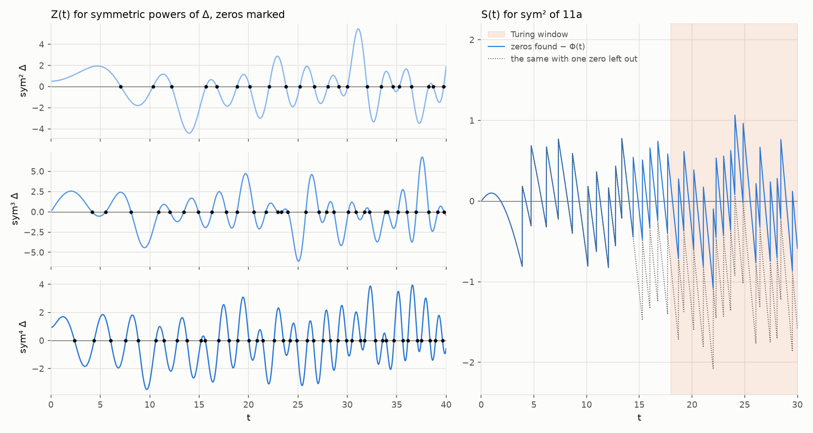

`selfdual.py` is the smoothed functional equation from the symmetric square section
with the curve taken out: any L-function with real coefficients, conductor q, gamma
factor ∏ Γ_R(s + μ_j) and sign ε. `sympower.py` feeds it the symmetric powers of Δ.
At a prime with τ(p) = 2p^(11/2) cos θ_p the local factor of sym^m is
∏ (1 − e^(i(m − 2j)θ_p) p^(−s))^(−1) over j = 0..m, and the gamma shifts come from
pairing the Hodge types: (1, 11, 12) for sym², (5.5, 6.5, 16.5, 17.5) for sym³,
(0, 11, 12, 22, 23) for sym⁴. Level 1 means q = 1, and the sign is +1, −1, +1.
Automorphy is known up to m = 4 (Gelbart-Jacquet, Kim-Shahidi, Kim), so those are
the ones the module offers.

The check that the data is right is that the functional equation holds: two
different smoothing weights agree to 1e−11 for every m, and flipping ε or moving one
shift by 1 breaks that at the 1e−4 level. Then the zeros against Yoshida's 1994
tables (arXiv:math/9411213), who summed the Dirichlet series with an experimental
acceleration: his ten zeros of sym³ below 19 (4.1558656464, 5.5491219562, ...) agree
to his ten digits, his fourteen of sym⁴ (2.3864500, 4.3752457, ..., 18.874) to the
three to seven digits he gives. L(sym³ Δ, 1/2) = 0 to machine precision, as the sign
forces.

For sym² there are exact values. Rankin's method gives
L(sym² Δ, 1) = 2²³ π¹³ (Δ, Δ)/11!, and Zagier showed
L(sym² Δ, s)/(π^(2s + 11) (Δ, Δ)) is rational at s = 1, 3, ..., 11. The Petersson
norm is computed here from the q-expansion over the fundamental domain
(1.03536205680432e−6, 30 digits against the published value). The values at 1 and 3
agree to 12 digits through the functional equation, and those at 5 to 11 are
recognized blind by continued fractions from 30 digit Euler products. The rationals
run from 2¹⁵/(3⁴·5²·7·11) at s = 1 to 2²⁴/(3⁹·5⁴·7²·11·13·17·19·23·691) at s = 11,
with Ramanujan's 691 in the last denominator.

A sign-change scan can miss a close pair of zeros, and nothing in the scan says so.
Turing's method does. With N(t) = Φ(t) + S(t), where Φ comes from the gamma factor
and the conductor, the integral of S over a window [t₁, t₂] is bounded (Booker 2006,
arXiv:math/0507502, for a general L-function). A list that misses k zeros below t₁
overestimates that integral by k(t₂ − t₁), so a window longer than the bound rules
out k ≥ 1. On [30, 40] the bound allows at most 0.53, 0.79 and 0.97 missing zeros for
sym², sym³ and sym⁴ of Δ, so the 13, 19 and 27 zeros below 30 are all of them, and
deleting any one of those pushes the figure past 1. For sym² of 11a (conductor 121) the
window [18, 30] gives 0.56 with 15 zeros below 18. The right panel shows why it
works: S(t) hovers around 0 for the full list and sits a whole unit low once a zero
is left out. This runs in floating point, so it is a check and not a proof.

The pointwise code is slow: one value of sym⁴ Δ near t = 40 is a 579 node contour
integral over about 2,100 coefficients, and the 41 zeros below 40 take 30 seconds. `mellin.py`
gets the whole line at once. Λ(1/2 + it) is the Fourier transform of
g(u) = e^(u/2) Σ a_n K(n e^u/√q), where K is the inverse Mellin transform of the
gamma factor, and g itself is one FFT of the Dirichlet polynomial times the gamma
factor along Re s = 1. Sample g once and every Z(t) is a dot product. The catch is
that Λ decays like e^(−πdt/4), so in double precision the values drown. Booker's
fix is to move the u contour to u + iθ, which multiplies the transform by e^(θt).
Here θ is chosen per window as the slope of log|γ(1/2 + it)| at the window's peak,
so that e^(θt)|γ| stays within e⁸ of its maximum across the window; two windows
cover [0, 40] for sym⁴. The functional equation g(−u) = ε g(u) supplies the negative
half, so the truncated Dirichlet sum only has to be right for u ≥ 0.

| L-function | T | zeros | pointwise | one transform | terms |
| --- | --- | --- | --- | --- | --- |
| sym² Δ | 40 | 22 | 4.5 s | 0.04 s | 81 |
| sym³ Δ | 40 | 31 | 11.4 s | 0.07 s | 621 |
| sym⁴ Δ | 40 | 41 | 32.1 s | 0.14 s | 2,239 |
| sym² 11a | 30 | 31 | 26.0 s | 0.09 s | 1,228 |
| sym² Δ | 200 | 240 | | 0.33 s | 804 |
| sym² 11a | 150 | 271 | | 2.5 s | 13,302 |

The two methods agree on every zero in the first four rows to 8e−12 or better, and
each list in the table passes the Turing check on its last 12 units.

```python
from zeta_explorer.mellin import MellinLine
from zeta_explorer.selfdual import turing
from zeta_explorer.sympower import critical_ratio, delta_power

L = delta_power(3)
L(0.5)                               # 0j
z = MellinLine(L, 100.0).zeros()     # 122 zeros, 4.15586565, 5.54912196, ...
turing(L, z, 88.0, 100.0).missing    # 0.627
critical_ratio(1)                    # 0.210152316818984 = 2^15/(3^4 5^2 7 11)
```

### The symmetric squares of level 1 eigenforms

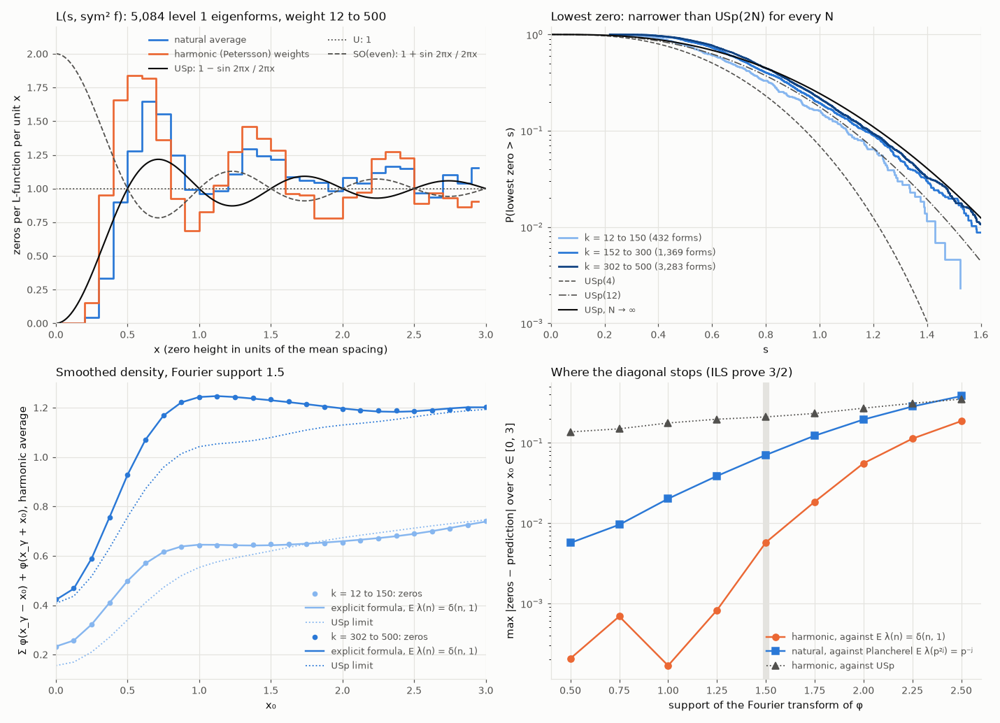

Iwaniec, Luo and Sarnak (arXiv:math/9901141) proved that the low zeros of
L(s, sym² f), with f running over the Hecke eigenforms of level 1 and weight k,
follow the symplectic law 1 − sin 2πx/2πx, as long as the test function has Fourier
support inside (−3/2, 3/2). This section builds that family from scratch up to
weight 500 and looks at what happens at finite k.

`hecke.py` makes the eigenforms. S_k has the basis Δ^j E₄^a E₆^b (4a + 6b = k − 12j),
which is unitriangular in q, so the matrix of T₂ comes out over Z from the first 2d
coefficients. Its characteristic polynomial is factored in FLINT (irreducible for
every weight up to 500, as Maeda conjectured), the roots are taken as Arb balls, and
each eigenvector is solved in ball arithmetic, so λ_f(p) = a_f(p)/p^((k−1)/2) comes
with a certified radius. Precision starts at 128 bits and doubles until every λ_f(p),
p < 2048, is known to 1e−20. Weight 500 (41 forms) takes 2.3 s. The checks are
independent of that pipeline: Δ's coefficients against the η-product τ(n), LMFDB's
1.24.a.a (Hecke field Q(√144169), trace of a₂ = 1080, of a₃ = 339480), T₂ and T₃
commuting, and the Eichler-Selberg trace formula (Hurwitz class numbers from reduced
forms, checked against the Kronecker-Hurwitz relation): Σ_f λ_f(p) and Σ_f λ_f(p²)
match Tr T_p and Tr T_(p²) to 1e−12 at weights 48 and 100.

The harmonic weight of f is ω_f = Γ(k − 1)/((4π)^(k−1) ⟨f, f⟩) = 2π²/((k − 1) L(1, sym² f)),
so every ω_f is one value of the sym² L-function from `selfdual.py`. For Δ it agrees
with the Petersson norm computed earlier to 12 digits. Petersson's formula says
Σ_f ω_f λ_f(m) λ_f(n) = δ(m, n) + 2π i^(−k) Σ_c S(m, n; c)/c · J_(k−1)(4π√(mn)/c), and
the two sides agree to 1e−11 for weights 24 to 44 and m, n up to 5. The Bessel term
is tiny while 4π√(mn) < k − 1 and switches on past it: at weight 60 the harmonic mean
of λ_f(p²) is 2e−16, 1.5e−7, 1.05 and −0.53 for p = 2, 3, 5, 7.

The zeros come from the Mellin-transform line of the previous section with 32 sample
points per mean gap. Eight per gap was not enough once: Turing's check flagged a
weight 400 form with 800 zeros below t = 427 where its siblings had 803, and the
missing pair sits at t = 96.4558 and 96.4749. Below x = 5 the lists are also checked
by the argument principle, N(T) = θ(T)/π + arg L(1/2 + iT)/π with the argument
followed in from σ = 3: every fourth form, 1,271 in all, agrees with the scan.

With x = θ(γ)/π (mean spacing 1), the 5,084 forms give 25,577 zeros below x = 5. On
30 bins up to x = 3, weights 302 to 500, χ² is 486 against USp, 1,534 against U and
2,834 against SO(even). USp wins by a wide margin, but 486 on 30 bins is far from a
fit: the density is zero below x = 0.22 and has bumps near 0.6, 1.4 and 2.3. The
lowest zero is more concentrated than USp allows: P(x₁ > 0.5) is 0.890 against 0.795,
P(x₁ > 1.2) is 0.093 against 0.110. Finite N moves USp(2N) the other way on both
counts, and a likelihood fit over N runs to the edge of its grid.

The explicit formula says why. For an even g with ĝ of compact support,
Σ_(γ>0) g(γ) = ∫₀^∞ g(t) θ′(t)/π dt − (1/2π) Σ_n c(n) n^(−1/2) ĝ(log n), where
c(p^m) = log p · (1 + 2cos 2mθ_p) and 2cos 2mθ_p = λ_f(p^(2m)) − λ_f(p^(2m−2)). With
g a Jackson kernel (sinc⁴, so ĝ is a cubic spline with support s in units of the mean
spacing) the sum is finite. Averaging over a family only needs the family means of
λ_f(p^(2j)). The diagonal of Petersson's formula gives δ(n, 1), with nothing fitted.
For the natural average Serre's Plancherel measure gives p^(−j), and the trace
formula shows the natural mean of λ_f(p²) approaching 1/p like 1/k (−0.020 over
weights 100 to 200, −0.005 over 400 to 800, p = 2).

Two tests close the loop exactly. One form's zeros reproduce its own explicit formula
to 1e−5. All the zeros of weights 32 and 36 reproduce the formula fed with Petersson's
exact means (harmonic weights) and with Eichler-Selberg traces (natural weights) to
1e−5. Then the measured family against the predictions, weights 302 to 500, as the
largest error over x₀ in [0, 3]:

| support s | harmonic vs δ(n, 1) | natural vs Plancherel | harmonic vs USp |
| --- | --- | --- | --- |
| 0.5 | 0.0002 | 0.006 | 0.137 |
| 1.0 | 0.0002 | 0.020 | 0.177 |
| 1.5 | 0.006 | 0.071 | 0.211 |
| 2.0 | 0.056 | 0.196 | 0.271 |
| 2.5 | 0.187 | 0.384 | 0.352 |

Up to support 1 the diagonal term explains the family to the noise of the tail
correction, and it is still within 0.006 at 3/2, where the ILS theorem stops. Past
that the off-diagonal Kloosterman terms carry real weight and the diagonal stops
working, the same Bessel transition as at weight 60 above. The USp limit is off by
0.14 to 0.35 throughout: at these weights 1/log of the conductor is about 0.16, and
the lower-order terms are that size.

```python
from zeta_explorer.hecke import eigenforms, trace
from zeta_explorer.symfamily import family, harmonic_weight, predicted, sato_tate, smoothed

F = eigenforms(24)                   # two forms, a2 = 540 ± 12√144169
sum(f.lam[0] for f in F) * 2**11.5   # 1080.0 = trace(24, 2)
fam = family(range(300, 320, 2))     # 252 forms with their zeros below x = 3
smoothed(fam, [0.5], 1.0, harmonic=True)              # 0.8289
predicted(fam, [0.5], 1.0, sato_tate, harmonic=True)  # 0.8280
```

### Dedekind zeta of quadratic fields

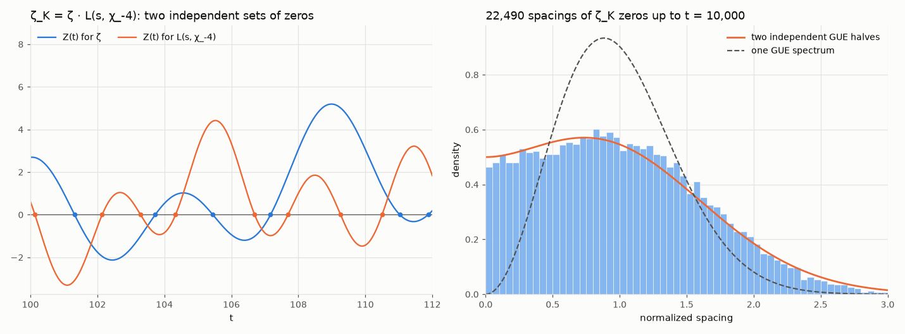

For a quadratic field K of discriminant D, ζ_K(s) = ζ(s) L(s, χ_D), and the
coefficient of n^(−s) counts ideals of norm n: a_n = Σ_{d | n} χ_D(d). For D < 0
`form_counts` counts representations by each reduced form of discriminant D by
brute force, and their total is w·a_n (Dirichlet's formula; for Q(i) it is
Jacobi's r₂(n) = 4 Σ χ₋₄(d)). ζ_K(0) = −h/w for imaginary fields and
ζ_K′(0) = −h·log ε/2 for real ones, both to 1e−8 or better.

Real class numbers come from Gauss's reduction of indefinite forms. A form
(a, b, c) with b² − 4ac = D is reduced when 0 < b < √D and
√D − b < 2|a| < √D + b, all checked in integers. The reduction operator ρ
permutes the finitely many reduced forms in cycles, one cycle per narrow class,
and h = h⁺ when the fundamental unit has norm −1, h⁺/2 otherwise. For every
fundamental D < 3000 this agrees with √D·L(1, χ_D)/(2 log ε) to 1e−8, including
Q(√229), Q(√401), Q(√577) with h = 3, 5, 7 and Q(√1957) with h = 3, h⁺ = 6.
ζ_K(−1) is a rational number. Siegel's formula
ζ_K(−1) = (1/60) Σ_{b² < D, b ≡ D (2)} σ₁((D − b²)/4) and the generalized
Bernoulli number B₂,χ/24 agree exactly as fractions for every D < 1500, and the
complex-analytic ζ_K(−1) matches both to 1e−12 (1/30 for Q(√5), 1/12 for Q(√2)).

The zeros of ζ_K are the zeros of ζ together with those of L(s, χ_D), and the two
sets know nothing about each other. Rudnick and Sarnak proved, for test functions
of restricted support, that the zeros of a product of distinct primitive
L-functions correlate like independent GUE spectra laid on top of each other. If each half is a GUE
spectrum at half the density, the gap probability of the union is E(s/2)², with E
the sine-kernel Fredholm determinant, so the spacing density is
(E′(s/2)² + E(s/2)E″(s/2))/2. It starts at 1/2 instead of 0: there is no
repulsion between a zero of ζ and a zero of L. For Q(i) up to t = 10,000 (10,142
zeros of ζ and 12,349 of L(s, χ₋₄)), the 22,490 spacings have Kolmogorov distance
0.018 to that law and 0.139 to a single GUE. The 0.018 is the usual finite height
effect: each family alone sits 0.029 and 0.035 from GUE at these heights. Among
the first 2,000 zeros of each, the closest ζ zero and L zero are 0.00052 apart.

Counting the L zeros caught a real bug. With 8 grid points per mean spacing the
zero finder missed 4 close pairs between t = 3000 and 9000, visible as N(T) − θ(T)/π
drifting to −3.6. With 16 and 32 points the counts agree and match the smooth
count to within 0.5, so `dedekind.zeros` uses 32.

```python
from zeta_explorer import dedekind

dedekind.real_class_number(229)        # 3
dedekind.zeta_minus_one_siegel(5)      # Fraction(1, 30)
dedekind.form_counts(-4, 10)[1:]       # [4 4 0 4 8 0 0 4 4 8]
```

### No Siegel zeros below 10^6

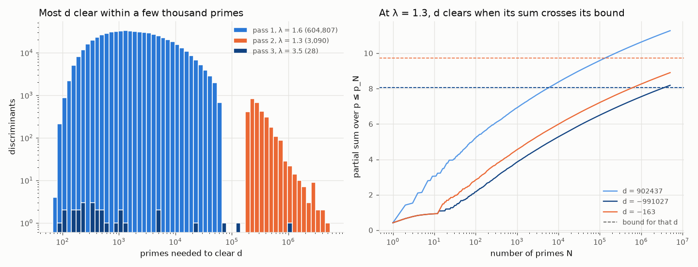

A Siegel zero would be a real zero β of L(s, χ_d) very close to 1. Nobody can rule
them out in general, but for any finite range of d it is a computation. Lu, Zaman
and Zhao (arXiv:2602.03626) check that L(σ, χ) ≠ 0 for σ ≥ 1 − 1/(5 log q) for every
quadratic character of modulus q ≤ 10^10, and `siegel.py` runs their method for every
fundamental discriminant with 3 ≤ |d| ≤ 10^6: 607,925 of them, 303,957 positive.

The method is a positivity argument. ζ(s)L(s, χ) is the Dedekind zeta function of
Q(√d), so at σ = 1 + r the sum Σ Λ(n)(1 + χ(n))/n^σ = −ζ′/ζ(σ) − L′/L(σ, χ) has
nonnegative terms. Their Theorem 2.1 bounds it from above, and a real zero β adds a
negative term −1/(σ − β) that gets large when β is close to 1:

    Σ Λ(n)(1 + χ(n))/n^σ ≤ 1/r − 1/(σ − β) + (σ − β)/(r + 7/8)² + φ log q + E.

If β ≥ 1 − c/log q, the right side is at most an explicit B(q). So once a partial
sum over primes exceeds B(q), there is no such β. The sum over prime powers has a
closed form, log p/(p^σ − 1) + χ(p) log p/(p^σ − χ(p)) per prime, and every term is
nonnegative, so partial sums only grow and stopping early is valid. φ and E come
from Jensen's formula on circles around 1 + r together with convexity bounds for
|L| at σ = 1/2, 3/4 and 7/8. `constants(r)` recomputes both from the paper's
section 6 and reproduces its Table 1: φ = 0.226748 and E = 1.161302 at λ = 1.6,
which the paper prints rounded up as 0.22675 and 1.1614, and the same at
λ = 1.3, 1.2 and 1.1 (r = λ/(10 log 10)).

Three passes clear everything:

| pass | r | primes | discriminants cleared | median primes needed | most needed |
|---|---|---|---|---|---|
| 1 | 0.0695 (λ = 1.6) | 60,000 | 604,807 | 1,743 | 59,991 |
| 2 | 0.0565 (λ = 1.3) | 5,000,000 | 3,090 | 275,149 | 4,861,102 (d = 41) |
| 3 | 0.152 (λ = 3.5) | 5,000,000 | 28 | 396 | 1,080,519 (d = −3) |

The whole run takes 207 s. Pass 1 is vectorized over discriminants: one Legendre
table per prime, or Euler's criterion once few d are left. Passes 2 and 3 go the
other way, one discriminant at a time, with χ_d tabulated on residues mod |d| as a
product of local characters and looked up for five million primes at once.

The third pass is the interesting one. The 28 survivors of pass 2 are all tiny,
|d| ≤ 232, and the paper never meets them because it hands q ≤ 4·10^5 to Platt's
GRH computations. For d = −163 the full sum at λ = 1.3 is 15.2 against a bound of
9.73, so the criterion holds, but the partial sums converge like N^(−r)/r and five
million primes only reach 8.90. A larger r makes B(q) smaller and the tail shorter
at the same time, and at r = 0.152 all 28 clear, −163 after 72,327 primes. The
trade goes the other way for large |d|: the φ log q term grows, and d = −991027
clears at r = 0.0565 after 3.6 million primes but not at all at r = 0.152.

Each clearing needs the partial sum to beat B(q) by 1e−7 in double precision, well
above the worst-case rounding of five million positive terms (n·u·S < 1e−8). The
five tightest clearings of pass 1 and the three tightest of pass 3 (d = −3 after
1.08 million primes among them) were re-summed in Arb at 128 bits: every ball lies
above B(q), and the float sums agree with the balls to 1e−13. φ and E themselves
are computed with mpmath at 30 digits. Separately,
the 28 small discriminants are checked by direct evaluation: L(σ, χ_d) at points of
[1 − 1/(5 log q), 1] in Arb, with the gaps covered by |L′(σ)| ≤ φ(q)/(eσ) from
partial summation. (Arb's ball evaluation is useless here, since it goes through
Hurwitz zeta and blows up near the pole at s = 1.) Both methods agree that none of
them has a zero in that range.

```python
import math

from zeta_explorer import siegel

k = siegel.constants(1.6 / (10 * math.log(10)))   # phi 0.226748, E 1.161302
v = siegel.verify(10**6)                           # 207 s
v.ok, v.counts()                                   # True, [604807, 3090, 28]
```

### Certified zeros of Dirichlet L-functions

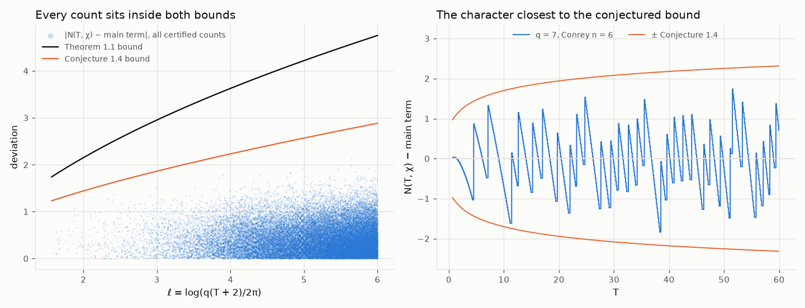

`lcertified.py` proves, character by character, that every zero of L(s, χ) with
|γ| ≤ T is on the critical line and simple, in the style of Platt's verification of
GRH. It runs for all 2,115 primitive characters with 3 ≤ q ≤ 150 (one from each
conjugate pair) up to T(q) = min(2πe⁶/q − 2, 60), which is the range ℓ ≤ 6 of
Bennett, Martin, O'Bryant and Rechnitzer (arXiv:2005.02989) with T capped at 60 for
q ≤ 40. In total that is 89,264 zeros, in 446 s on 15 processes.

There are two halves. The lower bound: Hardy's function
Z_χ(t) = e^(iθ(t)) L(1/2 + it, χ) is real, Arb evaluates it in ball arithmetic, and a
sign change between two grid points whose balls exclude 0 proves a zero between
them. Running t over [−T, T] picks up the zeros of χ̄ as well, since
|Z_χ(−t)| = |Z_χ̄(t)|. The upper bound is Turing's method with Booker's explicit
bound on the integral of S(t) (the same bound `selfdual.py` uses, now exposed as
`turing_bound(q, mu, t1, t2)`), applied to χ and χ̄ on a window [T, T + 10]. With
N(T) = (T/π) log(q/π) + (2/π) Im log Γ(1/4 + a/2 + iT/2) + S(T, χ) + S(T, χ̄), if
m zeros were missed below T then the area between the found count and the smooth
term drops by m(t₂ − t₁), and it cannot drop below minus the bound. Every character
passes with fewer than 0.982 zeros possibly missing, so none are. The grid starts at
8 points per mean gap and doubles whenever Turing's check fails.

Their Theorem 1.1 says |N(T, χ) − (T/π) log(qT/2πe) + χ(−1)/4| ≤ 0.22737ℓ +
2 log(1 + ℓ) − 0.5 with ℓ = log(q(T + 2)/2π), and N(T, χ) = 0 when ℓ ≤ 1.567. On a
grid of T in steps of 0.1 (462,179 pairs of χ and T away from any isolating
interval) the largest ratio to that bound is 0.605, for χ₋₃ at T = 11.4. Their
Conjecture 1.4 replaces the bound with ℓ/log(2 + ℓ); the closest any count comes is
0.929 of it, for the real character mod 7 at T = 11.1. Both extremes are real
characters of tiny modulus, where zeros come in ± pairs and N jumps by 2. The
N = 0 clause is sharp at q = 3: ℓ ≤ 1.567 means T ≤ 8.036, and the first zero of
L(s, χ₋₃) is at 8.0397.

The checks: the first zeros of L(s, χ₋₄) and L(s, χ₋₃) bisect to 6.020948904697597
and 8.039737155681 within 1e−11; counts up to T = 20 match the floating-point
argument principle of `lfunction.count_zeros_box` for five characters; Conrey labels
agree with `characters.conrey` value by value; the main term stays within
(2 − a)/(50T) of the smooth term, which is their Proposition 3.2; and deleting two
zeros from a certificate raises its missing count by exactly 2.

```python
from flint import dirichlet_char

from zeta_explorer import lcertified

cert = lcertified.certify(dirichlet_char(4, 3), 30.0)
cert.complete, cert.count(30.0)        # True, 20
```

### Davenport-Heilbronn: when the functional equation isn't enough

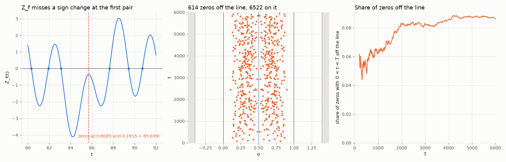

Take the two characters mod 5 with χ(2) = ±i and mix them:

```
f(s) = (1 − iκ)/2 · L(s, χ) + (1 + iκ)/2 · L(s, χ̄),   κ = (√(10 − 2√5) − 2)/(√5 − 1) ≈ 0.284079
```

The Dirichlet coefficients are real and periodic, 1, κ, −κ, −1, 0, and κ is the
one value that makes (1 + iκ)/(1 − iκ) equal the root number of χ. Then
Λ(s) = (5/π)^((s+1)/2) Γ((s+1)/2) f(s) satisfies Λ(s) = Λ(1 − s), the same shape as
Riemann's. What f lacks is an Euler product, and RH fails for it.

`davenport.py` builds f out of the existing L(s, χ) code, so it works anywhere in
the plane and switches to the approximate functional equation at large height.
The tests compare it with Arb's Hurwitz zeta to 1e−11 (including σ < 0) and check
Λ(s) = Λ(1 − s) with mpmath's Γ.

Where can the zeros be? For σ > 1, |f(s)| ≥ 1 − Σ_{n≥2} |a_n| n^(−σ), and that
stays positive for σ > σ₀ = 1.395136 (`zero_free_sigma`, a root of a Hurwitz zeta
equation). By the functional equation the only zeros with σ < 1 − σ₀ are the
trivial ones at −1, −3, −5, .... So the nontrivial zeros live in a strip of width
1.79 instead of 1. Since f(s̄) is the conjugate of f(s), a zero ρ off the line
always comes with its mirror 1 − ρ̄.

`zeros_in_window(t₁, t₂)` counts every zero in the box
[1 − σ₀ − 0.25, σ₀ + 0.25] × [t₁, t₂] with the argument principle. It finds the
zeros on the line as sign changes of Z_f(t) = e^(iθ(t)) f(1/2 + it), seeds complex
Newton from the local minima of |f| on a grid right of the line, and mirrors
each hit. It only returns when the zeros it found add up to the box count; on a
mismatch it refines the Z_f grid first (the usual cause is a close pair of zeros on
the line) and then the |f| grid.

```python
from zeta_explorer.davenport import zeros_in_window

w = zeros_in_window(80, 90)
w.total, len(w.line)   # (7, 5)
w.off                  # [0.19148282+85.69934849j, 0.80851718+85.69934849j]
```

In windows of 10 from t = 1 to 6001 there are 7,136 zeros: 6,522 on the line and
614 off it. The first four pairs match the six digits Spira printed in 1994
(heights 85.699, 114.163, 166.479, 176.702). Real parts right of the line run from
0.5061 (t ≈ 5861.53) to 0.8978 (t ≈ 2442.53). None has σ > 1 below 6001, although
Davenport and Heilbronn proved there are at least cT of them up to height T. The
share of zeros off the line rises from 5% at T = 500 to 8.3% at 2000 and stays
around 8.6% out to 6000.

A few arXiv preprints argue that these off-line zeros are numerical artifacts.
`certified.krawczyk` checks that claim for the first four. It evaluates f and f′
in Arb as balls, over a box B of radius 1e−10 around each Newton root, and forms
the Krawczyk operator K = m − f(m)/f′(m) + (1 − f′(B)/f′(m))(B − m). If K lies
inside B, then B contains exactly one zero. All four pass, the boxes come back with
radius under 1e−15, and every real part is above 0.57. These zeros really are
off the line.

### The de Bruijn-Newman heat flow

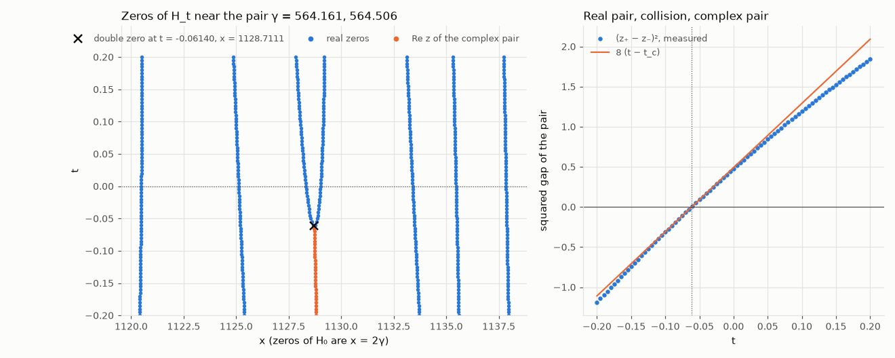

Following Pólya and de Bruijn, put

```
Φ(u) = Σ_{n≥1} (2π²n⁴e^(9u) − 3πn²e^(5u)) exp(−πn²e^(4u))
H_t(z) = ∫_0^∞ e^(tu²) Φ(u) cos(zu) du
```

Then H_0(z) = ξ(1/2 + iz/2)/8 and ∂H/∂t = −∂²H/∂z². The de Bruijn-Newman constant
Λ is the smallest t for which H_t has only real zeros, so RH is Λ ≤ 0. Rodgers and
Tao proved Λ ≥ 0 in 2018 and Polymath 15 brought the upper bound to 0.22.

The integral is easy to write and hard to evaluate: H_0(x) decays like e^(−πx/8)
while the integrand is of size 1, so at x = 100 the cosine integral cancels 17
digits. `heat.ht` moves the contour. Φ is analytic and super-exponentially small in
the strip |Im u| < π/8, so the integral over the real line can be taken along
Im u = θ = π/8 − δ, which pulls out a factor e^(−θz) and leaves cancellation of only
e^(δx). With δ = (π/8)·min(1, 4/x) that factor is at most e^(π/2). Φ is even and
real, so the half of the line with u < 0 is the conjugate of the other half, and
what is left is a trapezoid sum over u > 0. On a line inside an analytic strip the
trapezoid rule is exact up to an aliasing error of order e^(−2πδ/h), so a step of
δ/8 is plenty, and the Φ sum stops once πn²e^(4u)·sin 4δ passes 40. At x = 1130
that is 11,700 nodes and 50 terms.

Checks:

- H_0(z) = ξ(1/2 + iz/2)/8 to 2e-12 relative for real and complex z up to x = 400.
  At x = 1128, where H is 5.4e-191, the agreement is 2.6e-11.
- Against mpmath's quadrature of the defining integral itself at 30 digits, for
  t = −1, −0.3, 0 and 0.25: 1e-10 relative.
- The backward heat equation by finite differences, Φ(u) = Φ(−u) (which is
  Jacobi's theta identity), H_t(z̄) = conj H_t(z), and the zeros of H_0 at exactly
  2γ for the first five zeros of ζ.

The zeros move. Write H_t = c∏(1 − z²/x_j²) over its zeros ±x_j. Differentiating
H(x_k(t), t) = 0 and using the heat equation gives ẋ_k = H''/H' at the zero, and
the product turns that into

```
dx_k/dt = 2 Σ_{j≠k} 1/(x_k − x_j) + 2 Σ_j 1/(x_k + x_j)
```

so as t grows the zeros repel like charges, and running t backwards pulls close
pairs together. `heat.velocities` evaluates the sum from a list of zeros plus the
smooth density log(x/4π)/4π beyond the last one. For the seven zeros of H_0 with
1119 < x < 1139 it matches `heat.zero_velocity` (H''/H' from the integral, no
differencing) to 6.8e-7 using the first 4,000 zeros of ζ:

| x_k = 2γ_k | 1120.48 | 1125.12 | 1128.32 | 1129.01 | 1133.40 | 1135.46 | 1137.85 |
|---|---|---|---|---|---|---|---|
| dx_k/dt at t = 0 | 0.23730 | −1.31979 | −3.44762 | 2.00431 | −1.49289 | −0.68430 | −0.55859 |

The third and fourth columns are the closest pair below γ = 600, γ = 564.1609 and
564.5061. Backwards in t they collide. `heat.collision` follows the critical point
of H_t between them and solves for the t where its value crosses zero, which lands
at t_c = −0.0614041 and x_c = 1128.71107, where H and H' both vanish to 1e-13
relative. Near a double zero H_t ≈ (z − x_c)² − 2(t − t_c), which solves the heat
equation exactly, so the squared gap of the pair should be 8(t − t_c) on both
sides: real for t > t_c and −4(Im z)² after. At t_c ± 10⁻⁴ the ratios are 0.99995
and 1.00005, and the right panel shows how the other zeros bend the line further
out. The other zeros hold the pair apart a little: an isolated pair with the same
gap would collide sooner, at −Δx²/8 = −0.0596.

This is the mechanism behind the old lower bounds on Λ. For a Lehmer pair,
Csordas, Smith and Varga show the collision time cannot be below
λ = [(1 − 5Δ²g/4)^(4/5) − 1]/(8g), and `lehmer.newman_bound` gives λ = −0.0616036
for this pair (Δ²g = 0.238). The real collision is only 2.0·10⁻⁴ above it.

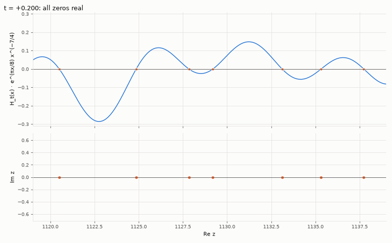

`heat.zero_paths` tracks every zero in a window as t decreases: real zeros by
sign changes and Illinois steps, and when two real zeros disappear between steps
it starts Newton from their midpoint with an imaginary part of half their old gap,
then follows the complex zero by Newton. Over t ∈ [−0.2, 0.2] the other five zeros
in the window stay real and the pair reaches Im z = 0.545 at t = −0.2. Each of the
81 frames takes about 1.6 s.

### Polymath 15's effective approximation

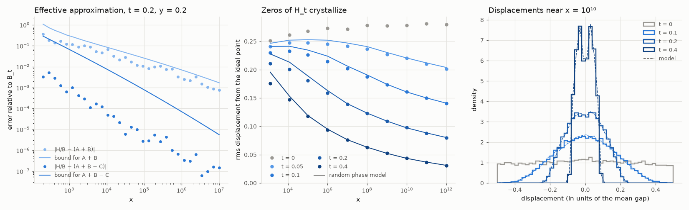

The contour integral in `heat.ht` costs O(x) nodes and underflows past x ≈ 5600,
where H_t is below 10⁻³⁰⁸. Polymath 15 (Res. Math. Sci. 2019) replaced it with a
Riemann-Siegel formula for H_t. Write s = (1 + y − ix)/2 and

```
M_0(s) = (1/8) (s(s−1)/2) π^(−s/2) √(2π) exp((s/2 − 1/2) log(s/2) − s/2)
α(s)   = 1/(2s) + 1/(s−1) + (1/2) log(s/2π)
B_t(x + iy) = exp((t/4) α(s)²) M_0(s)
s*     = s + (t/2) α(s),   b_n = exp((t/4) log² n),   N = ⌊√(x/4π + t/16)⌋
f_t    = Σ_{n≤N} b_n n^(−s*) + γ Σ_{n≤N} n^y b_n n^(−conj(s*) − κ)
```

with γ the ratio of M_t at the reflected point and κ a small correction. Their
Theorem 1.3 says H_t/B_t = f_t + O(e_A + e_B + e_C,0) for 0 < t ≤ 1/2, 0 ≤ y ≤ 1,
x ≥ 200, with every constant explicit. B_t carries the whole e^(−πx/8) decay, so
`effective.ratio` returns H_t/B_t, which is of size 1 at any height. Subtracting
their C term (the C_0(p) correction of Riemann-Siegel, moved through the heat
flow) gives A + B − C with a smaller bound e_C.

The approximation needs a check that does not share its derivation, and the heat
equation gives one. ∂H/∂t = −∂²H/∂z² is solved by a Gaussian average in the
imaginary direction:

```
H_t(z) = E[H_0(z + iv)],   v ~ N(0, 2t)
```

since averaging cos((z + iv)u) over v gives e^(tu²) cos(zu). `kernel_ratio`
evaluates ξ off the critical line with mpmath at 48 Gauss-Hermite nodes. At
x = 300 it agrees with the contour integral to 3e−14 for five (t, y) pairs, and
at x = 10⁴ it changes by less than 1e−14 between 32 and 64 nodes. Against it, with
t = y = 0.2:

| x | A + B error | its bound | A + B − C error | its bound |
|---|---|---|---|---|
| 250 | 0.144 | 0.778 | 1.85e−3 | 0.236 |
| 10⁴ | 4.21e−2 | 8.54e−2 | 7.47e−5 | 7.63e−3 |
| 10⁵ | 1.35e−2 | 2.54e−2 | 1.31e−5 | 7.78e−4 |
| 10⁶ | 4.97e−3 | 6.96e−3 | 1.29e−6 | 7.01e−5 |
| 10⁷ | 1.33e−3 | 1.69e−3 | 1.99e−7 | 5.58e−6 |

Every bound holds at every point tested, for t from 0.05 to 0.5 and y from 0 to 1.
The C,0 bound is tight to within a factor of 2 at large x. The C term buys a factor
of 80 at x = 250 and 6,700 at 10⁷, and its bound is 30 to 130 times loose. At t = 0 the same code is
the Riemann-Siegel formula with its first correction: H_0(x)/|B_0(x)| = −Z(x/2) to
1.5e−4 at x = 2·10⁴.

Two numerical details. The C term's phase is the difference of two numbers of
size x log x, so in floats it carries an error of 10⁻³ at x = 10¹². Written out,
everything cancels except 3π/2 − arctan T′ + arg C_0(p), and the amplitude
simplifies the same way, so `c_amplitude` never forms a large number. C_0 has
removable singularities at p = ±1/2 where it equals (1 − i)/4.

On the real axis γ = e^(2iϑ_t) and κ = 0, so H_t(x)/|B_t(x)| = 2 Re(e^(−iϑ_t)A) − C,
with A = Σ b_n n^(−s*) and ϑ_t = −arg B_t. That is a Hardy Z function for H_t.
`effective.zt` evaluates it directly; `HtWindow` evaluates it the way
`multieval.ZWindow` evaluates Z. The coefficients of A depend on x only through
s*, and inside a window s*(x) = s*(x_0) − i(x − x_0)/2 + ε(x) with
ε = (t/2)(α(s) − α(s_0)) of order t(x − x_0)/x. Expanding n^(−ε) to the order where
(ε ln N)^K/K! drops below 10⁻¹⁶ turns A into K band-limited sums (two at 10¹², five
for a window of width 400 at 3·10⁴), each one nonuniform FFT. The phases t_0 log n
come from mpmath and ϑ_t is assembled from Riemann-Siegel θ, the Stirling tail and
(t/4) α², never from a float of size 10¹³. `multieval.BandSum` is the interpolator
that ZWindow used inline, now shared. Against `zt` the window agrees to 7e−9 at
10⁶ (where the direct sum is still accurate), and at t = 0 near the 10¹²th zero it
finds Odlyzko's ten zeros to 2.2e−9, inside his stated 3e−9. A window of 2,000
zeros at x = 2·10¹² takes 0.9 s to build and 0.2 s to search.

### Crystallization

For t > 0 the sum A tends to 1 as x grows: Re s* ≈ 1/2 + (t/4) log(x/4π), so every
term past n = 1 decays like a power of x. Then H_t ≈ 2|B_t| cos ϑ_t and the zeros
sit at the ideal points ϑ_t = (n − 1/2)π, an arithmetic progression in ϑ. Ki, Kim
and Lee proved that for t > 0 all but finitely many zeros are real and simple;
numerically they also line up. The phase ϑ_t − ϑ_0 tends to (t/16)π log(x/4π),
which is the t/16 log x term in the zero count of H_t.

`displacement` measures how far each zero sits from its ideal point, in units of
the local gap, and up to the C term the result is arg(A)/π at the zero. That suggests a
model: by Kronecker's theorem the phases x/2 · log p are equidistributed for
distinct primes, so A behaves like Σ b_n n^(−Re s*) e^(iθ_n) with independent
uniform θ_p and θ_n additive over the factorization of n. `phase_model` samples
that sum. Weighting by zeros instead of by x adds only a boundary term, so the
model's arg/π should match the displacement law. The window searches give, for
2,000 zeros at each height (183 at 10³):

| x | t = 0 | t = 0.05 (model) | t = 0.1 (model) | t = 0.2 (model) | t = 0.4 (model) |
|---|---|---|---|---|---|
| 10³ | 0.251 | 0.241 (0.246) | 0.230 (0.241) | 0.211 (0.228) | 0.176 (0.196) |
| 10⁴ | 0.261 | 0.248 (0.252) | 0.233 (0.241) | 0.201 (0.213) | 0.147 (0.153) |
| 10⁵ | 0.268 | 0.247 (0.253) | 0.226 (0.235) | 0.181 (0.189) | 0.118 (0.119) |
| 10⁶ | 0.273 | 0.245 (0.252) | 0.215 (0.224) | 0.159 (0.163) | 0.094 (0.095) |
| 10⁷ | 0.272 | 0.241 (0.247) | 0.202 (0.206) | 0.139 (0.140) | 0.076 (0.076) |
| 10⁸ | 0.278 | 0.236 (0.241) | 0.188 (0.191) | 0.123 (0.123) | 0.063 (0.063) |
| 10⁹ | 0.278 | 0.227 (0.230) | 0.174 (0.174) | 0.109 (0.109) | 0.052 (0.052) |
| 10¹⁰ | 0.278 | 0.221 (0.221) | 0.161 (0.161) | 0.098 (0.097) | 0.044 (0.043) |
| 10¹¹ | 0.281 | 0.210 (0.212) | 0.150 (0.150) | 0.088 (0.088) | 0.037 (0.037) |
| 10¹² | 0.280 | 0.202 (0.204) | 0.140 (0.141) | 0.080 (0.080) | 0.031 (0.031) |

At t = 0 the displacement stays near the uniform value 1/√12 = 0.289, and about 30%
of consecutive zeros do not get consecutive indices: that is Gram's law failing,
seen from the midpoints of the Gram intervals. For t > 0 the model and the
measurement agree to 0.003 or better in every column from 10⁹ up. Below that the
zeros sit up to 0.02 closer than the model says, at heights where the C term,
which the model leaves out, is still of size 10⁻². At t = 0.4 every Gram interval of
H_t holds exactly one zero in all ten windows, and no zero is more than 0.43 gaps
from its ideal point. At t = 0.05 there are still 22 exceptions among 2,000 zeros
at 10¹². The convergence is slow: the n = 2 term shrinks like (x/4π)^(−(t/4) ln 2),
so from 10⁶ to 10¹² the rms halves at t = 0.2 and falls by three at t = 0.4.

The right panel has a feature the rms hides. Near 10¹⁰ at t = 0.4 the n = 2 term
has r = 0.18 and the next one 0.07, and arg(1 + r e^(iθ)) with θ uniform piles up
at its extremes ±arcsin r, which is ±0.057 after dividing by π. The smaller terms
blur that into two peaks near ±0.035 with a dip at zero, in the data and in the
model alike.

### Λ ≤ 0.22, recomputed

Polymath's upper bound (Theorem 1.2 of arXiv:1904.12438) needs three facts for
t₀ = y₀ = 0.2 and X = 6·10¹⁰ + 83952 − 0.5. First, RH holds up to height X/2,
which is Platt's verification to 3.06·10¹⁰. Second, H_t₀ has no zeros with
x ≥ X and 0.2 ≤ y ≤ 1. Third, no zero of H_t crosses the barrier
X ≤ x ≤ X + 1, 0.2 ≤ y ≤ 1 at any time 0 ≤ t ≤ 0.2. Then Λ ≤ t₀ + y₀²/2 = 0.22.
`barrier.py` redoes the second and third numerically. Everything is in doubles
with phases from mpmath, not in interval arithmetic, so it is a careful
replication and not a certificate.

The barrier. On the rectangle N = 69,098 is fixed, so f_t is holomorphic there,
and |H_t/B_t − f_t| ≤ e_A + e_B + e_C,0, which is 1.2496·10⁻³ at the worst corner
(the paper: 1.249·10⁻³). If |f_t| stays above that bound plus the slack between
mesh points, Rouché's theorem gives H_t and f_t the same winding number. Writing
f_t = Σ b_n n^(−s*) + γ Σ b_n n^(−(1−s)*), each sum is stored once per time block
of width 0.01 as moments Σ w_n (log n)^m at a center, and every point in the block
is a double Taylor series in (t − t_c) log² n and (ω − ω_c) log n, with the orders
picked so the truncation error stays under 10⁻¹³. The huge phases (X/2) log n are
reduced mod 2π in mpmath, and log γ is the mpmath value at the center plus an
8-point Gauss-Legendre integral of its derivative (i/2)(α(1 − s) + α(s)). The
result matches a 40-digit direct sum to 10⁻¹³ at x = 10⁶. The mesh spacing and
the time step come from bounds on |∂f/∂z| and |∂f/∂t| over each box, maximized
over its corners. Those bounds sit 4 to 30 times above finite-difference slopes.

| | here | Polymath |
|---|---|---|
| min of \|f_0(x + i)\| at x = X, X + 0.5, X + 1 | 4.319 | 4.32 |
| mesh points at t = 0 | 2,686 | 11,076 |
| mesh points at the last step | 40 | 56 |
| time steps | 269 | not stated |
| smallest \|f_t\| on any mesh | 1.55 | |
| winding number | 0 at every step | 0 |

The whole sweep evaluates f 368,008 times and takes 14 seconds.

The zero-free region. Past the barrier the paper multiplies by the Euler factor
E = Π_(p ≤ 5) (1 − b_p p^(−s*)), which cancels the worst oscillation of f_t, and
shows that E·H_t/B_t stays off the negative real axis around the rectangle
x ≥ X, 0.2 ≤ y ≤ 1, N ≤ 1.5·10⁶; beyond that N the triangle inequality alone gives
|f_t − 1| < 1. Each piece, here against the paper:

| quantity | here | Polymath |
|---|---|---|
| Re s* on the region, lower bound | 1.71433 | 1.7143 |
| \|E\| between | 0.5351 and 1.6340 | 0.534 and 1.635 |
| \|arg E\| at most | 0.5519 | 0.553 |
| A at N = 1.5·10⁶ | 1.906 | 1.88 |
| B, largest over N ≥ 1.5·10⁶ | 0.0740 | 0.075 |
| \|f − 1\| on the top edge | 0.671 | 0.8 |
| \|f\| and \|arg f\| on the left edge, t = 0.2 | ≥ 1.575, ≤ 0.127 | ≥ 1, ≤ π/2 |

A is two sums, 1.774 for Σ b_n n^(−α) and 0.132 for the γ term, and I could not
find a reading of the paper's definition that gives 1.88. It does not matter for
the proof: A + B = 1.980 still keeps |f − 1| below 1, and the right edge then has
|E f| ≥ 0.0107 at an angle of at most 1.923, a distance of 0.0100 from the
negative axis.

The lower edge y = 0.2 is the hard one. Lemma 8.5 bounds the distance by
1 − r − Σ max(|β_n − r λ_n|, k |β_n + r λ_n|) n^(−σ) over n ≤ 30N, where β and λ
are the coefficients of E times the two sums, r = c N₋^(−0.2) and
k = (1 − r)/(1 + r). Those coefficients depend on N through the cutoff n/d ≤ N, and
N runs over a whole interval [N₋, N₊]. Taking them at N₊, as the paper's numbers
seem to, reproduces its values within 0.0015. Taking for each n the worst of the
cutoffs that occur inside the interval, with the sharper constant c = 1.004 from
the paper's own bound on |γ| (it uses 1.03), gives the first column:

| [N₋, N₊] | N tracked | at N₊, c = 1.03 | Polymath | triangle inequality |
|---|---|---|---|---|
| [69098, 8·10⁴] | 0.0308 | 0.0268 | 0.0263 | −0.175 |
| [8·10⁴, 1.1·10⁵] | 0.0495 | 0.0475 | 0.0470 | −0.146 |
| [1.1·10⁵, 2.2·10⁵] | 0.0937 | 0.0935 | 0.093 | −0.081 |
| [2.2·10⁵, 1.5·10⁶] | 0.0639 | 0.0614 | 0.060 | −0.094 |

All of them beat the 2.15·10⁻³ the argument needs, and the plain triangle
inequality (the paper's (98)) is negative on every interval, which is why the
lemma exists. With the edges at 0.0100 (right), 0.176 (top), 0.843 (left) and
0.0308 (bottom), E·H_t/B_t cannot wind around 0, so H_0.2 has no zeros there and
Λ ≤ 0.22 follows.

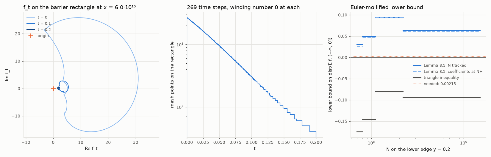

### The Mertens conjecture

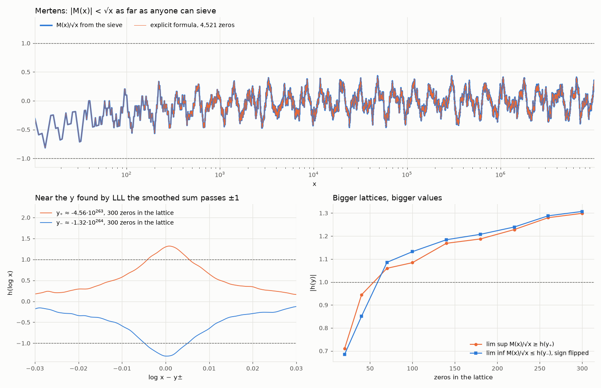

The Mertens function M(x) = Σ_{n ≤ x} μ(n) moves like a random walk with steps
−1, 0, +1, and for every x anyone has computed, |M(x)| < √x. Mertens conjectured in 1897
that this holds for all x > 1. It would imply RH, and Odlyzko and te Riele showed
in 1985 that it is false, without ever exhibiting an x.

Two ways to compute M are in `mertens.py`. `mertens_table(n)` sieves μ up to n
and takes a cumulative sum. `mertens(x)` uses the identity Σ_{d ≤ x} M(x/d) = 1:
values of M below u ≈ x^(2/3)/4 come from the sieve, the x/u large values
M(x/k) are filled in from k = x/u down to 1, and each one splits its sum at √v
into a direct part and a part grouped by the quotient q = v/d, all vectorized in
numpy. Every power of ten agrees with OEIS A084237:

| x     | M(x)    | time   |
|-------|---------|--------|
| 10⁹   | −222    | 0.10 s |
| 10¹⁰  | −33722  | 0.37 s |
| 10¹¹  | −87856  | 1.45 s |
| 10¹²  | 62366   | 6.6 s  |
| 10¹³  | 599582  | 36 s   |

Under RH with simple zeros, the explicit formula gives

```
M(x)/√x = 2 Σ_{γ > 0} cos(γ log x − ψ_γ) / |ρ ζ′(ρ)| + O(x^(−1/2)),   ψ_γ = arg(ρ ζ′(ρ))
```

plus a −2 and a rapidly convergent sum over the trivial zeros. The top panel
overlays this sum over the first 4,521 zeros on the sieve up to 10⁷. For
x > 1000 the two differ by 0.006 rms and 0.024 at worst, most of it the Gibbs
ringing a truncated sum has at each jump of M.

Ingham's theorem turns this into a disproof strategy. With the kernel
f(u) = (1 − u) cos πu + sin(πu)/π, which is nonnegative on [0, 1],

```
h(y) = 2 Σ_{γ ≤ T} f(γ/T) cos(γ y − ψ_γ) / |ρ ζ′(ρ)|
```

satisfies lim inf M(x)/√x ≤ h(y) ≤ lim sup M(x)/√x for every real y. The
theorem does not assume RH: if RH fails, or a zero is multiple, M(x)/√x is
unbounded anyway. So it is enough to find one y with |h(y)| > 1, which means
making the phases γy − ψ_γ of the zeros with the largest weights all close to
multiples of 2π at once. That is an inhomogeneous simultaneous Diophantine
approximation problem, and LLL solves it approximately. Following Odlyzko-te
Riele and Hurst's 2018 setup, the basis has one row per chosen zero with entry
⌊2π √a_i 2^ν⌋, one row with ⌊√a_i γ_i 2^(ν−10)⌋ (whose coefficient becomes the
integer z with y = z/2¹⁰), and one row with −⌊√a_i ψ_i 2^ν⌋ and a huge marker. A
short vector containing the marker has small entries √a_i (γ_i y − ψ_i − 2πm_i),
so the heavy cosines are near 1. Shifting ψ by π looks for large negative h.

The weights need many digits: y comes out near 2^ν, so γ_i y mod 2π is only
meaningful if γ_i is known to well over ν bits. `certified_zeros(T, bits)` gets
every zero below T from the Turing-certified Gram blocks of `certified.py`, refines
each one by Newton on ζ(s) with the precision doubling up to `bits`, proves the
zero lies in a ball of radius 2^(−bits)·γ by a certified sign change of Z at both
ends, and then evaluates ζ′(ρ) on that ball with `acb_series`, so a_γ and ψ_γ come
with rigorous error bounds. With 4,521 zeros to t = 5000 at 2048 bits (7 minutes),
h(y) itself is an Arb ball:

| zeros in the lattice | ν   | h(y₊)  | h(y₋)   | log₁₀ abs(y) | LLL + h |
|----------------------|-----|--------|---------|-------------|---------|
| 20                   | 60  | 0.7099 | −0.6846 | 13          | 0.02 s  |
| 40                   | 120 | 0.9444 | −0.8509 | 30          | 0.1 s   |
| 70                   | 210 | 1.0598 | −1.0858 | 57          | 0.5 s   |
| 100                  | 300 | 1.0843 | −1.1321 | 84          | 2.7 s   |
| 140                  | 420 | 1.1685 | −1.1841 | 120         | 7.7 s   |
| 180                  | 540 | 1.1874 | −1.2075 | 156         | 20 s    |
| 220                  | 660 | 1.2283 | −1.2395 | 191         | 42 s    |
| 260                  | 780 | 1.2801 | −1.2882 | 224         | 70 s    |
| 300                  | 900 | 1.2989 | −1.3072 | 263         | 125 s   |

The 70-zero lattice already gives 1.0598 and −1.0858. Odlyzko and te Riele also
used 70 zeros (the ones with the largest weights among the first 400) and 2,000
zeros in h, and got 1.06 and −1.009; FLINT's LLL does that size in half a second.
Their paper has a sanity check worth reproducing: 2 Σ a_γ over those 70 weights is
1.0787, the most any h could reach with them, and the running sum first passes 1 at
the 54th weight. Both come out the same here and are in the tests.

Each h in the table is a ball of radius below 1e−35, so both bounds are proofs,
given that the list of zeros is complete, which Turing's method supplies. Hurst
got 1.826 and −1.838 with 800 zeros in the lattice, 14,400 in h and 35 days of
fplll. The y's come out negative or positive at random, and that is fine: h is
almost periodic, so a value it takes near y it takes again near arbitrarily large
y. The bottom left panel shows h around y± for the 300-zero lattice. The peak is
about 0.01 wide in log x, set by the height of the last zero (t = 5000), and more
than 0.005 away from y± the sum stays below 1.04 in absolute value.

```python
from zeta_explorer import mertens

mertens.mertens(10**12)                 # 62366
zs = mertens.certified_zeros(200, 256)  # 79 zeros, balls of radius ~1e-75
r = mertens.search(zs, 20)
float(r.h.mid()), float(r.h.rad())      # (0.58149694297398, 1.42e-37)
```

### Where π(x) first beats li(x)

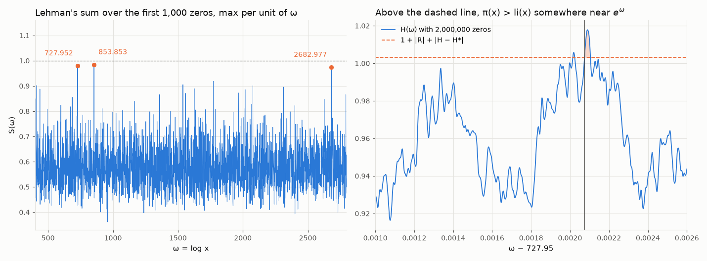

π(x) < li(x) for every x anyone has checked, but Littlewood proved in 1914 that
the difference changes sign infinitely often. Lehman's 1966 theorem makes this
computable. With a Gaussian K of variance 1/α,

```
I(ω, η) = ∫_{ω−η}^{ω+η} K(u − ω) u e^(−u/2) (π(e^u) − li(e^u)) du
        = −1 − Σ_{0 < |γ| ≤ T} e^(iγω) e^(−γ²/2α) / ρ + R
```

where |R| ≤ s₁ + … + s₆ is fully explicit as long as RH has been verified up to
some height A and α, η, ω satisfy 4A/ω ≤ α ≤ A² and 2A/α ≤ η ≤ ω/2. If the zero
sum H beats 1 + |R|, then I > 0, and because K > 0 there is an x in
[e^(ω−η), e^(ω+η)] with π(x) > li(x).

`skewes.py` has the pieces: `lehman_sum` evaluates the sum (vectorized over a
grid of ω in blocks), `lehman_errors` the six error terms in mpmath, with Chao and
Plymen's sharper s₁ = 2.1457/(ω − η) from Panaitopol's bounds on π(x), and
`zero_error` a mean-value bound on how much H moves if every γ is off by δ.

Without the Gaussian, the sum over the first 1000 zeros (left panel) has a few
spikes close to 1. Lehman found 727.952, 853.853 and 2682.977 this way. The scan
over ω ∈ [400, 2800] in steps of 4·10⁻⁴ finds exactly those three, at 727.951
(0.980), 853.853 (0.984) and 2682.977 (0.973), and nothing else above 0.92. At
the two values near 10¹⁹⁰ in Chao and Plymen's table 3 the sum is 0.88258736 and
0.88873670, against their 0.88258736 and 0.88873669.

Chao and Plymen's proof near e^727.952 needs the first two million zeros.
`bulk_zeros(2_000_000)` gets them in under 4 minutes from `zeros_fast` windows of
20,000 Gram intervals, each padded on both sides because a window only returns
zeros between its first and last good Gram points. γ₂₀₀₀₀₀₀ = 1131944.4718248623,
and they list 1131944.4718. With their parameters ω = 727.952074, η = 0.000198219, α = 7.86·10¹⁰, A = 7.79·10⁶:

|                        | here                       | Chao and Plymen          |
|------------------------|----------------------------|--------------------------|
| H                      | 1.0031960526               | 1.0031960183             |
| bound on abs(H − H*)   | 2.69·10⁻⁵ (δ = 2·10⁻⁹)     | 2.06·10⁻⁵ (δ = 10⁻⁹)     |
| s₁                     | 0.0029476                  | 0.0030163                |
| s₂                     | 5.93·10⁻⁵⁰                 | 5.93·10⁻⁵⁰               |
| s₅                     | 6.8205·10⁻⁵                | 6.8205·10⁻⁵              |
| s₆                     | 9.7500·10⁻⁵                | 9.7500·10⁻⁵              |
| abs(R)                 | 0.0031133                  | 0.0031207                |
| I(ω, η) >              | 5.58·10⁻⁵                  | 6.21·10⁻⁵                |

The two values of H differ by 3.4·10⁻⁸, well inside either error bound. So
I(ω, η) > 5.58·10⁻⁵, and since K integrates to 1, some x in
[1.39792136·10³¹⁶, 1.39847567·10³¹⁶] has π(x) − li(x) > 5.58·10⁻⁵ · e^(u/2)/u,
which is more than 9.07·10¹⁵⁰. The right panel shows H(ω) around their ω with the
threshold. H clears it for ω between 727.952016 and 727.952104 and peaks at 1.0178
near 727.95209, so their ω sits inside a window about 9·10⁻⁵ wide.

Two small things in the paper. Their Theorem 3.1 has s₁ = 2.1457/(ω − η), but
the number they plug in, 0.003016271, is 2.1957/(ω − η). The smaller constant is
the right one (3·0.71523279), so their bound was a little pessimistic. And their
"s₃ < 10⁻⁶⁷⁴, s₄ < 10⁻⁶⁶⁷" are really 3.6·10⁻⁶⁷³ and 5.6·10⁻⁶⁶⁷, which changes
nothing. A = 7.8·10⁶, the value written in their s₆ line, would violate
2A/α ≤ η; 7.79·10⁶ satisfies it and reproduces their s₆ to six digits.

The float zeros from `zeros_fast` are not certified, so this is a reproduction
rather than a new proof. `polish` moves each one by a secant step on Z between
γ ± 10⁻⁷ (and refuses a zero without a sign change there). Against 256-bit Arb
zeros at 840 random indices the largest error is then 1.2·10⁻⁹, against 2.9·10⁻⁹
before polishing, so the table uses δ = 2·10⁻⁹.

### In the browser

`web/` is a static page with no build step and no dependencies. `web/js/zeta.js`
is a port of the Python numerics: Euler-Maclaurin with Backlund's stopping rule,
the reflection formula through log χ, Stirling's log Γ, θ, Gram points, and the
Riemann-Siegel formula with C0 to C4. The Bernoulli numbers are exact BigInt
fractions. The C_k polynomials come precomputed in `web/data/rs.json`, trimmed to
the terms that still matter at |z| ≤ 1/2 (39 to 45 coefficients instead of 90; the
dropped tail changes nothing above 1e-16). Z uses Euler-Maclaurin below t = 200
and Riemann-Siegel above, same as the Python side.

The phase portrait is drawn by up to eight module workers, each rendering a band
of rows, first in 8×8 blocks and then at full resolution. A 948×474 frame of the
default view takes about 1 s on one core (2.2 μs per pixel), so it arrives in
roughly 150 ms. While the new frame renders, the old one is stretched to the new
view so panning stays smooth. The Z explorer samples Z once per pixel, takes zeros
from a table of the first 10,000 and finds the rest by sign changes and Illinois
refinement, and colors a Gram point orange when (−1)ⁿZ(g_n) < 0. At t = 10⁹ each Z
costs about 0.37 ms (12,615 terms), so the sample count is capped by a budget of
4·10⁶ terms per frame. Above 10⁸ or so the phases t·log n lose about 1e-6 radians
in doubles; the windowed evaluator would fix that, but the curve is fine for
looking at. The explicit formula keeps a running sum per x, so moving the slider
up only adds the new zeros.

Dirichlet L-functions have their own port. `web/js/characters.js` builds Conrey
characters the same way as `characters.py` (a generator per odd prime that is
primitive mod p², the ±5^k split for powers of 2) and reads off order, parity,
conductor, the Gauss sum and the root number. `web/js/lfunction.js` evaluates
L(s, χ) as q^(−s) Σ χ(a) ζ(s, a/q) with the head summed directly up to N·q,
N = 10 + ⌊|t|/π⌋, and an Euler-Maclaurin tail per residue class. The tail's
w^(1−s)/(s − 1) term is written as −log w · expm1(u)/u with u = (1 − s) log w; since
Σ χ(a) = 0 the dropped 1/(s − 1) cancels, and the first version, which skipped that
step, lost 9e-8 to cancellation at s = 1 + 1e-9. The terms χ(n) n^(−σ) are cached per
character, so one Z(t, χ) on the critical line costs 12 μs for q = 13 at t = 20,
96 μs for q = 163 and 265 μs for q = 199 at t = 100. For q ≤ 200 and |t| ≤ 1000 that
is well inside the range where the Python dispatcher also picks Euler-Maclaurin
over the smoothed approximate functional equation.

The section plots Z(t, χ) for the chosen character and, below it, the zeros with
|t| < 20 of every primitive character mod q, one row each. Z(−t, χ) = Z(t, χ̄), so a
complex pair is computed once and the second row is the mirror image. The rows go to
a pool of up to four workers: mod 163 there are 161 primitive characters and 81
distinct rows, which take 6.3 s on one thread and arrive in about 2.3 s.

Elliptic curves are the third port. `web/js/elliptic.js` follows `elliptic.py`:
the discriminant in BigInt, the conductor of a semistable curve as the product of
its bad primes, a_p from the Legendre-symbol sum over x, a_n by multiplicativity
and the Hecke recursion, the root number −Π(−a_p) over bad p, twists by the
Kronecker symbol of a fundamental discriminant d with ε(E_d) = ε(E)·χ_d(−N), the
central value or derivative from the exponential and E₁ sums, and Z(t) from the
rotated smoothed functional equation with the incomplete gamma Γ(1 + it, w) by
series or Legendre's continued fraction. The section draws Z for 11a, 37a, 389a,
5077a or any semistable curve typed in, marks the central zero with its order, and
plots L(1/2, E ⊗ χ_d) for every even twist in range, computed in two workers.

Point counting was the first bottleneck: the cubic 4x³ + b₂x² + 2b₄x + b₆ mod p
evaluated with `%` took 1.7 s for every prime below 3·10⁴. Stepping through x with
the three forward differences of the cubic (the third is the constant 24) needs
only additions and one conditional subtraction each, and takes 0.22 s. Z costs
57 ms for 400 samples of 11a on [0, 40] and 1.1 s for 624 samples of 5077a, where
the terms run to 4,000 per point and the continued fraction is slow near |w| ≈ |z|.
The twist scan takes 0.3 s for the 274 even twists of 11a with |d| ≤ 1000, of which
33 have L(1/2) = 0, the same counts as `elliptic.twists` in Python. The range in d
is cut so no twist needs more than 3·10⁴ coefficients: |d| ≤ 860 for 37a, 265 for
389a and 73 for 5077a.

Comparing with Python found a weakness on the Python side. `zeros_below` takes the
roots of a Chebyshev fit to ξ(√u) on [0, T²], and ξ falls like e^(−πt/2), so the
fit's relative error swamps the small end: at T = 20 the roots near the top are off
by up to 2e-6 for 11a and 4.7e-3 for 5077a. The low-lying statistics only use
zeros with x ≤ 3, where the fit is fine, so the library is unchanged and the
browser's reference zeros are polished with Illinois on Z instead. The JavaScript
finds zeros from sign changes, eight samples per mean spacing, and agrees with
the polished values to 1e-9.

`python -m zeta_explorer.site` writes the three data files: the trimmed
Riemann-Siegel coefficients, the first 10,000 zeros, and the spacing histogram and
pair correlation of 40,000 zeros from n = 10¹² (computed with `zeros_fast`, 13 s
for all three). A test checks that the committed coefficients and the first 200
zeros still match what the code produces.

The JavaScript has its own tests under `web/test`, run with `node --test`. They
compare ζ at 18 points across the plane, Z at 13 heights, θ, Gram points and the
first 29 zeros with mpmath values stored in `reference.json` (written by
`reference.py`), check that the live zero finder agrees with the table, and check
the explicit formula against the Python version and against ψ(x) itself.

Those tests caught a real bug in the Python zero table. `zeros_between` stopped
the Illinois iteration once a step fell below 1e-12 relative, which is 1e-8 in
absolute terms at t = 10⁴. The stopping step is usually much larger than the
remaining error, but not always: 635 of the first 10,000 zeros were off by more
than 5e-10, the worst by 4.5e-9. `first_zeros` now refines to 1e-15 relative and
28 zeros sampled across the table agree with mpmath's `zetazero` to 3e-11. Just above t = 200 the
Riemann-Siegel truncation error (3e-9 in Z) still limits zeros to about 1.5e-9.

## Development

```bash
pip install -e ".[dev]"
pytest
ruff check .
cd web && npm test
python -m http.server -d web 8000
```

## License

MIT
